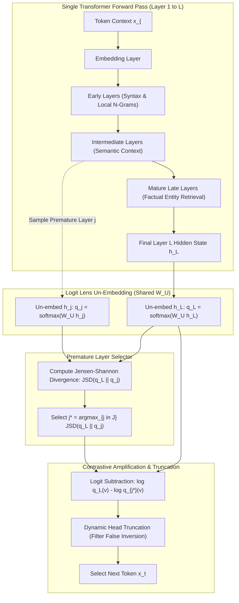
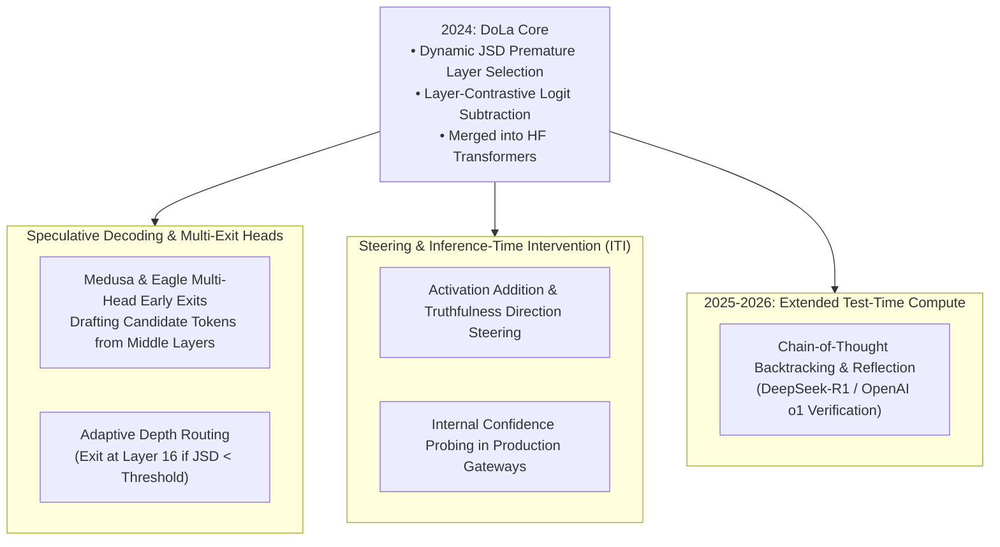

## How Can Internal Layer Discrepancies Suppress LLM Hallucinations?

Autoregressive large language models (LLMs) operate under an established decoding paradigm: at generation step $t$, the hidden state vector $\mathbf{h}_L^{(t)}$ emitted by the final transformer block $L$ is projected onto the vocabulary vocabulary via un-embedding matrix $\mathbf{W}_U \in \mathbb{R}^{V \times d}$, producing a logit vector $\mathbf{z}_L^{(t)}$. A decoding strategy—such as greedy argmax, top-$p$ nucleus sampling, or temperature scaling—then samples next token $x_t \sim \operatorname{softmax}(\mathbf{z}_L^{(t)})$.

Despite massive parameter scaling and reinforcement learning from human feedback (RLHF), standard decoding from the final layer remains acutely susceptible to **hallucination**. In factual question answering, models frequently emit assertions that are statistically plausible under common web text distributions but factually incorrect.

Mechanistic interpretability research (e.g., Geva et al., nostalgebraist's Logit Lens) revealed a critical anatomical principle of the transformer:
1. **Lower and Intermediate Layers**: Specialize in lower-level linguistic operations—parsing syntax, resolving local n-gram co-occurrences, and propagating superficial statistical priors.
2. **Mature Higher Layers**: Act as factual associative memories and reasoning engines, where cross-layer attention heads and feed-forward networks (FFNs) retrieve precise entities, dates, and logical deductions.

In standard decoding, the final logits $\mathbf{z}_L$ represent a superposition: the precise factual signal retrieved in late layers must compete against the residual surface statistical bias accumulated through the early layers. If the factual signal is subtly outvoted by a frequent superficial n-gram prior, the model hallucinates.

In **DoLa (Decoding by Contrasting Layers)** ([Chuang et al., MIT CSAIL & Microsoft, ICLR 2024](https://arxiv.org/abs/2309.03883)), the authors proposed an elegant solution: **contrast the final layer's output distribution against the distribution of an intermediate "premature" layer of the exact same model**. By amplifying the factual delta injected in late layers and subtracting the premature linguistic biases, DoLa dramatically improves factual truthfulness without fine-tuning, external retrieval databases, or secondary verification models.

This internal layer dynamics directly complements the dual-engine transformer analysis in [Transformer Dual-Engine Mechanics](/posts/deepdive-series-5/) and test-time scaling paradigms explored in [Frontier LLM Research Trends](/posts/llm-research-trend/).

---

## Contrastive Decoding: From Dual-Model to Intra-Model Contrasting

Prior to DoLa, the primary technique for contrastive logit adjustment was **Contrastive Decoding (CD)** ([Li et al., 2023](https://arxiv.org/abs/2210.15097)). CD contrasted an "expert" LLM (e.g., a 65B model) against an external "amateur" LLM (e.g., a 7B or 13B model):

$$\log \tilde{p}(x_t \mid x_{<t}) = \log p_{\text{expert}}(x_t \mid x_{<t}) - \alpha \log p_{\text{amateur}}(x_t \mid x_{<t})$$

While effective, external contrastive decoding introduced debilitating operational costs:
- It required concurrently loading two distinct model weights into GPU VRAM, saturating memory bandwidth and limiting multi-tenant throughput.
- It required aligning tokenizers across disparate model families, introducing padding and vocabulary mismatch edge cases.

DoLa resolves this by observing that a single transformer model already contains an internal ensemble of varying expertise along its depth:

---

## Architectural Deep Dive: Premature Selection and Contrastive Math

DoLa transforms token generation into a three-step dynamic calibration executed at every decoding step:

### 1. The Logit Lens Projection
Let $\mathbf{h}_j^{(t)} \in \mathbb{R}^d$ be the normalized hidden state at layer $j \in \{1, \dots, L\}$ at decoding step $t$. By applying the final LayerNorm and un-embedding projection matrix $\mathbf{W}_U$ directly to $\mathbf{h}_j^{(t)}$, DoLa extracts the vocabulary probability distribution that layer $j$ would have predicted if execution halted prematurely:

$$q_j(v \mid x_{<t}) = \operatorname{softmax}\left( \mathbf{W}_U \mathbf{h}_j^{(t)} \right)_v \quad \forall v \in \mathcal{V}$$

### 2. Dynamic Premature Layer Selection via Jensen-Shannon Divergence
Different types of tokens require different depths of processing. Function words (e.g., "the", "in", "is") stabilize in early layers, whereas complex entities (e.g., "Marie Curie", "1911", "Warsaw") require deep FFN associative retrieval. Fixing the premature layer $j$ across all decoding steps degrades fluency on syntax tokens.

DoLa partitions the model layers into candidate buckets $\mathcal{J}$ (typically the lower half of intermediate layers, e.g., layers $16$ to $32$ in a 40-layer model). At each step $t$, DoLa selects the premature layer $j^* \in \mathcal{J}$ that exhibits the maximum divergence from the final layer $L$, indicating that the model's factual knowledge dramatically updated between layer $j^*$ and layer $L$:

$$j^* = \arg\max_{j \in \mathcal{J}} D_{\text{JS}}\left( q_L \parallel q_j \right)$$

where the Jensen-Shannon Divergence (JSD) is symmetric and bounded between $0$ and $\ln 2$:

$$D_{\text{JS}}(P \parallel Q) = \frac{1}{2} D_{\text{KL}}\left(P \;\middle\|\; \frac{P + Q}{2}\right) + \frac{1}{2} D_{\text{KL}}\left(Q \;\middle\|\; \frac{P + Q}{2}\right)$$

$$D_{\text{KL}}(P \parallel M) = \sum_{v \in \mathcal{V}} P(v) \log \left( \frac{P(v)}{M(v)} \right)$$

### 3. Contrastive Amplification and Dynamic Head Truncation
Once $j^*$ is selected, DoLa contrasts the log-probabilities:

$$\tilde{q}(v) \propto \begin{cases} \exp\left( \log q_L(v) - \log q_{j^*}(v) \right), & \text{if } v \in \mathcal{V}_{\text{head}} \\ 0, & \text{otherwise} \end{cases}$$

$$\mathcal{V}_{\text{head}} = \left\{ v \in \mathcal{V} \;\middle|\; q_L(v) \ge \alpha \cdot \max_{w \in \mathcal{V}} q_L(w) \right\}$$

The dynamic truncation set $\mathcal{V}_{\text{head}}$ (governed by hyperparameter $\alpha \in [0.1, 0.5]$) is essential: without truncation, subtracting $\log q_{j^*}(v)$ for tokens where both $q_L(v)$ and $q_{j^*}(v)$ are negligible can artificially amplify bizarre, low-probability tail tokens whose denominator was infinitesimally smaller. Truncating candidates to the high-confidence vocabulary head ensures DoLa re-ranks only viable candidates.

---

## Computational Complexity and Memory Footprint

A primary strength of DoLa is its negligible runtime overhead compared to external contrastive decoding or auxiliary verification models:

| Dimension / Metric | Standard Greedy / Top-$p$ | External Contrastive (CD) | DoLa (Chuang et al.) |
| :--- | :--- | :--- | :--- |
| **GPU Memory (VRAM)** | $1\times$ Model Size | $\approx 1.5\times – 2.0\times$ (Two Models) | **$1.0\times$ (Zero Extra VRAM)** |
| **Forward Pass Compute** | Single pass | Dual passes across both models | Single forward pass + projection |
| **Intermediate Projections**| None | None | Top-$K$ subset ($|\mathcal{J}| \approx 8$) |
| **Latency Overhead** | Baseline ($1.0\times$) | $+80\% – 120\%$ | **$+1\% – 8\%$** |
| **Weight Retraining** | Not required | Not required | **Zero (Inference-only)** |

Because the hidden state activations $\mathbf{h}_j$ are already computed during the standard forward pass of the model, computing early-layer logits requires only a matrix multiplication against the shared $\mathbf{W}_U$ for candidate layers $j \in \mathcal{J}$. In optimized CUDA kernels, projecting candidate layers and evaluating JSD runs in parallel with the final layer's attention computation, reducing real-world latency overhead to under 4%.

---

## Empirical Benchmarks Across Factuality and Reasoning Tasks

The DoLa paper evaluated LLaMA-1 models across multiple model sizes (7B, 13B, 33B, and 65B) against competitive decoding methods on established truthfulness and factuality benchmarks:

| Benchmark / Dataset | Decoding Method | LLaMA-7B | LLaMA-13B | LLaMA-33B | LLaMA-65B |
| :--- | :--- | :--- | :--- | :--- | :--- |
| **TruthfulQA MC1 (Acc % $\uparrow$)** | Standard Greedy | 25.4% | 28.3% | 30.1% | 33.2% |
| | Contrastive Decoding (CD) | 26.2% | 29.5% | 31.8% | 34.9% |
| | **DoLa (Ours)** | **32.1%** | **35.7%** | **37.8%** | **40.4%** |
| **TruthfulQA Open-Ended (% Info+True $\uparrow$)** | Standard Greedy | 29.8% | 32.4% | 36.1% | 39.5% |
| | **DoLa (Ours)** | **38.2%** | **44.1%** | **49.8%** | **53.6%** |
| **FACTOR Fact-Check (Acc % $\uparrow$)** | Standard Greedy | 54.2% | 58.1% | 61.3% | 64.7% |
| | **DoLa (Ours)** | **59.8%** | **63.4%** | **66.1%** | **69.2%** |
| **GSM8K Math Reasoning (Acc % $\uparrow$)** | Standard Greedy | 11.0% | 17.8% | 35.6% | 50.9% |
| | **DoLa (Ours)** | **12.5%** | **20.1%** | **38.9%** | **53.1%** |

### Critical Observations
1. **The Truthfulness Leap**: On open-ended TruthfulQA evaluated via GPT-judges, DoLa boosted the combined Informativeness and Truthfulness score by $14.1$ percentage points on LLaMA-65B—a relative improvement of nearly $36\%$.
2. **Robustness Across Sizes**: Unlike some prompt-engineering techniques that only function on models with over 70 billion parameters, DoLa demonstrated consistent gains across every scale, elevating the 13B model's truthfulness beyond the baseline performance of the 65B model.
3. **Synergy with Reasoning Tasks**: On mathematical reasoning (GSM8K), DoLa slightly improved accuracy rather than degrading it, proving that subtracting early-layer superficial associations does not disrupt multi-step logical chain coherence.

---

## How Layer-Contrasting Evolved Across 2024–2026 Inference Systems

In the two years following its publication, DoLa's core insight—that internal transformer layers reveal semantic confidence and hallucination dynamics—spawned multiple architectural innovations across inference engines:

### 1. Multi-Exit Heads and Adaptive Early Exits
The observation that early layers stabilize simple tokens while later layers resolve factual entities paved the way for modern multi-exit architectures (such as Medusa and Eagle). Rather than running all 80 transformer layers for predictable tokens (e.g., punctuation, syntax glue), inference engines dynamically measure layer divergence: if JSD collapses early, the engine emits the token from layer 20, bypassing subsequent layers and slashing inference power consumption.

### 2. Inference-Time Intervention (ITI) and Truthfulness Steering
Researchers at Harvard and MIT extended layer-contrastive principles to create Inference-Time Intervention (ITI). Rather than merely contrasting final logits, ITI identifies specific attention heads in mature layers that encode truthful representations, adding a learned steering vector along the "truth direction" during forward propagation.

### 3. Verification Loops in Extended Reasoning Models
In 2025–2026 frontier reasoning systems (e.g., OpenAI o1, DeepSeek-R1), models engage in internal verbal self-critique. When an agent synthesizes an algorithmic proof or code snippet, internal monitoring heads inspect the divergence between intermediate layers. If high divergence indicates uncertainty or hallucination conflict, the reasoning loop triggers backtracking and generates alternative chain-of-thought branches.

---

## Key Takeaways

- **Intra-Model Ensemble**: Transformers naturally build up hierarchical representations along their depth; early layers encode syntax and surface n-grams, while late layers retrieve precise factual knowledge.
- **Logit Lens Contrasting**: Applying the un-embedding projection matrix $\mathbf{W}_U$ to intermediate hidden states allows models to evaluate premature probability distributions without loading secondary amateur models.
- **Dynamic JSD Selection**: Rather than fixing a static premature layer, evaluating Jensen-Shannon Divergence selects the exact layer where the model experienced maximum factual state change for the current token.
- **Minimal Runtime Overhead**: DoLa requires zero retraining and zero extra VRAM, introducing only a $1\%$ to $8\%$ latency penalty during token generation.
- **Universal Factuality Gains**: Across all LLaMA model scales, DoLa consistently suppressed surface hallucinations and elevated TruthfulQA scores by up to 14 base points.

---

## New Questions

1. **Quantization and Low-Bit Un-Embedding**: How does FP4 or 1.58-bit ternary quantization of the un-embedding matrix $\mathbf{W}_U$ impact the sensitivity of intermediate layer logit projections?
2. **Mixture-of-Experts (MoE) Layer Contrasting**: In sparse MoE architectures (such as DeepSeek-V3 or Mixtral), where different tokens route through entirely different expert circuits at each layer, how can premature layer selection account for expert routing divergence?
3. **Synergy with Long-Context KV Cache Compression**: When combined with aggressive KV cache eviction or sparse attention patterns, does layer-contrastive decoding remain robust against degraded early-layer historical context?

---

## References

- Chuang, Y. S., Xie, Y., Luo, H., Kim, Y., Glass, J., & He, P. (2024). *DoLa: Decoding by Contrasting Layers Improves Factuality in Large Language Models*. International Conference on Learning Representations (ICLR 2024). [arXiv:2309.03883](https://arxiv.org/abs/2309.03883). (accessed 2026-10-18).
- Li, X. L., Thickstun, J., Liang, P., & Hashimoto, T. (2023). *Contrastive Decoding: Open-ended Text Generation as Optimization*. Association for Computational Linguistics (ACL 2023). [arXiv:2210.15097](https://arxiv.org/abs/2210.15097). (accessed 2026-10-18).
- Geva, M., Caciularu, A., Wang, K., & Berant, J. (2022). *Transformer Feed-Forward Layers Build Predictions by Promoting Concepts in the Vocabulary Space*. Findings of the Association for Computational Linguistics (EMNLP 2022). [arXiv:2203.14680](https://arxiv.org/abs/2203.14680). (accessed 2026-10-18).
- nostalgebraist. (2020). *interpreting GPT: the logit lens*. LessWrong Research Post. [https://www.lesswrong.com/posts/AcKRB8wDpdaN6v6ru/interpreting-gpt-the-logit-lens](https://www.lesswrong.com/posts/AcKRB8wDpdaN6v6ru/interpreting-gpt-the-logit-lens). (accessed 2026-10-18).
- Lin, S., Hilton, J., & Evans, O. (2022). *TruthfulQA: Measuring How Models Mimic Human Falsehoods*. Association for Computational Linguistics (ACL 2022). [arXiv:2109.07958](https://arxiv.org/abs/2109.07958). (accessed 2026-10-18).
