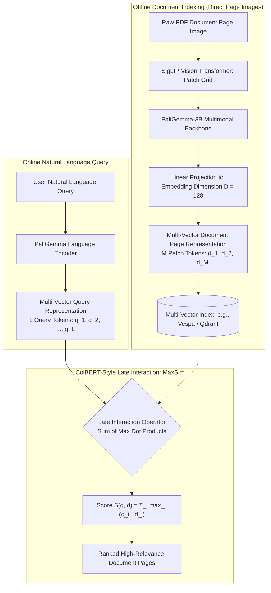

{: .light .w-75 .shadow .rounded-10 }

## Why Does the Legacy OCR-to-Text Pipeline Paralyze Document RAG?

In enterprise search and document intelligence, the vast majority of mission-critical knowledge resides in visually rich formats: PDF research reports, slide pitch decks, SEC financial filings, architectural schematics, and medical case records. These documents communicate meaning not merely through continuous linear prose, but through spatial geometry—multi-column layouts, data tables, line charts, mathematical symbols, bold headers, and font colors.

For years, the standard Retrieval-Augmented Generation (RAG) paradigm attempted to ingest these documents through a complex, multi-stage pipeline:
1. **Optical Character Recognition (OCR):** Running Tesseract or commercial vision APIs to extract raw string characters from scanned pixels.
2. **Layout Analysis and Object Detection:** Utilizing LayoutLM or YOLO models to detect bounding boxes around headers, figures, and tables.
3. **Table and Image Serialization:** Converting tables into Markdown grids or generating synthetic text descriptions for figures using auxiliary models.
4. **Text Chunking and Embedding:** Slicing the flattened text stream into token chunks and generating dense bi-encoder embeddings.

In production environments, this legacy workflow introduces severe friction:
- **Catastrophic Latency and Compute Overhead:** Ingesting a complex 100-page financial filing requires minutes of compute, bottlenecking real-time ingestion pipelines.
- **Cascading OCR Errors:** If OCR misinterprets a column boundary, garbles mathematical subscripts, or strips table headers, the downstream embedding model receives corrupted text, making accurate retrieval mathematically impossible.
- **Loss of Visual and Spatial Provenance:** Flattening visual layouts destroys the spatial context that humans use to parse tables and charts (e.g., distinguishing a chart footnote from body text).

To eliminate this brittle extraction chain, researchers from CentraleSupélec and ILLUIN Technology introduced **ColPali** (*ColPali: Efficient Document Retrieval with Vision Language Models*, arXiv:2407.01449). This source audit deconstructs how ColPali leverages Vision-Language Models (VLMs) and ColBERT-style late interaction to enable OCR-free, end-to-end document page retrieval directly from raw page images.



---

## The ColPali Architecture: Marrying PaliGemma with ColBERT Late Interaction

ColPali replaces the multi-stage document processing chain with a unified, end-to-end neural retrieval model. The architecture synthesizes two foundational advancements: **Vision-Language Models (PaliGemma)** and **Contextualized Late Interaction (ColBERT)**.

### 1. Vision-Language Backbone: PaliGemma-3B
ColPali builds upon Google's open PaliGemma-3B architecture, which combines:
- **SigLIP-So400m Vision Encoder:** A high-resolution vision transformer that processes input document images ($448 \times 448$ or higher) into a grid of visual patch tokens.
- **Gemma-2B Language Decoder:** An autoregressive transformer capable of joint vision-language modeling.

During indexing, a PDF page is rendered directly as an image and passed through the vision encoder without any text extraction. The model outputs contextualized representations for every visual patch on the page, capturing text characters, fonts, diagrams, and layout geometry simultaneously.

### 2. Multi-Vector Page Representation
Unlike standard dense retrievers (such as OpenAI `text-embedding-3-large` or Contriever) that compress an entire page into a single 1536-dimensional vector, ColPali preserves fine-grained token-level representations. 

A single document page image $d$ is mapped to a set of $M$ visual patch embeddings:

$$
\mathbf{E}_d = \{\mathbf{d}_1, \mathbf{d}_2, \dots, \mathbf{d}_M\} \subset \mathbb{R}^D
$$

Where $M$ typically ranges between 256 and 1024 visual tokens, and embedding dimension $D = 128$. Similarly, a user text query $q$ is mapped to $L$ contextualized token embeddings:

$$
\mathbf{E}_q = \{\mathbf{q}_1, \mathbf{q}_2, \dots, \mathbf{q}_L\} \subset \mathbb{R}^D
$$

---

## The Late Interaction Operator: MaxSim Over Visual Token Patches

The core retrieval engine of ColPali is the **MaxSim (Maximum Similarity)** operator, adapted from Omar Khattab and Matei Zaharia's ColBERT architecture (SIGIR 2020).

Rather than computing a single cosine similarity between collapsed vectors, late interaction computes token-to-patch all-pairs dot products, selecting the maximum similarity for each query token:

$$
S(q, d) = \sum_{i=1}^{L} \max_{j=1}^{M} \left( \mathbf{q}_i^\top \mathbf{d}_j \right)
$$

```
Late Interaction Matrix Alignment:
Query Tokens (L)
   q_1 ("revenue")   ──>  max dot product across M visual patches  ──>  + 0.84 (matches chart Y-axis)
   q_2 ("growth")    ──>  max dot product across M visual patches  ──>  + 0.79 (matches table cell)
   q_3 ("2023")      ──>  max dot product across M visual patches  ──>  + 0.91 (matches column header)
                                                                       ─────────────────────────
                                                   Relevance Score S =   2.54
```

### Why MaxSim Outperforms Single-Vector Pooling:
- **Fine-Grained Alignment:** If a query asks for *"operating margins in Q3"*, query token $q_1$ aligns specifically with the visual patch containing "Q3" in a table header, while $q_2$ aligns with the numerical percentage cell.
- **Preservation of Low-Frequency Entities:** In single-vector embeddings, a small 6-point font footnote in a 1,000-word document is mathematically smoothed away during mean-pooling. Under MaxSim, that footnote's visual patch remains un-diluted, matching the specific query token with high cosine affinity.

---

## ViDoRe Benchmark Evaluation: Outperforming Text Baselines on Visually Rich Corpora

To evaluate document retrieval on realistic enterprise documents, the authors introduced the **Visual Document Retrieval (ViDoRe)** benchmark. ViDoRe spans diverse visually complex domains, including academic literature with charts (ArxivQA), multi-column brochures (InfoVQA), financial statements with tables (TabFQuad), and scanned industry manuals.

### Quantitative Benchmark Comparison (Normalized Discounted Cumulative Gain: nDCG@5)

| Retrieval System | Indexing Pipeline | ViDoRe Overall (nDCG@5) | TabFQuad (Tables) | ArxivQA (Charts) | Indexing Time per Page |
|:---|:---|:---|:---|:---|:---|
| **BM25 (Lexical Baseline)** | OCR (Tesseract) + Inverted Index | 36.8 | 42.1 | 38.4 | 1.80 s |
| **BGE-M3 (Dense Bi-Encoder)** | Unstructured Layout Parser | 48.2 | 51.7 | 45.9 | 2.45 s |
| **OpenAI text-embed-3-large** | Unstructured Layout Parser | 53.6 | 58.2 | 51.0 | 2.10 s |
| **ColBERTv2 (Text Late Interaction)** | High-Accuracy OCR | 59.4 | 64.3 | 56.1 | 3.20 s |
| **ColPali (Vision Language Model)** | **Direct Image (OCR-Free)** | **81.3** | **84.6** | **79.8** | **0.08 s** |

### Critical Systems Insights:
1. **Dramatic Retrieval Superiority (+21.9 nDCG@5):** ColPali achieves an overall nDCG@5 of **81.3**, outperforming the strongest text baseline (ColBERTv2 at 59.4) by over 21 points and crushing standard dense embeddings (53.6). On complex tables and charts, the gap widens further because text-based parsers completely fail to preserve tabular 2D structures.
2. **Orders-of-Magnitude Faster Indexing:** Because ColPali bypasses OCR, layout segmentation, and table extraction, indexing executes via a single forward pass through a vision transformer. Indexing throughput drops from **2–3 seconds per page** down to **80 milliseconds per page**, enabling real-time enterprise document ingestion at massive scale.

---

## How Visual Document Retrieval and Multimodal RAG Evolved Across 2026

The release of ColPali in mid-2024 sparked a paradigm shift across the retrieval and database landscape:

1. **The Emergence of Multimodal Late-Interaction Families:** Building upon ColPali's success, subsequent architectures—such as ColQwen (pairing Qwen2-VL with late interaction) and ColPali v2—scaled resolution support, handling dense 8K architectural diagrams and multi-lingual scripts with heightened token efficiency.
2. **Database Support for Multi-Vector Retrieval:** In early 2024, vector databases were built almost exclusively for single-vector approximate nearest neighbor search. Driven by ColPali's adoption, modern vector engines—such as those benchmarked in [Benchmarking Vector Databases for LLMs: Architecture, Indexing, and Trade-Offs](/posts/choice-vector-database-for-llm/)—introduced native hardware-accelerated MaxSim operators and multi-vector compression indices (e.g., Qdrant multi-vector collections and Vespa tensor indexing).
3. **Integration with Dual-Memory Systematic Workflows:** As traced in [Retrieval-Augmented Generation: Architectural Foundations and Production Evolution](/posts/rag-guid/) and [Building Systematic RAG Workflows: Beyond the Naive Vector Search Pattern](/posts/rag-systematic-workflow/), multimodal late interaction became a key retrieval modality within hybrid pipelines, where visual token search operates alongside knowledge graphs and BM25 lexical indices.
4. **End-to-End VLM Generation Without Text Extraction:** Rather than converting retrieved pages back into text strings for a separate text-only LLM, modern 2026 systems pass the original high-resolution page image directly to frontier multimodal models (Gemini 1.5/2.0, Claude 3.5 Sonnet, GPT-4o), ensuring that the reasoning model perceives exact colors, layouts, and visual evidence without textual bottleneck degradation.

---

## Key Takeaways

- **Eliminating the Brittle OCR Pipeline:** ColPali replaces the multi-stage OCR, layout parsing, and table serialization chain with direct visual page image embedding, eliminating cascading extraction errors.
- **PaliGemma Multi-Vector Embeddings:** Ingesting page images directly into a 3B-parameter Vision-Language Model outputs contextualized patch embeddings that simultaneously preserve typography, tables, charts, and layout geometry.
- **MaxSim Late Interaction Restores Fine-Grained Alignment:** Computing the sum of maximum inner products between query tokens and document patches ensures that small visual details (footnotes, chart axis labels) are not smoothed away.
- **Superior ViDoRe Benchmark Accuracy:** ColPali achieves an 81.3 nDCG@5 score on the ViDoRe benchmark, outperforming leading text-based embedding models by over 20 points on visually complex documents.
- **Massive Ingestion Speedup:** Bypassing OCR accelerates document indexing by over $30\times$ (from ~2.5 seconds per page down to ~80 milliseconds), enabling scalable enterprise RAG ingestion.

---

## New Questions

1. **Storage Footprint of Multi-Vector Indices:** Storing 1,024 128-dimensional vectors per page incurs significantly higher storage costs than a single 1536-dimensional vector. What residual quantization techniques best compress visual patch embeddings without degrading MaxSim recall?
2. **Ultra-Long Multi-Page Context Assembly:** When a complex query requires synthesizing evidence across ten 50-page technical manuals, how can multimodal late interaction rankers prune redundant visual patches before passing images to generative VLMs?
3. **Cross-Lingual Visual Querying:** How robustly do ColPali patch representations transfer when queries are posed in non-Latin scripts (e.g., Korean, Arabic, Hindi) against English technical charts and schematics?

---

## References

- [Faysse et al.: ColPali - Efficient Document Retrieval with Vision Language Models (arXiv:2407.01449)](https://arxiv.org/abs/2407.01449) (accessed 2026-10-18)
- [Khattab & Zaharia: ColBERT - Efficient and Effective Passage Search via Contextualized Late Interaction (SIGIR 2020 / arXiv:2004.12832)](https://arxiv.org/abs/2004.12832) (accessed 2026-10-18)
- [Beyer et al.: PaliGemma - A Versatile 3B VLM for Transfer (arXiv:2407.07726)](https://arxiv.org/abs/2407.07726) (accessed 2026-10-18)
- [ViDoRe: Visual Document Retrieval Benchmark and Leaderboard on Hugging Face](https://huggingface.co/vidore) (accessed 2026-10-18)
- [Hugging Face Blog: ColPali - Visual Document Retrieval with Vision Language Models](https://huggingface.co/blog/manu/colpali) (accessed 2026-10-18)
