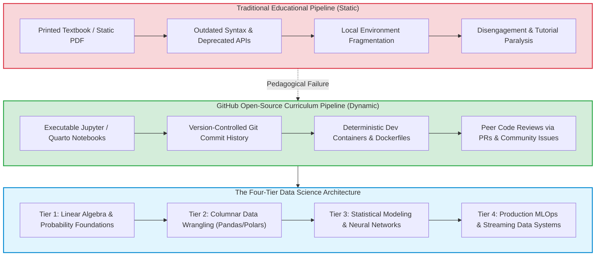

The barrier to entry for mastering data science and machine learning has historically been gatekept by expensive graduate degrees and closed commercial training bootcamps. Traditional university programs often suffer from severe curricular lag: by the time academic syllabi receive administrative accreditation, the underlying open-source software libraries, hardware accelerators, and architectural paradigms have fundamentally evolved.

In parallel, an organic educational revolution unfolded in the open-source community. **GitHub transformed into a decentralized, peer-reviewed global university**. From university-equivalent degree roadmaps maintained by the Open Source Society University (OSSU) to battle-tested computational notebooks curated by leading industry practitioners, the world's highest-quality educational materials are openly accessible in version-controlled repositories.

However, navigating thousands of repositories without a coherent pedagogical framework leads to tutorial hell: collecting hundreds of starred repositories, copying isolated code snippets, and never building end-to-end engineering intuition.

This source audit analyzes why open-source version-controlled curricula outperform static textbooks, establishes a four-tier learning architecture for mastering computational statistics and deep learning, and evaluates how AI pair programming and in-browser execution environments transformed developer education across 2026.


## Why Has GitHub Superseded Traditional Textbooks for Applied Data Science?

Traditional technical textbooks decouple theoretical exposition from executable computing environments. A printed text presents static mathematical formulas and illustrative code blocks, leaving students stranded when deprecated API signatures, environment mismatches, or missing sample data prevent local execution.

In contrast, GitHub-hosted educational repositories offer four decisive structural advantages:



1. **Executability and Reproducibility**: High-quality repositories bundle reproducible configuration files (`environment.yml`, `requirements.txt`, or devcontainers). Students do not simply read about singular value decomposition; they execute it against live datasets in Jupyter notebooks.
2. **Git Commit Provenance**: By inspecting the commit history of educational repositories, learners observe how production code evolves through incremental refactoring, bug fixes, and optimization passes. The mechanics of Git's underlying directed acyclic graphs are analyzed in our study of [Git internal DAG and object architecture](/posts/git-in-a-Nutshell/).
3. **Collaborative Problem Solving**: Open-source repositories host active issue trackers where thousands of learners document edge cases, identify alternative mathematical derivations, and debate trade-offs in public view.

## The Four-Tier Open-Source Data Science Curriculum

To transition from casual scripting to senior machine learning engineering, learners must systematically traverse four foundational tiers:

### Tier 1: Mathematical Foundations and Numerical Computing
Data science without mathematics is cargo-cult engineering. Repositories like OSSU Data Science ground learners in:
- **Multivariate Calculus & Matrix Decompositions**: Understanding eigenvalues, SVD, and gradient descent vector fields.
- **Probability & Bayesian Inference**: Moving beyond basic descriptive statistics to likelihood estimation, prior updating, and rare-event statistical behavior. The mathematics of handling extreme probability skew is explored in our audit on [optimal negative subsampling in imbalanced datasets](/posts/deal-with-imbalanced-data/).

### Tier 2: Vectorized Data Wrangling and Memory Hierarchy
Mastering tools like NumPy, Pandas, and Polars requires understanding memory layout:
- **Contiguous Memory vs. Object Overhead**: Contrasting contiguous C-arrays with Python object pointer arrays.
- **Columnar Storage and Apache Arrow**: Transitioning from row-oriented storage to columnar memory layouts for zero-copy streaming analysis.
- **Defensive Data Validation**: Enforcing schema invariants and data quality gates before passing arrays to model estimators.

```python
"""
Production Data Pipeline Validation Template:
Demonstrating vectorized transformations, schema validation, and defensive assertions
suitable for production data science workflows.
"""

import numpy as np
import pandas as pd
from typing import Tuple

def process_raw_telemetry(df: pd.DataFrame) -> Tuple[pd.DataFrame, dict]:
    """Cleans and validates sensor telemetry using vectorized operations."""
    # 1. Enforce strict schema constraints
    required_columns = {"timestamp", "device_id", "voltage", "temperature"}
    if not required_columns.issubset(df.columns):
        missing = required_columns - set(df.columns)
        raise ValueError(f"Schema violation: missing required columns {missing}")

    # 2. Vectorized timestamp conversion and index assignment
    df["timestamp"] = pd.to_datetime(df["timestamp"], utc=True)
    df = df.sort_values("timestamp").reset_index(drop=True)

    # 3. Vectorized outlier filtering without slow iterrows loops
    valid_voltage_mask = (df["voltage"] >= 0.0) & (df["voltage"] <= 50.0)
    valid_temp_mask = (df["temperature"] >= -40.0) & (df["temperature"] <= 125.0)
    cleaned_df = df[valid_voltage_mask & valid_temp_mask].copy()

    # 4. Feature engineering: rolling window statistics
    cleaned_df["voltage_rolling_mean"] = (
        cleaned_df.groupby("device_id")["voltage"]
        .rolling(window=5, min_periods=1)
        .mean()
        .reset_index(level=0, drop=True)
    )

    metrics = {
        "raw_records": len(df),
        "clean_records": len(cleaned_df),
        "dropped_anomalies": len(df) - len(cleaned_df)
    }
    return cleaned_df, metrics
```

### Tier 3: Statistical Modeling and Neural Network Architectures
Studying repositories like Donne Martin's data science notebooks allows learners to build estimators from scratch:
- **Linear Models and Regularization**: Ridge, Lasso, and ElasticNet loss formulations.
- **Ensemble Tree Architectures**: Gradient Boosting (XGBoost, LightGBM, CatBoost) and splitting criterion optimizations.
- **Deep Neural Networks**: PyTorch module encapsulation, backward autograd mechanics, and attention mechanisms.

### Tier 4: Production Systems and Distributed MLOps
Graduating to industry roles demands understanding distributed infrastructure:
- **Scalable Data Processing**: Apache Spark, Ray, and distributed Dask task graphs.
- **System Evaluation and Scale**: Understanding the architectural trade-offs tested in frontier interviews, as reviewed in our analysis of [Google technical interview evaluation](/posts/prepared-google-interview/).

## How Developer Education and Open-Source Collaboration Evolved Across 2026

Between 2024 and 2026, open-source technical education transitioned from passive reading into interactive, agent-assisted apprenticeships:

1. **WASM-Powered In-Browser Computational Sandboxes (Pyodide & WebGPU)**: Learners no longer struggle with local CUDA installations or Python virtual environment conflicts. Modern educational repositories embed interactive WebAssembly and WebGPU kernels directly inside the browser, allowing students to train neural networks on client-side GPUs with zero cloud setup.
2. **AI-Driven Socratic Mentorship**: Rather than searching Stack Overflow for confusing syntax errors, modern repository learners work alongside AI coding partners. Agents provide Socratic guidance—asking leading questions about gradient dimensions and vector shapes rather than immediately providing the solution.
3. **Automated Continuous Integration Feedback on Student PRs**: Open-source learning repositories integrate automated grading and linter bots into GitHub Actions. When a student submits a pull request solving a machine learning assignment, CI runners execute unit tests, memory benchmark suites, and code-cleanliness checks within seconds.
4. **Synthetic Dataset Generation for Safe Learning**: Learners are no longer constrained by static Kaggle CSVs. Students utilize open-source generative pipelines to synthesize realistic, HIPAA-compliant patient records or e-commerce clickstream data, allowing them to practice feature engineering on enterprise-scale distributions.

## Key Takeaways

- **GitHub Operates as a Living Knowledge Base**: Open-source repositories provide continuously updated, reproducible, and executable educational curricula that outpace static textbooks.
- **Four Tiers Build Comprehensive Competence**: Mastering data science requires a progressive progression from mathematical foundations to columnar data wrangling, statistical modeling, and production MLOps.
- **Vectorization is Mandatory**: Real-world data pipelines must avoid slow Python iteration loops, leveraging contiguous vectorized arrays and Arrow columnar storage.
- **Collaboration Trumps Solitary Grinding**: Active participation in open-source discussions, issue triaging, and code review builds the communication and architectural skills required in enterprise engineering.

## New Questions

- **Will Automated AI Code Synthesis Diminish Foundational Programming Skills?** As generative agents auto-complete complex data transformations, will new engineers fail to develop essential debugging intuition and algorithmic fluency?
- **How Will Universities Adapt to Open-Source Credentialing?** As employers increasingly value demonstrable open-source contributions and merged PRs over academic transcripts, how will traditional higher education justify tuition costs?
- **What are the Security Risks of Untrusted Community Notebooks?** As students download community Python notebooks, what automated sandboxing mechanisms are needed to prevent malicious dependency injections and credential scrapers?

## References

- McKinney, W. (2022). *Python for Data Analysis: Data Wrangling with pandas, NumPy, and Jupyter* (3rd ed.). O'Reilly Media. Available at: [https://wesmckinney.com/book/](https://wesmckinney.com/book/) (accessed 2026-10-18).
- Open Source Society University (2024). *Path to a Free Self-Taught Education in Data Science*. GitHub Repository. Available at: [https://github.com/ossu/data-science](https://github.com/ossu/data-science) (accessed 2026-10-18).
- VanderPlas, J. (2016). *Python Data Science Handbook: Essential Tools for Working with Data*. O'Reilly Media. Available at: [https://jakevdp.github.io/PythonDataScienceHandbook/](https://jakevdp.github.io/PythonDataScienceHandbook/) (accessed 2026-10-18).
- Martin, D. (2024). *Data Science Python Notebooks: Deep Learning, Scikit-Learn, NumPy, and Pandas*. GitHub Repository. Available at: [https://github.com/donnemartin/data-science-ipython-notebooks](https://github.com/donnemartin/data-science-ipython-notebooks) (accessed 2026-10-18).
