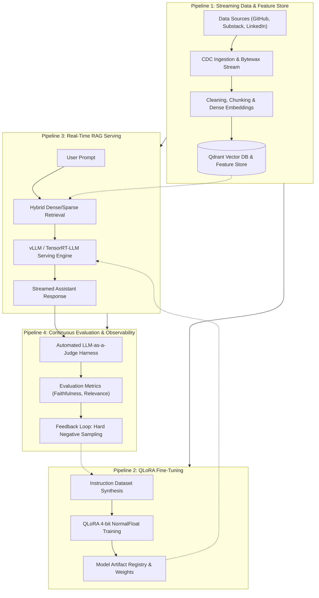
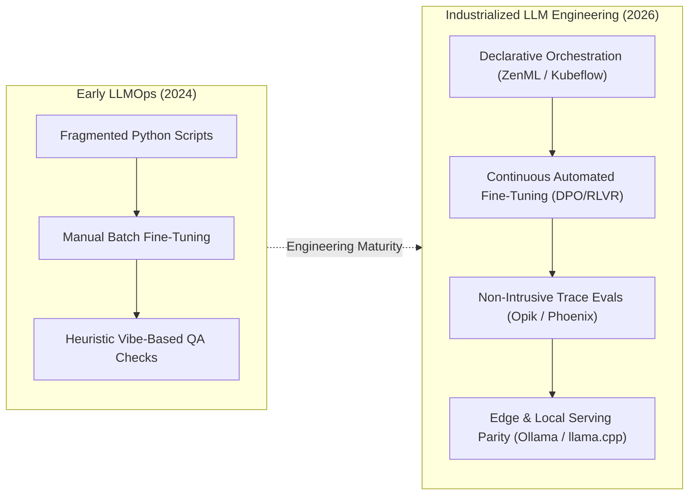

## Why Do Ad-Hoc LLM Prototypes Fail to Transition into Reliable Production Systems?

During the early exploration of generative artificial intelligence, building a prototype required little more than wrapping an OpenAI API call in a lightweight Streamlit interface or Jupyter notebook. However, when software engineering organizations attempt to transition these experimental prototypes into enterprise production environments, ad-hoc architectures inevitably collapse.

Production AI systems face complex, distributed software engineering challenges that standalone API wrappers cannot address:

1. **Unreproducible Data Ingestion and Pipeline Drift**: Ad-hoc scripts that scrape blogs, documentation, and source code repositories lack schema validation, change data capture (CDC), and idempotency guarantees. When source documents are edited or deleted, downstream vector indexes diverge silently from underlying truth, producing hallucinated answers grounded in stale data.
2. **Brittle Fine-Tuning and Lack of Lineage Tracking**: Fine-tuning open-weights models without version-controlled data manifests, artifact registries, and experiment tracking makes model regression debugging impossible. Teams cannot determine which specific training dataset or hyperparameter configuration caused a newly deployed checkpoint to regress on safety or formatting benchmarks.
3. **The Evaluation Vacuum**: Without automated evaluation harnesses, testing relies on qualitative "vibe checks" conducted manually by developers. Changes made to system prompts or retrieval chunking strategies cannot be verified systematically for regressions against historical query distributions.

To provide a rigorous, production-grade engineering blueprint, **Paul Iusztin** and **Alex Vesa** (authors of *The LLM Engineer's Handbook* and creators of the open-source *LLM Twin Course*) introduced the **LLM Twin Architecture**. Rather than viewing an LLM application as a monolithic script, the LLM Twin decomposes production AI into four decoupled, version-controlled software pipelines: Streaming Data Collection, Fine-Tuning, Real-Time RAG Serving, and Continuous Evaluation.

As detailed in our technical audits on [enterprise LLM production stacks](/posts/llm-build-tools-cookbook/) and [architectural trade-offs between prompting, RAG, and fine-tuning](/posts/improving-the-performance-llm/), decoupling these pipelines is essential for reliable operations.



---

## Deconstructing the 4-Pipeline Architecture of the LLM Twin

The core philosophy of the LLM Twin system is that an AI engineer's digital persona or specialized enterprise assistant requires four independently scalable, testable, and maintainable pipelines:

### 1. The Streaming Data Ingestion and Feature Pipeline
Raw content originates across disparate platforms: Git commits, technical articles, and social media posts. The data pipeline must process these diverse streams reliably:
- **Streaming Orchestration via Bytewax**: Rather than running brittle batch cron jobs, data streams are ingested using Python stream processing engines like Bytewax (built on Rust's Timely Dataflow). Bytewax handles stateful streaming, deduplication, and windowing with millisecond latency.
- **Hierarchical Chunking**: Documents are split into semantic chunks that preserve context boundaries (e.g., Markdown header-aware splitting).
- **Dense Embedding Upsert**: Embeddings are computed and upserted into **Qdrant**, an enterprise-grade vector database written in Rust that supports payload-based metadata filtering and high-concurrency HNSW search.

### 2. The Instruction Fine-Tuning Pipeline
To mimic a specialized engineer's reasoning style and technical vocabulary, an open-weights foundation model (e.g., Llama 3 or Mistral) is fine-tuned using parameter-efficient methods:
- **Synthetic Instruction Dataset Generation**: The raw ingested articles and code repositories are processed through automated prompts that generate thousands of diverse (Instruction, Input, Output) triplets.
- **Quantized Low-Rank Adaptation (QLoRA)**: Base model weights are loaded in 4-bit NormalFloat (NF4) precision using `bitsandbytes`, drastically reducing GPU VRAM requirements from 80GB down to under 16GB. LoRA adapter matrices are trained exclusively on attention projection modules (`q_proj`, `k_proj`, `v_proj`, `o_proj`).
- **Experiment Tracking and Lineage**: Training runs, validation loss curves, and artifact checkpoints are logged into experiment registries (such as Comet ML or Weights & Biases), ensuring every deployed adapter can be traced back to the exact commit SHA and dataset snapshot.

### 3. The Real-Time Inference and RAG Serving Pipeline
Serving user queries with minimal latency requires high-throughput inference infrastructure:
- **Hybrid Search**: Inbound user queries trigger both dense vector semantic search (via cosine similarity in Qdrant) and sparse keyword search (BM25), mitigating the blind spots of pure dense embeddings.
- **Prompt Formulation & Guardrails**: Retrieved chunks are assembled into a structured system prompt, augmented with safety guardrails that detect jailbreak attempts or out-of-domain inquiries.
- **High-Throughput Serving (vLLM)**: Inference execution is handled by high-performance serving engines like vLLM, utilizing PagedAttention to eliminate memory fragmentation and dynamic continuous batching to maximize tokens generated per second.

### 4. The Continuous Evaluation and Observability Pipeline
A production LLM system cannot fly blind. Pipeline 4 establishes an automated quality control loop:
- **Triad Metrics (Faithfulness, Relevance, Groundedness)**: An automated LLM-as-a-judge system systematically evaluates live inference traces. It checks whether the answer is strictly grounded in the retrieved context (Faithfulness) and whether the answer directly addresses the user's inquiry (Relevance).
- **Data Flywheel for Continuous Improvement**: Queries where the model exhibited low confidence or received negative user feedback are captured and routed into a specialized review queue. These edge cases are synthesized into hard-negative pairs and fed back into Pipeline 2 for subsequent fine-tuning iterations.

---

## Vector Database Topology and Streaming Ingestion Mechanics

In production RAG systems, the vector database is not merely a passive storage bucket; it is a high-performance feature store operating under strict latency budgets.

```
+----------------------------------------------------------------------------------------------------+
|                                  Qdrant Vector Database Topology                                   |
+----------------------------------------------------------------------------------------------------+
| Component            | Implementation Layer                | Architectural Function                |
+----------------------+-------------------------------------+---------------------------------------+
| Storage Engine       | Rust Core + Memory-Mapped Files     | Provides ACID-safe disk persistence   |
|                      | (Mmap) on SSD                       | with minimal RAM overhead             |
| Indexing Algorithm   | Hierarchical Navigable Small World  | Sub-10ms Approximate Nearest Neighbor |
|                      | (HNSW) Graphs                       | search across millions of vectors     |
| Payload Filtering    | In-Payload JSON Metadata            | Executes boolean filters (e.g., user, |
|                      | (B-Tree & Keyword Indices)          | date, tags) directly during traversal |
| Vector Quantization  | Scalar & Product Quantization (PQ)  | Compresses 32-bit floats to 8-bit ints|
|                      |                                     | cutting RAM footprints by up to 75%   |
+----------------------------------------------------------------------------------------------------+
```

### Eliminating the Post-Filtering Performance Penalty
A common flaw in generic vector search setups is **post-filtering**: retrieving the top-100 nearest neighbors purely by cosine distance, and then discarding vectors that fail business metadata filters (e.g., `author == "Paul"` or `tenant_id == "enterprise_102"`). If relevant matching documents are sparse, post-filtering returns an empty set or severely truncated results.

Modern vector engines like Qdrant execute **filtered HNSW traversal**: metadata indexes are evaluated concurrently during the graph traversal step, ensuring that every explored candidate satisfies security and domain filters without sacrificing recall or speed.

---

## How LLMOps Infrastructure Evolved Across 2026

Between 2024 and 2026, the disciplines of MLOps and LLM engineering matured into a standardized enterprise platform discipline:



1. **Declarative Pipeline Orchestration**: Fragile bespoke shell scripts have been superseded by declarative MLOps orchestrators like ZenML and Kubeflow Pipelines. Pipelines define hardware resource requirements (e.g., `@step(enable_gpu=True)`), container base images, and caching rules directly in code, executing seamlessly across local development workstations and remote Kubernetes GPU clusters.
2. **Industrialized Non-Intrusive Observability**: Platforms like Comet Opik, Arize Phoenix, and Langfuse integrate directly into application routers via OpenTelemetry standards. Every LLM interaction—including prompt tokens, completion tokens, latency, cost, and intermediate retrieval chunks—is captured as a trace span, automatically scored against semantic evaluation rubrics without impacting user latency.
3. **Automated Alignment via DPO and RLVR**: Supervised Fine-Tuning (SFT) has increasingly transitioned to automated preference optimization via Direct Preference Optimization (DPO) and Reinforcement Learning with Verifiable Rewards (RLVR). Systems generate multiple candidate responses, score them automatically against execution compilers or deterministic unit tests, and optimize model policy weights without human annotation overhead.
4. **Local and Edge Inference Parity**: While training remains anchored to cloud GPU clusters, production serving increasingly leverages small, highly optimized models (e.g., Llama 3.2 3B, Qwen2.5 7B) running locally on edge hardware via `llama.cpp` or Ollama, delivering localized AI twin interactions with zero cloud API token expenses.

---

## Key Takeaways

- **The Four-Pipeline Mandate**: A resilient production LLM application requires decoupling into four independent pipelines: Streaming Data Collection, Fine-Tuning, RAG Serving, and Continuous Evaluation.
- **Streaming Over Batch**: Ingesting unstructured real-world data via streaming architectures (such as Bytewax and Qdrant) prevents vector index drift and guarantees fresh, authoritative retrieval grounding.
- **Resource-Efficient Specialization**: Combining QLoRA 4-bit quantization with parameter-efficient adapter training enables domain customization without massive enterprise compute budgets.
- **Continuous Evaluation Flywheels**: Replacing subjective manual testing with automated LLM judges and observability trace telemetry establishes an objective feedback loop for continuous model improvement.

---

## New Questions

- How do streaming vector ingestion pipelines handle atomic rollbacks when an upstream document retraction occurs across distributed HNSW graph indexes?
- What are the performance trade-offs of using scalar versus product quantization in Qdrant when serving high-dimensional embeddings on latency-critical edge devices?
- How can automated synthetic instruction generation be constrained to avoid reinforcing domain-specific hallucinations during iterative continuous fine-tuning loops?

---

## References

- Iusztin, Paul, and Alex Vesa. *The LLM Engineer's Handbook: Building Production-Ready LLM Systems*. Packt Publishing, 2024. [https://www.packtpub.com/en-us/product/the-llm-engineers-handbook-9781836200079](https://www.packtpub.com/en-us/product/the-llm-engineers-handbook-9781836200079) (accessed 2026-10-18).
- Decoding ML. *The LLM Twin Course: Building an End-to-End Production LLM System*. GitHub Repository, 2024. [https://github.com/decodingml/llm-twin-course](https://github.com/decodingml/llm-twin-course) (accessed 2026-10-18).
- Dettmers, Tim, Artidoro Pagnoni, Ari Holtzman, and Luke Zettlemoyer. *QLoRA: Efficient Finetuning of Quantized LLMs*. Advances in Neural Information Processing Systems (NeurIPS), 2023. [https://arxiv.org/abs/2305.14314](https://arxiv.org/abs/2305.14314) (accessed 2026-10-18).
- Qdrant Team. *Qdrant: Vector Database for Next-Generation AI Applications*. Qdrant Documentation, 2024. [https://qdrant.tech/documentation/](https://qdrant.tech/documentation/) (accessed 2026-10-18).
