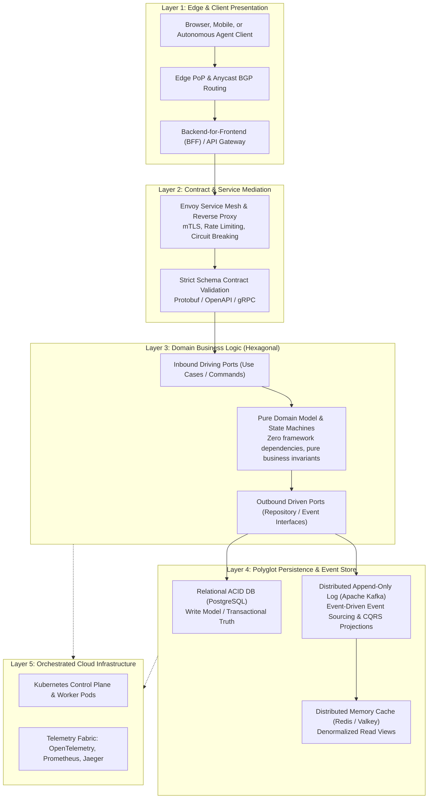

{: .light .shadow .rounded-10 w='1212' h='668' }

## How Do Architectural Boundaries Prevent Cascading Failures in Complex Systems?

In introductory software engineering courses, architecture is frequently simplified into a clean, vertical three-tier diagram: User Interface, Business Logic, and Database. While this conceptual abstraction suffices for small educational CRUD applications, enterprise production environments quickly expose its fatal vulnerabilities. In a naive layered model, database schema details leak upward into presentation handlers, synchronous remote procedure calls form fragile cascading dependency chains, and a single database deadlock cascades into total system failure.

Modern software engineering addresses this fragility not by drawing arbitrary organizational boxes, but by enforcing strict mathematical and operational boundaries. Architectural engineering is the discipline of managing coupling, state mutability, latency amplification, and fault domains.

Evaluating modern system architecture requires moving past superficial layer enumerations to examine how data and control flow traverse the five structural boundaries of modern software: the edge presentation layer, the contract mediation gateway, the decoupled domain core, the polyglot persistence substrate, and the underlying cloud-native infrastructure mesh.



---

## 1. Layer 1: Edge Presentation and Client Orchestration

The outermost boundary of modern software systems manages diverse client protocols (HTTP/3 QUIC, WebSockets, Server-Sent Events, and gRPC-Web) across geographically distributed points of presence (PoPs).

### The Backend-for-Frontend (BFF) Pattern
Rather than exposing a single monolithic REST API to desktop web applications, native mobile apps, and autonomous third-party agents, modern architectures employ the **Backend-for-Frontend (BFF)** pattern. A dedicated aggregation layer tailors payload shapes, network round-trips, and authentication token validation to the specific network constraints of the consuming client. For example, a mobile BFF compresses JSON responses and aggregates five microservice calls into a single response, shielding mobile radios from battery-draining multi-hop latency, as detailed in our analysis of [asynchronous concurrency bottlenecks](/posts/async-code-performance-issues-solutions/).

---

## 2. Layer 2: Contract Mediation, Gateways, and Service Meshes

As systems scale into distributed microservices or modular micro-kernels, inter-service communication becomes the primary source of operational outages. 

Modern architectures interpose an intelligent mediation fabric:
- **Strict Schema Enforcement**: Utilizing strongly typed binary protocols (such as Protocol Buffers over gRPC) eliminates the serialization parsing overhead and type ambiguity common in ad-hoc JSON endpoints.
- **Service Mesh and Sidecar Proxies**: Technologies like Envoy and Istio decouple networking concerns from application code. Traffic routing, mutual TLS (mTLS) cryptographic handshakes, dynamic retries, and distributed tracing headers (W3C Trace Context) are executed out-of-process in a sidecar proxy.
- **Circuit Breakers and Bulkheading**: Based on Michael Nygard's stability patterns, circuit breakers automatically open when downstream error rates exceed pre-set thresholds (e.g., 50% failure over 10 seconds), fast-failing traffic to prevent thread exhaustion from propagating up the call graph.

```
Service A ──► [ Envoy Proxy ] ──(mTLS / Traced)──► [ Envoy Proxy ] ──► Service B
                    │                                    │
                    └──► [ Circuit Breaker: OPEN ] ◄─────┘
                         (Fails fast; protects caller)
```

---

## 3. Layer 3: The Decoupled Domain Core (Hexagonal Architecture)

The most critical architectural discipline is isolating business logic from external frameworks, databases, and network transports. 

Introduced by Alistair Cockburn (and formalized in Robert C. Martin's Clean Architecture), **Hexagonal Architecture (Ports and Adapters)** applies the **Dependency Inversion Principle (DIP)**:

$$\text{High-level business policies must not depend on low-level technical mechanisms.}$$

```
                ┌────────────────────────────────────────────────────────┐
                │                  Infrastructure Layer                  │
                │                                                        │
                │   ┌────────────────────────────────────────────────┐   │
                │   │               Application Layer                │   │
                │   │                                                │   │
                │   │   ┌────────────────────────────────────────┐   │   │
                │   │   │              Domain Core               │   │   │
[ HTTP Handler ]───►│───►│ [Inbound Port]                         │   │   │
 (Primary Adapter)  │   │        │                               │   │   │
                │   │   │        ▼                               │   │   │
                │   │   │  Domain Entity & Business Invariants   │   │   │
                │   │   │        │                               │   │   │
                │   │   │        ▼                               │   │   │
                │   │   │ [Outbound Port (Interface)]            │   │   │
                │   │   └────────┼───────────────────────────────┘   │   │
                │   │            │                                   │   │
                │   └────────────┼───────────────────────────────────┘   │
                │                ▼                                       │
                │       [ SQL Repository Adapter ]                       │
                │          (Secondary Adapter)                           │
                └────────────────┼───────────────────────────────────────┘
                                 ▼
                         [ PostgreSQL Database ]
```

### The Ports and Adapters Mechanism
1. **The Domain Core**: Contains pure business entities, value objects, and domain services. It imports zero third-party packages, zero ORM frameworks, and zero HTTP libraries.
2. **Inbound (Driving) Ports**: Interfaces defining application use cases (e.g., `PlaceOrderCommand`). Driving adapters (REST controllers, CLI commands, Kafka message consumers) invoke these ports.
3. **Outbound (Driven) Ports**: Interfaces defining external capabilities required by the domain (e.g., `OrderRepositoryPort`, `PaymentGatewayPort`). Secondary adapters (PostgreSQL implementations, Stripe SDK wrappers) implement these interfaces.

Because dependencies point strictly inward toward the domain core, the database, web framework, or messaging broker can be swapped without modifying a single line of business logic.

---

## 4. Layer 4: Polyglot Persistence, Event Sourcing, and CQRS

Enterprise systems have abandoned the illusion that a single database engine can satisfy all transactional, analytical, and search workloads simultaneously.

Modern data architecture embraces **Command Query Responsibility Segregation (CQRS)**:
- **Write Path (Command)**: Optimized for relational integrity, concurrency control, and transactional consistency (e.g., PostgreSQL with strict foreign keys and serializable isolation).
- **Event Log**: Changes to transactional state are published as immutable domain events to a distributed append-only log (such as Apache Kafka), preserving a pristine historical audit trail.
- **Read Path (Query)**: Asynchronous background consumers project the event stream into specialized, denormalized read stores:
  - Document databases for nested hierarchical profiles.
  - In-memory key-value caches (Redis) for microsecond lookups.
  - Columnar search engines for vector similarity and full-text search, utilizing indexing algorithms reviewed in our audit of [foundational algorithms](/posts/10-core-algorithms/).

---

## 5. Layer 5: Orchestrated Cloud Infrastructure and Telemetry

The physical foundation upon which modern distributed software executes is automated container orchestration. As explored in our deep dive on [Kubernetes cluster design](/posts/what-is-kubernetes/), the infrastructure layer provides:
- **Declarative Reconciliation Loops**: Schedulers continuously reconcile current cluster state against desired state, automatically replacing unhealthy worker containers.
- **Dynamic Horizontal Pod Autoscaling (HPA)**: Scales compute instances based on CPU, memory, or custom business metrics (e.g., queue message lag).
- **Unified Observability (The Three Pillars)**: Standardized telemetry collection using OpenTelemetry:
  - **Metrics**: High-cardinality time-series for alerting (Prometheus).
  - **Logs**: Structured JSON events for root-cause inspection.
  - **Distributed Traces**: Propagated span IDs tracking requests across multi-service hops (Jaeger).

---

## Architectural Comparison Matrix

| Architectural Pattern | Primary Strengths | Primary Weaknesses | Typical Scale Threshold | Team Topology Match |
| :--- | :--- | :--- | :--- | :--- |
| **Monolithic N-Tier** | Simple deployment, zero network latency between layers | High coupling, slow CI builds, database bottleneck | Startups, < 50k DAU | Single team (3–8 engineers) |
| **Modular Monolith** | In-process domain isolation, simple operational model | Enforces discipline via linting/compilers, shared DB | Growth phase, 50k–2M DAU | Medium org (10–40 engineers) |
| **Microservices** | Independent deployability, clear team boundaries | Network latency, distributed transactions, high infra cost | Enterprise, > 2M DAU | Large org (50+ engineers, multiple squads) |
| **Event-Driven CQRS** | Infinite read scalability, complete audit history | Eventual consistency, complex replay and debugging | High-throughput financial/e-commerce | Specialized distributed systems teams |

---

## How Software Architecture Evolved Across 2026

Entering 2026, software architecture adapted to accommodate autonomous AI agents and dynamic runtimes:

1. **Machine-Readable API Contracts (Agentic Interfaces)**: External APIs increasingly abandon human-oriented documentation in favor of self-describing Model Context Protocol (MCP) and JSON schema registries. Autonomous coding agents inspect API schemas dynamically and generate type-safe consumer bindings at runtime.
2. **Compiler-Enforced Architecture Boundaries**: Tools like ArchUnit, cargo-deny, and automated AST linters enforce hexagonal layer boundaries directly in CI pipelines, rejecting pull requests where presentation layers accidentally import persistence adapters.
3. **Deterministic State Machine Workflows**: Distributed sagas are increasingly orchestrated through code-as-configuration temporal engines (e.g., Temporal, Cadence). These engines ensure that long-running multi-service workflows survive network partitions and server restarts with deterministic replay guarantees.

---

## Key Takeaways

- **Boundaries Define Architecture**: True software architecture is not about picking libraries; it is about establishing strict, decoupled boundaries that prevent local failures from cascading.
- **Invert Dependencies Around Business Invariants**: Hexagonal architecture shields core business rules from external framework churn and database technology shifts.
- **Separate Reads from Writes**: CQRS and event sourcing decouple high-throughput read traffic from transactional write integrity, enabling independent scaling across heterogeneous databases.

---

## New Questions

- How will the rise of autonomous agent-to-agent transactions affect traditional database transaction isolation levels when agents execute thousands of micro-decisions per second?
- Can compiler-verified modular monoliths eliminate the operational overhead of microservices without sacrificing independent deployment agility?

---

## References

- Cockburn, A. (2005). *Hexagonal Architecture (Ports and Adapters)*. Alistair Cockburn Blog. [https://web.archive.org/web/20180422210157/http://alistair.cockburn.us/Hexagonal+architecture](https://web.archive.org/web/20180422210157/http://alistair.cockburn.us/Hexagonal+architecture) (accessed 2026-10-18).
- Martin, R. C. (2017). *Clean Architecture: A Craftsman's Guide to Software Structure and Design*. Prentice Hall. [https://www.pearson.com/en-us/subject-catalog/p/clean-architecture-a-craftsmans-guide-to-software-structure-and-design/P200000009511](https://www.pearson.com/en-us/subject-catalog/p/clean-architecture-a-craftsmans-guide-to-software-structure-and-design/P200000009511) (accessed 2026-10-18).
- Evans, E. (2003). *Domain-Driven Design: Tackling Complexity in the Heart of Software*. Addison-Wesley Professional. [https://www.oreilly.com/library/view/domain-driven-design-tackling/0321125215/](https://www.oreilly.com/library/view/domain-driven-design-tackling/0321125215/) (accessed 2026-10-18).
- Nygard, M. T. (2018). *Release It!: Design and Deploy Production-Ready Software* (2nd ed.). Pragmatic Bookshelf. [https://pragprog.com/titles/mnee2/release-it-second-edition/](https://pragprog.com/titles/mnee2/release-it-second-edition/) (accessed 2026-10-18).
- Newman, S. (2021). *Building Microservices: Designing Fine-Grained Systems* (2nd ed.). O'Reilly Media. [https://www.oreilly.com/library/view/building-microservices-2nd/9781492034018/](https://www.oreilly.com/library/view/building-microservices-2nd/9781492034018/) (accessed 2026-10-18).
