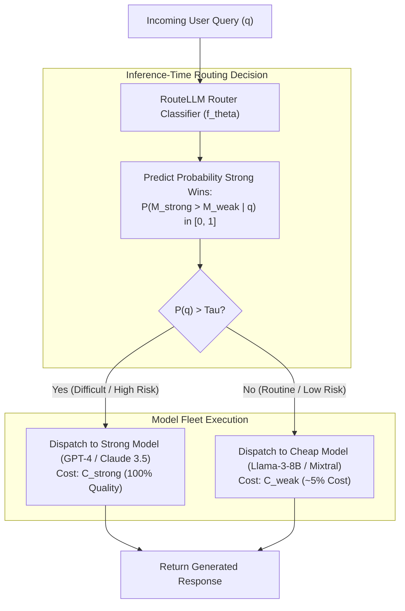
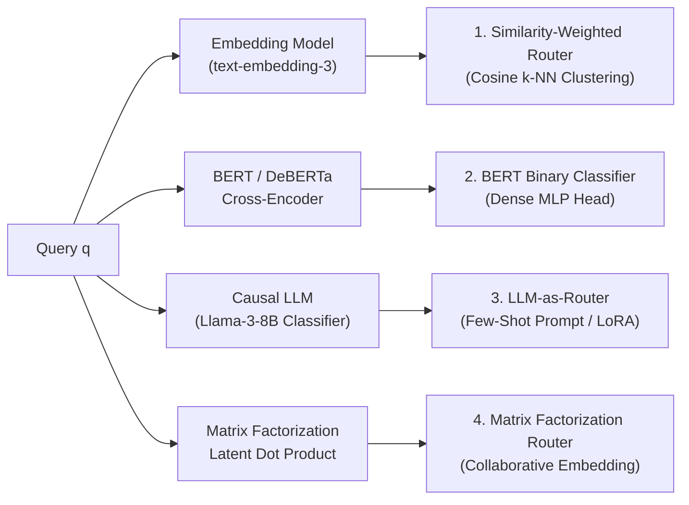
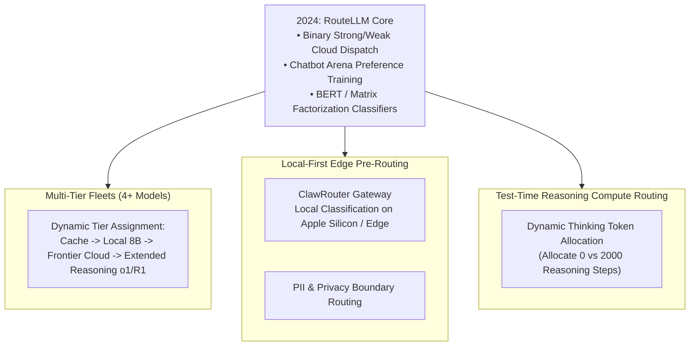

## Why Does Uniform Model Dispatch Create an Economic Deadweight Loss?

In standard enterprise AI deployments, infrastructure architectures dispatch every user prompt to a single static foundation model. If an organization selects a premier frontier model (such as GPT-4, Claude 3.5 Sonnet, or Gemini 1.5 Pro) to guarantee that complex legal, coding, and mathematical queries succeed, every request—including basic text reformatting, greetings, simple sentiment classifications, and straightforward entity extractions—incurs frontier-tier monetary cost and high time-to-first-token (TTFT) latency.

This uniform dispatch pattern creates massive **economic deadweight loss**:
1. **The Cost Asymmetry Gap**: Frontier API models typically cost $10\times$ to $50\times$ more per million tokens than open-weight 8B-parameter models (such as Llama 3-8B or Mistral-7B).
2. **Empirical Query Distribution**: Analysis of real-world conversational distributions (such as LMSYS Chatbot Arena) demonstrates that over $50\%$ of natural language queries are cognitively trivial and can be answered with equivalent human satisfaction by a compact model.
3. **The Static Threshold Fallacy**: Hardcoding heuristic rules (e.g., character length checks or regex matching) to determine whether a query is "complex" fails because prompt length correlates poorly with intrinsic semantic difficulty. A three-sentence mathematical riddle requires deep frontier reasoning, while a 2,000-word text paste requesting basic punctuation cleanup requires minimal cognitive capacity.

In **RouteLLM** ([Ong et al., LMSYS Org & UC Berkeley, 2024](https://arxiv.org/abs/2406.18665)), researchers formalized model routing as a supervised preference learning problem. By leveraging over 80,000 human pairwise preference judgments from Chatbot Arena, RouteLLM trains lightweight classifiers that predict whether a cheaper model's response will satisfy the user or whether escalating to an expensive frontier model is strictly necessary.

This cost-quality optimization connects directly to local-first model routing in [ClawRouter](/posts/clawrouter-local-routing/), enterprise multi-tier infrastructure in [Generative AI Systems Architecture](/posts/generative-ai-eco-system/), and test-time compute trade-offs in [Frontier LLM Research Trends](/posts/llm-research-trend/).

---

## The Routing Formulation: Pareto Optimization Between Cost and Quality

RouteLLM formulates model selection as a binary decision between a **strong (expensive) model** $M_{\text{strong}}$ and a **weak (cheap) model** $M_{\text{weak}}$:

### Mathematical Objective
Let $c_{\text{strong}}$ and $c_{\text{weak}}$ denote the unit costs (per token or per query) of invoking $M_{\text{strong}}$ and $M_{\text{weak}}$, with $c_{\text{weak}} \ll c_{\text{strong}}$. Let $y_{\text{strong}}(q)$ and $y_{\text{weak}}(q)$ be the generated outputs for query $q$, and let $r(q, y) \in \mathbb{R}$ represent human utility or benchmark performance.

A routing policy $\pi(q) \in \{0, 1\}$ selects $M_{\text{weak}}$ when $\pi(q) = 0$ and $M_{\text{strong}}$ when $\pi(q) = 1$. The expected cost and performance under distribution $\mathcal{D}$ are:

$$\mathbb{E}[\text{Cost}] = \mathbb{E}_{q \sim \mathcal{D}} \left[ \pi(q) c_{\text{strong}} + (1 - \pi(q)) c_{\text{weak}} \right]$$

$$\mathbb{E}[\text{Quality}] = \mathbb{E}_{q \sim \mathcal{D}} \left[ \pi(q) r(q, y_{\text{strong}}) + (1 - \pi(q)) r(q, y_{\text{weak}}) \right]$$

The router optimizes quality subject to an explicit budget constraint:

$$\max_{\pi} \mathbb{E}[\text{Quality}] \quad \text{s.t.} \quad \mathbb{E}[\text{Cost}] \le B$$

By the Neyman-Pearson lemma, the optimal decision rule thresholds the posterior probability that the strong model outperforms the weak model:

$$\pi_\tau(q) = \mathbb{I}\left( P\left( M_{\text{strong}} \succ M_{\text{weak}} \;\middle|\; q \right) > \tau \right)$$

where threshold $\tau \in [0, 1]$ acts as a continuous operational control knob balancing cost reduction against quality degradation.

---

## The Four Router Architectures

Ong et al. investigated four distinct machine learning architectures for estimating the win probability function $f_\theta(q) \approx P(M_{\text{strong}} \succ M_{\text{weak}} \mid q)$:

### 1. Similarity-Weighted Router (k-NN Clustering)
Projects query $q$ into dense vector space using a lightweight embedding model $\mathbf{e}(q) \in \mathbb{R}^d$. The router retrieves the top-$K$ most similar queries from a training corpus of annotated Chatbot Arena battles $\{\mathbf{e}(q_i), y_i\}_{i=1}^N$ (where $y_i = 1$ if the strong model won):

$$P(M_{\text{strong}} \succ M_{\text{weak}} \mid q) = \frac{\sum_{i \in \text{TopK}} \operatorname{sim}(\mathbf{e}(q), \mathbf{e}(q_i)) \cdot y_i}{\sum_{i \in \text{TopK}} \operatorname{sim}(\mathbf{e}(q), \mathbf{e}(q_i))}$$

This non-parametric approach requires zero weight training and supports instant dynamic updates by appending new battles to the vector database.

### 2. Matrix Factorization Router (Collaborative Filtering)
Borrowing from recommender systems, matrix factorization maps each query $q$ and each model $m \in \mathcal{M}$ into a shared latent space $\mathbb{R}^k$. The probability that model $A$ defeats model $B$ on query $q$ is modeled using the Bradley-Terry-Luce (BTL) preference formulation:

$$P(M_A \succ M_B \mid q) = \sigma\left( \mathbf{v}_q^T (\mathbf{u}_A - \mathbf{u}_B) + \beta_A - \beta_B \right)$$

where $\mathbf{v}_q$ is an inferred query vector, $\mathbf{u}_m$ is the model representation vector, and $\beta_m$ represents global model bias (analogous to the model's global Elo rating in Chatbot Arena).

### 3. BERT-Based Cross-Encoder Classifier
A pre-trained bidirectional transformer (such as modern DeBERTa-v3 or RoBERTa) receives query $q$ and outputs a classification logit through an MLP head:

$$f_\theta(q) = \sigma\left( \mathbf{w}^T \operatorname{Encoder}(q)_{[\text{CLS}]} + b \right)$$

Trained via binary cross-entropy on Arena win/loss labels, this model captures complex syntactic nuances and lexical markers that embeddings compress away.

### 4. Causal LLM Classifier
Prompts a fine-tuned small LLM (e.g., Llama-3-8B) with the prompt and a scoring rubric: "Evaluate the complexity of the following prompt and output a score from 0 to 1". While highly accurate, invoking an 8B model to route a query introduces substantial inference latency, eroding the economic benefit of routing.

---

## Evaluating Routing Efficiency: The Call Rate Metric

Standard classification metrics (accuracy, F1-score) do not reflect the economic trade-offs of model routing. Ong et al. introduced the **Call Rate at Performance ($CP_K$)** metric.

Let $S_{\text{strong}}$ and $S_{\text{weak}}$ denote the benchmark scores (e.g., MMLU or MT-Bench) achieved by routing $100\%$ of queries to the respective models. For any threshold $\tau$, the routed system achieves score $S(\tau)$ and dispatches a fraction $C(\tau) \in [0, 1]$ of total queries to $M_{\text{strong}}$.

The metric **$CP_K$** is defined as the minimum call rate to the strong model required to achieve $K\%$ of the performance gap between $M_{\text{weak}}$ and $M_{\text{strong}}$:

$$CP_K = \min_{\tau \in [0, 1]} C(\tau) \quad \text{s.t.} \quad S(\tau) \ge S_{\text{weak}} + \frac{K}{100} \left( S_{\text{strong}} - S_{\text{weak}} \right)$$

A smaller $CP_K$ indicates a superior router. For instance, $CP_{95} = 0.40$ means the system achieves $95\%$ of frontier model quality while invoking the frontier model on only $40\%$ of requests.

---

## Empirical Benchmarks Across Core Benchmarks

RouteLLM was benchmarked routing between **GPT-4** (strong model) and **Mixtral-8x7B** or **Llama-3-8B** (weak models) across MT-Bench, MMLU, GSM8K, and Chatbot Arena Hard:

| Router Architecture | MT-Bench $CP_{95} \downarrow$ | MMLU $CP_{95} \downarrow$ | GSM8K $CP_{95} \downarrow$ | Routing Latency (ms) | Router Cost Overhead |
| :--- | :--- | :--- | :--- | :--- | :--- |
| **Random Baseline** | 0.95 | 0.95 | 0.95 | 0 ms | 0.0% |
| **Prompt Length Heuristic** | 0.88 | 0.84 | 0.92 | < 1 ms | 0.0% |
| **Similarity (k-NN)** | 0.62 | 0.68 | 0.74 | 18 ms | 0.15% |
| **Matrix Factorization** | 0.54 | 0.59 | 0.68 | 8 ms | 0.08% |
| **BERT Classifier** | **0.44** | **0.51** | **0.58** | **14 ms** | **0.12%** |
| **Causal LLM (Llama-3-8B)**| 0.42 | 0.49 | 0.55 | 240 ms | 4.80% |

### Critical Takeaways from Benchmark Data
1. **The 2x Cost Reduction Horizon**: The BERT classifier router achieved $CP_{95} = 0.44$ on MT-Bench. By sending $56\%$ of traffic to Mixtral-8x7B and only $44\%$ to GPT-4, overall inference expenditures were cut by more than $50\%$ while preserving $95\%$ of GPT-4's conversational quality.
2. **Negligible Overhead**: The BERT router evaluates input tokens in $14\text{ ms}$ at an inference cost of under $0.0001$ per query—less than $0.12\%$ of a typical GPT-4 completion cost.
3. **Failure of Simple Heuristics**: Character length and token count baselines required $CP_{95} \approx 0.88$, verifying that prompt length cannot reliably discriminate between hard and easy reasoning tasks.

---

## How RouteLLM Evolved Across 2024–2026 Routing Architectures

In the two years following RouteLLM's introduction, model routing expanded from binary cloud dispatch into sophisticated multi-tier, multi-modal control planes:

### 1. Multi-Tiered Fleets and Cache Integration
Modern enterprise gateways (such as LiteLLM, vLLM, and [ClawRouter](/posts/clawrouter-local-routing/)) have generalized RouteLLM beyond binary selection. Gateways manage a 4-tier hierarchy:
1. **Tier 0 (Zero Cost)**: Semantic vector cache lookup (sub-10ms response).
2. **Tier 1 (Sub-Cent)**: On-premise or local 8B model (Llama 3.3, Qwen 2.5).
3. **Tier 2 (Cent-Scale)**: Frontier general model (GPT-4o, Claude 3.5 Sonnet).
4. **Tier 3 (Dollar-Scale)**: Extended reasoning model (OpenAI o1, DeepSeek-R1).

### 2. Test-Time Reasoning Allocation
In 2025–2026, reasoning models introduced a new dimension to routing: **test-time compute budgets**. Instead of only choosing *which* model to invoke, the router predicts *how many internal reasoning tokens* are necessary. For a straightforward question, the router limits reasoning tokens to zero; for a complex distributed systems bug or mathematical proof, it allocates thousands of test-time deliberation tokens.

### 3. Local-First Privacy Gateways
Enterprises subject to strict data sovereignty (GDPR, HIPAA) cannot route arbitrary user text to external cloud APIs. Modern routers run on local hardware: they inspect the query for PII and enterprise secrets, routing compliant queries locally whenever possible and securely redacting text before escalating unresolvable edge cases to cloud endpoints.

---

## Key Takeaways

- **Eliminating Uniform Dispatch Waste**: Uniformly routing all queries to top-tier frontier models creates massive economic waste; more than half of real-world queries can be resolved by compact models with zero perceptible quality degradation.
- **Preference-Driven Learning**: By training on empirical human preference pairs from Chatbot Arena, RouteLLM predicts model win probabilities without relying on brittle handcrafted regex rules.
- **Pareto Efficiency via Threshold Tuning**: The decision threshold $\tau$ functions as a continuous economic lever, allowing organizations to achieve $95\%$ frontier quality while cutting API expenditures by $50\%$ to $85\%$.
- **Sub-1% Router Overhead**: Small BERT-style classifiers make routing decisions in under 15ms, introducing negligible latency and costing less than $0.15\%$ of a frontier completion.
- **Foundation for 2026 Multi-Tier Gateways**: RouteLLM established the mathematical foundation for modern multi-model gateways managing local edge models, frontier APIs, and test-time reasoning budgets.

---

## New Questions

1. **Multi-Turn Contextual Routing Drift**: When a user begins a dialogue with a trivial greeting (routed to an 8B model) and subsequently transitions into a complex architecture debate, how should the router seamlessly migrate the conversation history to a frontier model without KV cache recomputation overhead?
2. **Adversarial Jailbreaks Against Router Classifiers**: Can malicious prompts be crafted to intentionally fool the router classifier into routing dangerous queries to an unaligned or weakly-moderated small model?
3. **Multi-Modal Routing Across Video, Audio, and Code**: How can RouteLLM's binary classifier architecture be extended to multi-modal inputs where cross-modal embedding dimensions vary across text, audio spectrograms, and video frame sequences?

---

## References

- Ong, D. S., Almahairi, A., Wu, V., Chiang, W. L., Wu, T., Gonzalez, J. E., Chen, M., & Stoica, I. (2024). *RouteLLM: Learning to Route LLMs with Preference Data*. LMSYS Organization, UC Berkeley, UCSD, & CMU. [arXiv:2406.18665](https://arxiv.org/abs/2406.18665). (accessed 2026-10-18).
- Zheng, L., Chiang, W. L., Sheng, Y., Zhuang, S., Wu, Z., Zhuang, Y., Lin, Z., Li, Z., Xing, E. P., Zhang, H., Gonzalez, J. E., & Stoica, I. (2023). *Judging LLM-as-a-Judge with MT-Bench and Chatbot Arena*. Advances in Neural Information Processing Systems (NeurIPS 2023). [arXiv:2306.05685](https://arxiv.org/abs/2306.05685). (accessed 2026-10-18).
- LMSYS Organization. *RouteLLM Open Source Repository*. GitHub. [https://github.com/lm-sys/RouteLLM](https://github.com/lm-sys/RouteLLM). (accessed 2026-10-18).
- Bradley, R. A., & Terry, M. E. (1952). *Rank Analysis of Incomplete Block Designs: I. The Method of Paired Comparisons*. Biometrika, 39(3/4), 324-345. [DOI:10.2307/2334029](https://doi.org/10.2307/2334029). (accessed 2026-10-18).
- Jiang, A. Q., Sablayrolles, A., Mensch, A., Bamford, C., Chaplot, D. S., et al. (2024). *Mixtral of Experts*. arXiv preprint. [arXiv:2401.04088](https://arxiv.org/abs/2401.04088). (accessed 2026-10-18).
