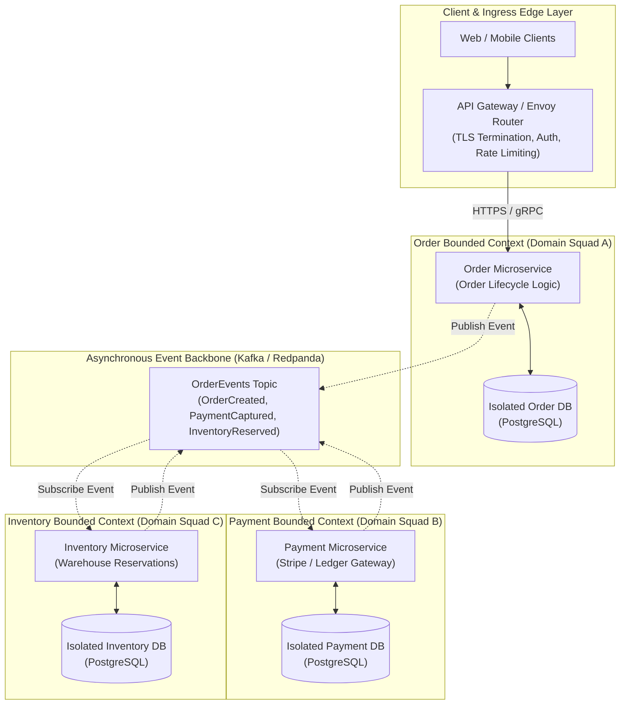
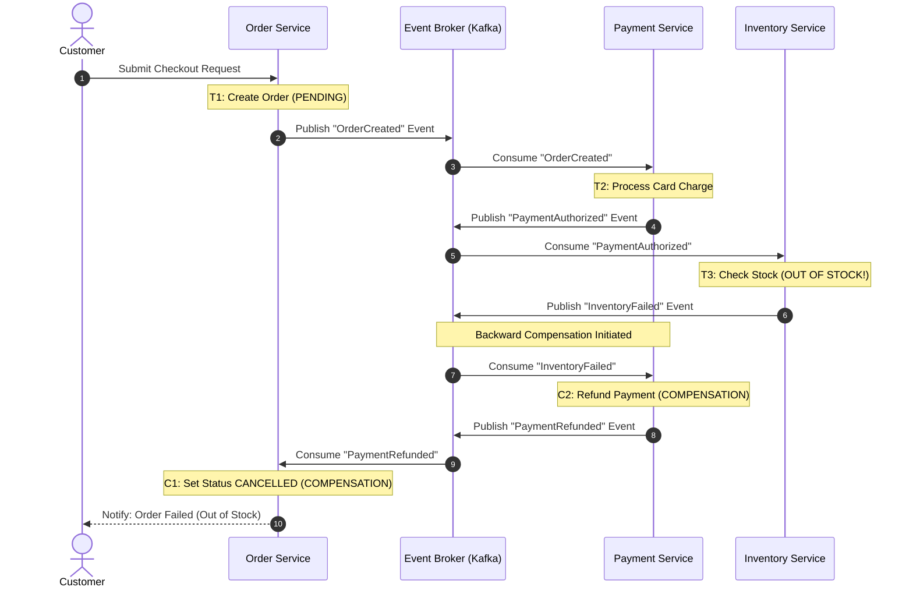
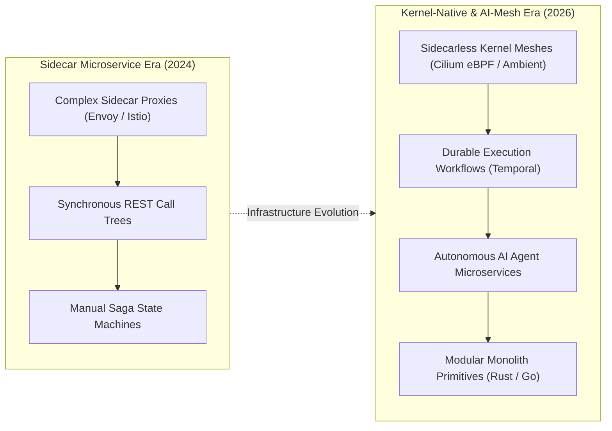

## Why Do Premature Microservice Splits Incur Crippling Distributed System Overhead?

Over the past decade, the microservices architectural style has achieved near-universal recognition as the default paradigm for enterprise software engineering. In theory, decomposing a monolithic application into small, autonomous services yields substantial benefits: independent deployments, fine-grained horizontal scaling, fault isolation, and autonomous engineering squads organized around specific business domains.

In practice, however, premature or unprincipled microservice decomposition frequently plunges engineering organizations into an operational crisis far worse than the monolith they sought to replace: the **Distributed Monolith**.

A distributed monolith arises when software boundaries are carved along arbitrary technical layers (e.g., splitting a frontend service, a business service, and a data service) rather than cohesive business domain boundaries:

1. **Tight Coupling and Lock-Step Deployments**: If deploying a change to Service A requires simultaneous, coordinated releases of Service B and Service C to avoid breaking API payloads, the services are not autonomous. The organization inherits all the networking latencies and failure modes of distributed systems while retaining the deployment friction of a monolith.
2. **Cascading Failure Cascades**: In naive microservice architectures dominated by synchronous HTTP/REST call chains ($A \to B \to C \to D$), a transient latency spike or network blip in leaf node $D$ saturates thread pools up the call stack, triggering total system outages.
3. **Dual-Write Inconsistency and Distributed State Corruption**: When business operations span multiple service databases, traditional single-node ACID guarantees are lost. If an operation succeeds in Service A's PostgreSQL instance but network timeout panics Service B's MongoDB cluster, data state diverges silently.

According to **Conway's Law**, systems design inevitably mirrors the communication structures of the organization. Microservices are not a tool to fix broken engineering communication; they are an organizational scaling mechanism appropriate when an enterprise scales beyond dozens of independent engineering teams requiring distinct release cycles.

As detailed in our infrastructure blueprints on [resilient 3-tier cloud architectures on AWS](/posts/visualization-of-architecture-on-aws/) and [enterprise data platforms from lakes to meshes](/posts/key-data-term-quick-guid/), mastering distributed boundaries requires rigorous domain modeling and asynchronous communication patterns.



---

## Domain-Driven Design and the Bounded Context Contract

The indispensable theoretical foundation for architecting resilient microservices is **Domain-Driven Design (DDD)**, formulated by Eric Evans. The primary failure mode of distributed systems is treating microservices as simple CRUD database endpoints rather than encapsulated domain models.

### The Non-Negotiable Database-per-Service Rule
A microservice must possess exclusive, private ownership over its persistent data store. Under no circumstances should two distinct microservices read or write to the same relational database schema:
- **Encapsulation Protection**: When services share a database, schema migrations executed by one team instantly break downstream services, completely violating deployment autonomy.
- **Hidden Lock Contention**: Shared databases create cross-service table and row locking conflicts that are virtually impossible to diagnose across independent application logs.
- **Forced Communication through Contracts**: By isolating databases, services are forced to interact strictly through explicit, versioned API contracts (gRPC Protocol Buffers or OpenAPI) or asynchronous domain events.

### Bounded Contexts and Ubiquitous Language
A **Bounded Context** defines the conceptual boundary within which a specific domain model applies consistently. Inside that boundary, every term in the **Ubiquitous Language** has an unambiguous, singular meaning.

Consider the concept of a `User` in an e-commerce platform:
- In the **Authentication & Identity Context**, a `User` consists of an email, password hash, multi-factor authentication (MFA) tokens, and cryptographic role permissions.
- In the **Billing & Invoicing Context**, a `Customer` consists of tax identifiers, credit card tokens, billing addresses, and payment histories.
- In the **Fulfillment & Shipping Context**, a `Recipient` consists of physical street coordinates, delivery instructions, and courier tracking identifiers.

Attempting to collapse these three concepts into a single monolithic `users` database table creates massive schema bloat, tight coupling, and constant merge conflicts. In a microservices architecture, each Bounded Context maintains its own minimal, specialized entity model, linked loosely by a shared immutable identifier (`customer_id: UUID`).

---

## Managing Distributed Transactions: Two-Phase Commit vs. The Saga Pattern

When an enterprise workflow spans multiple independent microservices—such as an e-commerce checkout involving order creation, credit card charging, and warehouse inventory reservation—the system cannot execute a single atomic SQL transaction.

### The Failure of Two-Phase Commit (2PC) in Cloud Environments
Historically, distributed database systems attempted to achieve strict ACID semantics across network partitions using **Two-Phase Commit (2PC)**:
1. *Prepare Phase*: A central transaction coordinator asks all participant databases if they are ready to commit. Participants acquire local database locks and reply with agreement.
2. *Commit Phase*: If all participants agree, the coordinator commands all databases to commit changes simultaneously.

In modern cloud environments, 2PC is fundamentally unviable:
- **Lock Amplification and Latency**: Database rows remain locked throughout the entire two-phase network exchange. If one participant experiences network latency, locks are held open across all services, rapidly exhausting database connection pools.
- **Coordinator Single Point of Failure**: If the transaction coordinator crashes during the prepare phase, participant databases remain locked indefinitely in doubt, requiring manual administrator intervention.
- **CAP Theorem Constraints**: Under network partitions, 2PC sacrifices availability entirely to maintain consistency, causing system-wide outages.

### The Saga Pattern: Eventual Consistency and Compensating Actions
To maintain high availability across distributed boundaries, microservices adopt the **Saga Pattern** (Garcia-Molina & Salem, 1987). A Saga is a sequence of local transactions where each local transaction updates a private database and emits an event or message that triggers the subsequent local transaction in another service.

Because Sagas do not acquire distributed locks, intermediate states are visible across services. To guarantee eventual consistency, Sagas rely on **Compensating Transactions**:

```
+----------------------------------------------------------------------------------------------------+
|                                    E-Commerce Checkout Saga Lifecycle                              |
+----------------------------------------------------------------------------------------------------+
| Step | Forward Transaction (T_i)           | Compensating Transaction (C_i)                        |
+------+-------------------------------------+-------------------------------------------------------+
| 1    | Order Service: Create Pending Order | Order Service: Set Order Status to CANCELLED          |
| 2    | Payment Service: Charge Credit Card | Payment Service: Refund Customer Charge to Card       |
| 3    | Inventory Service: Reserve Stock    | Inventory Service: Release Reserved Stock to Inventory|
+------+-------------------------------------+-------------------------------------------------------+
```

If Step 3 (Inventory Reservation) fails due to an out-of-stock condition, the Saga initiates backward recovery: it executes the compensating transactions in reverse order ($C_2 \to C_1$), refunding the customer's credit card and cancelling the pending order.



---

## How Microservices and Service Meshes Evolved Across 2026

By 2026, the operational reality of microservices shifted decisively away from the hype-driven fragmentation of the early 2020s toward high-efficiency, compiler-enforced architectures:



1. **The Modular Monolith Renaissance**: Industry consensus has decisively embraced modular monoliths as the default starting architecture. Organizations construct strongly encapsulated, single-binary applications using modern language module boundaries (such as Rust crates or Go packages). Services are extracted into independent microservices strictly when divergent hardware requirements (e.g., dedicated GPU inference nodes) or extreme scaling boundaries demand it.
2. **Sidecarless Service Meshes via eBPF and Ambient Mesh**: Early service mesh implementations (such as Istio with Envoy sidecars) injected a separate proxy container alongside every application pod, imposing substantial memory overheads and adding 2 to 4 network hops per RPC call. In 2026, kernel-native service meshes powered by **Cilium eBPF** and **Istio Ambient Mesh** handle mTLS encryption, L7 traffic routing, and telemetry directly inside the Linux kernel, eliminating sidecar containers and reducing network overhead by over 70%.
3. **Durable Execution Engines Replacing Bespoke Sagas**: Handcrafted Saga state machines have largely been replaced by **Durable Execution** frameworks (such as Temporal and Cadence). Engineers author complex, multi-day distributed business workflows in standard procedural code; if an underlying worker node crashes midway through an inventory checkout, the durable execution runtime transparently recovers state and replays transactions deterministically without data loss.
4. **AI Agent Microservice Topologies**: Microservices in 2026 frequently host autonomous AI agents rather than human-facing web endpoints. These agents expose strongly typed tool interfaces using the **Model Context Protocol (MCP)** and gRPC, communicating over high-speed event meshes to perform collaborative software verification, compliance checking, and automated system remediation.

---

## Key Takeaways

- **Conway's Law and the Monolith First Principle**: Microservices solve organizational team scaling challenges, not simple code modularity; start with a well-architected modular monolith before extracting distributed services.
- **Strict Database-per-Service Isolation**: The defining boundary of a microservice is private data ownership; sharing a persistent database across services creates fragile, tightly coupled distributed monoliths.
- **Bounded Contexts Dictate Boundaries**: Use Domain-Driven Design to identify natural business boundaries where ubiquitous terms have singular, clear meanings.
- **The Saga Pattern for Eventual Consistency**: Replace brittle Two-Phase Commit locks with distributed Sagas, coordinating local database updates and compensating actions via asynchronous event brokers.

---

## New Questions

- How do durable execution engines maintain deterministic state replay when distributed workflows invoke non-deterministic third-party LLM inference endpoints?
- What are the performance and consistency trade-offs of using eBPF-based ambient service meshes across multi-region hybrid Kubernetes clusters?
- How should event-sourced architectures handle data schema migrations and cryptographic key rotations when audit logs must remain immutably preserved for decades?

---

## References

- Evans, Eric. *Domain-Driven Design: Tackling Complexity in the Heart of Software*. Addison-Wesley Professional, 2003. [https://www.domainlanguage.com/ddd/](https://www.domainlanguage.com/ddd/) (accessed 2026-10-18).
- Newman, Sam. *Building Microservices: Designing Fine-Grained Systems*. 2nd ed. O'Reilly Media, 2021. [https://samnewman.io/books/building_microservices_2nd_edition/](https://samnewman.io/books/building_microservices_2nd_edition/) (accessed 2026-10-18).
- Garcia-Molina, Hector, and Kenneth Salem. *Sagas*. ACM SIGMOD Record 16, no. 3 (1987): 249–259. [https://doi.org/10.1145/38714.38742](https://doi.org/10.1145/38714.38742) (accessed 2026-10-18).
- Richardson, Chris. *Microservices Patterns: With Examples in Java*. Manning Publications, 2018. [https://microservices.io/patterns/data/saga.html](https://microservices.io/patterns/data/saga.html) (accessed 2026-10-18).
