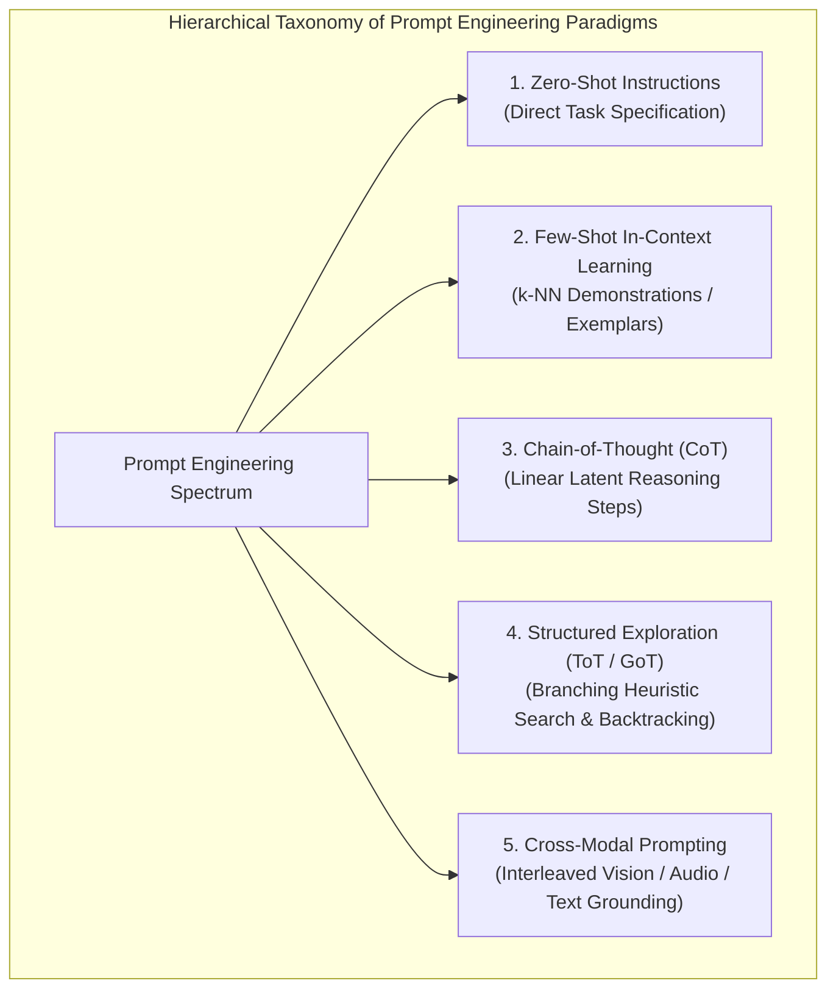
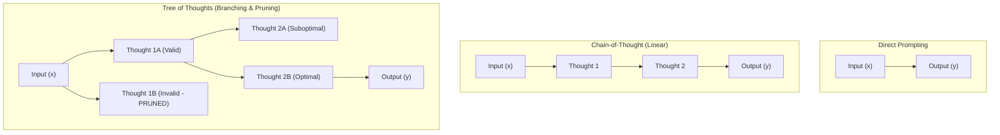
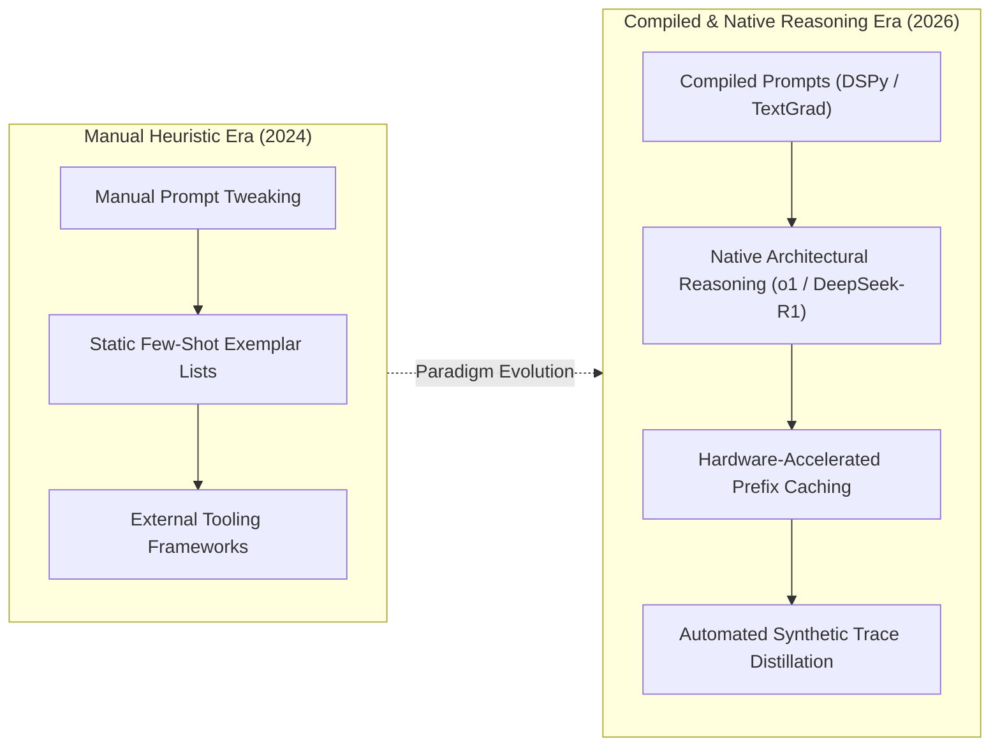

## Why Did Prompt Engineering Transition from Heuristic "Hacks" to Formal Algorithmic Science?

In the immediate aftermath of ChatGPT's release, the discipline of "prompt engineering" was widely perceived as an unscientific assortment of empirical tricks, conversational persuasion heuristics, and superficial "magic keywords" circulated across social media. Early guides frequently claimed that phrases like *"Take a deep breath and work on this step-by-step"* or *"I will tip you $200 for a perfect answer"* fundamentally changed model performance.

As the underlying mechanics of autoregressive Transformer architectures became better understood by the academic and systems engineering communities, prompt engineering matured from folklore into a rigorous branch of discrete optimization and test-time computation.

Mathematically, an autoregressive language model parameterizes a conditional probability distribution $P_\theta(y \mid x)$ over output sequences $y$ given input sequence $x$. Introducing a prompt prefix $p$ modifies the conditioning context:

$$y^* = \arg\max_y P_\theta(y \mid x, p)$$

The goal of prompt engineering is to find an optimal prompt $p^* \in \mathcal{V}^*$ (over the discrete vocabulary space $\mathcal{V}$) that maximizes task performance across an evaluation dataset $\mathcal{D}$:

$$p^* = \arg\max_p \sum_{(x, y) \in \mathcal{D}} \mathcal{L}\Big(y, \text{LLM}(x, p)\Big)$$

Crucially, modern reasoning techniques—such as Chain-of-Thought (CoT) and Tree-of-Thoughts (ToT)—do not merely alter surface linguistic style. They dynamically expand the model's **effective compute budget at inference time**. In a standard Transformer forward pass, predicting the immediate next token $y_1$ is constrained to a fixed number of layer matrix multiplications ($O(L \cdot d_{\text{model}}^2)$). By prompting the model to generate an intermediate scratchpad sequence of reasoning tokens ($z_1, z_2, \dots, z_k$), the model allocates $k$ additional forward passes of internal computation before committing to the final answer $y$, enabling the resolution of complex multi-step logical, mathematical, and algorithmic problems.

As analyzed in our decision frameworks on [LLM adaptation via prompting, RAG, and fine-tuning](/posts/improving-the-performance-llm/) and [empirical evaluation methodologies for generative models](/posts/evaluating-llm/), Sahoo et al. (*A Survey on Prompt Engineering Methods in Large Language Models*, 2024) established the definitive taxonomy unifying these diverse techniques.



---

## Structural Taxonomy: Deconstructing the 39 Core Prompting Paradigms

Sahoo et al. systematically reviewed 44 seminal research papers, synthesizing 39 distinct text-based and multimodal prompting methods across 29 standardized NLP benchmarks. Their taxonomy partitions prompt engineering into five primary operational archetypes:

```
+----------------------------------------------------------------------------------------------------+
|                                  Taxonomy of Core Prompting Methodologies                          |
+----------------------------------------------------------------------------------------------------+
| Paradigm             | Foundational Technique              | Computational Mechanism               |
+----------------------+-------------------------------------+---------------------------------------+
| 1. Direct Directive  | Zero-Shot Instruction & Role-Play   | Conditions output distribution on     |
|                      | (System Prompt Framing)             | persona priors and formatting masks   |
| 2. Exemplar-Driven   | In-Context Learning (ICL) &         | Injects analogical demonstration pairs|
|                      | Dynamic k-NN Exemplar Selection     | into the key-value attention stream   |
| 3. Step-by-Step      | Manual CoT, Zero-Shot CoT, and      | Forces generation of intermediate     |
|    Reasoning         | Least-to-Most Decomposition         | reasoning tokens (scratchpad states)  |
| 4. Ensemble & Search | Self-Consistency, Tree of Thoughts  | Explores multi-path reasoning graphs  |
|                      | (ToT), and Graph of Thoughts (GoT)  | with heuristic evaluation & voting    |
| 5. Program-Aided     | Program-Aided Language Models (PAL) | Offloads intermediate arithmetic and  |
|                      | and Program-of-Thought (PoT)        | logic to an external Python sandbox   |
+----------------------------------------------------------------------------------------------------+
```

### 1. Zero-Shot Directives and Role Prompting
Zero-shot prompting provides task instructions without demonstration examples. Techniques in this category focus on eliminating semantic ambiguity:
- **Role Assignment**: Priming the model with domain expertise (e.g., *"You are a principal distributed systems architect..."*) shifts internal activation trajectories toward specialized technical vocabularies and higher-density syntax.
- **Negative Constraints and Output Schemata**: Enforcing strict delimiter boundaries (e.g., Markdown backticks, XML tags, or JSON schemas) restricts token entropy and simplifies downstream parsing.

### 2. Exemplar-Driven In-Context Learning (ICL)
First demonstrated at scale in GPT-3 (Brown et al., 2020), ICL provides input-output demonstration pairs within the prompt context:
- Rather than adjusting neural network weights, exemplars function as non-parametric training data evaluated across the model's self-attention layers.
- **Dynamic Selection**: Selecting demonstrations dynamically based on semantic cosine similarity (k-NN retrieval over training sets) consistently outperforms static demonstration lists, especially for cross-lingual and domain-specific classification.

### 3. Step-by-Step Chain-of-Thought (CoT)
Introduced by Wei et al. (2022), CoT transforms reasoning tasks by guiding the model to articulate intermediate rationales before emitting final conclusions:
- **Zero-Shot CoT** (Kojima et al., 2022): Appending the simple trigger phrase *"Let's think step by step"* elicits latent zero-shot reasoning chains, unlocking substantial accuracy improvements across symbolic reasoning benchmarks without manual exemplar curation.
- **Least-to-Most Prompting** (Zhou et al., 2022): Systematically decomposes a complex problem into a sequence of simpler sub-problems, solving each sub-problem sequentially and feeding intermediate solutions forward.

---

## Mathematical Formulations: Chain-of-Thought, Self-Consistency, and Tree-of-Thoughts

The transition from naive linear prompting to branching tree search can be formulated mathematically through the lens of probabilistic graphical models and search algorithms:

### 1. Standard Greedy Decoding versus Chain-of-Thought
In standard direct prompting, the model attempts to map input $x$ directly to output $y$:

$$\hat{y} = \arg\max_y P(y \mid x)$$

In Chain-of-Thought prompting, the generation process introduces a sequence of latent reasoning tokens $z = (z_1, z_2, \dots, z_m)$, formalizing generation as marginalizing over all valid reasoning paths:

$$P(y \mid x) = \sum_{z \in \mathcal{Z}} P(y, z \mid x) = \sum_{z \in \mathcal{Z}} P(y \mid x, z) P(z \mid x)$$

Because calculating the exact sum over the infinite space of natural language strings $\mathcal{Z}$ is intractable, standard CoT greedily samples a single path $\hat{z} \sim P(z \mid x)$, and then predicts $\hat{y} \sim P(y \mid x, \hat{z})$.

### 2. Self-Consistency: Monte Carlo Path Sampling with Majority Voting
A single greedy CoT path often suffers from local reasoning errors (e.g., an arithmetic miscalculation on step 3 propagates catastrophically to the final answer). **Self-Consistency** (Wang et al., 2022) addresses this by replacing greedy decoding with temperature-scaled stochastic sampling.

The system samples $M$ independent reasoning paths:

$$(z^{(i)}, y^{(i)}) \sim P(z, y \mid x), \quad i \in \{1, 2, \dots, M\}$$

The final consensus prediction $y^*$ is selected by taking the majority vote (mode) across the marginal outputs, effectively averaging out uncorrelated reasoning mistakes:

$$y^* = \arg\max_y \sum_{i=1}^M \mathbb{I}\left(y^{(i)} = y\right)$$

Empirically, sampling $M = 20 \dots 40$ paths delivers dramatic accuracy gains across mathematical (GSM8K) and multi-hop reasoning tasks, albeit at an $M$-fold increase in token computation cost.

### 3. Tree of Thoughts (ToT): Framing Deliberation as Tree Search
While Self-Consistency samples independent linear paths without self-correction, **Tree of Thoughts** (Yao et al., 2023) frames problem-solving as systematic search over a tree of discrete thought states.

A state $s = [x, z_{1 \dots i}]$ represents a partial sequence of intermediate thoughts. ToT defines four operational operators:
1. **Thought Generation**: $G(p_\theta, s, k)$ generates $k$ candidate next-step thoughts for the current state $s$.
2. **State Evaluation**: $V(p_\theta, S)$ evaluates the utility of candidate states, classifying states as *sure*, *likely*, or *impossible*.
3. **Search Algorithm**: A classical search algorithm—typically Breadth-First Search (BFS) or Depth-First Search (DFS) with backtracking—traverses the state space.
4. **Heuristic Pruning**: Branches scored as *impossible* are pruned immediately, preventing the model from exploring dead-end reasoning trajectories.



---

## How Prompt Engineering Evolved Across 2026

Between 2024 and 2026, the operational role of prompt engineering underwent a profound structural transformation:



1. **Automated Prompt Compilation via DSPy and TextGrad**: Human engineers rarely write handcrafted system prompts for production pipelines in 2026. Instead, frameworks like DSPy and TextGrad treat prompt optimization as an automated compilation process. Developers specify high-level type signatures and metrics; the compiler uses gradient-free search algorithms (such as MIPROv2) to synthesize, evaluate, and optimize instructions and few-shot exemplars automatically against golden validation sets.
2. **Intrinsic Test-Time Reasoning (o1, o3, DeepSeek-R1)**: Early prompt engineering forced models to reason by prepending external strings like *"Let's think step by step"*. In 2026, frontier foundation models have natively internalized test-time compute. When presented with complex problems, the model automatically triggers internal hidden reasoning traces, self-evaluating hypotheses, identifying intermediate contradictions, and backtracking before emitting visible tokens.
3. **Hardware-Accelerated Prefix Caching**: The historical penalty of detailed prompt engineering—inflated Time-to-First-Token latency and high token billing—has been eliminated by hardware-level prefix caching. Serving runtimes cache the KV-activations of long system instructions and exemplar libraries, enabling subsequent requests to execute with near-zero latency overhead.
4. **Synthetic Reasoning Distillation**: Advanced reasoning traces generated by multi-path search (ToT / GoT) are curated, filtered, and distilled into compact 3B to 8B parameter models, allowing small localized language models to execute sophisticated multi-step reasoning without requiring complex runtime search infrastructure.

---

## Key Takeaways

- **From Hacks to Formal Optimization**: Prompt engineering is the mathematical optimization of conditioning contexts over discrete token spaces to maximize task performance.
- **Test-Time Compute Expansion**: Techniques like Chain-of-Thought and Tree-of-Thoughts function by providing intermediate token scratchpads, scaling effective inference compute per query.
- **The Power of Multi-Path Search**: Self-Consistency averages out stochastic reasoning errors via majority voting, while Tree of Thoughts incorporates explicit heuristic pruning and backtracking.
- **Automated Algorithmic Compilation**: In 2026, manual trial-and-error prompt drafting has been superseded by declarative prompt compilers (DSPy) and models with intrinsic, reinforcement-learned reasoning loops.

---

## New Questions

- How do dynamic prompt compilers navigate multi-objective trade-offs between prompt token length, latency budgets, and reasoning depth?
- What are the safety implications of foundation models generating opaque internal reasoning traces that cannot be directly inspected or steered via system prompts?
- Under what problem complexity regimes does external Tree-of-Thoughts heuristic search outperform intrinsic end-to-end reasoning models?

---

## References

- Sahoo, Pranab, Ayush Kumar Singh, Sriparna Saha, Vinija Jain, Samrat Mondal, and Aman Chadha. *A Systematic Survey of Prompt Engineering in Large Language Models: Techniques and Applications*. arXiv preprint arXiv:2407.12994, 2024. [https://arxiv.org/abs/2407.12994](https://arxiv.org/abs/2407.12994) (accessed 2026-10-18).
- Wei, Jason, Xuezhi Wang, Dale Schuurmans, Maarten Bosma, Fei Xia, Ed Chi, Quoc V. Le, and Denny Zhou. *Chain-of-Thought Prompting Elicits Reasoning in Large Language Models*. Advances in Neural Information Processing Systems (NeurIPS), 2022. [https://arxiv.org/abs/2201.11903](https://arxiv.org/abs/2201.11903) (accessed 2026-10-18).
- Wang, Xuezhi, Jason Wei, Dale Schuurmans, Quoc Le, Ed Chi, Sharan Narang, Aakanksha Chowdhery, and Denny Zhou. *Self-Consistency Improves Chain of Thought Reasoning in Language Models*. International Conference on Learning Representations (ICLR), 2023. [https://arxiv.org/abs/2203.11171](https://arxiv.org/abs/2203.11171) (accessed 2026-10-18).
- Yao, Shunyu, Dian Yu, Jeffrey Zhao, Izhak Shafran, Thomas L. Griffiths, Yuan Cao, and Karthik Narasimhan. *Tree of Thoughts: Deliberate Problem Solving with Large Language Models*. Advances in Neural Information Processing Systems (NeurIPS), 2023. [https://arxiv.org/abs/2305.10601](https://arxiv.org/abs/2305.10601) (accessed 2026-10-18).
