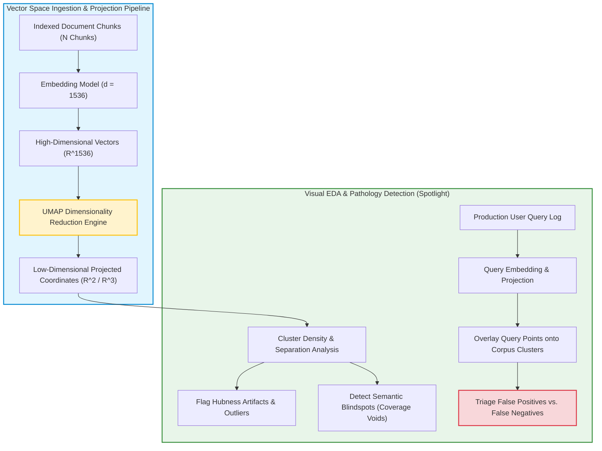

In traditional tabular machine learning, no competent data scientist would train a model without first conducting thorough Exploratory Data Analysis (EDA)—inspecting feature distributions, correlation matrices, class imbalance ratios, and missing value patterns. Yet, in Retrieval-Augmented Generation (RAG) engineering, teams frequently operate in total visual blindness. Developers chunk documents, feed them into an embedding API, dump millions of vectors into a database, and treat cosine similarity as an unassailable mathematical truth.

When downstream users complain that the system hallucinates or fails to recall obvious facts, engineers have historically relied on trial-and-error: tweaking prompt templates, swapping embedding models, or blindly altering chunk sizes.

Treating high-dimensional vector spaces as opaque black boxes hides critical structural pathologies. In high-dimensional manifolds (such as 1536-dimensional OpenAI embeddings or 1024-dimensional open weights), geometrical phenomena—such as the **Hubness problem** (Radovanović et al., 2010), catastrophic cluster fragmentation, and semantic retrieval voids—routinely sabotage retrieval precision.

This source audit analyzes why exploratory data analysis is essential for production vector retrieval, evaluates non-linear dimensionality reduction via UMAP (Uniform Manifold Approximation and Projection), and details interactive diagnostic workflows for debugging RAG pipelines using tools like Renumics Spotlight.


## Why Is Exploratory Data Analysis Mandatory for Production Vector Retrieval?

When an embedding model encodes textual chunks, it maps discrete linguistic tokens onto a continuous Riemannian manifold. While vector distance metrics (cosine similarity, inner product, Euclidean distance) provide mathematically defined rankings, they frequently fail to reflect human semantic intent.

Without visual EDA, three systemic pathologies remain completely invisible:

1. **The Hubness Phenomenon in High Dimensions**: In spaces with hundreds or thousands of dimensions, distance distributions concentrate. Certain vectors (termed "hubs") become nearest neighbors to an abnormally large number of disparate queries, regardless of true topical relevance. A hub chunk about generic company disclaimers might inadvertently pollute the top-$k$ context of hundreds of unrelated technical searches.
2. **Semantic Cluster Fragmentation**: Chunks derived from the same domain or document can shatter into disconnected clusters due to formatting artifacts (e.g., Markdown headers vs. raw plain text, or varying paragraph lengths). When an embedding model places syntactically different but semantically identical documents on opposite sides of the vector space, recall collapses.
3. **Out-of-Distribution (OOD) Query Voids**: Production user queries often fall into semantic deserts where no relevant documentation exists. Without visual inspection, an ungrounded system blindly forces the nearest chunks into the prompt context, directly inducing hallucinations.

Visualizing vector spaces resolves this by projecting high-dimensional embeddings into an interactive 2D or 3D manifold:



## Mathematical Mechanics: UMAP Projections and Vector Diagnostics

To project high-dimensional embeddings into a visual space without losing cluster structure, modern EDA relies on **UMAP (Uniform Manifold Approximation and Projection)** (McInnes et al., 2018).

Unlike linear methods like PCA (Principal Component Analysis)—which only capture global linear variance—or t-SNE (which preserves local neighborhoods but tears global manifold relationships), UMAP constructs a fuzzy simplicial set in high-dimensional space and optimizes a low-dimensional layout using cross-entropy minimization:

$$C = \sum_{e \in E} \left[ w_h(e) \log \frac{w_h(e)}{w_l(e)} + (1 - w_h(e)) \log \frac{1 - w_h(e)}{1 - w_l(e)} \right]$$

Where $w_h(e)$ represents the fuzzy edge probability between points in high-dimensional space and $w_l(e)$ represents the edge probability in the low-dimensional projection. This mathematical formulation preserves both tight local neighborhoods and macro-cluster boundaries.

```python
"""
Diagnostic Script for RAG Embedding Exploratory Data Analysis.
Extracts vectors from ChromaDB, computes UMAP projections, and flags cluster outliers.
"""

import numpy as np
import pandas as pd
import umap
from sklearn.metrics import silhouette_score
from typing import Dict, Any

class RAGEmbeddingDiagnostics:
    def __init__(self, n_neighbors: int = 15, min_dist: float = 0.1):
        self.reducer = umap.UMAP(
            n_neighbors=n_neighbors,
            min_dist=min_dist,
            metric="cosine",
            random_state=42
        )

    def analyze_vector_space(
        self, embeddings: np.ndarray, metadata: pd.DataFrame
    ) -> Dict[str, Any]:
        """Projects embeddings to 2D coordinates and evaluates clustering quality."""
        assert len(embeddings) == len(metadata), "Embeddings and metadata rows must match"

        # 1. Non-linear dimensionality reduction to 2D manifold
        projected_2d = self.reducer.fit_transform(embeddings)
        
        # 2. Augment metadata dataframe with spatial coordinates
        diagnostics_df = metadata.copy()
        diagnostics_df["umap_x"] = projected_2d[:, 0]
        diagnostics_df["umap_y"] = projected_2d[:, 1]

        # 3. Compute vector distance variance to detect hubness anomalies
        norm_vectors = embeddings / np.linalg.norm(embeddings, axis=1, keepdims=True)
        sample_similarity = np.dot(norm_vectors[:100], norm_vectors.T)
        avg_similarities = np.mean(sample_similarity, axis=0)

        # Flag chunks with abnormally high average similarity (potential hubs)
        hub_threshold = np.percentile(avg_similarities, 98)
        diagnostics_df["is_potential_hub"] = avg_similarities > hub_threshold

        return {
            "projected_data": diagnostics_df,
            "hub_count": int(np.sum(diagnostics_df["is_potential_hub"])),
            "mean_cosine_similarity": float(np.mean(avg_similarities))
        }

if __name__ == "__main__":
    print("RAG vector space diagnostic harness loaded successfully.")
```

For practical guidance on building hybrid retrieval systems that combine dense embeddings with keyword indexes, see our audit on [production RAG LangChain pipelines](/posts/try-implementing-rag-using-langchain/). To explore how knowledge graphs resolve cluster fragmentation by explicitly linking entities across documents, refer to our analysis of [GraphRAG hierarchical knowledge graphs](/posts/graphrag-opensource/). For understanding how attention layers consume these retrieved vectors, review our guide on [Transformer self-attention mechanics](/posts/nlp-course-trying/).

## How Vector Observability and RAG Diagnostics Evolved Across 2026

Between 2024 and 2026, vector visualization transitioned from offline static Jupyter analysis into live, real-time observability telemetry:

1. **Continuous Embedding Space Drift Monitoring**: In 2026 production systems, vector stores continuously monitor geometric centroids. As new product documentation or user tickets are ingested, automated drift detectors alert teams if newly arrived vectors pull existing cluster centroids apart or create disconnected islands.
2. **Real-Time Query Centroid Overlay (Negative Space Auditing)**: Rather than waiting for user feedback, production observability platforms project live user queries directly into the pre-computed document manifold. If queries repeatedly land in low-density "negative space" (semantic deserts where no document vectors reside), the system automatically drafts a content-gap ticket for technical writers.
3. **Automated Synthetic Probe Generation**: Frontier RAG harnesses evaluate embedding coverage proactively. An autonomous agent inspects UMAP clusters, identifies sparse boundary zones, and synthesizes 1,000 targeted adversarial probe queries to measure whether the vector database can reliably retrieve the correct documents without bleeding into neighboring clusters.
4. **Integration of Multimodal Visual Projections**: Visual EDA expanded beyond text chunks to multimodal embedding spaces (CLIP, SigLIP). Modern diagnostic interfaces allow engineers to inspect image vectors, text vectors, and audio spectrogram embeddings on a single shared manifold, identifying cross-modal alignment failures instantly.

## Key Takeaways

- **Vector Databases Require Visual EDA**: Treating embedding spaces as black boxes leads to blind spots; visual inspection reveals cluster fragmentation, hubness artifacts, and semantic voids.
- **UMAP Preserves Manifold Topologies**: Non-linear dimensionality reduction with UMAP preserves both local nearest-neighbor relationships and global cluster structures, making it the gold standard for embedding visualization.
- **The Hubness Problem Causes False Positives**: Certain generic chunks act as universal nearest neighbors in high-dimensional space; identifying and filtering hubs dramatically improves retrieval precision.
- **Query Overlays Expose Knowledge Gaps**: Mapping production user queries against document clusters instantly highlights whether user questions match indexed enterprise knowledge.

## New Questions

- **Can Dimensionality Reduction Distort Critical High-Dimensional Topology?** Because UMAP projects 1536 dimensions down to 2, what subtle multi-dimensional geometric relationships are inevitably destroyed during the projection process?
- **How Will Real-Time Vector Projections Scale to Billions of Chunks?** Computing UMAP embeddings for billions of vectors requires substantial memory; what approximation algorithms can maintain real-time streaming projections at internet scale?
- **Will Dynamic Metric Learning Replace Static Embedding Visualization?** Rather than merely diagnosing static vector spaces, will future systems autonomously fine-tune projection matrices in real time based on user feedback loops?

## References

- McInnes, L., Healy, J., & Melville, J. (2018). *UMAP: Uniform Manifold Approximation and Projection for Dimension Reduction*. arXiv:1802.03426. Available at: [https://arxiv.org/abs/1802.03426](https://arxiv.org/abs/1802.03426) (accessed 2026-10-18).
- Stoll, M. (2024). *Visualize Your RAG Data — EDA for Retrieval-Augmented Generation*. ITNEXT / Renumics. Available at: [https://github.com/Renumics/renumics-rag](https://github.com/Renumics/renumics-rag) (accessed 2026-10-18).
- Radovanović, M., Nanopoulos, A., & Ivanović, M. (2010). *Hubs in Space: Popular Nearest Neighbors in High-Dimensional Data*. Journal of Machine Learning Research, 11, 2487–2531. Available at: [https://jmlr.org/papers/v11/radovanovic10a.html](https://jmlr.org/papers/v11/radovanovic10a.html) (accessed 2026-10-18).
- Lewis, P., Perez, E., Piktus, A., Petroni, F., Karpukhin, V., Goyal, N., Küttler, H., Lewis, M., Yih, W., Rocktäschel, T., Riedel, S., & Kiela, D. (2020). *Retrieval-Augmented Generation for Knowledge-Intensive NLP Tasks*. Advances in Neural Information Processing Systems (NeurIPS 2020). Available at: [https://arxiv.org/abs/2005.11401](https://arxiv.org/abs/2005.11401) (accessed 2026-10-18).
