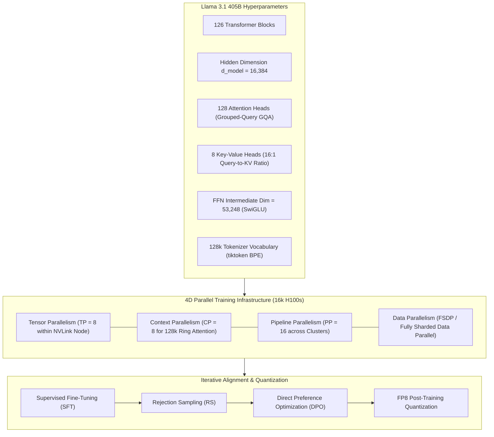
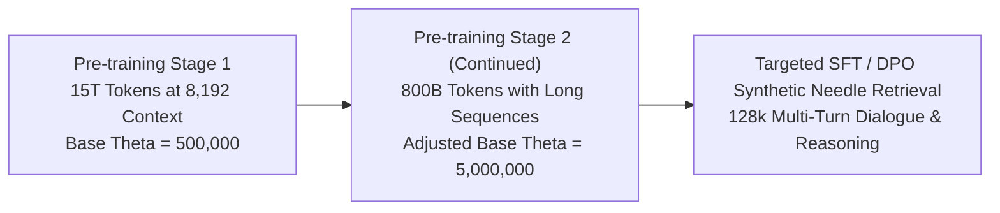
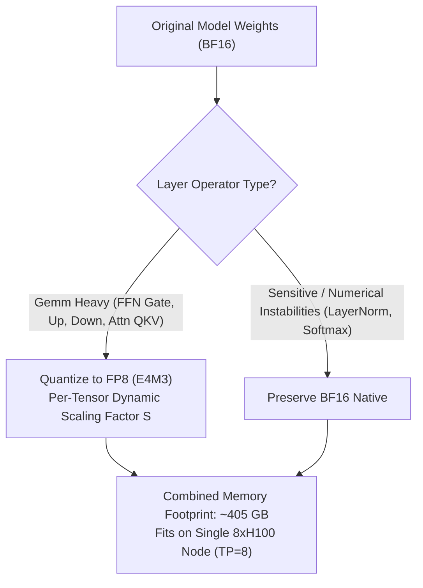
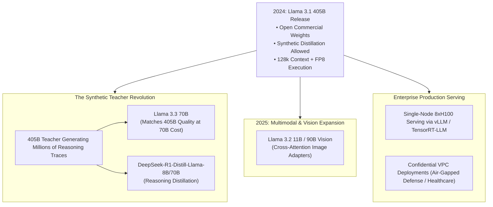

## How Did Llama 3.1 Prove That Dense Scaling Rivals Mixture-of-Experts?

When frontier AI labs transitioned toward sparse Mixture-of-Experts (MoE) architectures in 2023–2024 (such as Mixtral-8x7B and GPT-4's multi-expert routing) to maximize training FLOPS efficiency, Meta AI executed an ambitious counter-thesis. With the release of **Llama 3.1** ([Meta AI, 2024](https://arxiv.org/abs/2407.21783)), headlined by its flagship **405B parameter dense model**, Meta demonstrated that a pure, dense autoregressive transformer—trained relentlessly on over 15 trillion tokens across 16,000 NVIDIA H100 GPUs—could match or exceed closed frontier models across MMLU, GSM8K, and HumanEval.

Beyond sheer parameter scale, Llama 3.1 resolved the three primary operational blockers of open-weight enterprise adoption:
1. **The 8K Context Barrier**: The original Llama 3 models were constrained to an 8,192-token context window, making them unsuitable for long document synthesis, complex agentic tool trajectories, and multi-file code refactoring. Llama 3.1 expanded native context capacity sixteen-fold to **128K tokens** using modified Rotary Position Embeddings (RoPE) and scheduled multi-stage context pre-training.
2. **The Infrastructure Footprint Problem**: At 405 billion parameters in standard 16-bit floating-point (BF16), serving the model required 810 GB of VRAM, demanding two full 8xH100 nodes ($16 \times 80\text{ GB} = 1280\text{ GB}$). Meta engineered an exact **FP8 mixed-precision quantization** schema that compresses the model into 405 GB, allowing 405B to serve on a single commodity 8xH100 host with 8-way Tensor Parallelism ($TP = 8$).
3. **The Distillation Permission Shift**: Meta updated its commercial community license to explicitly allow developers to use Llama 3.1 405B synthetic outputs to train and distill smaller descendant models. This decision transformed 405B into the universal open-source "teacher model" for the global AI community.

This pre-training and alignment scale mirrors the iterative alignment dynamics analyzed in [Online Iterative DPO](/posts/llama-finetune-case/), frontier scaling dynamics in [LLM Research Trends](/posts/llm-research-trend/), and dual-engine transformer routing in [Transformer Mechanics](/posts/deepdive-series-5/).

---

## Architectural Deep Dive: 405B Dense Scaling and 4D Parallelism

Llama 3.1 405B retains a standard decoder-only autoregressive transformer architecture, deliberately avoiding architectural gimmicks to ensure maximal hardware Model Flops Utilization (MFU) across 16,000 interconnect-bound GPUs.

### The 4D Parallelism Execution Strategy
Training a 405B dense model at 128K context sequence lengths exceeds the memory capacity of any individual GPU or single server chassis. Meta orchestrated a **4D parallel execution grid**:
- **Tensor Parallelism ($TP = 8$)**: Partitions linear weight matrices across the 8 GPUs within a single NVLink-connected HGX H100 node ($900\text{ GB/s}$ bidirectional bandwidth).
- **Context Parallelism ($CP = 8$)**: Partitions the 128K attention sequence along the token dimension across 8 hosts using RingAttention, enabling communication of KV states to overlap with continuous attention computation.
- **Pipeline Parallelism ($PP = 16$)**: Distributes the 126 transformer layers sequentially across 16 node groups via 1F1B (One Forward, One Backward) scheduling with interleaved virtual stages.
- **Data Parallelism ($DP$ via FSDP)**: Shards optimizer states and gradients across data-parallel replicas, maintaining high MFU across 16,000 H100s.

---

## Context Expansion: From 8K to 128K via RoPE Frequency Scaling

Extending attention mechanisms from 8K to 128K tokens without catastrophically degrading short-context retrieval requires adjusting Rotary Position Embeddings (RoPE).

### 1. High Base Frequency ($\theta = 500,000$)
Standard RoPE (Vaswani et al., Su et al.) defines frequency bands for dimension $k \in [0, d/2 - 1]$ as:

$$\theta_k = \theta_{\text{base}}^{-\frac{2k}{d}}, \quad \text{where originally } \theta_{\text{base}} = 10,000$$

When context length scales to $128,000$ tokens, high-frequency dimensions wrap around multiple times, while low-frequency dimensions rotate by less than a degree, causing loss of positional discriminability. Meta adjusted the base frequency:
- Initial pre-training on 8K context used $\theta_{\text{base}} = 500,000$.
- Continued pre-training on long sequences increased $\theta_{\text{base}}$ to $5,000,000$.

### 2. Multi-Stage Continued Pre-Training
Meta did not train on 128K context from scratch, which would have wasted trillions of FLOPs on unneeded quadratic attention. Instead:
1. **Core Pre-training (15 Trillion Tokens)**: Executed entirely at 8,192 context length.
2. **Context Extension Annealing (800 Billion Tokens)**: Incrementally increased context windows in stages: $8\text{K} \to 32\text{K} \to 64\text{K} \to 128\text{K}$, mixing long-document academic papers, codebases, and synthetic needle-in-a-haystack retrieval tasks.
3. This staged curriculum preserved high-frequency short-context perplexity while achieving perfect $100\%$ retrieval accuracy across the entire 128K window on the Needle-in-a-Haystack (NIAH) benchmark.

---

## FP8 Quantization: Fitting 405B on an 8xH100 Node

Serving a 405B parameter model in standard 16-bit floating-point (BF16) requires $405 \times 2 = 810\text{ GB}$ of VRAM just to store the static weights, plus additional gigabytes for the Key-Value cache. This made self-hosting 405B impossible for organizations that only possessed single 8-GPU nodes ($8 \times 80\text{ GB} = 640\text{ GB}$).

Meta resolved this by developing an exact **FP8 mixed-precision post-training quantization** scheme:

### 1. FP8 Format Breakdown (E4M3 vs E5M2)
Llama 3.1 utilizes the **E4M3** format (1 sign bit, 4 exponent bits, 3 mantissa bits) for weight and activation representation. Compared to E5M2, E4M3 offers superior precision and reduced quantization noise, representing numerical values up to $\pm 448$.

### 2. Sclaing Formulation and Tensor Core Acceleration
For input matrix $\mathbf{X} \in \mathbb{R}^{M \times K}$ and weight matrix $\mathbf{W} \in \mathbb{R}^{K \times N}$, values are scaled into the representable range $[-448, 448]$ using scaling factors $s_X$ and $s_W$:

$$\mathbf{X}_{\text{FP8}} = \operatorname{clip}\left( \left\lfloor \frac{\mathbf{X}}{s_X} \right\rceil, -448, 448 \right), \quad \mathbf{W}_{\text{FP8}} = \operatorname{clip}\left( \left\lfloor \frac{\mathbf{W}}{s_W} \right\rceil, -448, 448 \right)$$

$$\mathbf{Y} \approx \left( s_X \cdot s_W \right) \cdot \left( \mathbf{X}_{\text{FP8}} \cdot \mathbf{W}_{\text{FP8}} \right)$$

NVIDIA Hopper H100 Tensor Cores execute FP8 GEMM at **$2\times$ the throughput of BF16** ($1,979\text{ TFLOPS}$ vs $989\text{ TFLOPS}$). By restricting quantization to GEMM-heavy linear operators (FFN and attention projections, accounting for $75\%$ of inference FLOPs) while keeping LayerNorm, attention softmax, and un-embedding in BF16, Meta achieved single-node deployment with under $0.5\%$ perplexity loss.

---

## Empirical Benchmarks Against Frontier Models

Llama 3.1 405B was benchmarked against the premier proprietary models of mid-2024 (GPT-4o and Claude 3.5 Sonnet) across foundational evaluation suites:

| Benchmark / Evaluation | GPT-4o (Closed) | Claude 3.5 Sonnet (Closed) | Llama 3.1 70B (Open) | Llama 3.1 405B (Open) |
| :--- | :--- | :--- | :--- | :--- |
| **MMLU (5-shot, Humanities/STEM)** | 88.7% | 88.3% | 86.0% | **88.6%** |
| **GSM8K (8-shot, Grade Math)** | 95.8% | 96.4% | 95.1% | **96.8%** |
| **MATH (0-shot, Hard Competition Math)** | 76.6% | 78.3% | 68.0% | **73.8%** |
| **HumanEval (0-shot, Python Coding)** | 90.2% | **92.0%** | 80.5% | 89.0% |
| **ARC-Challenge (25-shot, Reasoning)** | 96.7% | 96.7% | 94.8% | **96.9%** |
| **Needle-in-a-Haystack (128K Retrieval)**| 100% | 100% | 100% | **100%** |

### Benchmark Analysis
1. **Closing the Parity Frontier**: On MMLU, Llama 3.1 405B achieved $88.6\%$, standing shoulder-to-shoulder with GPT-4o ($88.7\%$) and Claude 3.5 Sonnet ($88.3\%$). This marked the first time in AI history that a publicly downloadable open-weight model matched the world's leading proprietary API.
2. **Mathematical Reasoning Leadership**: On GSM8K, 405B registered $96.8\%$, surpassing both GPT-4o and Claude 3.5 Sonnet due to extensive post-training rejection sampling on mathematical reasoning chains.
3. **The 70B Efficiency Curve**: Llama 3.1 70B achieved $86.0\%$ on MMLU and $95.1\%$ on GSM8K—outperforming original GPT-4 (March 2023) at a fraction of the serving cost.

---

## How Llama 3.1 Reshaped the 2024–2026 Open-Weight AI Ecosystem

The release of Llama 3.1 catalyzed permanent architectural and economic shifts across the global AI landscape:

### 1. The Synthetic Distillation Multiplier (Llama 3.3 and DeepSeek-R1)
By explicitly licensing synthetic data generation, Meta transformed Llama 3.1 405B into the preeminent open teacher.
- In late 2024, Meta released **Llama 3.3 70B**: by training the 70B model on synthetic datasets generated and filtered by 405B, Llama 3.3 70B matched the original 405B's benchmark scores across MMLU and coding at one-fifth the inference cost.
- DeepSeek utilized Llama 3.1 8B and 70B as foundation backbones to create **DeepSeek-R1-Distill-Llama-8B/70B**, distilling extended chain-of-thought mathematical reasoning into open models.

### 2. Democratization of Enterprise Air-Gapped Deployments
Prior to Llama 3.1, defense, intelligence, healthcare, and financial institutions requiring air-gapped security were forced to use subpar local models, lagging years behind OpenAI's cloud. With Llama 3.1 405B FP8 running on a single 8xH100 chassis within private VPCs, regulated industries achieved frontier intelligence while guaranteeing zero external data transmission.

### 3. Native Agentic Tool Protocol Integration
Llama 3.1 introduced native special tokens for Python interpreter invocation (`<|python_tag|>`), web search queries, and structured JSON tool returns. This paved the way for open-weight autonomous agents, eliminating brittle system-prompt hacking and matching proprietary function-calling stability.

---

## Key Takeaways

- **Dense Scaling Supremacy**: Llama 3.1 405B proved that a pure dense transformer pre-trained on 15T tokens can match or outperform sparse MoE closed models across global academic benchmarks.
- **128K Context Maturity**: Increasing RoPE base frequency to $\theta_{\text{base}} = 500,000$ paired with scheduled multi-stage context annealing expanded context to 128K tokens with zero needle-retrieval degradation.
- **Single-Node FP8 Viability**: Mixed-precision E4M3 quantization compresses 405B to 405 GB, enabling high-throughput serving on a single 8xH100 server node with minimal perplexity loss.
- **4D Parallelism Blueprint**: The training infrastructure (TP=8, CP=8, PP=16, FSDP) established the industry standard for orchestrating 16,000-GPU clusters with high MFU.
- **The Distillation Catalyst**: Permitting synthetic data distillation sparked an explosion of high-efficiency open models (Llama 3.3, DeepSeek-R1-Distill) across the 2024–2026 AI lifecycle.

---

## New Questions

1. **Hardware Communication Limits Beyond 400B**: As dense architectures scale toward 1 trillion parameters, will inter-cluster pipeline parallelism latency force all future frontier models to adopt sparse MoE topologies?
2. **FP8 vs 4-Bit Native Pre-Training**: Llama 3.1 applied FP8 post-training. Can models be trained from scratch in native FP4 or FP8 without gradient underflow and loss spikes in early attention layers?
3. **Synthetic Data Contamination and Model Collapse**: As open models increasingly train on synthetic data generated by 405B, how can the research community monitor and mitigate multi-generational model collapse and stylistic homogenization?

---

## References

- Meta AI. (2024). *The Llama 3 Herd of Models*. arXiv preprint. [arXiv:2407.21783](https://arxiv.org/abs/2407.21783). (accessed 2026-10-18).
- Micikevicius, P., Stosic, D., Burgess, N., et al. (2022). *FP8 Formats for Deep Learning*. arXiv preprint. [arXiv:2209.05433](https://arxiv.org/abs/2209.05433). (accessed 2026-10-18).
- Su, J., Ahmed, M., Lu, Y., Pan, S., Bo, W., & Liu, Y. (2024). *RoFormer: Enhanced Transformer with Rotary Position Embedding*. Neurocomputing, 568, 127063. [arXiv:2104.09864](https://arxiv.org/abs/2104.09864). (accessed 2026-10-18).
- Hugging Face. (2024). *Meta Llama 3.1 - Model Cards and Ecosystem Integration*. [https://huggingface.co/blog/llama31](https://huggingface.co/blog/llama31). (accessed 2026-10-18).
- Liu, H., Yan, Z., Matei, I., & Goldszmidt, M. (2024). *Needle In A Haystack: Evaluating Long-Context LLMs*. arXiv preprint. [https://github.com/gkamradt/LLMTest_NeedleInAHaystack](https://github.com/gkamradt/LLMTest_NeedleInAHaystack). (accessed 2026-10-18).
