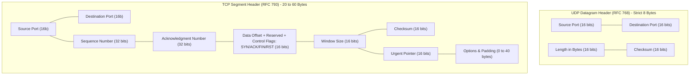
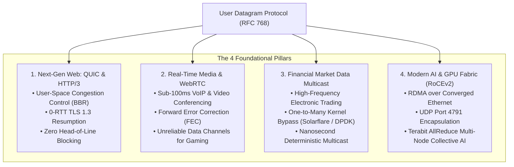
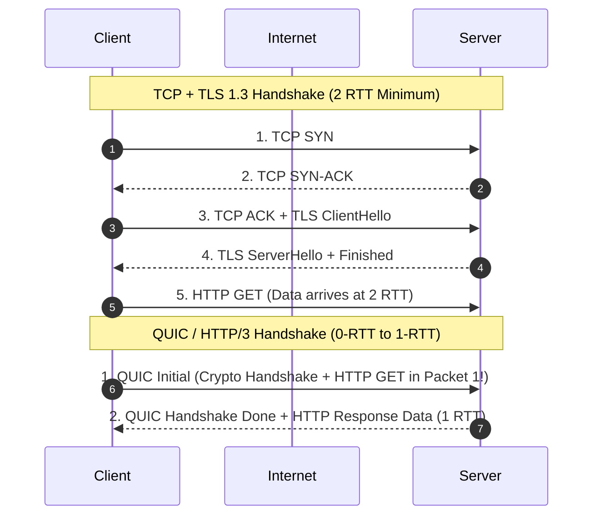
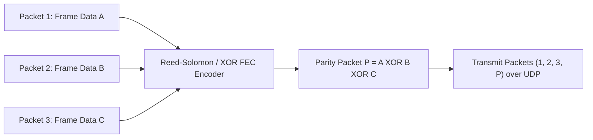
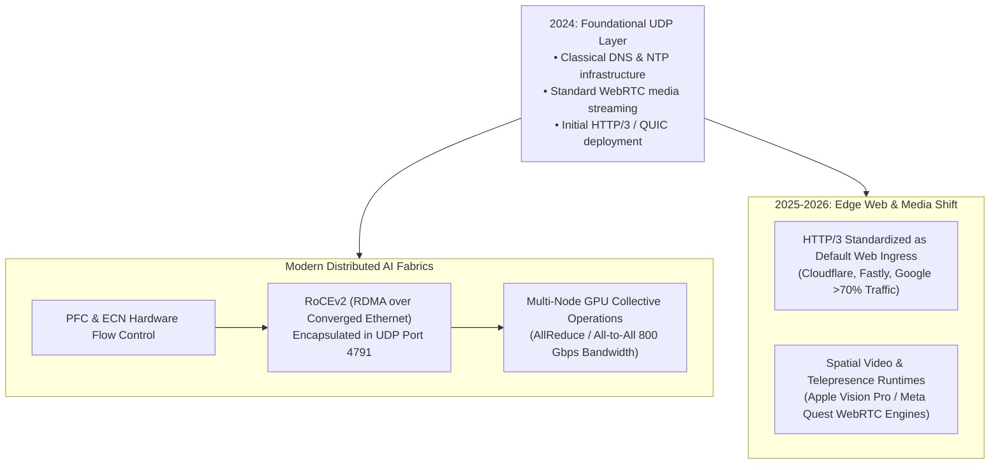

## Why Does Minimalist Transport Layer Design Enable Ultra-Low Latency?

When Jon Postel published RFC 768 in August 1980, defining the **User Datagram Protocol (UDP)**, the specification occupied barely three pages. In stark contrast to the Transmission Control Protocol (TCP, RFC 793)—which implements connection state machines, three-way handshakes, sequence acknowledgment numbers, retransmission timers, flow control windows, and congestion control algorithms—UDP provides only the bare minimum required to interface with the Internet Protocol (IP) network layer.

UDP offers zero guarantees:
- **No Connection Setup**: Packets are dispatched immediately without pre-allocating state or exchanging handshake round-trips.
- **No Delivery Guarantee**: Dropped or corrupted packets are silently discarded rather than retransmitted.
- **No Ordering Invariance**: Datagrams can arrive out of order, duplicated, or not at all.
- **No Congestion Feedback**: The protocol pushes bits into the socket as rapidly as the host kernel permits, agnostic to intermediate router buffer bloat.

For decades in early computer science education, this lack of reliability was framed as an inferior trade-off, relegated strictly to loss-tolerant legacy voice audio. In modern high-throughput distributed systems, this architectural minimalism is recognized as UDP's greatest strength: **by refusing to impose kernel-enforced ordering and retransmission policies, UDP serves as the blank canvas upon which user-space protocols engineer deterministic, ultra-low-latency transport engines**.

This transport-layer foundation connects directly to edge proxy ingress in [Production Web Systems](/posts/web-application-10-essential/), decoupled microservices in [Modern Software Architecture](/posts/modern-software-architecture/), and high-velocity delivery in [Modern Software Development Cycles](/posts/software-development-cycle/).

---

## Packet Anatomy: Comparing UDP and TCP Headers

The operational overhead of a transport protocol begins with its packet header. Every byte transmitted across network interfaces consumes serialization time and router parsing cycles:

### The 8-Byte UDP Invariant
A standard UDP header consists of exactly four 16-bit fields:
1. **Source Port (16 bits)**: Identifies the sending process port (optional; can be set to zero if no reply is expected).
2. **Destination Port (16 bits)**: Directs the datagram to the specific receiving application socket.
3. **Length (16 bits)**: Specifies the total length in bytes of the UDP header plus payload (minimum value $8$, theoretical maximum $65,535$ bytes).
4. **Checksum (16 bits)**: Evaluates payload integrity across a 16-bit one's complement sum of the UDP header, data, and an IPv4/IPv6 "pseudo-header" (source/destination IP, protocol number, UDP length). In IPv4, this checksum is technically optional (set to zero to disable); in IPv6, it is mandatory.

In contrast, a minimal TCP header consumes at least 20 bytes—expanding up to 60 bytes with timestamps, window scaling, and selective acknowledgment (SACK) options. For small payload transactions (such as a 64-byte DNS query or an atomic telemetry metric), TCP introduces over $300\%$ protocol header overhead compared to UDP.

---

## The Four Foundational Pillars of Modern UDP Usage

While toy applications treat UDP as a crude fire-and-forget mechanism, modern infrastructure leverages UDP across four high-performance engineering domains:

---

## Architectural Deep Dive: QUIC and HTTP/3

For nearly three decades, HTTP/1.1 and HTTP/2 ran exclusively over TCP. In HTTP/2, multiplexing allowed dozens of concurrent requests to share a single TCP connection. However, this introduced a critical flaw: **TCP Head-of-Line (HoL) Blocking**.

Because the operating system kernel enforces strictly sequential in-order byte delivery for the entire TCP stream, if a single IP packet belonging to Stream A is dropped in transit, the kernel halts delivery of all subsequent packets—even if they belong to completely independent Streams B, C, and D—until the lost packet is retransmitted.

### The QUIC Innovation
Published in RFC 9000 by the IETF in 2021, QUIC encapsulates transport state machine logic **inside UDP datagrams in user space**:
1. **Independent Stream Multiplexing**: QUIC tracks sequence offsets independently per logical stream. If a packet on Stream 1 drops, Streams 2, 3, and 4 continue streaming into the application layer without a millisecond of delay.
2. **0-RTT Connection Resumption**: By fusing the transport handshake with the cryptographic TLS 1.3 key exchange, a client reconnecting to a known server emits application payload data on the very first network flight ($0\text{-RTT}$).
3. **Connection Migration**: TCP connections are defined by the 4-tuple `(Source IP, Source Port, Dest IP, Dest Port)`. When a smartphone switches from Wi-Fi to 5G cellular, the local IP changes, abruptly breaking all active TCP sockets. QUIC identifies connections via a 64-bit Connection ID (CID) embedded in the UDP payload; IP changes are handled seamlessly without dropping active video calls or downloads.

---

## Ultra-Low Latency Media: WebRTC and Forward Error Correction

In interactive real-time communications (such as Zoom, Google Meet, Apple FaceTime, and competitive cloud gaming), the human perceptual threshold for conversational lag is approximately $150\text{ milliseconds}$.

When a network glitch drops a video frame packet:
- Under TCP, the receiver halts rendering, triggers an ACK timeout, waits for the sender to retransmit the missing packet over a full Round-Trip Time (RTT), and only then resumes playback, causing a noticeable freeze.
- Under UDP-based protocols (such as WebRTC using RTP/RTCP): the media engine simply discards the missing macroblock or extrapolates it using spatial-temporal motion vectors. A minor pixel artifact lasting a fraction of a second is vastly preferable to an audio freeze.

To bridge the gap between packet loss and visual fidelity, modern UDP streaming deploys **Forward Error Correction (FEC)**:

If Packet 2 drops during transit across the public internet, the receiving receiver computes:

$$\text{Packet 2} = \text{Packet 1} \oplus \text{Packet 3} \oplus \text{Parity Packet } P$$

recovering the missing data instantaneously with **zero network round-trips**.

---

## Market Data Multicast and Kernel Bypass

In electronic financial exchanges (such as CME, NASDAQ, and Eurex), market quotes and order book updates are broadcast to hundreds of competing quantitative trading firms simultaneously:

### 1. Hardware Multicast (IGMP / PIM)
If an exchange used TCP, the server would be forced to maintain separate point-to-point connections with every trading firm, sequentially looping through sockets and granting an unfair nanosecond advantage to the first client in the queue. Using UDP Multicast over Class D IP addresses (`224.0.0.0/4`), the exchange switch broadcasts a single UDP datagram simultaneously down all fiber lines, achieving microsecond fairness across market participants.

### 2. Kernel Bypass (Solarflare Onload / DPDK)
Standard Linux kernel network stacks incur approximately $1.5$ to $3.5$ microseconds of overhead per packet due to interrupt handling, context switching, and socket buffer copying between kernel space and user space. High-frequency trading systems deploy kernel bypass network interface cards (NICs):
- The NIC writes incoming UDP datagrams directly into user-space application memory via Direct Memory Access (DMA).
- This eliminates context switching entirely, allowing trading logic to parse UDP market data packets within $400\text{ nanoseconds}$ of arrival.

---

## Transport Layer Mathematics and Latency Models

The fundamental performance differences between TCP and UDP can be modeled mathematically as a function of network Round-Trip Time ($\text{RTT}$) and Packet Loss Rate ($p$).

### 1. Connection Establishment Latency
Let $\text{RTT}$ denote the round-trip propagation time between client and server. For an application requesting an $S$-byte payload:

$$T_{\text{TCP}} = \underbrace{\text{RTT}}_{\text{TCP Handshake (SYN/ACK)}} + \underbrace{\text{RTT}}_{\text{TLS 1.3 Key Exchange}} + \underbrace{\frac{1}{2} \text{RTT} + \frac{S}{C}}_{\text{Request/Response Transfer}} = 2.5 \cdot \text{RTT} + \frac{S}{C}$$

$$T_{\text{UDP / QUIC 0-RTT}} = \underbrace{\frac{1}{2} \text{RTT} + \frac{S}{C}}_{\text{Instantaneous Handshake + Payload}} = 0.5 \cdot \text{RTT} + \frac{S}{C}$$

On cross-continental connections where $\text{RTT} = 150\text{ ms}$, raw TCP requires $375\text{ ms}$ before the first byte of application data is processed, whereas UDP/QUIC begins processing payload in $75\text{ ms}$—an immediate $5\times$ latency reduction.

### 2. Mathis Formula: Throughput Degradation Under Packet Loss
Matthew Mathis et al. established that standard TCP throughput is fundamentally bounded by packet loss $p$ and Maximum Segment Size (MSS):

$$\text{Throughput}_{\text{TCP}} \le \frac{\text{MSS}}{\text{RTT} \cdot \sqrt{p}} \times C_0$$

When packet loss increases on long-distance or lossy wireless links (e.g., $p = 2\%$), TCP's congestion avoidance algorithm continually halves its congestion window ($W \leftarrow W/2$), causing bandwidth utilization to plummet. In contrast, UDP applications using modern user-space congestion control (e.g., Google BBRv3 over QUIC) distinguish between random packet loss and buffer congestion, maintaining high throughput across congested physical backbones.

---

## How UDP Underpins Modern 2024–2026 AI Clusters and QUIC Protocols

Between 2024 and 2026, the strategic importance of UDP surged driven by two massive architectural trends in global computing:

### 1. RoCEv2: The Lifeblood of Distributed GPU AI Clusters
When training massive foundational models (such as Llama 3.1 405B across 16,000 H100 GPUs), GPUs must exchange gigabytes of intermediate gradient activations across nodes via AllReduce collective communication.
- InfiniBand has historically dominated, but cost and proprietary supply-chain constraints led hyperscalers to deploy **RoCEv2 (RDMA over Converged Ethernet v2)**.
- **The UDP Encapsulation**: RoCEv2 encapsulates raw InfiniBand network packets inside standard UDP datagrams fixed to destination port `4791`.
- **Why UDP?**: Encapsulating RDMA inside UDP allows modern enterprise Ethernet switches to hash the UDP source port across Equal-Cost Multi-Path (ECMP) routing pipelines, load-balancing terabits of inter-GPU traffic evenly across physical switch backplanes without packet reordering.

### 2. HTTP/3 Dominance Across Global Internet Traffic
By 2025–2026, HTTP/3 (QUIC over UDP) surpassed HTTP/2 as the majority transport protocol for major content delivery networks (Cloudflare, Fastly, Google, Meta), handling over $70\%$ of mobile web requests. The ability of QUIC to gracefully survive cellular handoffs without breaking ongoing TCP streams reduced mobile API failure rates by an order of magnitude.

### 3. Spatial Audio and Holographic Telepresence
The emergence of spatial computing headsets (Apple Vision Pro, Meta Quest 3) created stringent perceptual requirements: spatial video and 3D spatialized audio require end-to-end transport latency under $30\text{ ms}$ to avoid vestibular motion sickness. Custom WebRTC-over-UDP pipelines streaming 4K stereoscopic frames utilize adaptive jitter buffers and hardware-accelerated FEC, ensuring smooth real-time immersion over standard Wi-Fi 6E/7 home networks.

---

## Key Takeaways

- **Minimalist Transport Simplicity**: RFC 768 defines an immutable 8-byte header (ports, length, checksum) that introduces zero connection handshake delay and zero kernel-imposed ordering constraints.
- **User-Space Transport Innovation**: Because UDP does not enforce in-kernel retransmission or congestion logic, modern protocols (QUIC, WebRTC) engineer advanced features—such as 0-RTT handshakes, connection migration, and forward error correction—entirely in user space.
- **Eliminating Head-of-Line Blocking**: Encapsulating independent streams within UDP datagrams in QUIC ensures that individual dropped packets do not halt unrelated concurrent streams.
- **Microsecond Financial Fairness**: Multicast UDP distributes live market data down fiber lines simultaneously, ensuring atomic microsecond fairness across electronic exchanges.
- **The Modern AI Backbone**: Encapsulating RDMA inside UDP (RoCEv2 port 4791) powers multi-node collective communication (AllReduce) across tens of thousands of GPUs in frontier AI training clusters.

---

## New Questions

1. **Carrier Middlebox UDP Throttling**: Because some consumer ISPs deprioritize UDP traffic to limit P2P file-sharing or DDoS attacks, how can modern client-server runtimes dynamically detect UDP degradation and execute fallback to TCP without breaking active user sessions?
2. **Post-Quantum Cryptography in 0-RTT Handshakes**: As post-quantum key exchange mechanisms (e.g., ML-KEM) introduce public key payloads exceeding 1,000 bytes, how can QUIC 0-RTT packets prevent IP fragmentation within standard 1,500-byte Ethernet MTUs?
3. **Lossless RoCEv2 Congestion Control at Scale**: In 100,000-GPU clusters, how can Priority Flow Control (PFC) and Explicit Congestion Notification (ECN) on UDP packets eliminate PFC deadlocks without causing packet loss?

---

## References

- Postel, J. (1980). *User Datagram Protocol*. RFC 768. Internet Engineering Task Force (IETF). [https://www.rfc-editor.org/rfc/rfc768.html](https://www.rfc-editor.org/rfc/rfc768.html). (accessed 2026-10-18).
- Iyengar, J., & Thomson, M. (2021). *QUIC: A UDP-Based Multiplexed and Secure Transport*. RFC 9000. Internet Engineering Task Force (IETF). [https://www.rfc-editor.org/rfc/rfc9000.html](https://www.rfc-editor.org/rfc/rfc9000.html). (accessed 2026-10-18).
- Mockapetris, P. (1987). *Domain Names - Implementation and Specification*. RFC 1035. Internet Engineering Task Force (IETF). [https://www.rfc-editor.org/rfc/rfc1035.html](https://www.rfc-editor.org/rfc/rfc1035.html). (accessed 2026-10-18).
- Mathis, M., Semke, J., Mahdavi, J., & Ott, T. (1997). *The Macroscopic Behavior of the TCP Congestion Avoidance Algorithm*. Computer Communication Review, 27(3), 67-82. [DOI:10.1145/263932.264023](https://doi.org/10.1145/263932.264023). (accessed 2026-10-18).
- Kurose, J. F., & Ross, K. W. (2021). *Computer Networking: A Top-Down Approach* (8th Edition). Pearson. ISBN: 978-0136681557. (accessed 2026-10-18).
