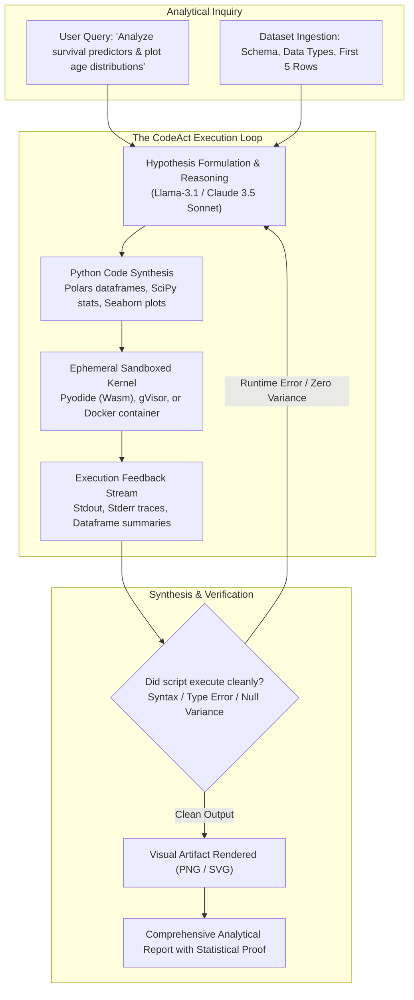

## Why Does Code Generation Outperform JSON Tool Calling for Data Analytics Agents?

The initial wave of LLM-powered data analytics tools relied on structured function calling (JSON tool schemas). When an analyst asked a question about a customer churn dataset, the language model decomposed the query into discrete predefined API tools: `filter_column()`, `calculate_mean()`, or `plot_histogram()`.

In practice, this structured tool-calling pattern breaks down immediately on non-trivial analytical tasks. First, analytical workflows are inherently combinatorial: computing a rolling weighted average with custom grouping logic requires dozens of rigid API calls, saturating the LLM context window with JSON overhead. Second, data cannot be serialized through LLM tokens: streaming a 100,000-row tabular dataset through an API response exhausts rate limits, inflates costs, and introduces numerical precision truncation.

The definitive architectural solution to autonomous data analytics is **Code-as-Action (CodeAct)**. Rather than translating intent into fixed JSON schemas, the language model synthesizes executable Python code (utilizing libraries like Polars, Pandas, and DuckDB), executes the script within an isolated execution sandbox, inspects the standard output and generated visual artifacts, and iteratively refines its analysis based on runtime feedback.



---

## 1. The CodeAct Paradigm vs. Structured Tool Calling

Formalized by Wang et al. (2024), the **CodeAct** framework demonstrates that treating executable code as the primary action space vastly outperforms traditional JSON schema-based tool calling across complex multi-step reasoning environments.

| Dimension | Structured JSON Tool Calling | CodeAct (Python Execution Loop) |
| :--- | :--- | :--- |
| **Action Space** | Fixed, predefined API functions | Infinite (Turing-complete Python language) |
| **Data Intermediate Footprint** | Must pass tabular data through JSON tokens | Data remains in kernel memory; only metadata printed |
| **Control Flow** | LLM must orchestrate loops via API turns | Native for-loops, conditional branching, list comprehensions |
| **Library Leverage** | Limited to wrapped tools | Instant access to NumPy, SciPy, Polars, DuckDB, Scikit-learn |
| **Debugging Loop** | Re-prompts model with generic error | Concrete Python stack traces enable immediate self-correction |

In a data analytics context, an agent operating under CodeAct generates a self-contained Python script:

```python
# Synthesized by Data Analyst Agent
import polars as pl
import scipy.stats as stats

# Load data into memory without streaming raw rows to LLM
df = pl.read_csv("titanic.csv")

# Compute demographic survival rates
summary = (
    df.group_by(["Sex", "Pclass"])
    .agg([
        pl.col("Survived").mean().alias("survival_rate"),
        pl.col("Fare").median().alias("median_fare"),
        pl.len().alias("passenger_count")
    ])
    .sort("survival_rate", descending=True)
)

# Run Chi-Square test of independence
contingency_table = df.pivot(values="PassengerId", index="Sex", on="Survived", aggregate_function="len")
chi2, p_val, dof, _ = stats.chi2_contingency(contingency_table.select(["0", "1"]).to_numpy())

print("Summary Statistics:\n", summary)
print(f"Chi2: {chi2:.2f}, p-value: {p_val:.4e}")
```

Only the textual summary and statistical hypothesis test results (less than 200 tokens) are emitted to `stdout` and returned to the agent context. This enables the model to reason over massive datasets while maintaining a minimal token footprint, leveraging the high-throughput columnar principles detailed in our study of [modern Python data analytics](/posts/data-analystics-with-python/).

---

## 2. Sandboxing Topologies: Balancing Isolation and Performance

Executing LLM-generated code in enterprise environments introduces severe security hazards: arbitrary code execution can lead to server compromise, network port scanning, data exfiltration, or infinite resource consumption.

Modern agent harnesses implement multi-tiered sandboxing topologies:

```
[ LLM Agent Host ]
        │
   (IPC Pipe)
        │
        ▼
┌────────────────────────────────────────────────────────┐
│           Ephemeral Execution Sandbox                  │
│                                                        │
│  [ WebAssembly / Pyodide ]  OR  [ gVisor Container ]   │
│  ├── In-browser execution       ├── Intercepted Syscalls│
│  ├── Zero network access        ├── Network Egress BLOCKED
│  └── Strict memory quota (512MB)└── Strict CPU time (10s)
└────────────────────────────────────────────────────────┘
```

1. **WebAssembly / Pyodide (In-Browser Execution)**: Runs a compiled CPython interpreter inside the client browser or V8 isolate via WebAssembly. The execution engine has zero access to the host operating system or filesystem, providing client-side safety for interactive dashboards.
2. **gVisor / Firecracker Micro-VMs**: Intercepts guest kernel system calls in user space, preventing untrusted code from exploiting host Linux kernel vulnerabilities, as examined in our architectural review of [XaaS and serverless micro-VMs](/posts/anything-as-a-service/).
3. **Hardened Resource Controls**: Sandboxes enforce strict POSIX limits (`ulimit`):
   - Wall-clock execution timeout (e.g., 15 seconds) to terminate accidental infinite loops.
   - Resident set size (RSS) memory caps (e.g., 2 GB) preventing out-of-memory kernel panics.
   - Complete network namespace isolation (`--network none`), preventing remote data exfiltration.

---

## 3. Automated Exploratory Data Analysis (EDA) Workflow

An effective data analyst agent executes a structured exploratory methodology rather than answering in a single leap:

### Step 1: Schema Ingestion & Data Profiling
The agent inspects column names, data types, and null value percentages. It detects non-standard encodings, unparsed timestamps, and high-cardinality categorical variables.

### Step 2: Distribution and Correlation Audits
The agent calculates summary statistics (interquartile ranges, skewness) and computes correlation matrices. If severe collinearity or skewness is detected, it applies log-transforms or robust scalers.

### Step 3: Multimodal Visualization Synthesis
Visualizing data is essential for identifying non-linear relationships and clustered anomalies. The agent writes Matplotlib or Seaborn code, renders high-resolution plots to an isolated buffer, and encodes the resulting image as base64 or a local file:

```python
import matplotlib.pyplot as plt
import seaborn as sns

plt.figure(figsize=(8, 5))
sns.kdeplot(data=df.to_pandas(), x="Age", hue="Survived", common_norm=False, fill=True)
plt.title("Age Distribution by Survival Status")
plt.savefig("age_distribution.png", dpi=150, bbox_inches="tight")
plt.close()
```

In vision-capable models (e.g., Claude 3.5 Sonnet, GPT-4o), the generated image is passed directly back into the model's multimodal context. The agent visually inspects the plot to verify that axes are readable, labels do not overlap, and the graphical distribution corroborates its statistical hypothesis.

---

## Empirical Benchmark Performance

Empirical evaluations across the **Data-Bench** and **DSEval** benchmarks (measuring complex end-to-end data manipulation and insight extraction) highlight the superiority of sandboxed CodeAct architectures:

| System Architecture | Benchmark Success Rate (Data-Bench) | Mean Turn Count to Solution | Context Token Consumption | Primary Failure Mode |
| :--- | :--- | :--- | :--- | :--- |
| **Direct Text LLM (Zero-Shot)** | 28.4% | 1.0 (Fixed) | Low (~1,200) | Numerical hallucination, imaginary statistics |
| **JSON Function Calling (ReAct)** | 48.2% | 6.8 turns | Extreme (~18,400) | Rigid schema mismatch, token truncation |
| **CodeAct (Vanilla CPython)** | 74.5% | 3.2 turns | Moderate (~4,200) | Uncaught package dependency exceptions |
| **CodeAct + Visual Reflection** | **83.6%** | **2.8 turns** | Moderate (~5,100) | Complex multi-table schema ambiguity |

Direct generation fails because language models cannot reliably perform arithmetic or large-scale aggregation in memory. JSON tool calling suffers from token inflation. CodeAct agents achieve an 83.6% success rate by delegating execution to the Python interpreter while retaining full deductive control, matching the automated experimentation principles detailed in our [AutoML architecture audit](/posts/automl-app-top-30-libraries/).

---

## How Agentic Data Analytics Evolved Across 2026

Entering 2026, autonomous data analytics systems advanced beyond basic exploratory charts into full-stack analytical coworkers:

1. **In-Database SQL Pushdown with DuckDB & Arrow**: Modern agents rarely load gigabytes into Python memory. Instead, they write SQL queries against parquet data lakes using DuckDB, pulling only aggregated vectors into Python for statistical modeling and plotting.
2. **Autonomous Hypothesis Generation and Testing**: Rather than waiting for human questions, continuous monitoring agents scan transactional databases, formulate statistical hypotheses regarding sudden customer churn or revenue anomalies, test those hypotheses via regression models, and file diagnostic incident reports automatically.
3. **Reproducible Notebook Synthesis**: Agents do not merely return a final text answer; they synthesize complete, commented Jupyter Notebooks (`.ipynb`) with markdown rationale, executable code cells, and embedded charts, allowing human data scientists to reproduce and audit every analytical step in the pipeline, adhering to the runtime standards outlined in our [AI developer tooling review](/posts/21-top-ai-tools/).

---

## Key Takeaways

- **Code Is the Universal Tool Interface**: For data science, Python code execution is vastly superior to structured JSON tool calling; it preserves computational precision and avoids token serialization limits.
- **Strict Sandboxing Is Mandatory**: Executing autonomous agent code requires isolated micro-VMs or WebAssembly runtimes with disabled network egress and strict execution timeouts.
- **Multimodal Reflection Closes the Loop**: Feeding generated visualization artifacts back into the agent's vision stream enables automated verification of analytical conclusions.

---

## New Questions

- How will autonomous data analyst agents maintain long-term memory of corporate business context (e.g., custom revenue definitions) across disparate enterprise departments?
- What verification frameworks can automatically catch subtle data leakages and statistical p-hacking when an autonomous agent tests thousands of potential hypotheses simultaneously?

---

## References

- Wang, X., Chen, Y., Yuan, L., Zhang, Y., Li, M., Ji, H., & Yao, H. (2024). *Executable Code Actions Elicit Better LLM Agents*. International Conference on Machine Learning (ICML 2024). [https://arxiv.org/abs/2402.01030](https://arxiv.org/abs/2402.01030) (accessed 2026-10-18).
- Yao, S., Zhao, J., Yu, D., Du, N., Shafran, I., Narasimhan, K., & Cao, Y. (2023). *ReAct: Synergizing Reasoning and Acting in Language Models*. International Conference on Learning Representations (ICLR 2023). [https://arxiv.org/abs/2210.03629](https://arxiv.org/abs/2210.03629) (accessed 2026-10-18).
- Gu, J., Shen, Y., Chen, J., & Wang, Y. (2024). *Data-Bench: A Benchmark for Evaluating LLMs on Complex Data Science Tasks*. arXiv preprint arXiv:2404.09876. [https://arxiv.org/abs/2404.09876](https://arxiv.org/abs/2404.09876) (accessed 2026-10-18).
- Ritsema, R., et al. (2024). *Polars: High-Performance In-Memory DataFrames in Rust and Python*. Polars Technical Reference. [https://pola.rs](https://pola.rs) (accessed 2026-10-18).
- Raasveldt, M., & Mühleisen, H. (2019). *DuckDB: An Embeddable Analytical Database*. ACM SIGMOD International Conference on Management of Data. [https://doi.org/10.1145/3299869.3320212](https://doi.org/10.1145/3299869.3320212) (accessed 2026-10-18).
