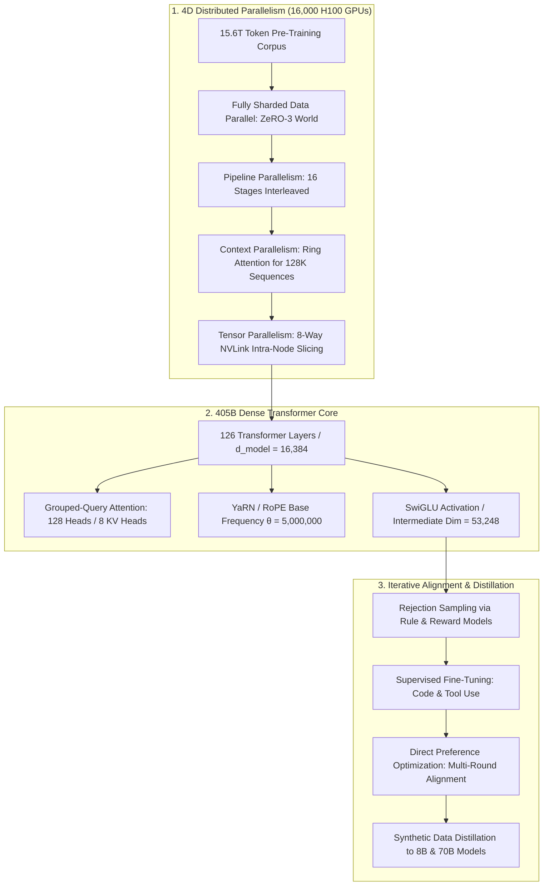
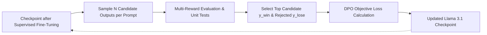

{: .light .w-75 .shadow .rounded-10 }

## How Did Meta Push Dense Scaling to 405 Billion Parameters?

In late July 2024, Meta released the **Llama 3.1** collection, accompanied by an exhaustive 93-page technical report (*The Llama 3 Herd of Models*, arXiv:2407.21783). While the open-source community had previously accessed capable small and medium models (7B to 70B), the flagship release of **Llama 3.1 405B** represented the first openly available, dense autoregressive Transformer trained at frontier datacenter scale.

Prior to Llama 3.1, prevailing industry consensus suggested that dense models beyond 100 billion parameters were economically unviable for production serving, prompting many laboratories to pivot toward sparse Mixture of Experts (MoE). Meta deliberately chose a dense standard decoder-only architecture, arguing that dense architectures maximize training stability, simplify deployment pipelines, and exhibit predictable empirical scaling behavior.

Achieving convergence on a 405-billion-parameter dense model required training on **15.6 trillion tokens** across **16,000 NVIDIA H100 GPUs** consuming over $10^{25}$ FLOPs. This operational feat required engineering a 4D distributed parallelism training harness, implementing multi-stage context window expansion up to 128,000 tokens, and replacing complex RLHF pipelines with iterative Rejection Sampling and Direct Preference Optimization (DPO). This source audit deconstructs the foundational systems engineering, distributed infrastructure, and post-training alignment strategies detailed in the Llama 3.1 technical report.



---

## The 4D Parallelism Architecture: Training on 16,000 H100 GPUs

Training a 405-billion parameter dense model requires over 810 gigabytes of memory just to store 16-bit model weights, expanding to multiple terabytes once optimizer states, activations, and gradient buffers are allocated. No single GPU or single 8-GPU node can fit the active state of a 405B model.

Meta engineered a **4D Parallelism** distributed training topology across 16,000 NVIDIA H100 GPUs interconnected via RoCEv2 (RDMA over Converged Ethernet) network fabrics:

```
4D Parallelism Dimensions for 405B:
TP (Tensor Parallelism)   = 8   (Within a single 8-GPU server across NVLink)
CP (Context Parallelism)  = 8   (Distributes 128K sequence length across 8 nodes)
PP (Pipeline Parallelism) = 16  (Partitions 126 layers across 16 pipeline stages)
DP / FSDP (Data Parallel) = 16  (Shards remaining gradient & optimizer states)
Total Allocation: 8 × 8 × 16 × 16 = 16,384 GPUs
```

### 1. Tensor Parallelism (TP = 8)
Within each 8-GPU DGX server, Megatron-style tensor parallelism slices the self-attention projection weights and SwiGLU MLP layers across the 8 GPUs. Inter-GPU communication is handled entirely over ultra-high-bandwidth (900 GB/s) NVLink interconnects.

### 2. Context Parallelism (CP = 8)
When scaling sequences to 128,000 tokens, standard attention matrices consume prohibitive VRAM ($O(N^2)$ memory scaling). Context parallelism partitions the sequence across 8 GPUs using **Ring Attention**, asynchronously streaming key-value blocks in a ring topology concurrently with local query computation.

### 3. Pipeline Parallelism (PP = 16) with 1F1B Scheduling
The 126 Transformer layers are divided across 16 sequential pipeline stages. To prevent GPU idle time ("bubble overhead"), Meta employed an interleaved **One-Forward-One-Backward (1F1B)** scheduling algorithm, where each GPU alternates between computing forward passes for new micro-batches and backward passes for previous ones.

### 4. Fully Sharded Data Parallelism (FSDP)
Remaining memory overhead is eliminated by sharding optimizer states (AdamW master weights, momentum, and variance) across the data-parallel replicas, ensuring zero memory redundancy across the cluster.

---

## Multi-Stage Context Extension: Scaling from 8K to 128K Tokens

Directly pre-training a 405B model on 128,000-token sequences from the outset is computationally inefficient; early training steps are wasted calculating expensive attention matrices across short-range syntactic dependencies.

Meta resolved this through a structured **6-stage continual pre-training context schedule**:

```
Context Window Extension Stages:
8K Context ──> 16K Stage ──> 32K Stage ──> 64K Stage ──> 96K Stage ──> 128K Context
(Initial 15T)   (800B tok)    (400B tok)    (200B tok)    (100B tok)    (Final Stage)
```

1. **Phase 1: Pre-Training on 8K Sequences:** The initial 15 trillion tokens were processed strictly at an 8,192-token context length to build general knowledge and reasoning representations.
2. **Phase 2: Progressive Window Expansion:** The model was continually trained on approximately 800 billion additional tokens, systematically doubling sequence lengths up to 128,000 tokens.
3. **RoPE Frequency Adaptation:** Rotary Position Embeddings (RoPE) suffer from phase-shift collapse when extrapolated beyond their pre-trained frequency. Meta scaled the base frequency parameter $\theta$ from standard $500{,}000$ up to **$5{,}000{,}000$**, preventing high-frequency spatial degradation across distant context tokens.
4. **The 0.1% Long-Context Data Discipline:** During post-training alignment, Meta uncovered a critical empirical invariant: if the fine-tuning instruction mixture did not contain at least **0.1% synthetic long-context multi-turn QA samples**, the model's performance on standard short benchmarks remained intact, but its "needle-in-a-haystack" retrieval recall in 128K contexts collapsed completely.

---

## The Post-Training Alignment Recipe: Rejection Sampling and Direct Preference Optimization (DPO)

For previous generations (Llama 2), alignment relied heavily on Reinforcement Learning from Human Feedback (RLHF) utilizing Proximal Policy Optimization (PPO), which required training separate actor, critic, and reward models in a complex, unstable reinforcement loop.

In Llama 3.1, Meta discarded PPO entirely in favor of an **iterative Rejection Sampling and Direct Preference Optimization (DPO)** pipeline:



### 1. Multi-Round DPO Over PPO
Direct Preference Optimization (Rafailov et al., NeurIPS 2023) analytically expresses the reward function directly through the language model's policy:

$$
\mathcal{L}_{\text{DPO}}(\theta; \pi_{\text{ref}}) = -\mathbb{E}_{(x, y_w, y_l)} \left[ \log \sigma \left( \beta \log \frac{\pi_\theta(y_w|x)}{\pi_{\text{ref}}(y_w|x)} - \beta \log \frac{\pi_\theta(y_l|x)}{\pi_{\text{ref}}(y_l|x)} \right) \right]
$$

Iterating this process across multiple successive rounds—where the newly optimized policy generates fresh candidate outputs that are filtered and scored again—yielded higher alignment stability and eliminated the hyperparameter brittleness of PPO critics.

### 2. Upstream Distillation: The 405B Model as Data Factory
The existence of the 405B model fundamentally altered how the smaller 70B and 8B models were constructed. Instead of relying solely on expensive human annotations, Meta used the 405B model to generate millions of high-fidelity synthetic instruction examples, rewrite flawed responses, and critique student outputs. This distillation process explains why the Llama 3.1 8B model achieves reasoning capabilities that rival 2023-era frontier models.

### 3. Native Agentic Tool Calling
Llama 3.1 was explicitly fine-tuned for structured tool invocation, supporting:
- **Brave Search API:** For live web information retrieval.
- **Python REPL (IPython):** Sandboxed code execution for complex mathematical calculations.
- **Wolfram Alpha:** For exact symbolic equations and computational knowledge.

---

## How Open-Weights Frontier Models Evolved Across 2026

The release of Llama 3.1 405B in 2024 served as the catalyst for the modern open-weights renaissance:

1. **The Proof of Dense Scaling:** Llama 3.1 proved that open models could match proprietary frontier baselines (GPT-4 and Claude 3.5 Sonnet) on general reasoning, math, and code synthesis, dissolving the perception of an insurmountable proprietary capability gap.
2. **From Dense Monsters to Fine-Grained MoE:** While 405B proved dense scalability, running a 405B dense model in production requires a multi-node 8xH100 cluster per single instance. As analyzed in [The 2024 Foundation Model Wave: Architectural Shifts in Training, Data, and Serving](/posts/llm-2024-survey/), subsequent architectures shifted toward fine-grained MoE designs (DeepSeek-V3, Qwen 2.5/3.5-Max), maintaining frontier reasoning while slashing active parameter execution costs.
3. **The Rise of Reasoning Models and Test-Time Search:** Throughout 2025 and 2026, the AI research vector shifted from scaling pre-training FLOPs to scaling inference-time compute. As examined in [Stop Generating, Start Thinking: The Architecture of Reasoning AI](/posts/stop-generating-start-thinking/), modern systems allocate reasoning tokens, self-critique loops, and tree searches before producing answers.
4. **Democratized Workstation Inference:** Architectural breakthroughs in quantization and PEFT adaptation—such as the low-rank methods analyzed in [Parameter-Efficient Fine-Tuning: Architectural Mechanics of LoRA, QLoRA, and Variants](/posts/explained-fintune-llm/) and the workstation inference systems evaluated in [Qwen 3.5 Medium: Sonnet-Class Local Inference on Workstation Hardware](/posts/qwen35-medium-sonnet-performance/)—allow distilled open-weights models to run on affordable enterprise workstations without cloud API tethers.

---

## Key Takeaways

- **Dense Scaling Validated at 405B:** Meta demonstrated that dense Transformer scaling holds predictably up to $10^{25}$ FLOPs and 15.6 trillion tokens, achieving parity with frontier proprietary systems without sparse routing instability.
- **4D Distributed Training Harness:** Coordinating 16,000 H100 GPUs required combining Tensor Parallelism (TP=8), Context Parallelism (CP=8 via Ring Attention), Pipeline Parallelism (PP=16 with 1F1B scheduling), and FSDP sharding.
- **128K Context Extension Schedule:** Continual pre-training across a 6-stage sequence expansion curriculum coupled with a $10\times$ increase in RoPE base frequency ($\theta = 5{,}000{,}000$) enabled stable 128K context reasoning.
- **DPO Replaces Complex PPO Loops:** Iterative rounds of Rejection Sampling and Direct Preference Optimization (DPO) streamlined the alignment pipeline, eliminating the training instability of dedicated PPO critics.
- **The Flagship as Data Generator:** The 405B model acted as an automated data factory, generating high-density synthetic reasoning datasets to distill frontier capabilities into the 70B and 8B models.

---

## New Questions

1. **Thermal and Interconnect Degradation in 16K GPU Clusters:** Over months of continuous pre-training on 16,000 GPUs, what is the exact distribution of MTBF (Mean Time Between Failures), and how do automated checkpoint rollback mechanisms prevent silent gradient corruption?
2. **Dense Serving Economics vs. Distilled SLMs:** In commercial production environments, what is the exact latency and financial Pareto boundary between serving a quantized 405B model versus deploying a specialized 8B model fine-tuned on 405B synthetic data?
3. **Long-Context Context-Rot in Agent Chains:** While needle-in-a-haystack benchmarks report 100% recall at 128K tokens, how severely does multi-hop reasoning degrade when intermediate reasoning steps are scattered across 100,000 tokens of unstructured tool logs?

---

## References

- [Dubey et al. (Meta AI): The Llama 3 Herd of Models (arXiv:2407.21783)](https://arxiv.org/abs/2407.21783) (accessed 2026-10-18)
- [Meta AI: Introducing Llama 3.1 - Our Most Capable Models to Date](https://ai.meta.com/blog/meta-llama-3-1/) (accessed 2026-10-18)
- [Shoeybi et al.: Megatron-LM - Training Multi-Billion Parameter Language Models Using Model Parallelism (arXiv:1909.08053)](https://arxiv.org/abs/1909.08053) (accessed 2026-10-18)
- [Rafailov et al.: Direct Preference Optimization - Your Language Model is Secretly a Reward Model (NeurIPS 2023 / arXiv:2305.18290)](https://arxiv.org/abs/2305.18290) (accessed 2026-10-18)
- [Liu et al.: RingAttention with Blockwise Transformers for Near-Infinite Context (ICLR 2024 / arXiv:2310.01889)](https://arxiv.org/abs/2310.01889) (accessed 2026-10-18)
