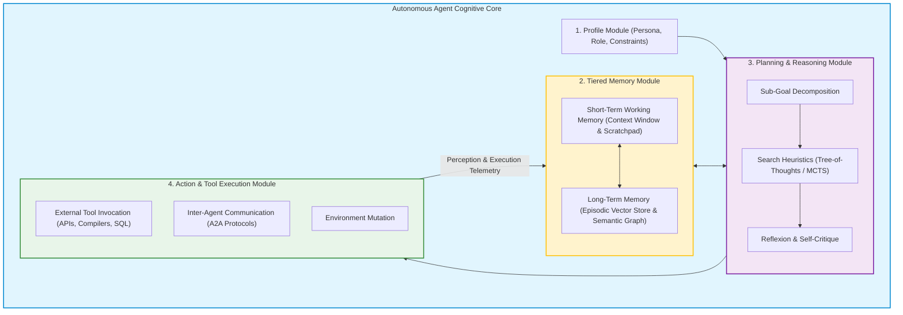

A foundational large language model, operating in isolation, is fundamentally passive: it samples tokens in response to a user prompt, terminates generation upon emitting an end-of-sequence token, and retains zero state across sessions. It cannot perceive changes in its environment, cannot formulate multi-step plans, and has no sovereignty to invoke external software tools.

To graduate foundation models from conversational chatbots into autonomous problem solvers, the research community formalized the concept of **LLM-Based Autonomous Agents**. By positioning the foundation model as the cognitive "brain" of a larger software harness, an agent continuously senses environmental states, references historical memories, plans future actions, and executes real-world side effects.

As comprehensively synthesized by Wang et al. (2023) and Xi et al. (2023), constructing an autonomous agent requires unifying four orthogonal modules: **Profile**, **Memory**, **Planning**, and **Action**.

This source audit analyzes the architectural mechanics of these four foundational pillars, evaluates planning algorithms (contrasting feedback-driven Reflexion loops with feedforward Tree-of-Thoughts searches), examines memory hierarchy design, and traces how agent harnesses evolved toward open communication standards across 2026.


## What Constitutes the Minimal Viable Architecture of an Autonomous AI Agent?

An agent is defined not by the underlying parameter count of its model, but by the completeness of its operational control loop. An LLM without tools or memory is merely a predictor; an agent is a closed-loop cybernetic system.

The unified conceptual framework established by Wang et al. decomposes an autonomous agent into four interconnected modules:



### Module 1: The Profile Module (Identity and Constraints)
The Profile module defines who the agent is, what role it plays, and what behavioral boundaries it must obey. Profiling methods range from:
- **Handcrafted Prompt Anchoring**: Explicitly defining domain expertise, tone, output format rules, and ethical guardrails.
- **Role Deconstruction**: In multi-agent environments, creating specialized personas (e.g., Code Reviewer, Security Auditor, Test Generator) to prevent cognitive bloat.
- **Alignment Invariants**: Hard limits that prevent the agent from executing dangerous operations (e.g., blocking file deletions or unauthenticated external POST requests).

### Module 2: The Tiered Memory Module
Human cognition relies on short-term working memory and long-term episodic/semantic storage. Agents mirror this division:
- **Short-Term Memory (STM)**: Managed entirely within the LLM's active context window. It maintains recent dialogue turns, active tool outputs, and scratchpad reasoning traces.
- **Long-Term Memory (LTM)**: Persisted externally in vector databases or knowledge graphs. Past interactions, successfully resolved error trajectories, and enterprise documentation are indexed and retrieved using semantic similarity or recency-importance weighting.

### Module 3: The Planning Module (Reasoning and Search)
When facing complex, non-linear objectives, an agent cannot rely on single-step greedy generation. The planning module decomposes macro-objectives into actionable sequences:
- **Planning Without Feedback**: Techniques like *Chain-of-Thought (CoT)* and *Tree of Thoughts (ToT)* (Yao et al., 2023) explore multiple reasoning paths simultaneously, using heuristic evaluators to prune unpromising branches before execution.
- **Planning With Feedback (Reflexion)**: Formalized by Shinn et al. (2023), Reflexion equips the agent with dynamic verbal memory. When a plan fails (e.g., an execution sandbox throws an error), a critic node evaluates the failure trace, generates natural language self-critique, and commits the insight to memory to prevent repeating the mistake on subsequent attempts.

### Module 4: The Action Module (The Bridge to Reality)
The Action module transforms cognitive decisions into concrete environment mutations:
- **Tool Calling Contracts**: Formatting requests into strict JSON Schema specifications, as detailed in our audit on [Anthropic tool use and function calling](/posts/llm-anthropic-course/).
- **Sandbox Sovereignty**: The host application retains complete control over execution privileges, validating network calls and enforcing timeouts.

```python
"""
Modular Python Agent Harness implementing the 4-Module Architecture:
Profile, Memory, Planning, and Action execution.
"""

from dataclasses import dataclass
from typing import List, Dict, Any

@dataclass
class AgentProfile:
    role: str
    objectives: List[str]
    disallowed_actions: List[str]

class AutonomousAgentHarness:
    def __init__(self, profile: AgentProfile, llm_engine):
        self.profile = profile
        self.llm = llm_engine
        self.short_term_memory: List[Dict[str, str]] = []
        self.long_term_reflections: List[str] = []

    def plan_next_step(self, task: str) -> str:
        """Formulates a plan by synthesizing profile, task, and memory reflections."""
        context = "\n".join(self.long_term_reflections[-3:])
        planning_prompt = (
            f"You are a {self.profile.role}.\n"
            f"Active Objectives: {', '.join(self.profile.objectives)}\n"
            f"Past Learned Reflections:\n{context}\n\n"
            f"Current Task: {task}\n"
            "Generate the next concrete action and specify tool parameters."
        )
        return self.llm.generate(planning_prompt)

    def execute_action(self, action_plan: str) -> Dict[str, Any]:
        """Dispatches action to sandboxed tool runtime while enforcing safety limits."""
        for disallowed in self.profile.disallowed_actions:
            if disallowed.lower() in action_plan.lower():
                raise PermissionError(f"Action violates safety profile: {disallowed}")
        
        # Simulate sandboxed tool execution
        return {"status": "SUCCESS", "output": f"Executed: {action_plan}"}

    def reflect_and_update(self, action_plan: str, result: Dict[str, Any]) -> None:
        """Reflexion step: records learnings into memory hierarchy."""
        if result["status"] == "SUCCESS":
            self.short_term_memory.append({"action": action_plan, "result": result["output"]})
        else:
            reflection = f"Failed attempting '{action_plan}'. Reason: {result.get('error', 'unknown')}"
            self.long_term_reflections.append(reflection)
```

For practical guidance on coordinating networks of specialized agents to distribute cognitive load across complex domains, see our audit of [multi-agent orchestration systems](/posts/llm-build-multi-agent/). For understanding how foundation models autonomously generate synthetic trajectories to improve their own agentic competence, consult our analysis of [autonomous self-evolution post-training](/posts/llm-self-evolution/).

## How Autonomous Agent Harnesses and Protocols Evolved Across 2026

Between 2024 and 2026, autonomous agent engineering matured from brittle script wrappers into standardized distributed computing ecosystems:

1. **Standardization on Inter-Agent Communication (A2A Protocols)**: In 2024, multi-agent frameworks (CrewAI, AutoGen) used incompatible internal message formats. By 2026, the industry converged on open standards (such as the Linux Foundation AAIF Agent-to-Agent protocol and Model Context Protocol). Agents running on different runtimes and clouds discover each other's capabilities and exchange tasks via structured RPC envelopes.
2. **Deterministic State-Machine Orchestration**: Early agents ran in unbounded `while True` loops that frequently hung or burned thousands of dollars in infinite replanning spirals. Production harnesses in 2026 enforce strict finite-state machines (FSMs), hard step budgets (`MAX_LOOPS = 15`), token quotas, and human-in-the-loop approval gates for high-risk actions.
3. **Multi-Modal Computer Use and Vision-Based Actions**: Agent actions expanded beyond REST APIs to operating system interaction. 2026 agents inspect desktop pixels, navigate complex GUI software, and interact with legacy desktop applications lacking public APIs.
4. **Defensible Benchmark Verification (SWE-bench & WebArena)**: Vibing an agent's competence on casual chat prompts has been replaced by rigorous regression suites. Teams grade agent quality against verified GitHub issues (SWE-bench) and realistic browser tasks (WebArena), measuring exact pass-at-1 success rates.

## Key Takeaways

- **Agents Require a Four-Module Architecture**: A foundation model alone is insufficient; true autonomous agency requires explicit Profile, Memory, Planning, and Action modules.
- **Decouple Planning from Execution**: Formulating plans through deliberate search (ToT, MCTS) and evaluating execution feedback via Reflexion prevents brittle single-shot failures.
- **Tiered Memory Prevents Context Overflow**: Dividing memory into in-context short-term scratchpads and persistent long-term vector/graph stores ensures scalability across long-horizon tasks.
- **SLA Discipline is Essential**: Production agent deployments must enforce strict circuit breakers—bounding execution steps, token expenditure, and tool permissions to guarantee reliability.

## New Questions

- **How Can We Mathematically Prevent Multi-Agent Deadlocks?** When two autonomous agents negotiate a mutual sub-task, what distributed consensus algorithms can guarantee they do not enter circular blaming or execution deadlocks?
- **What is the True Memory Retention Limit of Semantic Graphs?** As an agent interacts with users across years, how can long-term memory algorithms effectively prune irrelevant episodic memories without forgetting core user preferences?
- **Will Agent Sovereignty Require Legal Entity Frameworks?** As autonomous agents execute financial transactions and enter contractual API agreements on behalf of corporations, where does legal liability reside when an action fails?

## References

- Wang, L., Ma, C., Feng, X., Zhang, Z., Yang, H., Chen, J., Tang, J., Chen, X., Lin, Y., Zhao, W. X., Wei, Z., & Wen, J. R. (2023). *A Survey on Large Language Model based Autonomous Agents*. Frontiers of Computer Science. arXiv:2308.11432. Available at: [https://arxiv.org/abs/2308.11432](https://arxiv.org/abs/2308.11432) (accessed 2026-10-18).
- Xi, Z., Chen, W., Guo, X., He, W., Ding, Y., Liao, B., Yang, C., Chen, K., Zheng, W., Wu, B., & Liu, Z. (2023). *The Rise and Potential of Large Language Model Based Agents: A Survey*. arXiv:2309.07864. Available at: [https://arxiv.org/abs/2309.07864](https://arxiv.org/abs/2309.07864) (accessed 2026-10-18).
- Shinn, N., Cassano, F., Gopinath, A., Narasimhan, K., & Yao, S. (2023). *Reflexion: Language Agents with Verbal Reinforcement Learning*. Advances in Neural Information Processing Systems (NeurIPS 2023). Available at: [https://arxiv.org/abs/2303.11366](https://arxiv.org/abs/2303.11366) (accessed 2026-10-18).
- Yao, S., Yu, D., Zhao, J., Shafran, I., Griffiths, T. L., Cao, Y., & Narasimhan, K. (2023). *Tree of Thoughts: Deliberate Problem Solving with Large Language Models*. Advances in Neural Information Processing Systems (NeurIPS 2023). Available at: [https://arxiv.org/abs/2305.10601](https://arxiv.org/abs/2305.10601) (accessed 2026-10-18).
