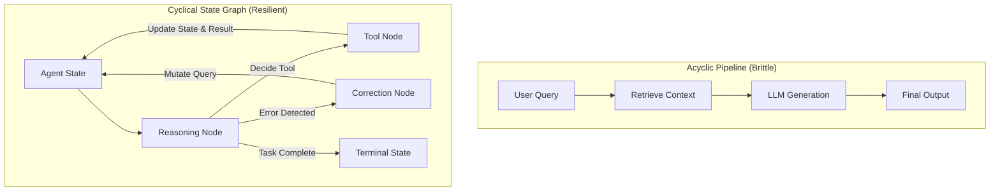
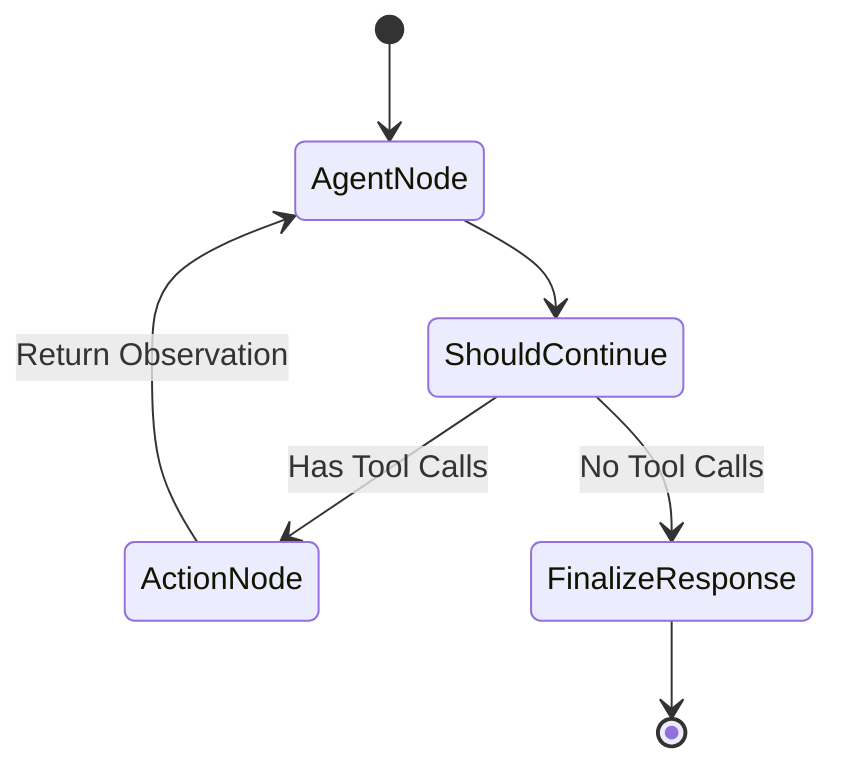

## Why Did Static Linear Chains Break Under Complex Multi-Step Agent Workflows?

When developers first connected large language models to external data in 2023 and 2024, the predominant architectural abstraction was the Directed Acyclic Graph (DAG) or linear sequence. Early framework patterns—epitomized by classic LangChain components like `LLMChain` and `SequentialChain`—assumed that prompt transformations could be reasoned about as predictable pipelines. A user input would flow through an embedding model, retrieve $k$ candidate passages, inject them into a template, and produce a final completion.

However, real-world task resolution quickly exposed the structural limits of acyclic pipelines. Complex problem solving demands dynamic branching, recursive error recovery, persistent state tracking, and environmental reflection. When a tool call returns a database syntax error or an incomplete document schema, an agent cannot simply abort the pipeline; it must inspect the stack trace, formulate an alternative SQL statement, and re-query the engine.



The fundamental failure of early agent scaffolding stemmed from treating orchestration as string passing rather than state transitions. This architectural friction prompted a two-stage paradigm shift: first, the formalization of declarative runnables through LangChain Expression Language (LCEL), and second, the migration toward graph-based state machines exemplified by LangGraph.

---

## Architectural Breakdown: LCEL Foundations and the Runnable Interface

To replace brittle inheritance hierarchies and hardcoded Python wrappers, LangChain introduced the `Runnable` protocol, formalized as LangChain Expression Language (LCEL). LCEL establishes a unified functional interface for chaining primitives using the Unix pipe operator (`|`):

$$\text{RunnableSequence} = R_1 \mid R_2 \mid \dots \mid R_n$$

Every runnable component implements a deterministic interface supporting synchronous, asynchronous, batch, and streaming invocations:

- `invoke(input, config)` / `ainvoke(input, config)`: Transforms an individual input into an output.
- `batch(inputs, config)` / `abatch(inputs, config)`: Evaluates a collection of inputs concurrently, optimizing network batching and throughput.
- `stream(input, config)` / `astream(input, config)`: Emits output chunks as tokens are generated by the underlying model.

```python
from langchain_core.prompts import ChatPromptTemplate
from langchain_core.output_parsers import StrOutputParser
from langchain_openai import ChatOpenAI

prompt = ChatPromptTemplate.from_messages([
    ("system", "You are an expert systems engineer. Analyze the architecture below."),
    ("human", "{code_snippet}")
])
model = ChatOpenAI(model="gpt-4o", temperature=0.0)
parser = StrOutputParser()

# Declarative functional composition via LCEL
analysis_chain = prompt | model | parser

# Execution with structured streaming
async for chunk in analysis_chain.astream({"code_snippet": "class AgentRunner..."}):
    print(chunk, end="", flush=True)
```

LCEL succeeded in eliminating boilerplate for parallel execution (`RunnableParallel`), routing (`RunnableBranch`), and schema validation via Pydantic. Yet, while LCEL solved the composition of directed acyclic graphs, it remained fundamentally ill-suited for non-deterministic cycles. Expressing a while-loop with conditional exit conditions in pure LCEL required complex recursion wrappers that easily caused stack overflows and obscured session state.

---

## From AgentExecutor to LangGraph: The Shift to Cyclic State Machines

Early agent implementations relied on `AgentExecutor`, a monolithic runtime loop that implemented the ReAct (Reasoning and Acting) pattern formulated by Yao et al. While convenient for quick demonstrations, `AgentExecutor` was an opaque black box. Developers had no granular control over message truncation, intermediate tool failures, human approval gates, or multi-agent handoffs.

LangGraph redesigned agent orchestration by modeling workflows as explicit, cyclical state machines. Rather than relying on hidden runtime state, LangGraph grounds execution in three formal primitives:

1. **State Schema**: A centralized, typed data structure (typically a `TypedDict` or Pydantic class) representing the shared memory of the system. State fields specify reducers (such as `operator.add` or replacement semantics) that govern how updates merge into the graph.
2. **Nodes**: Isolated Python functions or runnables that receive the current state, perform computation or external tool calls, and return a dictionary of state modifications.
3. **Edges & Conditional Edges**: Directed connections that route execution between nodes. Conditional edges evaluate current state variables (e.g., whether the LLM produced tool calls or an answer) to determine the next node dynamically.



### Implementing a Cyclic ReAct Architecture in LangGraph

The architectural strength of LangGraph lies in making cyclic feedback explicit. The implementation below demonstrates a complete, cyclic ReAct agent with explicit state management:

```python
import operator
from typing import Annotated, Sequence, TypedDict
from langchain_core.messages import BaseMessage, HumanMessage, ToolMessage
from langchain_core.tools import tool
from langchain_openai import ChatOpenAI
from langgraph.graph import StateGraph, END

# Define shared agent state with append reducer
class AgentState(TypedDict):
    messages: Annotated[Sequence[BaseMessage], operator.add]

@tool
def execute_database_query(query: str) -> str:
    """Executes a validated read-only SQL query against the warehouse."""
    # Simulated execution
    return f"Query executed: {query} -> Returned 42 rows."

tools = [execute_database_query]
model = ChatOpenAI(model="gpt-4o", temperature=0).bind_tools(tools)

# Define graph nodes
def call_agent_node(state: AgentState):
    response = model.invoke(state["messages"])
    return {"messages": [response]}

def call_tool_node(state: AgentState):
    last_message = state["messages"][-1]
    tool_outputs = []
    for tool_call in last_message.tool_calls:
        if tool_call["name"] == "execute_database_query":
            output = execute_database_query.invoke(tool_call["args"])
            tool_outputs.append(
                ToolMessage(content=str(output), tool_call_id=tool_call["id"])
            )
    return {"messages": tool_outputs}

# Routing logic
def should_continue(state: AgentState) -> str:
    last_message = state["messages"][-1]
    if hasattr(last_message, "tool_calls") and last_message.tool_calls:
        return "tools"
    return END

# Build cyclical state graph
builder = StateGraph(AgentState)
builder.add_node("agent", call_agent_node)
builder.add_node("tools", call_tool_node)

builder.set_entry_point("agent")
builder.add_conditional_edges("agent", should_continue, {"tools": "tools", END: END})
builder.add_edge("tools", "agent")  # Cycle back to agent for reflection

graph = builder.compile()
```

---

## Architectural Comparison: Framework Paradigms

| Dimension | LangChain Classic (Chains) | LangChain LCEL | LangGraph StateGraph |
| :--- | :--- | :--- | :--- |
| **Execution Topology** | Hardcoded Linear Sequence | Directed Acyclic Graph (DAG) | Arbitrary Cyclical State Machine |
| **State Paradigm** | Ephemeral, string-based kwargs | Typed inputs/outputs per Runnable | Centralized schema with field reducers |
| **Fault Recovery** | Try/catch around entire chain | Retries on individual Runnables | Explicit retry and error-correction subgraphs |
| **Human-in-the-Loop** | Difficult; required manual intercepts | External breakpoint coordination | Native `interrupt()` with state persistence |
| **Time Travel & Checkpointing** | Unsupported | Unsupported | Built-in durable checkpointers (Postgres, Redis) |
| **Multi-Agent Coordination** | Ad-hoc nested wrappers | Hierarchical chaining | First-class supervisor and swarm topologies |

---

## How Agent Orchestration Evolved Across 2026

Across 2026, agent engineering matured from heuristic experimental scripts into rigorous distributed systems. Several significant architectural shifts redefined how engineering teams structure agent runtimes:

1. **State Persistence and Time-Travel Debugging**: Production systems transitioned to durable checkpointer backends (such as PostgreSQL or SQLite WAL mode). In LangGraph, checkpointing captures the full state at every node transition. Developers can pause execution, modify an incorrect intermediate tool payload, and resume from step $k$ without re-running previous reasoning tokens.
2. **Strict Schema Constraints and Structured Outputs**: Early agents relied on fragile regex and markdown parsing to extract JSON tool calls. Modern foundation models provide native tool calling with constrained grammar decoding, allowing orchestration frameworks to validate tool arguments against Pydantic schemas deterministically before invocation.
3. **Decoupling Orchestration from Model Providers**: The ecosystem migrated toward vendor-neutral architectures, as explored in our [agent SDK landscape analysis](/posts/agent-sdk-landscape/). Rather than locking orchestration into single-provider prompt semantics, frameworks standardize on OpenTelemetry-compatible tracing spans (via LangSmith or Langfuse) and interchangeable model backends.
4. **Multi-Agent Specialization and Handoff Protocols**: Monolithic single-agent loops that attempt to handle broad workflows have been superseded by coordinated multi-agent graphs. Specialized sub-graphs (e.g., code synthesis, verification, deployment) operate with strict isolation boundaries, communicating via typed message passing and explicit supervisor transitions, aligning with principles established in [harness engineering](/posts/harness-engineering/) and [evidence-gated recursion](/posts/rlm-forge-evidence-gated-recursion/).
5. **Deterministic RAG Integration**: Orchestration frameworks now tightly integrate retrieval evaluation into the graph lifecycle. Rather than blindly concatenating search documents, graph nodes apply cross-encoder re-ranking and citation verification before passing context to reasoning agents, directly implementing [systematic RAG workflows](/posts/rag-systematic-workflow/).

---

## Key Takeaways

- **Acyclic Pipelines Cannot Model Real-World Agency**: Linear DAG architectures break down when confronted with tool execution failures, schema mismatches, and multi-step backtracking.
- **LCEL Formalized Declarative Runnables**: LangChain Expression Language resolved asynchronous streaming, batching, and parallel execution for directed pipelines, serving as the functional foundation for modern LangChain components.
- **LangGraph Elevates State to a First-Class Citizen**: By decoupling state schemas, computation nodes, and conditional edges, LangGraph provides deterministic control over cyclical loops, human-in-the-loop approvals, and checkpointed persistence.
- **2026 Production Standards Require Observability and Isolation**: Enterprise agent systems require time-travel debugging, persistent checkpointing, typed Pydantic validation, and multi-agent specialization to achieve commercial reliability.

---

## New Questions

- How do multi-agent swarm architectures handle state conflict resolution when multiple sub-agents execute parallel mutations against a shared global memory store?
- What are the throughput and latency trade-offs between centralized state graph checkpointers and distributed event-sourced agent architectures in high-concurrency environments?
- Can foundation models with extended context windows (1M+ tokens) eventually replace dynamic graph orchestration with continuous in-context reflection?

---

## References

- Yao, S., Zhao, J., Yu, D., Du, N., Shafran, I., Narasimhan, K., & Cao, Y. (2022). *ReAct: Synergizing Reasoning and Acting in Language Models*. arXiv preprint [arXiv:2210.03629](https://arxiv.org/abs/2210.03629) (accessed 2026-10-18).
- LangChain Documentation. (2026). *LangChain Expression Language (LCEL) Interface and Runnables*. LangChain Official Documentation. [https://python.langchain.com/docs/concepts/lcel/](https://python.langchain.com/docs/concepts/lcel/) (accessed 2026-10-18).
- LangGraph Documentation. (2026). *LangGraph: State Machines for Multi-Agent Workflows*. LangChain Official Documentation. [https://langchain-ai.github.io/langgraph/](https://langchain-ai.github.io/langgraph/) (accessed 2026-10-18).
- Martra, P. (2024). *Large Language Models Notebooks Course: LangChain and Evaluating LLMs*. GitHub Repository. [https://github.com/peremartra/Large-Language-Model-Notebooks-Course](https://github.com/peremartra/Large-Language-Model-Notebooks-Course) (accessed 2026-10-18).
