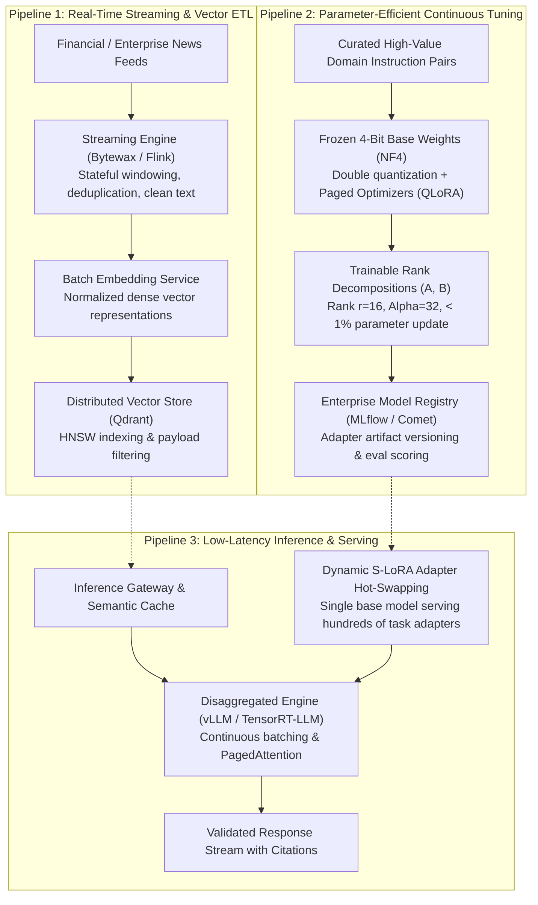

{: .light .shadow .rounded-10 w='1212' h='668' }

## How Does Production LLMOps Diverge from Classical MLOps Pipelines?

When foundation models emerged in 2023, engineering teams attempted to manage generative AI workloads using classical Machine Learning Operations (MLOps) frameworks designed for tabular scikit-learn models and convolutional networks. Traditional MLOps revolves around periodic batch retraining over static feature stores, tabular drift detection (such as Kolmogorov-Smirnov statistical tests), and deploying scalar regression microservices.

In production LLM systems, however, this classical paradigm collapses. Foundation models introduce non-deterministic textual outputs, billions of floating-point parameters, severe GPU high-bandwidth memory (HBM) constraints, and unpredictable inference latencies. A prototype built with twenty lines of notebook code functions reliably for a handful of test prompts, but deploying that system to serve thousands of concurrent enterprise users requires a fundamentally distinct discipline: **Large Language Model Operations (LLMOps)**.

Production LLMOps unites three decoupled asynchronous pipelines: real-time streaming data ingestion into vector indexes, parameter-efficient continuous fine-tuning (PEFT), and low-latency, memory-optimized inference serving.



---

## 1. Pipeline 1: Real-Time Streaming and Vector ETL

Enterprise domain knowledge is non-stationary: financial news, market transactions, regulatory updates, and customer communications arrive continuously. Static batch ETL pipelines that re-index document dumps nightly leave foundation models blind to real-time events.

### The Streaming Vector ETL Architecture
Modern LLMOps systems utilize lightweight Python-native streaming engines (such as Bytewax) or distributed stream processors (Apache Flink):
1. **Stateful Windowing and Deduplication**: Streaming engines ingest unstructured event streams from Apache Kafka, buffering message bursts across sliding time windows to detect redundant articles and assemble complete document boundaries.
2. **Chunking & Token Budgeting**: Documents are split into semantic chunks respecting structural markdown boundaries (headings, code blocks, lists) rather than arbitrary character offsets.
3. **Async Batch Embedding**: Embedding models operate most efficiently on batched tensor matrices. Streaming pipelines accumulate micro-batches (e.g., 32 to 64 chunks) before issuing vectorized inference calls, maximizing GPU operational intensity.
4. **Vector Database Ingestion**: Dense embeddings and metadata payloads (timestamp, author, access control permissions) are upserted into high-performance vector databases (e.g., Qdrant, Milvus) configured with Hierarchical Navigable Small World (HNSW) graph indices, enabling sub-10ms retrieval for downstream agentic queries, as detailed in our analysis of [Agentic RAG architectures](/posts/agentic-rag-cookbook/).

---

## 2. Pipeline 2: Parameter-Efficient Fine-Tuning with QLoRA

Full-parameter fine-tuning of 70B parameter models requires multi-node GPU clusters with distributed tensor and pipeline parallelism, costing thousands of dollars per training run. 

LLMOps circumvents this hardware barrier using **QLoRA (Quantized Low-Rank Adaptation)**, formulated by Dettmers et al. (2023). QLoRA enables fine-tuning a 70B parameter foundation model on a single 48GB GPU workstation by introducing three mathematical innovations:

### 1. NormalFloat4 (NF4) Data Type
Standard 4-bit integer (INT4) or floating-point (FP4) formats introduce significant quantization errors when modeling pre-trained neural network weights, which follow a zero-mean normal distribution $\mathcal{N}(0, \sigma^2)$. NF4 constructs an information-theoretically optimal quantile quantization grid where each bin contains an equal number of expected parameters, minimizing quantization distortion.

### 2. Double Quantization (DQ)
Quantization requires storing scaling constants $c_1$ for blocks of 64 parameters. Double quantization applies an additional 8-bit FP quantization to the scaling constants themselves, compressing memory overhead from 0.5 bits per parameter down to 0.127 bits per parameter—saving roughly 3 GB of VRAM on a 65B model.

### 3. Paged Optimizers
To prevent out-of-memory (OOM) crashes during gradient spikes, QLoRA allocates optimizer states (AdamW momentum and variance) across unified CPU and GPU memory using CUDA Unified Memory page-faulting primitives.

### The Low-Rank Adaptation Matrix Decomposition
During training, the base model weights $W_0 \in \mathbb{R}^{d \times k}$ remain frozen in 4-bit NF4 precision. Trainable parameter updates are factored into two low-rank matrices $A \in \mathbb{R}^{r \times k}$ and $B \in \mathbb{R}^{d \times r}$, where rank $r \ll \min(d, k)$:

$$W = W_0 + \Delta W = W_0 + \frac{\alpha}{r} (B \cdot A)$$

```
Input Vector (x) ────┬──────────────────────────────────────► Output Vector (y)
                     │                                            ▲
                     ├──► [ Frozen 4-Bit Base Weights (W_0) ] ────┤
                     │                                            │
                     └──► [ Matrix A (r x k) ] ──► [ Matrix B (d x r) ] ── (Scaled by alpha / r)
```

Because only $A$ and $B$ receive gradient updates, trainable parameters drop by over **99.5%**, producing lightweight adapter checkpoints (typically 50 to 200 MB) that can be trained locally on a single machine, as documented in our study of [single-node enterprise model training](/posts/rlhf-summary-from-human-feedback-single-dgx-spark/).

---

## 3. Pipeline 3: Low-Latency Inference and Multi-LoRA Serving

Deploying dozens of specialized models for distinct corporate departments (legal analysis, code review, customer support) historically required provisioning dedicated GPU instances for each model, multiplying infrastructure expenditure.

Modern LLMOps systems employ **S-LoRA (Sheng et al.) and Punica Multi-Tenant Serving**:
- **Shared Base Model in VRAM**: A single high-throughput base model (e.g., Llama-3-70B) is loaded into GPU High-Bandwidth Memory (HBM) once.
- **Dynamic Adapter Swapping**: Domain-specific QLoRA adapters (e.g., `adapter-finance.bin`, `adapter-legal.bin`) reside in system host RAM or fast NVMe storage.
- **PagedLoRA Memory Allocation**: When an incoming user request arrives at the inference gateway with a tenant tag, the serving engine dynamically streams the small adapter weights into pre-allocated GPU SRAM pages, executing batched inference for heterogeneous customer tasks across the same base forward pass.

---

## Classical MLOps vs. Production LLMOps

| Architectural Dimension | Classical MLOps (Scikit-Learn / XGBoost) | Production LLMOps (Foundation Models) |
| :--- | :--- | :--- |
| **Data Ingestion** | Batch feature store extraction | Real-time streaming vector ETL (Kafka, Bytewax, Qdrant) |
| **Model Artifact Size** | Megabytes (Pickle / ONNX) | Gigabytes to Terabytes (Safetensors / GGUF / Sharded BF16) |
| **Training Paradigm** | Full retraining from scratch | Parameter-Efficient Fine-Tuning (QLoRA) + In-Context RAG |
| **Primary Serving Bottleneck**| CPU compute / Network latency | GPU Memory Bandwidth (HBM) & KV Cache Capacity |
| **Evaluation Metrics** | Deterministic (ROC-AUC, RMSE, F1) | Non-deterministic (LLM-as-a-judge, G-Eval, RAGAS) |
| **Monitoring Concerns** | Covariate shift, statistical data drift | Hallucination rate, prompt injection, latency drift |

As detailed in our survey of [modern data engineering architectures](/posts/explore-the-landscape-of-open-source-data-engineering/), modern analytics and machine learning platforms are converging around composable, memory-efficient data interchange standards.

---

## How LLMOps Infrastructure Evolved Across 2026

Entering 2026, LLMOps engineering progressed beyond basic inference hosting into autonomous continuous improvement loops:

1. **Automated Synthetic Data Distillation Pipelines**: Fine-tuning datasets are increasingly synthesized by frontier reasoning teacher models (e.g., Claude 3.5 Sonnet, GPT-4o) using automated rejection sampling and execution-based verification, completely bypassing human data annotation bottlenecks.
2. **Speculative Decoding Engines**: Small, task-specific LoRA adapters serve as draft models for large base foundation models, speculating candidate tokens in parallel and accelerating generation throughput by 2x to 3x without degrading sampling distributions.
3. **Continuous Reinforcement Alignment with Verifiable Rewards**: Post-training pipelines replace brittle offline fine-tuning with automated reinforcement learning loops (RLVR), where models refine domain task policies autonomously against deterministic test harnesses and unit test runners.

---

## Key Takeaways

- **Decouple the Three Pipelines**: Production LLM systems must separate real-time vector streaming, asynchronous fine-tuning, and low-latency inference serving into independent architectural services.
- **QLoRA Democratizes Domain Specialization**: NF4 quantization and low-rank adapter decomposition allow organizations to fine-tune state-of-the-art models on single workstation GPUs.
- **Multi-LoRA Serving Slashes TCO**: Rather than deploying isolated GPU clusters for each department, multi-tenant serving engines co-locate hundreds of specialized task adapters on a single shared base model.

---

## New Questions

- How will enterprises maintain cryptographic audit trails and regulatory lineage when continuous streaming pipelines fine-tune adapter weights on real-time customer data?
- What architectural safeguards can prevent catastrophic catastrophic forgetting when a base model dynamically swaps dozens of adapters across multi-turn conversational sessions?

---

## References

- Dettmers, T., Pagnoni, A., Holtzman, A., & Zettlemoyer, L. (2023). *QLoRA: Efficient Finetuning of Quantized LLMs*. Advances in Neural Information Processing Systems, 36. [https://arxiv.org/abs/2305.14314](https://arxiv.org/abs/2305.14314) (accessed 2026-10-18).
- Hu, E. J., Shen, Y., Wallis, P., Allen-Zhu, Z., Li, Y., Wang, S., Wang, L., & Chen, W. (2022). *LoRA: Low-Rank Adaptation of Large Language Models*. International Conference on Learning Representations (ICLR 2022). [https://arxiv.org/abs/2106.09685](https://arxiv.org/abs/2106.09685) (accessed 2026-10-18).
- Sheng, Y., Cao, S., Li, D., Hooper, C., Zheng, L., Keutzer, K., ... & Stoica, I. (2023). *S-LoRA: Serving Thousands of Concurrent LoRA Adapters*. arXiv preprint arXiv:2311.03285. [https://arxiv.org/abs/2311.03285](https://arxiv.org/abs/2311.03285) (accessed 2026-10-18).
- Kwon, W., Li, Z., Zhuang, S., Sheng, Y., Zheng, L., Yu, C. H., ... & Stoica, I. (2023). *Efficient Memory Management for Large Language Model Serving with PagedAttention*. Proceedings of the 29th ACM Symposium on Operating Systems Principles (SOSP 2023). [https://doi.org/10.1145/3600006.3613165](https://doi.org/10.1145/3600006.3613165) (accessed 2026-10-18).
- Zaharia, M., Chen, A., Davidson, A., Ghodsi, A., Hong, S. A., Konwinski, A., ... & Shenker, S. (2018). *Accelerating the Machine Learning Lifecycle with MLflow*. IEEE Data Engineering Bulletin, 41(4), 39–45. [https://databricks.com/wp-content/uploads/2018/11/mlflow-ieee-paper.pdf](https://databricks.com/wp-content/uploads/2018/11/mlflow-ieee-paper.pdf) (accessed 2026-10-18).
