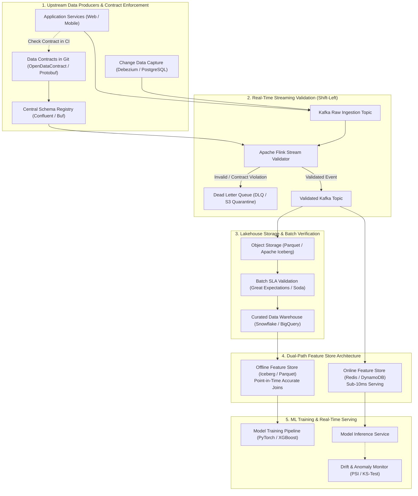
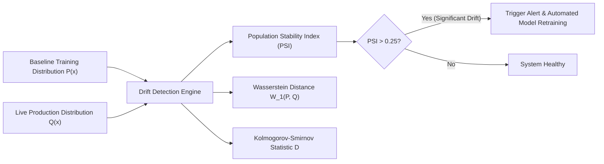
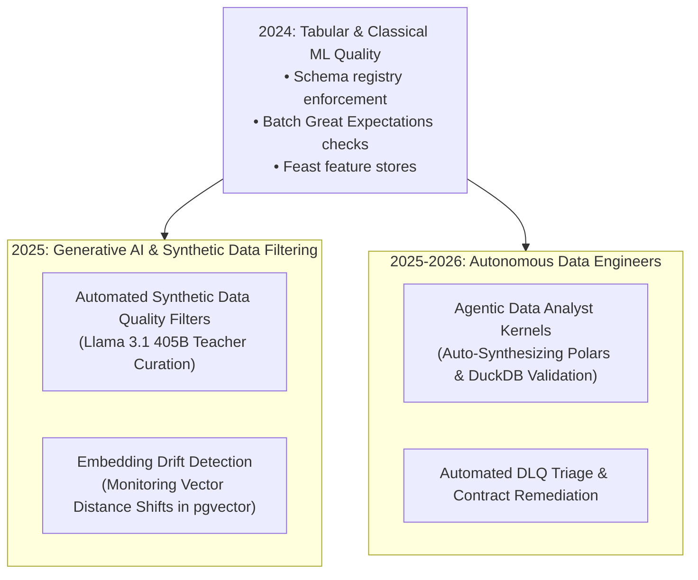

## Why Does Silent Data Corruption Destabilize Production Machine Learning?

In traditional software engineering, code bugs manifest loudly: an unhandled null pointer throws an exception, a syntax error halts compilation, or a service crash triggers an HTTP 500 error code that immediately wakes an on-call engineer. In machine learning systems, data failures behave completely differently: **they fail silently**.

As highlighted in Google's seminal paper *Hidden Technical Debt in Machine Learning Systems* ([Sculley et al., 2015](https://papers.nips.cc/paper_files/paper/2015/hash/86df7dcfd896fcaf2674f757a2463eba-Abstract.html)), machine learning code comprises a minuscule fraction of a real-world predictive system. The vast majority of infrastructure is dedicated to data ingestion, feature extraction, verification, and serving plumbing. When an upstream web engineer renames a database column, changes an enumerated string from `"US"` to `"USA"`, or alters an event trigger timestamp from UTC to local server time:
1. The downstream ETL pipeline does not crash.
2. The model training script continues running, happily ingesting null values or shifted distributions.
3. The resulting model deploys to production with catastrophically degraded inference accuracy, silently destroying business revenue without emitting a single alert.

Treating data quality as an ad-hoc downstream debugging step within ML training scripts is an operational anti-pattern. High-reliability machine learning architectures enforce **Shift-Left Data Governance**: data quality is treated as a software contract agreed upon by upstream data producers and downstream consumers, enforced deterministically at the point of ingestion via streaming validation engines and dual-path feature stores.

This data validation architecture directly underpins sandboxed Python pipelines in [Agentic Data Analysts](/posts/agentic-data-analyst/), high-throughput columnar analytics in [Modern Python Analytics with Arrow and Polars](/posts/data-analystics-with-python/), and production ML lifecycle governance in [LLMOps Systems Architecture](/posts/llm-systems-using-llmops/).

---

## Architectural Topology: The End-to-End Data Quality Pipeline

A resilient machine learning data platform intercepts data at generation and validates it across every stage of ingestion:

---

## Deconstructing the Core Data Quality Pillars

### 1. Data Contracts: Formal Producer-Consumer Agreements
A **Data Contract** is a machine-readable specification that establishes explicit structural, semantic, and operational commitments between data producers (software engineering teams) and data consumers (machine learning and data engineering teams).

A standard data contract specifies four core dimensions:
- **Schema & Versioning**: Explicit field types, required nullability constraints, and backward-compatibility rules (e.g., using Protobuf or JSON Schema). Breaking schema changes cannot merge into production without consumer deprecation notices.
- **Semantic Constraints**: Value domain bounds (e.g., `age BETWEEN 0 AND 120`), regex patterns (e.g., ISO-8601 timestamps), and foreign key integrity invariants.
- **Operational Service Level Agreements (SLAs)**: Freshness guarantees (e.g., $99\%$ of events delivered within 60 seconds of client creation), volume expectations (e.g., $10,000 \pm 20\%$ events per minute), and completeness thresholds.
- **Data Lineage and Ownership**: Explicit owner email, business domain tags, and privacy classifications (e.g., PII masking requirements).

### 2. Shift-Left Streaming Validation with Apache Flink
Validating data inside nightly batch ETL jobs means corrupted data persists inside production databases for hours before discovery. Modern architectures enforce stream-level gating:
- Raw events flow into an unvalidated Kafka topic.
- A stateful Apache Flink streaming application intercepts each record, deserializes the payload, and compares it against the active schema in the Schema Registry.
- Valid records emit to a `validated.events` topic; invalid records route to a **Dead Letter Queue (DLQ)** with detailed diagnostic metadata explaining the exact contract violation.

### 3. Dual-Path Feature Stores and Train-Serve Skew
One of the most insidious sources of machine learning failure is **train-serve skew**: the mathematical distribution of features observed during offline model training differs from the features computed during live online inference.

Modern feature stores (such as Feast, Hopsworks, or Tecton) eliminate train-serve skew via dual-path synchronization:
- **Online Store (Low-Latency Serving)**: Maintained in Redis or DynamoDB. Live streaming events update key-value records within milliseconds, allowing inference services to fetch feature vectors in $< 10\text{ ms}$.
- **Offline Store (Historical Parquet/Iceberg)**: Preserves historical snapshots. When constructing training sets, the feature store executes **as-of point-in-time joins**, reconstructing feature states exactly as they existed at the historic timestamp of each training label, eliminating target leakage.

---

## Mathematical Formulations: Quantifying Distribution Drift

Data quality extends beyond static schema compliance; it requires tracking whether continuous feature distributions remain statistically stable over time.

### 1. Population Stability Index (PSI)
The Population Stability Index is the industry standard for measuring covariate shift in continuous and categorical feature distributions between a reference training dataset $P$ and an operational production window $Q$.

The feature range is binned into $B$ discrete buckets (typically $B = 10$ deciles based on the baseline distribution). Let $P_b$ and $Q_b$ denote the fraction of observations falling into bucket $b$:

$$\text{PSI} = \sum_{b=1}^B \left( Q_b - P_b \right) \cdot \ln\left( \frac{Q_b}{P_b} \right)$$

The mathematical thresholds for operational intervention are strictly codified:
- $\text{PSI} < 0.10$: Minimal shift; the production distribution matches the training baseline.
- $0.10 \le \text{PSI} < 0.25$: Moderate drift; warning triggered; monitor feature for potential retraining.
- $\text{PSI} \ge 0.25$: Significant distribution shift; feature integrity compromised; model predictions are unreliable; trigger retraining or fallback logic.

### 2. Wasserstein-1 Distance (Earth Mover's Distance)
For continuous numerical features with unbounded domains or multimodal distributions, the Kolmogorov-Smirnov test can be hypersensitive to sample size. Modern platforms calculate the Wasserstein-1 metric:

$$\mathcal{W}_1(P, Q) = \int_{-\infty}^{\infty} \left| F_P(x) - F_Q(x) \right| dx$$

where $F_P(x)$ and $F_Q(x)$ are the cumulative distribution functions (CDFs) of baseline and production samples. $\mathcal{W}_1$ measures the minimum physical "work" required to transform distribution $P$ into $Q$, providing a continuous metric in the native units of the feature.

### 3. Freshness SLA Verification
Let $t_{\text{event}}$ be the client-side epoch timestamp when the user action occurred, and $t_{\text{ingest}}$ be the arrival timestamp at the data lakehouse. The Freshness metric evaluates whether pipeline latency violates contract guarantees:

$$\Delta t_{\text{latency}} = t_{\text{ingest}} - t_{\text{event}}$$

$$\text{SLA Compliance} = \frac{1}{N} \sum_{i=1}^N \mathbb{I}\left( \Delta t_{\text{latency}}^{(i)} \le \tau_{\text{SLA}} \right) \ge 0.99$$

---

## Empirical Comparison: Traditional vs Contract-Driven Data Architectures

| Architectural Dimension | Traditional Ad-Hoc Pipeline | Contract-Driven Shift-Left Architecture |
| :--- | :--- | :--- |
| **Schema Governance** | Implicit, undocumented in SQL scripts | Explicit, machine-readable git contracts |
| **Breaking Change Discovery** | Discovered by failed downstream reports | Blocked upstream in producer CI/CD |
| **Validation Execution** | Nightly batch ETL scripts | In-flight streaming via Apache Flink |
| **Invalid Record Handling** | Discarded silently or causes job crashes | Routed to Dead Letter Queue (DLQ) |
| **Feature Synchronization** | Separate SQL queries for train and serve | Unified dual-path feature store |
| **Drift Detection** | Manual inspection after business metrics drop | Automated continuous PSI / Wasserstein alerting |
| **Time-to-Detection (TTD)** | Days to weeks | Seconds to minutes |

---

## How ML Data Quality Evolved Across 2024–2026 AI Architectures

Between 2024 and 2026, the rise of foundational LLMs, generative agents, and synthetic dataset pipelines fundamentally expanded the definition of data quality:

### 1. Synthetic Training Data Quality Gates
Prior to 2024, data quality centered on structured tabular rows and clean labels. In 2025–2026, foundation model training relies heavily on synthetic data generated by teacher models (such as Llama 3.1 405B).
- Raw synthetic data contains hallucinations, circular reasoning, and stylistic degenerate repetitions.
- Modern pipelines apply multi-stage algorithmic data quality gates: heuristic length filters, perplexity cutoffs, semantic deduplication via MinHash LSH, and automated reward-model verifiers before fine-tuning datasets are approved.

### 2. High-Dimensional Embedding Drift in RAG Systems
In generative search and retrieval-augmented generation (RAG), data corruption does not appear as null values; it appears as **semantic distribution drift**.
- As user queries evolve, the vector space representations emitted by embedding models drift away from pre-indexed document clusters.
- Modern observability systems monitor the centroid distance of incoming query embeddings in vector stores (e.g., pgvector), alerting engineers when semantic drift indicates that vector knowledge indices require re-embedding.

### 3. Autonomous Data Quality Agents
In 2026, maintaining data quality shifted from manual data engineering tickets to autonomous agents (as demonstrated in [Agentic Data Analysts](/posts/agentic-data-analyst/)).
- When a Dead Letter Queue accumulates anomalous records, a triage agent spins up an ephemeral Python sandbox using high-performance engines like Polars and DuckDB (analyzed in [Modern Python Analytics](/posts/data-analystics-with-python/)).
- The agent analyzes the corrupted schema, generates a reproducible test case, drafts an updated data contract, and submits a pull request to the producer service repository with proposed schema fixes.

---

## Key Takeaways

- **Silent Failure Prevention**: Machine learning models fail silently under corrupted inputs; data quality must be enforced at ingestion rather than diagnosed inside downstream training scripts.
- **Data Contracts as Shift-Left Architecture**: Formal, versioned agreements between data producers and consumers prevent unannounced schema migrations from breaking production models.
- **In-Flight Stream Validation**: Coupling Apache Flink with central Schema Registries quarantines malformed events into Dead Letter Queues within milliseconds, preserving data lake integrity.
- **Dual-Path Feature Stores**: Synchronizing online low-latency key-value stores with historical point-in-time offline tables eliminates train-serve skew.
- **Statistical Drift Telemetry**: Continuous monitoring using Population Stability Index (PSI) and Wasserstein distance detects covariate shift before model prediction accuracy degrades.

---

## New Questions

1. **Multimodal Data Contract Specifications**: While tabular schemas and JSON payloads have standardized contracts (Protobuf/JSON Schema), how can data contracts formally specify non-textual quality invariants for high-dimensional video streams, 3D point clouds, and audio spectrograms?
2. **Dynamic Backpressure Under Massive DLQ Spikes**: If an upstream service deployment produces a bug that sends $90\%$ of traffic to a Dead Letter Queue, how can streaming validation engines throttle producers without exhausting Kafka broker disk storage?
3. **Automated Semantic Schema Negotiation**: Can autonomous agentic producers and consumers negotiate contract modifications dynamically via RPC protocols without requiring human engineering committee approvals?

---

## References

- Sculley, D., Holt, G., Golovin, D., Davydov, E., Phillips, T., Ebner, D., Chaudhary, V., Young, M., Crespo, J. F., & Dennison, D. (2015). *Hidden Technical Debt in Machine Learning Systems*. Advances in Neural Information Processing Systems (NeurIPS 2015). [https://papers.nips.cc/paper_files/paper/2015/hash/86df7dcfd896fcaf2674f757a2463eba-Abstract.html](https://papers.nips.cc/paper_files/paper/2015/hash/86df7dcfd896fcaf2674f757a2463eba-Abstract.html). (accessed 2026-10-18).
- Breck, E., Polyzotis, N., Roy, S., Whang, S., & Zinkevich, M. (2019). *Data Validation for Machine Learning*. Proceedings of the 2nd MLSys Conference. [https://research.google/pubs/data-validation-for-machine-learning/](https://research.google/pubs/data-validation-for-machine-learning/). (accessed 2026-10-18).
- Sanderson, C. (2023). *Data Contracts: Conceptual Framework and Practical Implementation*. O'Reilly Media. [https://datacontracts.org/](https://datacontracts.org/). (accessed 2026-10-18).
- Yurdakul, B. (2018). *Statistical Properties of the Population Stability Index*. Western Michigan University Dissertations. [https://scholarworks.wmich.edu/dissertations/3208/](https://scholarworks.wmich.edu/dissertations/3208/). (accessed 2026-10-18).
- Ng, A. (2021). *A Chat with Andrew on MLOps: From Model-centric to Data-centric AI*. DeepLearning.AI. [https://www.deeplearning.ai/the-batch/issue-86/](https://www.deeplearning.ai/the-batch/issue-86/). (accessed 2026-10-18).
