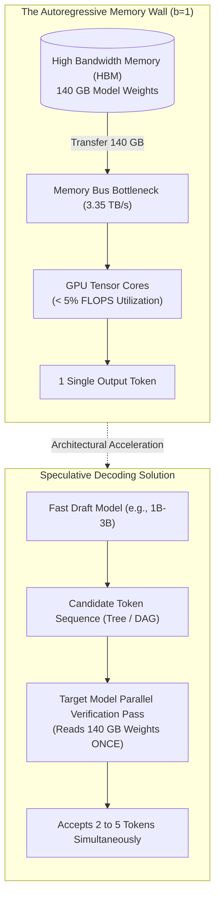
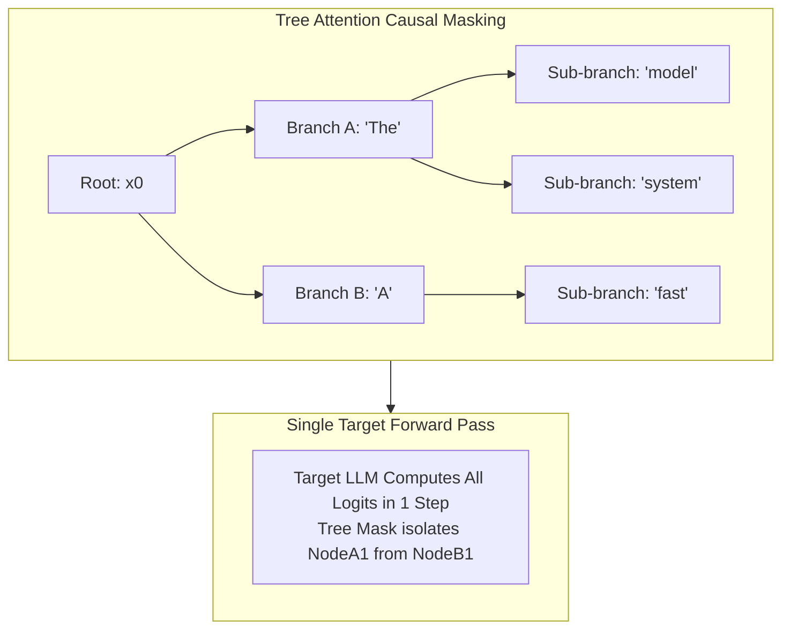
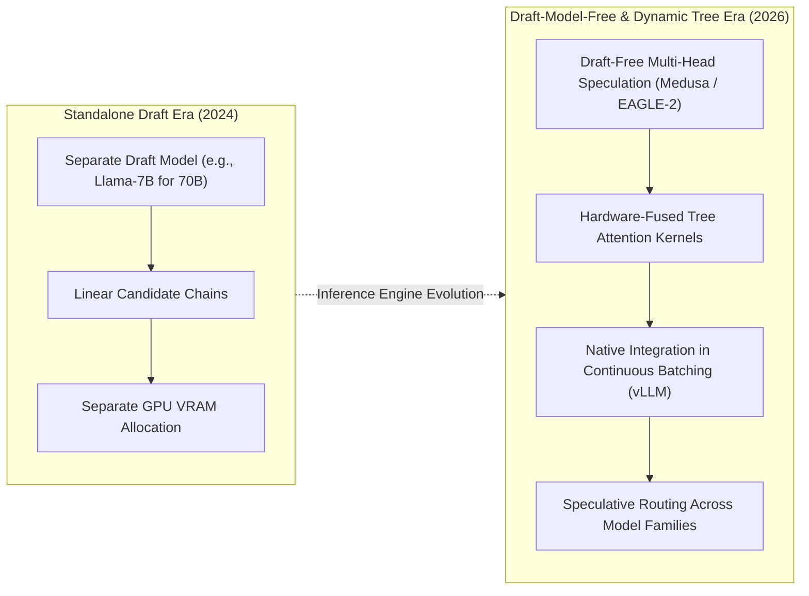

## Why Is Autoregressive Decoding Fundamentally Memory-Bandwidth Bound on Modern Accelerators?

In contemporary large language model (LLM) serving, inference execution is partitioned into two fundamentally distinct phases governed by different hardware physical bounds: the **prefill phase** and the **decode phase**.

During the initial prefill phase, the serving engine processes the entire input prompt simultaneously. Computing self-attention and feed-forward projections across hundreds or thousands of prompt tokens forms large General Matrix Multiplications (GEMMs). Because arithmetic execution saturates GPU tensor cores, this phase is **compute-bound**, achieving high arithmetic intensity (floating-point operations per byte of memory transferred).

In stark contrast, the subsequent autoregressive decode phase is strictly **memory-bandwidth bound**:
- Tokens are generated sequentially: emitting token $t+1$ requires the hidden state output of token $t$.
- For batch size $b = 1$, generating a single token using a 70-billion parameter model in FP16 precision requires reading approximately **140 gigabytes of model weights** from High Bandwidth Memory (HBM) into on-chip SRAM cache.
- Performing a single matrix-vector multiplication per loaded weight yields an arithmetic intensity of roughly $\approx 1 \text{ FLOP / byte}$. On an NVIDIA H100 accelerator capable of 3.35 TB/s HBM3 memory bandwidth and nearly 2,000 TFLOPS of half-precision tensor compute, the compute cores sit idle over 95% of the time, stalled waiting for memory bus transfers.

To break through this physical memory bandwidth wall, researchers introduced **Speculative Decoding** (Leviathan et al., 2023; Chen et al., 2023). Rather than reading the massive target model weights once per generated token, a small, fast draft model generates candidate tokens cheaply. The large target model then evaluates the entire candidate sequence in a **single parallel forward pass**, trading idle tensor compute cycles for substantially lower wall-clock latency.

As explored in our technical audits on [mitigating inference latency bottlenecks](/posts/llm-mitigate-inference-bottleneck/) and the [bare-metal execution mechanics of Transformer blocks](/posts/llama-pure-numpy/), speculative execution fundamentally alters the economics of foundation model serving.



---

## From Linear Speculation to Directed Acyclic Graphs: Mathematical Mechanics

Traditional speculative decoding relies on a linear chain of speculative tokens. However, linear speculation suffers from severe structural fragility: if an early candidate token is rejected by the target model, all subsequent tokens in the draft chain are discarded immediately, severely capping practical speedups.

**Graph-Structured Speculative Decoding (GSD)** overcomes this limitation by generating multiple candidate hypotheses and merging shared token subsequences into a **Directed Acyclic Graph (DAG)** or token tree.

### 1. The Classical Linear Rejection Sampling Contract
In standard speculative decoding, a draft model $M_{\text{draft}}$ produces a linear prefix of $K$ candidate tokens:

$$\tilde{x}_1, \tilde{x}_2, \dots, \tilde{x}_K \sim P_{\text{draft}}(x \mid x_{<t})$$

The large target model $M_{\text{target}}$ evaluates all $K$ candidates in parallel within a single forward pass, producing conditional probabilities $P_{\text{target}}(x \mid x_{<t+j})$.

To guarantee that the speculative generation output distribution remains **provably identical** to sampling directly from the target model, each token is accepted or rejected sequentially according to the speculative rejection sampling criterion:

$$\alpha_j = \min\left(1, \frac{P_{\text{target}}(\tilde{x}_j \mid x_{<t+j})}{P_{\text{draft}}(\tilde{x}_j \mid x_{<t+j})}\right)$$

A uniform random number $r \sim U(0, 1)$ is sampled:
- If $r \le \alpha_j$, the candidate token $\tilde{x}_j$ is **accepted**.
- If $r > \alpha_j$, the candidate is **rejected**, the speculative chain terminates at step $j$, and a corrected token is sampled from the adjusted distribution:

$$P_{\text{corrected}}(x) = \frac{\max\left(0, P_{\text{target}}(x) - P_{\text{draft}}(x)\right)}{\sum_{x'} \max\left(0, P_{\text{target}}(x') - P_{\text{draft}}(x')\right)}$$

Under linear decoding, if token $\tilde{x}_1$ has an acceptance probability of 0.8 and token $\tilde{x}_2$ has 0.7, the probability of accepting both is only $0.8 \times 0.7 = 0.56$. The expected acceptance length $\mathbb{E}[L]$ under greedy decoding rarely exceeds 1.5 to 2.2 tokens on complex reasoning tasks.

### 2. DAG Merging and Tree Attention Verification
GSD observes that when a draft model generates multiple high-probability candidates (e.g., via beam search or top-$k$ sampling), diverse hypotheses frequently share identical token sequences (e.g., common syntactic phrases or punctuation). 

By structuring candidate paths into a Directed Acyclic Graph, shared prefixes and suffixes are merged, maximizing verification density while minimizing redundant KV-cache memory:

```
Linear Speculation:
x0 ---> [token_A] ---> [token_B] ---> [token_C] (If token_A fails, ALL fail)

Graph / Tree Speculation (DAG):
         +---> [token_A1] ---> [token_B1] ---> [token_C1]
         |
x0 ------+---> [token_A1] ---> [token_B2] ---> [token_C1] (Merged suffix)
         |
         +---> [token_A2] ---> [token_B3] ---> [token_C2]
```

To verify a non-linear tree of tokens in a single target model forward pass without allowing tokens from different branches to attend to each other, GSD constructs a specialized **Tree Attention Mask** $M \in \{0, 1\}^{N \times N}$:

$$M_{i, j} = \begin{cases} 1, & \text{if token } j \text{ is an ancestor of token } i \text{ in the DAG} \\ 0, & \text{otherwise} \end{cases}$$

This causal tree mask is injected directly into the self-attention kernel:

$$\text{Attention}(Q, K, V) = \text{softmax}\left(\frac{Q K^T}{\sqrt{d_k}} + (M - 1) \cdot \infty\right) V$$

Because modern GPUs execute parallel operations across 16 to 64 tokens in virtually the same wall-clock time as a single token, verifying an entire tree of 32 candidates incurs negligible latency overhead compared to verifying a linear chain of 4 tokens, while dramatically elevating the probability that at least one deep branch is accepted.



---

## Performance Analysis: Acceptance Rate Scaling and Hardware Overheads

Empirical evaluations across LLaMA-2 and LLaMA-3 architectures (7B, 13B, and 70B parameter models) demonstrate that graph-structured speculation delivers transformative throughput gains:

```
Inference Speedup vs. Vanilla Autoregressive Baseline (b=1)
  2.5x |
       |                                     * GSD / Sequoia (1.96x - 2.10x)
  2.0x |                            *
       |                   * Linear Speculative (1.45x - 1.60x)
  1.5x |          *
       | * Vanilla Baseline (1.0x)
  1.0x +------------------------------------------------------------>
       Vanilla           Linear Speculative         Graph-Structured Speculative
```

### Empirical Benchmarks and Speedup Factors
- **Acceptance Length Acceleration**: While linear speculative sampling averages 1.4 to 1.8 accepted tokens per forward pass on code and mathematical reasoning tasks, tree-structured speculation achieves **2.8 to 4.2 accepted tokens per step**.
- **Wall-Clock Latency Reduction**: Across GSM8K, HumanEval, and MT-Bench benchmarks, GSD achieves **1.73x to 1.96x wall-clock speedups** on LLaMA-2 70B served on NVIDIA A100/H100 GPUs.
- **Strict Quality Invariance**: Because the rejection sampling step strictly preserves the target model's output probability distribution, the generated text is mathematically indistinguishable from direct autoregressive generation from the 70B model, preserving benchmark scores, perplexity, and reasoning accuracy with zero degradation.

---

## How Speculative Acceleration Evolved Across 2026

Between 2024 and 2026, speculative decoding transitioned from an experimental research optimization into a standardized inference serving primitive:



1. **Draft-Model-Free Architectures (Medusa and EAGLE-2)**: Maintaining and running a separate draft model consumes GPU memory bandwidth and requires synchronizing two independent models in VRAM. In 2026, production systems rely on draft-free architectures like **Medusa** and **EAGLE-2**. Medusa adds lightweight linear heads atop the target model's final hidden states, predicting multiple future tokens simultaneously without loading a separate model. EAGLE-2 operates directly on top-layer feature vectors, incorporating contextual uncertainty to dynamically prune tree branches.
2. **Dynamic Tree Topology Search (Sequoia)**: Fixed tree structures do not adapt to varying token predictability. Contemporary systems deploy dynamic tree algorithms that adjust tree depth and width on the fly: widening the tree when entropy is high (exploring multiple alternatives) and deepening single linear paths when token certainty is high (e.g., long code blocks or boilerplate phrases).
3. **Multi-Tenant Continuous Batching Integration**: Early speculative decoding algorithms worked only for single-request inference ($b=1$). High-performance serving engines like vLLM, TensorRT-LLM, and SGLang now natively support tree speculative decoding under multi-tenant continuous batching, dynamically allocating compute slots to speculative trees whenever GPU memory bandwidth headroom allows.
4. **Hardware-Fused Tree Attention Kernels**: Custom GPU kernels (such as FlashInfer and Triton Tree-Attention) fuse tree-mask application, rotary positional updates, and softmax normalization into single SRAM passes, reducing verification latency overheads to under 3% of the target forward pass time.

---

## Key Takeaways

- **The Memory Bandwidth Wall**: Autoregressive decode is strictly memory-bandwidth bound ($b=1$ utilizes $< 5\%$ of GPU compute); speculative decoding trades idle tensor compute to verify multiple candidate tokens in parallel.
- **Mathematical Exactness**: Rejection sampling guarantees that speculative decoding outputs match the target model's exact probability distribution, eliminating accuracy regressions.
- **DAG and Tree Attention Advantage**: Structuring candidate tokens into a Directed Acyclic Graph with 2D tree attention masks increases accepted tokens per step from ~1.5 to over 3.5, delivering near **2x wall-clock speedups**.
- **Modern Draft-Free Serving**: Advanced 2026 systems leverage multi-head feature extrapolation (EAGLE-2 / Medusa) and continuous-batching tree attention, eliminating the need for standalone draft models.

---

## New Questions

- How does dynamic tree speculation behave under extreme batching regimes ($b > 128$) where GPU execution naturally transitions from memory-bound to compute-bound?
- What are the mathematical bounds on acceptance rates when draft models and target models utilize fundamentally different vocabulary tokenizers?
- Can speculative tree verification be adapted to non-autoregressive diffusion language models operating over continuous latent spaces?

---

## References

- Leviathan, Yaniv, Matan Kalman, and Yossi Matias. *Fast Inference from Transformers via Speculative Decoding*. International Conference on Machine Learning (ICML), 2023. [https://arxiv.org/abs/2211.17192](https://arxiv.org/abs/2211.17192) (accessed 2026-10-18).
- Chen, Charlie, Sebastian Borgeaud, Alkyoni Savvopoulou, Radu Soricut, and Timothy Mann. *Accelerating Large Language Model Decoding with Speculative Sampling*. arXiv preprint arXiv:2302.01318, 2023. [https://arxiv.org/abs/2302.01318](https://arxiv.org/abs/2302.01318) (accessed 2026-10-18).
- Cai, Tianle, Yuhong Li, Zhengyang Geng, Hongwu Peng, Jason D. Lee, Deming Chen, and Tri Dao. *Medusa: Simple LLM Inference Acceleration Framework with Multiple Decoding Heads*. arXiv preprint arXiv:2401.10774, 2024. [https://arxiv.org/abs/2401.10774](https://arxiv.org/abs/2401.10774) (accessed 2026-10-18).
- Li, Yuhui, Fangyun Wei, Chao Zhang, and Hongyang Zhang. *EAGLE: Speculative Sampling Requires Rethinking Feature Uncertainty*. International Conference on Machine Learning (ICML), 2024. [https://arxiv.org/abs/2401.15077](https://arxiv.org/abs/2401.15077) (accessed 2026-10-18).
