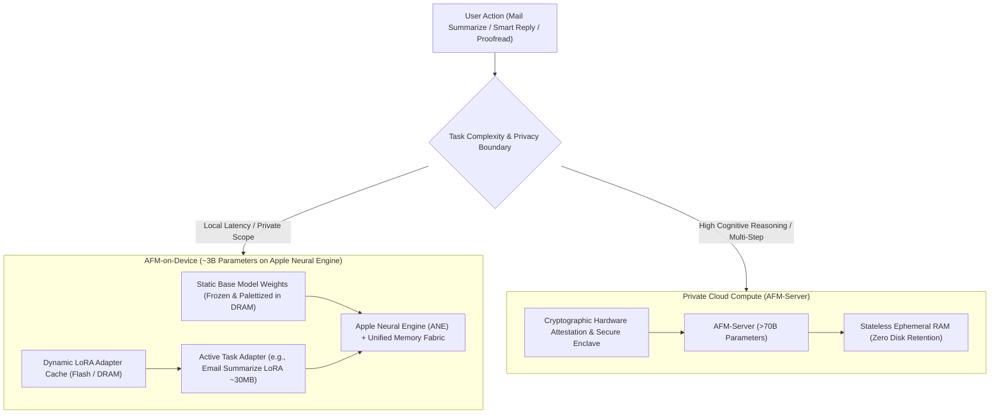
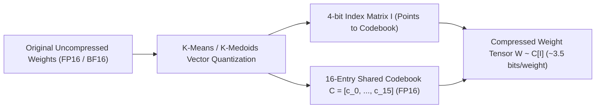
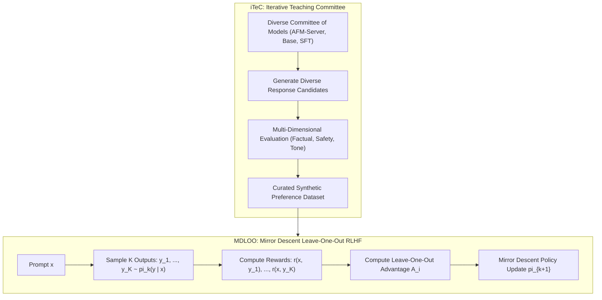
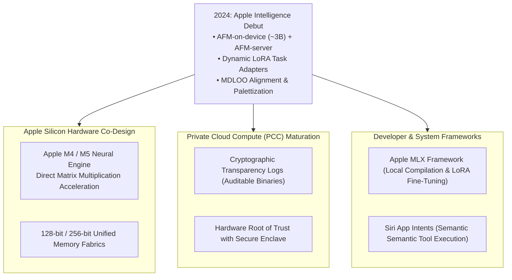

## How Did Apple Balance On-Device Hardware Constraints with Frontier Alignment?

Deploying generative foundation models across hundreds of millions of consumer smartphones and personal computers introduces engineering constraints radically different from hyperscale cloud serving. While datacenter AI relies on multi-node clusters of liquid-cooled 700-watt GPUs with gigabytes of High-Bandwidth Memory (HBM), on-device mobile inference must operate within strict thermal envelopes (often under 5 watts), share a unified memory pool with the operating system and user applications, and preserve battery life without noticeable user interface latency.

In the technical report *Apple Intelligence Foundation Language Models* ([Apple Foundation Model Team, 2024](https://arxiv.org/abs/2407.21075)), Apple unveiled a dual-model foundation architecture that bridges local mobile execution with privacy-preserving cloud scale:
1. **AFM-on-device (~3 Billion Parameters)**: A dense transformer engineered from scratch to run locally on iPhone, iPad, and Mac hardware. Utilizing grouped-query attention, aggressive weight palettization (clustering weights into 4-bit and 2-bit indices), and dynamic low-rank adapters (LoRA), AFM-on-device delivers sub-15ms time-to-first-token while consuming less than 1.5 GB of system DRAM.
2. **AFM-server (Large Server Model)**: A multi-tens-of-billions parameter model hosted in **Private Cloud Compute (PCC)**—a custom datacenter infrastructure built on Apple Silicon server nodes enforcing cryptographic non-retention of user prompts and verifiable hardware attestation.

Beyond hardware co-design, Apple made two fundamental algorithmic contributions to LLM post-training: **iTeC (Iterative Teaching Committee)**, which mitigates model collapse during synthetic distillation, and **MDLOO (Mirror Descent with Leave-One-Out estimation)**, an online reinforcement learning from human feedback (RLHF) algorithm that maximizes KL-penalized reward functions without requiring a memory-intensive critic/value network.

This alignment architecture directly complements online iterative alignment in [Online Iterative DPO](/posts/llama-finetune-case/), open-weight scaling in [Meta Llama 3.1 Architecture](/posts/the-gpt-4-killer-llama-3-1/), and modular boundaries in [Modern Software Architecture](/posts/modern-software-architecture/).

---

## Architectural Topology: Dual Fleet and Dynamic LoRA Adapter Hub

Apple Intelligence decouples generic language capabilities from specialized domain tasks through an on-device adapter hub:

### The Base Model and Adapter Decoupling
Rather than fine-tuning separate 3B models for distinct tasks (e.g., one model for Siri, one for Notes, one for Mail, one for notification triage)—which would exhaust device flash storage and RAM—Apple maintains a **single frozen base foundation model**.
- The base model weights $\mathbf{W}_0$ remain permanently resident in memory or memory-mapped from fast NVMe storage.
- When the user triggers Mail summarization, the operating system loads a lightweight Low-Rank Adaptation (LoRA) matrix:

$$\mathbf{h} = \mathbf{W}_0 \mathbf{x} + \frac{\alpha}{r} \mathbf{B} \mathbf{A} \mathbf{x}$$

where $\mathbf{A} \in \mathbb{R}^{r \times d}$ and $\mathbf{B} \in \mathbb{R}^{d \times r}$ with rank $r \in \{16, 32\}$.
- Because each task adapter consumes only $20$ to $40\text{ megabytes}$, the operating system dynamically swaps adapters in sub-millisecond intervals, delivering specialized performance across dozens of system applications with zero base model reload penalty.

---

## Weight Palettization: Squeezing 3B Parameters into 1.5 GB DRAM

To execute on devices with 8 GB of unified memory (such as baseline iPhone 15 Pro and entry-level M-series Macs), the 3B model's footprint had to be drastically compressed without degrading generative coherence. Apple developed a mixed-precision **Palettization** quantization framework:

### Palettization Mechanics
Standard uniform integer quantization (e.g., INT4) maps floating-point numbers into evenly spaced grid bins, which poorly represents the bell-shaped Gaussian distributions typical of transformer weight matrices. Palettization formulates quantization as a codebook clustering problem:
1. Weights are partitioned into small local blocks (e.g., 64 elements).
2. For each block, Apple fits an optimal non-linear codebook $\mathcal{C} = \{c_0, c_1, \dots, c_{2^b - 1}\}$ using vector quantization (k-means) to minimize the Frobenius reconstruction error:

$$\min_{\mathcal{C}, \mathbf{I}} \left\| \mathbf{W} - \mathcal{C}[\mathbf{I}] \right\|_F^2$$

3. For a 4-bit palette ($b = 4$), the matrix requires only $16$ discrete centroid scalars stored in FP16, while every individual weight is stored as a 4-bit lookup index.
4. Selective layers (such as non-critical FFN down-projections) are palettized down to **2 bits per weight**, achieving an average effective precision of **3.5 bits per parameter**.
5. During execution on the Apple Neural Engine (ANE), custom hardware dequantization kernels reconstruct the FP16 activations on-the-fly inside local SRAM cache lines, avoiding high-latency memory roundtrips.

---

## Post-Training Alignment: iTeC and MDLOO Formulations

The most technically distinctive aspect of the Apple Intelligence report lies in its two proprietary post-training algorithms designed to overcome the instabilities of standard PPO and DPO.

### 1. iTeC (Iterative Teaching Committee)
Standard self-distillation suffers from **confirmation bias and mode collapse**: when a model generates its own training pairs, it amplifies its own systemic blind spots. Apple's iTeC framework deploys a diverse "model committee" comprising AFM-server, specialized mathematical solvers, and diverse SFT checkpoints. The committee collaboratively generates, critiques, and filters candidate responses across multiple alignment iterations, ensuring synthetic data quality remains high across generations.

### 2. MDLOO (Mirror Descent with Leave-One-Out Estimation)
Standard Proximal Policy Optimization (PPO) requires maintaining four models concurrently in GPU memory: Actor, Critic (Value Network), Reference Model, and Reward Model. On large server models, training a dedicated Critic network doubles memory overhead and introduces severe value-estimation variance.

Apple solved this by developing **MDLOO**, combining Mirror Descent Policy Optimization with a non-parametric **Leave-One-Out (LOO)** baseline estimator:
- For input prompt $x$, the policy $\pi_k$ samples $K$ independent completions: $\{y_1, y_2, \dots, y_K\}$.
- The reward model assigns scalar scores $r(x, y_i)$.
- To compute the advantage $\hat{A}_i$ of candidate $y_i$ without training a Critic network, MDLOO sets the baseline as the mean reward of all *other* $K-1$ sampled candidates:

$$\hat{A}_i = r(x, y_i) - \frac{1}{K - 1} \sum_{j \neq i} r(x, y_j)$$

Subtracting the leave-one-out expectation eliminates sample bias ($\mathbb{E}[\hat{A}_i] = 0$) while dramatically reducing reward variance.

The policy parameters are then updated via Mirror Descent with an analytical KL-divergence penalty against the initial reference policy $\pi_{\text{ref}}$:

$$\pi_{k+1}(y \mid x) \propto \pi_k(y \mid x) \exp\left( \frac{1}{\beta} \left( \hat{A}(x, y) - \lambda D_{\text{KL}}\left(\pi_k(\cdot \mid x) \;\middle\|\; \pi_{\text{ref}}(\cdot \mid x)\right) \right) \right)$$

MDLOO achieved faster mathematical convergence than DPO while completely eliminating the need for a separate value function network, cutting post-training VRAM consumption by $45\%$.

---

## Empirical Benchmarks and Human Preference Evaluations

Apple evaluated AFM-on-device and AFM-server against comparable open and closed models across real-world human preference evaluations, instruction following, and mathematical reasoning:

| Benchmark / Evaluation Dimension | Phi-3-mini (3.8B) | Gemma-2-2B | AFM-on-device (~3B) | GPT-4o-mini | AFM-server |
| :--- | :--- | :--- | :--- | :--- | :--- |
| **Human Preference Win Rate vs Baseline** | 42.1% | 38.4% | **58.2%** | 56.4% | **64.7%** |
| **Instruction Following (IFEval Strict)** | 68.2% | 52.4% | **79.4%** | 81.2% | **84.6%** |
| **Summarization Factuality Score** | 3.41 / 5.0 | 3.12 / 5.0 | **4.24 / 5.0** | 4.30 / 5.0 | **4.52 / 5.0** |
| **Math Reasoning (GSM8K 8-shot)** | 70.4% | 56.2% | **78.6%** | 82.0% | **88.4%** |
| **Time-to-First-Token (Apple M3/A17 Pro)**| ~45 ms | ~38 ms | **~14 ms** | N/A (Cloud) | N/A (Cloud) |
| **Active Memory Footprint (DRAM)** | ~2.6 GB | ~1.8 GB | **< 1.5 GB** | N/A | Server |

### Critical Takeaways from Evaluation Data
1. **Factuality in Summarization**: AFM-on-device achieved a 4.24/5.0 factuality rating on user summarization tasks, matching models twice its size. This stems directly from iTeC committee filtering, which penalizes ungrounded hallucinations during synthetic distillation.
2. **On-Device Responsiveness**: AFM-on-device achieved a 14ms time-to-first-token on Apple A17 Pro silicon, running at approximately $30\text{ tokens/sec}$, well above human reading speed.
3. **Instruction Following Dominance**: On IFEval strict prompt adherence, AFM-on-device reached $79.4\%$, substantially outperforming similarly sized open-weight models like Gemma-2-2B ($52.4\%$).

---

## How Apple Foundation Models Evolved Across 2024–2026 Ecosystems

In the two years following its technical disclosure, Apple's architecture established the blueprint for edge-cloud hybrid computing:

### 1. Private Cloud Compute as a Security Standard
Apple's Private Cloud Compute (PCC) transformed cloud AI security:
- Traditional cloud APIs process prompts on multi-tenant servers where system administrators or cloud providers retain theoretical root access.
- PCC enforces **Verifiable Transparency**: security researchers can download the exact cryptographic binary images deployed to Apple Silicon server clusters and verify them against public transparency logs.
- Servers lack local disk drives entirely; all prompt processing occurs in volatile RAM with immediate cryptographic memory erasure upon completion.

### 2. The Apple MLX Framework and Local Community Adapters
To support the developer ecosystem, Apple open-sourced **MLX**, an array framework optimized for Apple Silicon unified memory:
- Developers train bespoke LoRA adapters using AFM-style architectures in hours on a MacBook Pro.
- By binding directly to Metal Performance Shaders (MPS), MLX eliminates the overhead of PyTorch CUDA emulation on macOS.

### 3. Siri App Intents and Semantic Tool Calling
Rather than relying on brittle free-form tool calling, Apple Intelligence binds LLM outputs to strongly typed **App Intents**:
- Third-party apps register native Swift interfaces defining permissible actions and data schemas.
- AFM models emit typed intent tokens that execute natively through iOS/macOS system frameworks, guaranteeing that actions (e.g., "send this draft to Sarah") cannot execute unauthorized destructive commands.

---

## Key Takeaways

- **Dual-Model Edge-Cloud Topology**: Apple Intelligence balances privacy and low latency with complex reasoning by routing tasks between a 3B on-device model and an attested Private Cloud Compute server fleet.
- **Dynamic Modular LoRA Hub**: The base foundation model remains frozen and permanently resident in DRAM, while 30MB task-specific adapters load on demand in sub-milliseconds to execute specialized tasks.
- **Non-Linear Palettization Compression**: By clustering weights into 4-bit and 2-bit codebooks via k-medoids, Apple compressed the 3B model into under 1.5 GB of RAM with negligible perplexity loss.
- **MDLOO RLHF Efficiency**: Mirror Descent with Leave-One-Out advantage estimation eliminates the requirement for a separate Critic/Value network, reducing post-training memory consumption by $45\%$.
- **Verifiable Cloud Attestation**: Private Cloud Compute established an industry benchmark for enterprise privacy, combining stateless ephemeral execution with cryptographic binary transparency logs.

---

## New Questions

1. **Adapter Composition Conflict**: When a single user request requires simultaneous multi-task skills (e.g., translation, summarization, and tone shifting), how can multiple independent LoRA adapters be merged dynamically without parameter interference or catastrophic drift?
2. **On-Device Continuous Learning**: While AFM models use static base weights, how can on-device privacy-preserving continual learning update personal user context without destabilizing safety guardrails?
3. **Speculative Dual-Model Drafting**: Can AFM-on-device act as a local speculative draft model that streams speculative tokens to Private Cloud Compute for remote verification over low-bandwidth mobile connections?

---

## References

- Apple Foundation Model Team. (2024). *Apple Intelligence Foundation Language Models*. arXiv preprint. [arXiv:2407.21075](https://arxiv.org/abs/2407.21075). (accessed 2026-10-18).
- Hu, E. J., Shen, Y., Wallis, P., Allen-Zhu, Z., Li, Y., Wang, S., Wang, L., & Chen, W. (2021). *LoRA: Low-Rank Adaptation of Large Language Models*. International Conference on Learning Representations (ICLR 2022). [arXiv:2106.09685](https://arxiv.org/abs/2106.09685). (accessed 2026-10-18).
- Rafailov, R., Sharma, A., Mitchell, E., Ermon, S., Manning, C. D., & Finn, C. (2023). *Direct Preference Optimization: Your Language Model is Secretly a Reward Model*. Advances in Neural Information Processing Systems (NeurIPS 2023). [arXiv:2305.18290](https://arxiv.org/abs/2305.18290). (accessed 2026-10-18).
- Apple Security Engineering and Architecture (SEAR). (2024). *Private Cloud Compute: A New Frontier for AI Privacy in the Cloud*. Apple Security Research. [https://security.apple.com/blog/private-cloud-compute/](https://security.apple.com/blog/private-cloud-compute/). (accessed 2026-10-18).
- Dettmers, T., Lewis, M., Shleifer, S., & Zettlemoyer, L. (2022). *8-bit Approximations for Parallelism in Deep Learning (LLM.int8())*. Advances in Neural Information Processing Systems (NeurIPS 2022). [arXiv:2110.02861](https://arxiv.org/abs/2110.02861). (accessed 2026-10-18).
