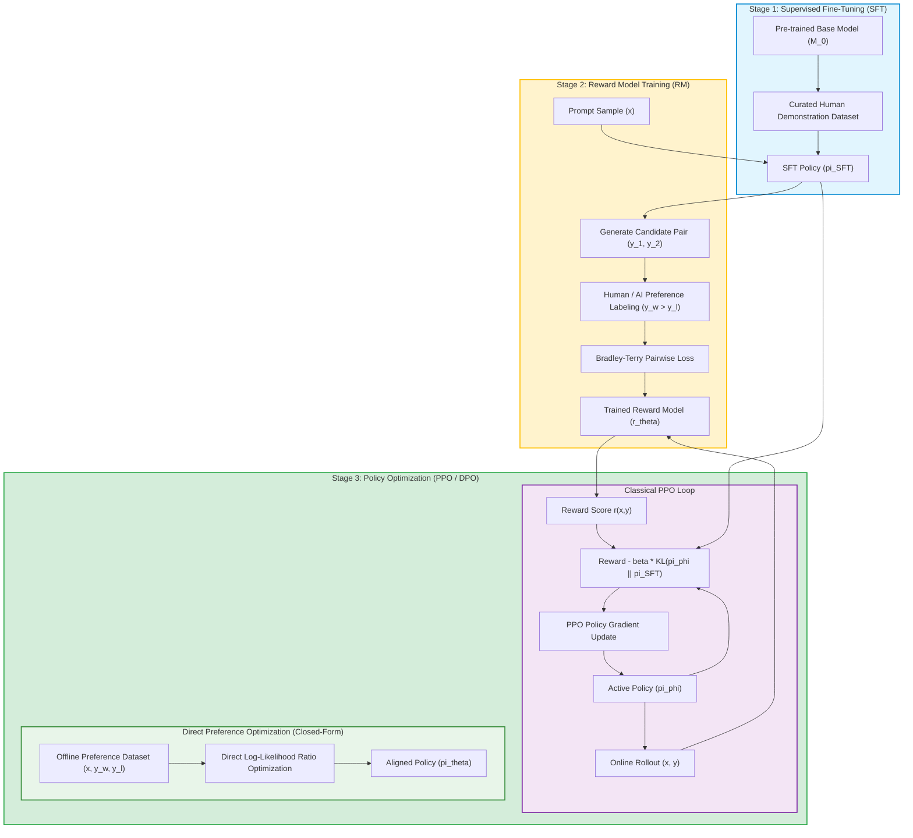

Pre-training foundational language models on hundreds of billions of web tokens produces exceptional statistical next-token predictors. However, raw pre-trained models are unaligned with human intent: they uncritically mirror internet biases, generate unhelpful sycophantic text, hallucinate plausible falsehoods, and struggle to decline dangerous requests.

Early alignment efforts relied entirely on **Supervised Fine-Tuning (SFT)**—collecting high-quality demonstration prompts and training the model via maximum likelihood estimation (MLE). While SFT successfully conditions models to adopt an instructional format, it suffers from two fatal limitations:
1. **The Annotation Scarcity Bottleneck**: Creating full, expert-written demonstration answers for complex technical, legal, and mathematical tasks is prohibitively expensive.
2. **Exposure Bias and Inability to Penalize Failures**: SFT only teaches the model what tokens to emit; it provides no gradient mechanism to penalize subtly flawed, deceptive, or harmful responses that look stylistically correct.

To transcend the limits of supervised demonstrations, the field adopted **Reinforcement Learning from Human Feedback (RLHF)**, pioneered by Christiano et al. (2017) and popularized in InstructGPT by Ouyang et al. (2022).

This source audit analyzes the mathematical mechanics of classical RLHF, evaluates the Bradley-Terry preference model, examines the tension between Proximal Policy Optimization (PPO) and Direct Preference Optimization (DPO), and traces how alignment evolved toward verifiable reward reinforcement learning across 2026.


## Why Is Supervised Fine-Tuning Insufficient for Aligning Foundation Models?

The core failure of pure Supervised Fine-Tuning is the **mode-collapse of negative feedback**. In standard cross-entropy loss, every token in a human demonstration is treated as an equally positive target. The model cannot learn relative rankings: it cannot understand that response $A$ is slightly better than response $B$, but response $C$ contains a subtle security backdoor.

Human evaluators find it significantly easier and faster to compare two candidate model outputs ($y_w \succ y_l$) than to author a pristine response from scratch. RLHF exploits this asymmetry by converting pairwise human preference rankings into an optimization signal:



## Mathematical Mechanics: From Bradley-Terry to Direct Preference Optimization

### 1. Bradley-Terry Preference Modeling
The reward model $r_\theta(x, y)$ assigns a scalar score to a prompt $x$ and output $y$. Assuming human preferences follow the Bradley-Terry (1952) model, the probability that a human prefers response $y_w$ (winning) over $y_l$ (losing) is parameterized as:

$$P(y_w \succ y_l | x) = \sigma(r_\theta(x, y_w) - r_\theta(x, y_l)) = \frac{1}{1 + e^{-(r_\theta(x, y_w) - r_\theta(x, y_l))}}$$

The reward model is trained by minimizing the negative log-likelihood over a dataset of paired comparisons:

$$\mathcal{L}_{\text{RM}}(\theta) = -\mathbb{E}_{(x, y_w, y_l)} \left[ \log \sigma(r_\theta(x, y_w) - r_\theta(x, y_l)) \right]$$

### 2. Reinforcement Learning via PPO and KL Regularization
In Stage 3, the policy $\pi_\phi$ is optimized to maximize expected reward while penalizing divergence from the reference policy $\pi_{\text{SFT}}$ to prevent **Reward Hacking** (where the model generates repetitive, nonsensical text that exploits flaws in the reward model):

$$\max_\phi \mathbb{E}_{x \sim \mathcal{D}, y \sim \pi_\phi(y|x)} \left[ r_\theta(x, y) \right] - \beta \mathbb{D}_{\text{KL}}(\pi_\phi(y|x) \parallel \pi_{\text{SFT}}(y|x))$$

Where $\beta$ controls the strength of the KL penalty anchor.

### 3. The Direct Preference Optimization (DPO) Revolution
Classical PPO requires loading four deep models simultaneously into GPU memory: the active policy (Actor), the value network (Critic), the reference policy, and the reward model. This creates extreme VRAM pressure and training instability.

Rafailov et al. (2023) introduced **Direct Preference Optimization (DPO)** by mathematically deriving the optimal policy in closed form. Under the Bradley-Terry objective, the implicit ground-truth reward can be expressed directly in terms of token log probabilities:

$$r(x, y) = \beta \log \frac{\pi_\theta(y|x)}{\pi_{\text{ref}}(y|x)}$$

Substituting this back into the Bradley-Terry objective yields the **DPO Loss Function**:

$$\mathcal{L}_{\text{DPO}}(\theta; \pi_{\text{ref}}) = -\mathbb{E}_{(x, y_w, y_l)} \left[ \log \sigma \left( \beta \log \frac{\pi_\theta(y_w|x)}{\pi_{\text{ref}}(y_w|x)} - \beta \log \frac{\pi_\theta(y_l|x)}{\pi_{\text{ref}}(y_l|x)} \right) \right]$$

DPO completely eliminates the reward model and reinforcement learning loop, optimizing preferences directly via standard supervised cross-entropy-style gradient steps.

```python
"""
PyTorch Implementation of Direct Preference Optimization (DPO) Loss.
Calculates preference alignment loss directly from policy and reference model log-probabilities.
"""

import torch
import torch.nn as nn
import torch.nn.functional as F

class DPOLoss(nn.Module):
    def __init__(self, beta: float = 0.1):
        super().__init__()
        self.beta = beta

    def forward(
        self,
        policy_chosen_logps: torch.Tensor,
        policy_rejected_logps: torch.Tensor,
        reference_chosen_logps: torch.Tensor,
        reference_rejected_logps: torch.Tensor
    ) -> torch.Tensor:
        """
        Computes the DPO loss for a batch of chosen and rejected response pairs.
        All inputs are 1D tensors containing sum of log probabilities of response tokens.
        """
        # Calculate log-ratios for chosen and rejected responses
        pi_logratios = policy_chosen_logps - policy_rejected_logps
        ref_logratios = reference_chosen_logps - reference_rejected_logps

        # Compute implicit reward difference scaled by beta
        logits = self.beta * (pi_logratios - ref_logratios)

        # Negative log-sigmoid loss
        losses = -F.logsigmoid(logits)
        return losses.mean()

if __name__ == "__main__":
    dpo_criterion = DPOLoss(beta=0.1)
    # Simulated log-probabilities for 4 batch samples
    p_chosen = torch.tensor([-12.4, -8.1, -15.2, -9.0])
    p_rejected = torch.tensor([-18.2, -9.5, -20.1, -12.4])
    r_chosen = torch.tensor([-13.0, -8.0, -15.5, -9.2])
    r_rejected = torch.tensor([-17.5, -8.9, -19.8, -11.5])

    loss = dpo_criterion(p_chosen, p_rejected, r_chosen, r_rejected)
    print(f"Calculated DPO batch loss: {loss.item():.4f}")
```

For practical guidance on configuring DPO datasets and hyperparameters within open-source post-training harnesses, refer to our [Llama Factory post-training workflows](/posts/llama-factory/) and parameter-efficient tuning tradeoffs in [LoRA parameter-efficient fine-tuning](/posts/lora-better-gpt4/). To understand how models iteratively evolve their own preference pairs autonomously, see our audit of [autonomous self-evolution and post-training](/posts/llm-self-evolution/).

## How Post-Training Alignment and Reasoning Runtimes Evolved Across 2026

Between 2024 and 2026, alignment research moved beyond soft subjective human preferences toward objective, verifiable reasoning frameworks:

1. **Reinforcement Learning from Verifiable Rewards (RLVR)**: For domains like software engineering, formal mathematics, and symbolic logic, human preference scoring has been entirely replaced by deterministic verifiers (unit tests, compiler exits, and theorem provers). Models generate thousands of reasoning trajectories, and reinforcement learning updates are conditioned strictly on ground-truth execution correctness rather than subjective ratings.
2. **Kahneman-Tversky Optimization (KTO)**: While DPO requires expensive paired data ($y_w, y_l$ for the exact same prompt), KTO directly optimizes on unpaired binary signals (thumbs-up / thumbs-down), halving data collection friction for production telemetry.
3. **Self-Rewarding Language Models and Multi-Turn Preference Trees**: Rather than training a static reward model once, modern alignment loops execute multi-generational self-training. The model scores its own candidate reasoning rollouts, filters out low-perplexity chains, and self-trains over multi-generational preference trees.
4. **Alignment Tax Mitigation**: Early RLHF models suffered from the "alignment tax"—a noticeable degradation in raw mathematical problem-solving and coding ability after safety alignment. In 2026, mixture-of-experts (MoE) routing and targeted parameter masking ensure safety guardrails apply only to safety-critical prompts without degrading reasoning capabilities.

## Key Takeaways

- **Pairwise Preferences Outperform Demonstrations**: Human annotators excel at ranking candidate outputs rather than authoring demonstrations from scratch, making preference optimization the foundation of alignment.
- **KL Regularization Prevents Reward Hacking**: Without anchoring to the reference policy, RL policies overfit to reward model flaws, producing pathological outputs.
- **DPO Slashes Training Overhead**: Direct Preference Optimization analytically eliminates the reward model and PPO reinforcement loop, democratizing post-training alignment on commodity hardware.
- **Verifiable Rewards Replace Subjective Scoring**: In mathematical and coding domains, RLVR anchors alignment to deterministic compiler and test suite feedback.

## New Questions

- **Can DPO Scale to Complex Multi-Step Reasoning Without Online Exploration?** Because DPO is strictly an offline algorithm, how can it discover novel, creative reasoning paths that never appeared in the offline preference dataset?
- **How Will RLVR Handle Subtle Security Flaws in Code?** If a model optimizes solely to pass existing unit tests, will it develop adversarial shortcuts that pass test assertions while introducing subtle memory leaks or vulnerabilities?
- **What are the Philosophical Limits of Human Alignment?** When foundation models surpass human expertise in fields like quantum physics or pharmacology, how can human annotators provide meaningful preference supervision?

## References

- Ouyang, L., Wu, J., Jiang, X., Almeida, D., Wainwright, C., Mishkin, P., Zhang, C., Agarwal, S., Slama, K., Ray, A., Schulman, J., Hilton, J., Kelton, F., Miller, L., Simens, M., Askell, A., Welinder, P., Christiano, P., Leike, J., & Lowe, R. (2022). *Training language models to follow instructions with human feedback*. Advances in Neural Information Processing Systems (NeurIPS 2022). Available at: [https://arxiv.org/abs/2203.02155](https://arxiv.org/abs/2203.02155) (accessed 2026-10-18).
- Rafailov, R., Sharma, A., Mitchell, E., Ermon, S., Manning, C. D., & Finn, C. (2023). *Direct Preference Optimization: Your Language Model is Secretly a Reward Model*. Advances in Neural Information Processing Systems (NeurIPS 2023). Available at: [https://arxiv.org/abs/2305.18290](https://arxiv.org/abs/2305.18290) (accessed 2026-10-18).
- Christiano, P. F., Leike, J., Brown, T., Martic, M., Legg, S., & Amodei, D. (2017). *Deep Reinforcement Learning from Human Preferences*. Advances in Neural Information Processing Systems (NeurIPS 2017). Available at: [https://arxiv.org/abs/1706.03741](https://arxiv.org/abs/1706.03741) (accessed 2026-10-18).
- Schulman, J., Wolski, F., Dhariwal, P., Radford, A., & Klimov, O. (2017). *Proximal Policy Optimization Algorithms*. arXiv:1707.06347. Available at: [https://arxiv.org/abs/1707.06347](https://arxiv.org/abs/1707.06347) (accessed 2026-10-18).
