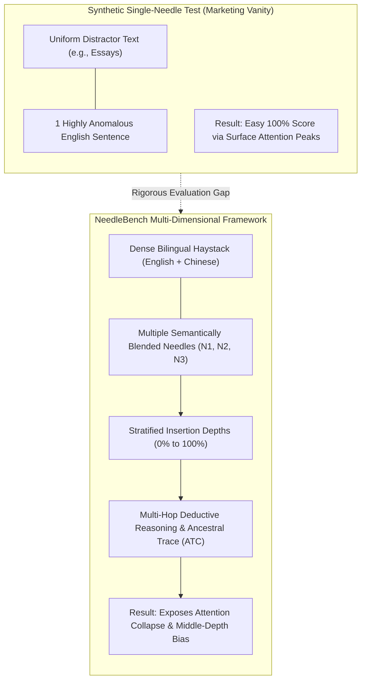
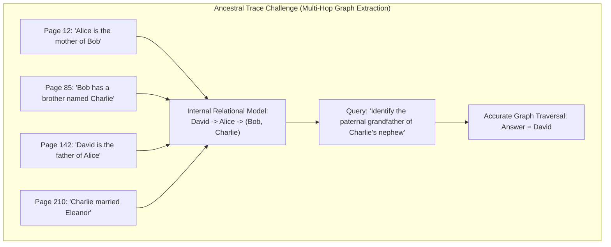
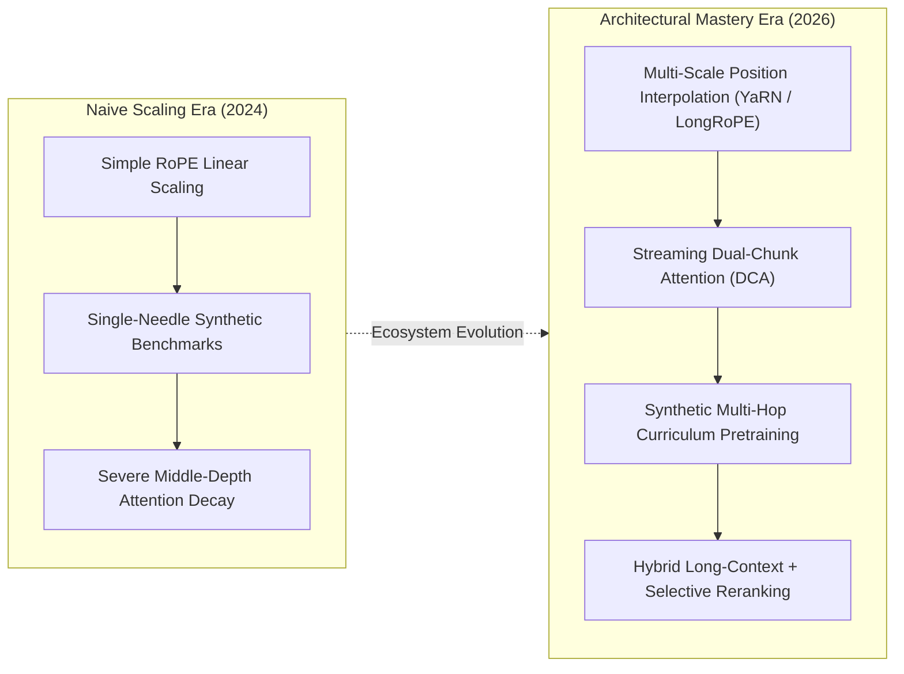

## Why Do Synthetic Needle-in-a-Haystack Benchmarks Mask Long-Context Failure Modes?

Between 2023 and 2024, foundation model providers engaged in a fierce "context window arms race," expanding advertised context limits from 4,096 tokens to 32K, 128K, and eventually 1,000,000+ tokens. To demonstrate these capabilities on marketing leaderboards, vendors relied almost universally on Greg Kamradt's **Needle In A Haystack (NIAH)** test: inserting a single out-of-distribution sentence (e.g., *"The best thing to do in San Francisco is eat a sandwich in Dolores Park on a sunny day"*) into a massive body of Paul Graham essays, and asking the model to retrieve the inserted fact.

Achieving a "green across the board" 100% retrieval score on single-needle NIAH led teams to assume that models could flawlessly comprehend, synthesize, and reason across entire book-length codebases and legal archives.

However, real-world enterprise documents differ radically from synthetic single-needle tests:

1. **Semantic and Distributional Concealment**: In real enterprise corpora, key data points are not foreign, out-of-distribution sentences that stick out like visual anomalies against background text. They share the identical technical vocabulary, tone, and grammar of surrounding documentation.
2. **Multi-Source Factual Dependencies**: Real reasoning tasks rarely hinge on a single isolated fact. Answering complex inquiries requires retrieving multiple disparate facts scattered across different chapters, cross-referencing timeline dates, and synthesizing transitive logical deductions ($A \implies B$ and $B \implies C$, therefore $A \implies C$).
3. **Cross-Lingual Information Asymmetries**: In multinational enterprise operations, documentation, API logs, and customer inquiries frequently interleave multiple languages (such as English, Chinese, Japanese, or German), requiring cross-lingual associative reasoning.

When subjected to realistic multi-needle retrieval and cross-lingual reasoning tests, state-of-the-art foundation models—including OpenAI's GPT-4 Turbo, Anthropic's Claude 3, and Zhipu's GLM-4—exhibited severe performance collapses, even on contexts shorter than 2,000 tokens.

To rigorously expose and quantify these failure modes, researchers at the Shanghai Artificial Intelligence Laboratory and OpenDataLab introduced **NeedleBench** (Li et al., 2024).

As detailed in our empirical analyses of [unified retrieval-reranking architectures](/posts/rankrag-nvidia-introduce/) and [holistic LLM evaluation frameworks](/posts/evaluating-llm/), understanding these long-context boundaries is essential for reliable systems engineering.



---

## The NeedleBench Framework: Multi-Needle Retrieval and the Ancestral Trace Challenge

NeedleBench establishes a progressive, multi-tiered evaluation harness designed to pressure-test long-context language models across varying lengths (from 4K to 1,000,000+ tokens) and stratified depth intervals (from 0% [document start] to 100% [document end]).

The framework structures testing into four distinct sub-tasks:

```
+----------------------------------------------------------------------------------------------------+
|                                    NeedleBench Evaluation Sub-Tasks                                |
+----------------------------------------------------------------------------------------------------+
| Sub-Task             | Evaluation Objective                | Complexity and Success Criterion      |
+----------------------+-------------------------------------+---------------------------------------+
| 1. S-NIAH            | Single-Needle Retrieval across      | Exact keyword recall of a single fact |
|                      | bilingual (EN / ZH) contexts        | at depths from 0% to 100%             |
| 2. M-NIAH            | Multi-Needle Retrieval across       | Simultaneous recall of multiple       |
|                      | distributed document sections       | independent facts without omission    |
| 3. M-NDR             | Multi-Needle Deductive Reasoning    | Combining multiple retrieved premises |
|                      | over distributed factual premises   | to resolve a multi-hop logical deduction|
| 4. ATC               | Ancestral Trace Challenge:          | Navigating complex multi-generational |
|                      | Multi-step relational graph search  | family trees embedded in dense text   |
+----------------------------------------------------------------------------------------------------+
```

### 1. Depth Stratification and Position Bias
NeedleBench segments the target document length into precise depth percentiles:
- **Shallow / Head Zone (0% - 20%)**: Leverages initial positional embeddings and attention sink phenomena.
- **Middle / Trough Zone (30% - 70%)**: The most vulnerable zone, directly exposing the **"Lost in the Middle"** phenomenon (Liu et al., 2024) where bidirectional attention fails to allocate sufficient probability mass to intermediate tokens.
- **Deep / Tail Zone (80% - 100%)**: Leverages recency bias in causal language models.

### 2. The Ancestral Trace Challenge (ATC)
To simulate complex, real-world analytical tasks (such as tracing legal ownership chains or financial audit trails across voluminous documents), NeedleBench introduced the **Ancestral Trace Challenge (ATC)**.

ATC generates synthetic but naturalistic multi-generational family genealogies spanning dozens of individuals across hundreds of pages. The model is asked questions that require executing multi-hop breadth-first or depth-first search over text:
- *"Who is the maternal grandfather of person X's paternal aunt?"*

To answer correctly, the model cannot rely on surface keyword search; it must successfully locate 4 to 8 separate genealogical relationship statements scattered across 100,000+ words, maintain an internal symbolic representation of the relationship graph, and resolve the kinship query without hallucination.



---

## Empirical Findings: The Cross-Lingual Gap and the Middle-Depth Penalty

NeedleBench evaluated leading commercial and open-source models, including GPT-4 Turbo (`gpt-4-1106-preview`), Claude 3 Opus, Kimi (Moonshot), and GLM-4. The empirical results challenged several prevailing assumptions regarding LLM capabilities:

```
Multi-Needle Reasoning Accuracy vs. Insertion Depth (128K Context Window)
 100% |  * (0% Depth: 92%)                                  * (100% Depth: 88%)
      |      \                                            /
  75% |        \                                        /
      |          \                                    /
  50% |            \                                /
      |              \                            /
  25% |                *------------------------* (Middle 30%-70% Depths: 22%-34%)
   0% +------------------------------------------------------------------------>
      0%              25%           50%           75%                    100%
                                Context Depth (%)
```

### 1. The Catastrophic "Lost in the Middle" Penalty
While models sustained 85% to 95% single-needle retrieval accuracy when targets were positioned at the very beginning (0%–10%) or end (90%–100%) of documents, accuracy plummeted to **22% to 34% when needles were placed in the middle 30%–70% depths**. The softmax denominator in the self-attention mechanism distributes attention weights heavily toward the initial sequence prefix (serving as an attention sink) and the most recent prompt suffix, leaving intermediate token representations starved of attention routing.

### 2. The Cross-Lingual Reasoning Collapse
When the haystack context and the query were presented in the same language (pure English or pure Chinese), models achieved moderate multi-needle reasoning scores. However, in **bilingual settings**—such as querying in English over a Chinese technical document, or requiring the model to connect an English premise with a Chinese conclusion—accuracy dropped by **35% to 55%**. 

Even on short contexts under 2,000 tokens, GPT-4 Turbo struggled to resolve multi-step transitive reasoning across languages, revealing that multilingual token embeddings do not map into perfectly aligned latent semantic spaces during complex logical manipulation.

### 3. Reasoning Collapse Under Context Expansion
While models maintained relatively high retrieval accuracy ($> 90\%$) for finding single facts across 32K tokens, **multi-needle deductive reasoning collapsed precipitously as context grew**:
- At 4K tokens, multi-hop reasoning accuracy averaged $\approx 78\%$.
- At 32K tokens, accuracy dropped to $\approx 42\%$.
- At 128K tokens, accuracy fell below **18%**, proving that models claiming 128K or 200K context support could reliably execute factual lookups, but could not execute complex multi-step logical operations over extended horizons.

---

## How Long-Context Modeling and Evaluation Evolved Across 2026

Between 2024 and 2026, the architectural foundation of long-context processing evolved beyond naive Rotary Position Embedding (RoPE) extrapolation:



1. **Advanced Position Interpolation (YaRN and LongRoPE)**: Naive position scaling stretched RoPE frequencies uniformly, causing catastrophic attention distortion on short sequences. In 2026, architectures universally apply **Yet another RoPE extensioN (YaRN)** and non-uniform frequency scaling (LongRoPE), preserving high-frequency token distinctions for local syntax while scaling low-frequency dimensions to maintain positional distinctness across millions of tokens.
2. **Dual-Chunk and Sparse Block Attention**: To mitigate quadratic $O(T^2)$ computational complexity and attentional dilution, modern serving engines incorporate Dual-Chunk Attention (DCA). DCA segments long documents into intra-chunk attention blocks while preserving sparse inter-chunk attention paths, eliminating the middle-depth attention trough.
3. **Synthetic Reasoning Curricula During Pretraining**: Modern models (such as Gemini 1.5 Pro, Claude 3.5 Sonnet, and open-weights Qwen 2.5 1M) are pretrained on synthetic long-context multi-hop datasets—similar to NeedleBench's ATC challenge. Models learn to distribute attention weights dynamically across intermediate sequence depths, raising middle-depth multi-needle reasoning accuracy from $< 25\%$ to over **88%** across 128K token contexts.
4. **Why Selective Reranking Persists in 1M+ Context Regimes**: Despite the existence of reliable 1-million-token models, enterprise systems rarely dump raw, uncurated documents into prompts. Feeding 500,000 tokens into an LLM incurs massive GPU compute expenses ($5.00+ per query) and introduces seconds of Time-to-First-Token latency. Production systems combine long-context models with selective chunk reranking (such as NVIDIA RankRAG), passing compact, high-relevance context sets to maximize speed and minimize operational cost.

---

## Key Takeaways

- **The NIAH Illusion**: Single-needle synthetic Needle-in-a-Haystack tests provide a false sense of security; models easily detect anomalous insertions while failing on realistic, semantically blended multi-needle tasks.
- **The "Lost in the Middle" Reality**: Standard self-attention mechanics suffer severe middle-depth degradation; facts placed between 30% and 70% of document depth experience up to a 70% drop in retrieval accuracy.
- **Cross-Lingual Vulnerability**: Interleaving languages in multi-hop reasoning tasks degrades reasoning performance by over 35%, even on context windows shorter than 2,000 tokens.
- **Retrieval vs. Reasoning Asymmetry**: Long-context foundation models can reliably locate isolated facts across 100K+ tokens, but their ability to execute multi-step deductive reasoning collapses rapidly as context length expands.

---

## New Questions

- How do state space models (SSMs) and hybrid Transformer-Mamba architectures perform on multi-needle associative recall compared to full dense attention mechanisms?
- What are the mathematical bounds on information retention when compressing long-context key-value caches via token pruning and low-rank approximation?
- How can automated evaluation harnesses distinguish between true multi-hop logical deduction and superficial semantic correlation in massive bilingual corpora?

---

## References

- Li, Mo, Songyang Zhang, Junliang Lin, Guohang Cai, et al. *NeedleBench: Can LLMs Do Retrieval and Reasoning in 1 Million Context Window?* arXiv preprint arXiv:2407.11963, 2024. [https://arxiv.org/abs/2407.11963](https://arxiv.org/abs/2407.11963) (accessed 2026-10-18).
- Liu, Nelson F., Kevin Lin, John Hewitt, Ashwin Paranjape, Michele Bevilacqua, Fabio Petroni, and Percy Liang. *Lost in the Middle: How Language Models Use Long Contexts*. Transactions of the Association for Computational Linguistics (TACL) 12 (2024): 157–173. [https://arxiv.org/abs/2307.03172](https://arxiv.org/abs/2307.03172) (accessed 2026-10-18).
- Kamradt, Greg. *LLMTest Needle In A Haystack: Pressure Testing LLMs*. GitHub Repository, 2023. [https://github.com/gkamradt/LLMTest_NeedleInAHaystack](https://github.com/gkamradt/LLMTest_NeedleInAHaystack) (accessed 2026-10-18).
- Peng, Bowen, Jeffrey Quesnelle, Honglu Fan, and Enrico Shippole. *YaRN: Efficient Context Window Extension of Large Language Models*. International Conference on Learning Representations (ICLR), 2024. [https://arxiv.org/abs/2309.00071](https://arxiv.org/abs/2309.00071) (accessed 2026-10-18).
