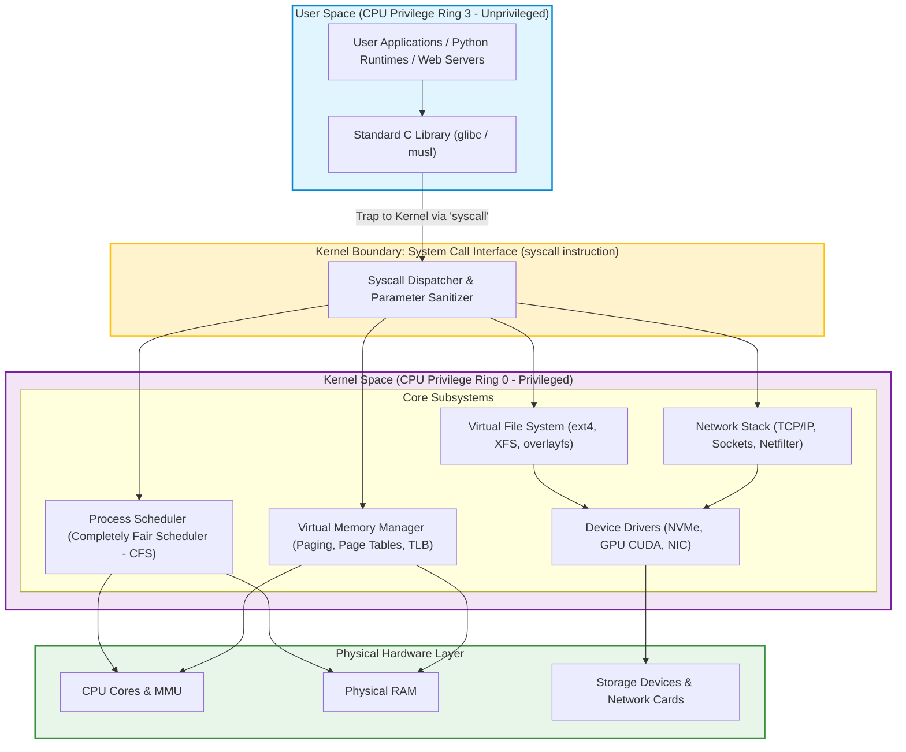

Every modern software system—from high-frequency trading engines and cloud Kubernetes clusters to distributed GPU training harnesses—executes on top of the **Linux Operating System**. Yet, for many software and machine learning engineers, the operating system remains an opaque layer: a black box that executes binaries, manages memory allocations, and schedules worker threads through invisible mechanisms.

When applications encounter severe performance degradation—such as unexpected page fault latency spikes during large language model inference, thread contention under high concurrency, or file descriptor exhaustion during distributed checkpointing—developers without operating system grounding struggle to diagnose the root cause.

Linux is a monolithic, preemptive, multi-user, multi-tasking Unix-like kernel. Designed to mediate between unprivileged user software and physical hardware, Linux enforces rigorous protection boundaries through hardware privilege rings, virtual memory page tables, and standardized system call dispatchers.

This source audit deconstructs the architectural anatomy of the Linux kernel, evaluates the mechanics of user-to-kernel mode transitions via system calls, analyzes virtual memory paging and process scheduling, and examines how cloud-native and AI runtimes leverage kernel primitives across 2026.


## How Does the Linux Kernel Enforce Hardware Protection and Process Isolation?

At the core of operating system design is the requirement of **unconditional isolation**: an unprivileged user process must not be able to read or mutate memory belonging to other processes, nor should a crash in user space bring down the entire physical machine.

To enforce this, Linux coordinates closely with the CPU hardware's Memory Management Unit (MMU) and privilege rings (specifically x86-64 Ring 0 and Ring 3):



### The Separation of Privilege: Ring 0 vs. Ring 3
1. **Ring 3 (User Space)**: Applications execute with restricted CPU instructions. Code running in Ring 3 cannot directly read disk blocks, modify page tables, or disable CPU interrupts. Any attempt to access protected memory triggers a hardware exception (`SIGSEGV`).
2. **Ring 0 (Kernel Space)**: The kernel executes with complete architectural control. It manages hardware device registers, programs interrupt vectors, maps physical page frames, and switches CPU context between processes.

### The System Call (Syscall) Dispatch Loop
When a user-space application needs to interact with the external world (e.g., calling `read()` on a file or `socket()` to establish a network connection), it cannot jump directly to a kernel memory address. Instead, it executes a hardware-mediated trap:
1. The C library (`glibc`) places the unique **syscall number** (e.g., `0` for `read`, `1` for `write`, `57` for `fork` on x86-64) into the `RAX` register and copies arguments into CPU registers (`RDI`, `RSI`, `RDX`, `R10`, `R8`, `R9`).
2. The program executes the atomic `syscall` assembly instruction.
3. The CPU saves user instruction pointers (`RIP`) and flags, elevates privilege from Ring 3 to Ring 0, and jumps to a predefined kernel entry point (`entry_SYSCALL_64`).
4. The kernel looks up the syscall table, executes the privileged routine, places the return value back into `RAX`, and executes `sysret` to drop privilege back to Ring 3.

## Virtual Memory, Paging, and the Address Space Layout

Linux never exposes physical RAM addresses directly to user processes. Instead, every process is granted the illusion of a private, continuous **Virtual Address Space** (spanning 128TB on 48-bit canonical x86-64 hardware).

### The Four-Level Page Table Hierarchy
The MMU translates virtual addresses to physical RAM frames using hierarchical page tables:
- **PML4** (Page Map Level 4) $\rightarrow$ **PDPT** (Page Directory Pointer Table) $\rightarrow$ **PD** (Page Directory) $\rightarrow$ **PT** (Page Table) $\rightarrow$ **Physical Page Frame** (typically 4KB).
- To accelerate this translation, the CPU caches recent mappings in the **Translation Lookaside Buffer (TLB)**.

### Page Faults and Demand Paging
When an application calls `malloc()`, Linux does not allocate physical RAM immediately. It merely updates the process's Virtual Memory Areas (VMAs). Physical RAM is only allocated when the CPU touches the memory address for the first time, triggering a **Minor Page Fault**. The kernel's page fault handler intercepts the exception, allocates an available 4KB physical page frame, updates the page table, and resumes execution seamlessly.

```python
"""
Python script inspecting low-level Linux kernel process abstractions.
Demonstrating direct system calls, /proc virtual filesystem inspection,
and memory mapped virtual memory regions.
"""

import os
import ctypes
import resource

# Load standard C library to access raw syscall interfaces
libc = ctypes.CDLL(None)

def audit_process_kernel_state():
    pid = os.getpid()
    
    # 1. Direct invocation of gettid (get thread ID) syscall (SYS_gettid = 186 on x86_64)
    # Python os.getpid() returns process ID; SYS_gettid returns kernel thread ID
    try:
        tid = libc.syscall(186)
    except Exception:
        tid = pid

    # 2. Query resource limits managed by the Linux kernel
    soft_nofile, hard_nofile = resource.getrlimit(resource.RLIMIT_NOFILE)

    # 3. Inspect virtual memory layout from /proc pseudo-filesystem
    maps_path = f"/proc/{pid}/maps"
    mapped_regions = 0
    if os.path.exists(maps_path):
        with open(maps_path, "r") as f:
            mapped_regions = len(f.readlines())

    return {
        "pid": pid,
        "tid": tid,
        "max_file_descriptors": soft_nofile,
        "active_vma_regions": mapped_regions
    }

if __name__ == "__main__":
    state = audit_process_kernel_state()
    print(f"Linux Kernel Process State: PID={state['pid']}, TID={state['tid']}, "
          f"FD_Limit={state['max_file_descriptors']}, VMA_Count={state['active_vma_regions']}")
```

For practical guidance on managing deployments and automated infrastructure on top of Linux distributions, review our audit of [modern DevOps and GitOps architectures](/posts/most-popular-devops-tools/). For understanding how version control systems manage file objects on Linux filesystems, see [Git internal DAG and object architecture](/posts/git-in-a-Nutshell/). For understanding distributed cluster scheduling across thousands of Linux nodes, refer to our analysis of [Google planet-scale system design](/posts/prepared-google-interview/).

## How Linux Systems and Cloud-Native Runtimes Evolved Across 2026

Between 2024 and 2026, Linux systems engineering moved beyond classic Unix POSIX patterns toward programmable kernel extensions, hardware-enforced isolation, and lightweight micro-virtualization:

1. **The eBPF (Extended Berkeley Packet Filter) Revolution**: Historically, extending kernel capabilities required writing risky C kernel modules that could crash the machine. In 2026, eBPF programs run in a sandboxed, JIT-compiled bytecode runtime directly inside the Linux kernel. This allows security tools and observability agents to inspect network packets, trace system calls, and enforce security policies with zero context-switching overhead.
2. **Cgroups v2 and OOM-Killer Resilience in Container Runtimes**: Modern container engines (Docker, containerd, Kubernetes) rely on Linux control groups (cgroups v2) to enforce strict CPU and memory limits. In 2026, modern kernels feature pressure stall information (PSI) hooks, allowing workloads to detect memory pressure and shed caches before the kernel's Out-Of-Memory (OOM) killer terminates the process.
3. **MicroVM Hypervisors (Firecracker & Cloud-Hypervisor)**: Standard Linux containers share a single host kernel, meaning a kernel exploit can breach container boundaries. Cloud platforms increasingly wrap untrusted customer workloads inside MicroVMs—stripped-down virtual machines that boot in under 5 milliseconds using Linux KVM (Kernel-based Virtual Machine) primitives.
4. **Confidential Computing Memory Encryption (AMD SEV & Intel TDX)**: Enterprise AI inference requires strict data sovereignty. 2026 Linux kernels integrate hardware-encrypted virtualization, where CPU hardware cryptographic keys ensure that even the host root administrator cannot inspect memory pages belonging to an active guest VM.

## Key Takeaways

- **Ring 0 / Ring 3 Privilege Decoupling Guarantees Stability**: The CPU hardware enforces memory protection; user applications cannot directly access hardware without going through the system call interface.
- **Virtual Memory Eliminates Fragmentation**: The kernel maps non-contiguous physical RAM frames into continuous virtual address spaces, allocating physical pages on-demand via minor page faults.
- **The `/proc` Filesystem Exposes Kernel State**: The `/proc` directory is a dynamic in-memory window into kernel data structures, allowing real-time monitoring of process memory maps, file descriptors, and scheduling metrics.
- **Modern Cloud Runtimes Depend on Kernel Primitives**: Containers and serverless sandboxes are not hardware; they are lightweight combinations of Linux namespaces, cgroups v2, and seccomp syscall filters.

## New Questions

- **Can Monolithic Kernels Scale as Accelerated Hardware Diversifies?** With heterogeneous AI clusters integrating GPUs, TPUs, NPUs, and smartNICs, will the monolithic Linux kernel architecture struggle compared to modern microkernel or exokernel designs?
- **How Will eBPF Programs Maintain Security Against Kernel Side-Channels?** As eBPF programs gain deeper access to kernel memory, what formal verification techniques will be required to prevent Spectre-like speculative execution side-channel leaks?
- **What is the Latency Floor of the Syscall Boundary?** For ultra-low-latency AI inference, will applications bypass the Linux kernel network and storage stacks entirely using user-space drivers (io_uring, SPDK, DPDK)?

## References

- Bovet, D. P., & Cesati, M. (2005). *Understanding the Linux Kernel* (3rd ed.). O'Reilly Media. Available at: [https://www.oreilly.com/library/view/understanding-the-linux/0596005652/](https://www.oreilly.com/library/view/understanding-the-linux/0596005652/) (accessed 2026-10-18).
- Love, R. (2010). *Linux Kernel Development* (3rd ed.). Addison-Wesley Professional. Available at: [https://www.informit.com/store/linux-kernel-development-9780672329463](https://www.informit.com/store/linux-kernel-development-9780672329463) (accessed 2026-10-18).
- Kerrisk, M. (2010). *The Linux Programming Interface: A Linux and UNIX System Programming Handbook*. No Starch Press. Available at: [https://man7.org/tlpi/](https://man7.org/tlpi/) (accessed 2026-10-18).
- Ward, B. (2021). *How Linux Works: What Every Superuser Should Know* (3rd ed.). No Starch Press. Available at: [https://nostarch.com/howlinuxworks3](https://nostarch.com/howlinuxworks3) (accessed 2026-10-18).
