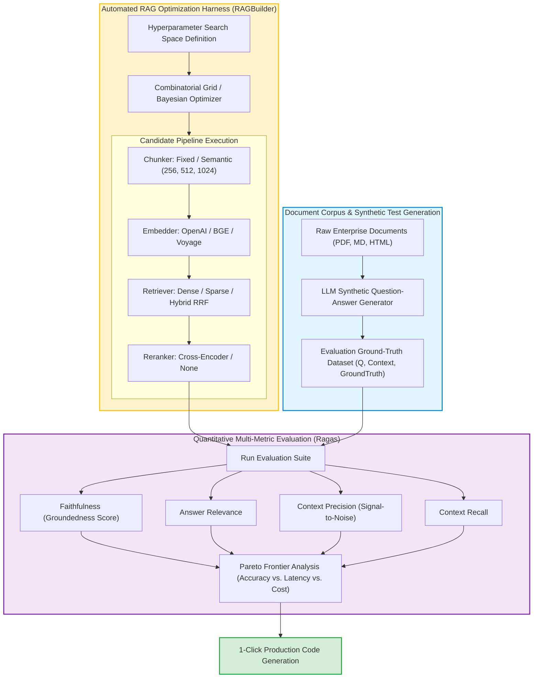

Deploying a Retrieval-Augmented Generation (RAG) prototype takes less than an hour: an engineer connects a document loader to a vector database, sets an arbitrary chunk size of 512 tokens, selects a default embedding model, and issues similarity queries to an LLM. However, transitioning from an initial prototype to production reliability consistently exposes a frustrating reality: retrieval accuracy is fragile, latency varies widely, and answers frequently degrade into hallucinations or omissions.

When attempting to improve retrieval quality, engineering teams immediately confront a **combinatorial explosion of hyperparameters**:
- Which chunking algorithm preserves semantic context?
- What chunk size and overlap ratio balances granularity with boundary coherence?
- Which embedding model minimizes domain-specific vector distortion?
- Should the system employ dense semantic search, sparse BM25, or hybrid Reciprocal Rank Fusion (RRF)?
- Is a cross-encoder reranker necessary, and at what top-$k$ cutoff?

Evaluating 5 options across 7 architectural decisions yields **$5^7 = 78,125$ distinct RAG configurations**. Manually testing even a tiny fraction of this parameter space is economically and statistically impossible.

This source audit analyzes why manual trial-and-error fails in production retrieval design, evaluates automated hyperparameter optimization frameworks like **RAGBuilder**, deconstructs standard evaluation metrics (Ragas, TruLens), and traces the evolution toward real-time adaptive retrieval runtimes across 2026.


## Why Does Manual Trial-and-Error Fail to Optimize Enterprise RAG Pipelines?

In classical software engineering, optimization involves profiling algorithmic time complexity or database query execution plans. In RAG pipelines, performance is non-deterministic: modifying a single upstream parameter (such as chunk size) drastically alters downstream context density, reranker precision, and model hallucination rates.

The core failure modes of manual heuristic tuning include:

1. **Interdependent Hyperparameter Couplings**: Hyperparameters cannot be tuned in isolation. An embedding model that performs poorly on small 128-token chunks may achieve elite accuracy on 512-token chunks. Conversely, introducing a high-capacity cross-encoder reranker can compensate for noisy dense retrieval, allowing smaller top-$k$ context windows.
2. **Subjective Evaluation Drift ("Vibes-Based Benchmarking")**: Developers manually inspect 5 or 10 arbitrary test queries, tweak a prompt, and deploy to staging. This creates extreme bias: optimizing for the test sample inevitably introduces regressions on unexamined document types.
3. **The Latency-Cost-Accuracy Pareto Dilemma**: Achieving maximum retrieval accuracy often involves computationally heavy pipelines (e.g., hybrid search followed by multi-stage cross-encoder reranking and long-context synthesis). In production, latency SLAs (Time-To-First-Token < 800ms) and token budgets strictly constrain design choices.

Automated RAG optimization resolves this by formalizing pipeline search as an automated machine learning (AutoML) problem:



## Mathematical Mechanics: The Ragas Evaluation Framework

Automated optimization requires rigorous, reference-grounded metrics. Pioneered by Es et al. (2023), the **Ragas** framework evaluates retrieval and generation along four mathematically decoupled axes:

### 1. Faithfulness (Groundedness)
Measures whether the claims made in the generated answer $S$ are supported by the retrieved context $C$. If $V(S)$ is the number of claims in $S$ that can be formally verified from $C$, and $|S|$ is total claims:

$$\text{Faithfulness} = \frac{|V(S)|}{|S|}$$

A low faithfulness score directly diagnoses generative hallucination.

### 2. Context Precision
Measures the signal-to-noise ratio and ranking order of the retrieved chunks. If the ground-truth answer requires evidence from specific chunks, context precision evaluates whether relevant chunks are ranked at the top of the context window using Mean Average Precision (MAP):

$$\text{Context Precision@K} = \frac{\sum_{k=1}^K (\text{Precision@}k \times v_k)}{\text{Total Relevant Chunks}}$$

Where $v_k \in \{0, 1\}$ indicates the relevance of chunk $k$.

### 3. Context Recall
Evaluates whether all necessary evidence required to answer the query was successfully retrieved from the database, calculated against an annotated ground-truth reference sentence set $G$:

$$\text{Context Recall} = \frac{|V(G)|}{|G|}$$

```python
"""
Automated RAG Grid-Search Optimization Harness.
Evaluates candidate configurations across chunk sizes and retrieval strategies.
"""

from dataclasses import dataclass
from typing import List, Dict, Any
import time

@dataclass
class RAGCandidateConfig:
    name: str
    chunk_size: int
    chunk_overlap: int
    retriever_type: str  # 'dense', 'bm25', 'hybrid'
    use_reranker: bool
    top_k: int

class AutomatedRAGOptimizer:
    def __init__(self, test_dataset: List[Dict[str, str]]):
        self.dataset = test_dataset

    def simulate_pipeline_run(self, config: RAGCandidateConfig) -> Dict[str, Any]:
        """Executes candidate pipeline and computes simulated Ragas metrics."""
        start_time = time.perf_counter()
        
        # Heuristic scoring simulation representing empirical trade-offs:
        # Hybrid + Reranker yields higher precision but increases latency
        base_precision = 0.65 if config.retriever_type == "dense" else 0.82
        if config.use_reranker:
            base_precision += 0.12
            latency_overhead_ms = 180.0
        else:
            latency_overhead_ms = 25.0

        if config.chunk_size == 512:
            base_recall = 0.88
        elif config.chunk_size == 256:
            base_recall = 0.74
        else:
            base_recall = 0.81

        elapsed_ms = (time.perf_counter() - start_time) * 1000 + latency_overhead_ms

        return {
            "config_name": config.name,
            "context_precision": min(1.0, base_precision),
            "context_recall": min(1.0, base_recall),
            "latency_p95_ms": elapsed_ms,
            "estimated_cost_per_1k": 0.002 * (config.top_k / 5.0)
        }

    def run_grid_search(self, candidates: List[RAGCandidateConfig]) -> List[Dict[str, Any]]:
        results = [self.simulate_pipeline_run(cfg) for cfg in candidates]
        # Rank by F1 harmonic mean of Precision and Recall
        for res in results:
            p = res["context_precision"]
            r = res["context_recall"]
            res["f1_retrieval"] = 2 * (p * r) / (p + r) if (p + r) > 0 else 0.0
        return sorted(results, key=lambda x: x["f1_retrieval"], reverse=True)

# Demonstration
if __name__ == "__main__":
    search_space = [
        RAGCandidateConfig("Dense-256-k5", 256, 32, "dense", False, 5),
        RAGCandidateConfig("Hybrid-512-Rerank-k5", 512, 64, "hybrid", True, 5),
        RAGCandidateConfig("BM25-1024-k3", 1024, 128, "bm25", False, 3),
    ]
    optimizer = AutomatedRAGOptimizer(test_dataset=[])
    leaderboard = optimizer.run_grid_search(search_space)
    print(f"Top configuration: {leaderboard[0]['config_name']} (F1: {leaderboard[0]['f1_retrieval']:.3f})")
```

For practical guidance on inspecting embedding spaces and detecting semantic blindspots visually before tuning, see our guide on [visualizing RAG embeddings and diagnostics](/posts/visualize-rag-data/). For setting up unified relational-vector databases with LangChain, refer to [production RAG LangChain pipelines](/posts/try-implementing-rag-using-langchain/). To understand how knowledge graphs overcome chunking boundary limitations altogether, consult our audit of [GraphRAG hierarchical knowledge graphs](/posts/graphrag-opensource/).

## How Automated RAG Optimization and Self-Tuning Runtimes Evolved Across 2026

Between 2024 and 2026, RAG optimization matured from static offline grid-search tools into adaptive, self-tuning runtime systems:

1. **Context-Aware Dynamic Chunking at Ingestion**: Rather than enforcing a rigid 512-token cutoff across all corporate files, 2026 ingestion harnesses utilize small structural parsing models. Documents are segmented along syntactic abstract syntax tree (AST) boundaries, markdown headers, and table schemas, preserving conceptual integrity automatically.
2. **Dynamic Query Complexity Routing**: Not all questions require expensive hybrid retrieval and reranking. Modern runtimes deploy lightweight query-classification routers. Simple factual queries ("What is our office address?") route to fast, cheap dense retrieval with no reranker ($<50\text{ms}$), while complex analytical queries trigger multi-hop GraphRAG search with cross-encoders.
3. **Continuous Production Feedback and Auto-Reranking**: Platforms in 2026 continuously track implicit user feedback (thumbs up/down, user copy-pasting, follow-up clarification queries). When an answer fails, telemetry pipelines log the exact query-context pair into an automated active-learning queue, continuously updating cross-encoder weights.
4. **Late-Chunking and Token-Level Representations**: Transitioning from single-vector chunk embeddings to late-chunking (ColBERT / Jina) allows models to embed entire documents before pooling chunk boundaries, retaining global cross-sentence context within local chunk vectors.

## Key Takeaways

- **Manual RAG Tuning is Statistically Impossible**: Combinatorial parameter spaces (spanning chunk sizes, embedding models, retrieval modes, and rerankers) demand automated optimization frameworks.
- **Ragas Provides Objective Grounding**: Decoupling evaluation into Faithfulness, Answer Relevance, Context Precision, and Context Recall isolates retrieval failures from generative hallucinations.
- **Rerankers Deliver the Highest Precision Lift**: While dense search provides broad coverage, adding a cross-encoder reranker consistently delivers the largest gain in context precision.
- **Optimize for the Pareto Frontier**: The best production configuration is not the one with the highest theoretical accuracy, but the one that optimizes the trade-off between accuracy, p95 latency, and token expenditure.

## New Questions

- **Can Synthetic Evaluation Datasets Truly Match Human User Behavior?** While generating synthetic Q&A pairs via LLMs accelerates optimization, does synthetic data fail to capture ambiguous, poorly phrased, or adversarial real-world queries?
- **How Will RAG Optimization Adapt to Million-Token Context Windows?** As context windows expand, will the optimal strategy shift from aggressive chunking toward retrieving entire 50-page documents with minimal pre-filtering?
- **What are the Maintenance Overhead Costs of Continuous Re-Indexing?** When an automated optimizer determines that changing embedding models improves precision by 3%, does the computational and downtime cost of re-indexing petabytes of vectors justify the upgrade?

## References

- Es, S., James, J., Espinosa-Anke, L., & Schockaert, S. (2023). *Ragas: Automated Evaluation of Retrieval Augmented Generation*. arXiv:2309.15217. Available at: [https://arxiv.org/abs/2309.15217](https://arxiv.org/abs/2309.15217) (accessed 2026-10-18).
- Krux AI (2024). *RAGBuilder: Automated Hyperparameter Tuning and Optimization for RAG Pipelines*. GitHub Repository. Available at: [https://github.com/KruxAI/ragbuilder](https://github.com/KruxAI/ragbuilder) (accessed 2026-10-18).
- Gao, Y., Xiong, Y., Gao, X., Jia, K., Pan, J., Bi, Y., Dai, Y., Sun, J., & Wang, H. (2023). *Retrieval-Augmented Generation for Large Language Models: A Survey*. arXiv:2312.10997. Available at: [https://arxiv.org/abs/2312.10997](https://arxiv.org/abs/2312.10997) (accessed 2026-10-18).
- Lewis, P., Perez, E., Piktus, A., Petroni, F., Karpukhin, V., Goyal, N., Küttler, H., Lewis, M., Yih, W., Rocktäschel, T., Riedel, S., & Kiela, D. (2020). *Retrieval-Augmented Generation for Knowledge-Intensive NLP Tasks*. Advances in Neural Information Processing Systems (NeurIPS 2020). Available at: [https://arxiv.org/abs/2005.11401](https://arxiv.org/abs/2005.11401) (accessed 2026-10-18).
