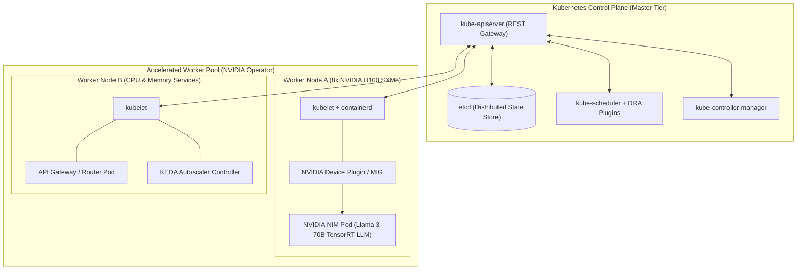
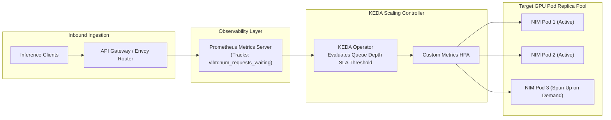
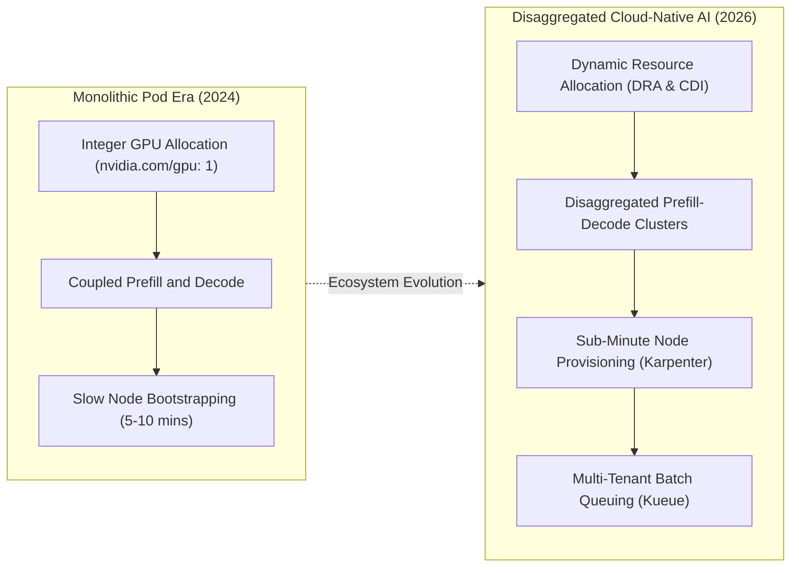

## Why Has Kubernetes Become the De-Facto Control Plane for Production AI Workloads?

In the early phases of machine learning experimentation, deploying models on standalone virtual machines (such as manual AWS EC2 `g5.2xlarge` instances) is simple and sufficient. However, as enterprise machine learning operations (MLOps) mature—encompassing dozens of distinct models, heterogeneous GPU hardware pools, multi-tenant engineering teams, and strict latency service-level agreements (SLAs)—static VM management becomes an operational bottleneck.

Operating machine learning models on unmanaged infrastructure triggers severe operational challenges:

1. **Underutilized GPU Capital Expenditure**: Modern datacenter accelerators (such as NVIDIA A100 and H100 GPUs) cost tens of thousands of dollars per unit. Statically binding a single model to a dedicated VM causes GPUs to sit idle during traffic lulls, resulting in massive financial waste.
2. **Absence of Declarative Self-Healing**: Foundation models served at scale frequently encounter memory fragmentation, out-of-memory (OOM) faults, or driver panics. Without an automated orchestration engine, a crashed process requires manual pager alerts and operational restarts, degrading system availability.
3. **Complex Multi-Model Ingress and Canary Routing**: Executing zero-downtime rolling updates, canary deployments, and multi-tenant traffic routing across disparate model versions requires writing fragile custom reverse-proxy configurations.

**Kubernetes (K8s)** resolves these challenges by providing a standardized, declarative control plane that abstracts physical compute, storage, and networking across on-premises clusters and multi-cloud hyperscalers.

However, Kubernetes introduces non-trivial operational complexity. For small engineering teams (fewer than 10-12 engineers) serving a single low-throughput model ($< 100 \text{ req/s}$), the operational overhead of maintaining a Kubernetes control plane often outweighs the benefits. Kubernetes becomes essential when organizations operate multiple microservices, require heterogeneous GPU scheduling, or demand dynamic autoscaling based on real-time inference queue depth.

As detailed in our architectural blueprints on [the seven-layer production LLM stack](/posts/awesome-production-llm/) and [resilient multi-tier cloud infrastructure](/posts/visualization-of-architecture-on-aws/), Kubernetes acts as the foundational bedrock uniting hardware accelerators with application microservices.



---

## Architecture of a Cloud-Native ML Cluster: Control Plane, GPU Operators, and Fractional Partitioning

A resilient Kubernetes cluster for machine learning decouples high-level orchestration from low-level accelerator hardware management:

### 1. The Declarative Control Plane
- **`kube-apiserver`**: The central administrative hub that exposes the Kubernetes API and validates declarative YAML manifests.
- **`etcd`**: A consistent, highly available distributed key-value store that immutably preserves the entire state of the cluster.
- **`kube-scheduler`**: Assigns unscheduled pods to optimal worker nodes based on resource requests, hardware topology, and affinity constraints.

### 2. The NVIDIA GPU Operator and Driver Lifecycle
In standard Linux environments, installing NVIDIA kernel drivers, the CUDA Toolkit, and the container runtime requires manual node provisioning. The **NVIDIA GPU Operator** automates this lifecycle declaratively using Kubernetes DaemonSets:
- **Automatic Driver Compilation**: Automatically compiles matching NVIDIA display drivers against the host's running Linux kernel version.
- **NVIDIA Container Toolkit**: Configures `containerd` to inject GPU device nodes (`/dev/nvidia*`) and CUDA user-space libraries directly into container namespaces.
- **NVIDIA Kubernetes Device Plugin**: Discovers GPU hardware and advertises available resources (e.g., `nvidia.com/gpu: 8`) to the `kube-scheduler`.

### 3. Hardware Fractionalization: MIG versus Time-Slicing
Large language models require whole physical GPUs or multi-node tensor parallelism. However, smaller auxiliary workloads (such as embedding models, rerankers, and safety classifiers) do not require an entire 80GB H100 accelerator. Kubernetes supports two primary fractionalization mechanisms:

```
+----------------------------------------------------------------------------------------------------+
|                                    GPU Fractionalization Strategies                                |
+----------------------------------------------------------------------------------------------------+
| Dimension            | Multi-Instance GPU (MIG)            | Time-Slicing (CUDA Core Sharing)      |
+----------------------+-------------------------------------+---------------------------------------+
| Hardware Support     | NVIDIA A100, H100, B200             | All modern NVIDIA GPUs                |
| Hardware Isolation   | Strict physical isolation: separate | Shared compute cores; time-shared     |
|                      | memory buses, SMs, and crossbars    | execution multiplexing                |
| Quality of Service   | Guaranteed deterministic latency    | Non-deterministic; "noisy neighbor"   |
| (QoS) Guarantees     | with zero cross-instance interference| memory contention risks               |
| Memory Protection    | Fault in one slice never crashes    | Out-of-memory (OOM) panic in one pod  |
|                      | neighboring slices                  | can impact shared GPU processes       |
+----------------------------------------------------------------------------------------------------+
```

Configuring MIG divides a single H100 into up to seven independent GPU instances (e.g., `1g.10gb` or `3g.40gb`), allowing a single physical node to serve embeddings, guardrails, and rerankers concurrently with complete hardware isolation.

### 4. Node Affinity, Taints, and Tolerations
To prevent general-purpose CPU services (such as web frontends or logging daemons) from occupying expensive GPU worker nodes, administrators apply **taints** to GPU nodes:

```yaml
# Applied to GPU Worker Nodes
taints:
  - key: "nvidia.com/gpu"
    value: "present"
    effect: "NoSchedule"
```

Only machine learning pods that explicitly specify corresponding **tolerations** and **nodeSelector** labels can be scheduled onto the accelerated hardware, ensuring strict isolation between compute tiers.

---

## Model Serving with NVIDIA NIM and Dynamic Queue Autoscaling via KEDA

Deploying modern generative models into production requires packaging optimized inference engines and establishing responsive autoscaling policies.

### Packaging Enterprise Models with NVIDIA NIM
**NVIDIA NIM (Inference Microservice)** represents a pre-built, production-ready container architecture designed for frictionless deployment on Kubernetes:
- **Self-Contained Runtime**: Bundles optimized serving runtimes (NVIDIA TensorRT-LLM and Triton Inference Server) with model weights, automated system checks, and standardized OpenAI-compatible REST and gRPC endpoints.
- **Hardware-Aware Graph Optimization**: Upon pod startup, NIM detects the exact underlying GPU microarchitecture (e.g., Ada Lovelace, Hopper, or Blackwell), compiling optimized CUDA engine graphs tailored specifically to the node's tensor core configurations and NVLink topology.

### The Failure of Standard CPU/Memory HPA for LLMs
In standard web microservices, the **Horizontal Pod Autoscaler (HPA)** scales pod replicas based on CPU utilization or memory consumption. For Large Language Models, this approach fails completely:
- When an LLM serving engine (such as vLLM or NIM) initializes, it immediately pre-allocates **90% to 95% of GPU High Bandwidth Memory** to store the model weights and the KV-Cache.
- Because memory usage remains static regardless of whether the model is serving zero requests or a hundred requests, memory-based HPA cannot detect traffic spikes.
- Similarly, GPU compute utilization spikes instantaneously to 100% during token generation, causing naive HPA policies to oscillate wildly between over-provisioning and rapid scale-downs (**flapping**).

### Event-Driven Autoscaling with KEDA
To achieve reliable elasticity, production teams deploy **KEDA (Kubernetes Event-driven Autoscaling)**. KEDA decouples scaling decisions from raw CPU metrics, triggering horizontal pod scaling based on **real-time inference queue depth**:



By querying application metrics directly from Prometheus—specifically `vllm:num_requests_waiting` or `triton_queue_duration_us`—KEDA dynamically provisions new GPU pod replicas as soon as incoming requests exceed target queue latency budgets, and scales idle pods to zero during off-peak hours to slash infrastructure expenses.

---

## How Cloud-Native AI Orchestration Evolved Across 2026

Between 2024 and 2026, the intersection of Kubernetes and artificial intelligence matured significantly:



1. **Dynamic Resource Allocation (DRA) and CDI**: The legacy Kubernetes scheduling constraint—where pods could only request integer numbers of GPUs (e.g., `nvidia.com/gpu: 1`)—has been replaced by **Dynamic Resource Allocation (DRA)** using the Container Device Interface (CDI). DRA enables pod specs to claim fine-grained hardware attributes: requesting specific PCIe interconnect bandwidths, sharing memory-mapped NVLink switches, or mounting virtualized GPU slices dynamically without static node reconfiguration.
2. **Disaggregated Prefill-and-Decode Clusters**: Because the prefill phase is compute-bound while the decode phase is memory-bandwidth bound, cutting-edge 2026 architectures split workloads across separate pod deployments. Prefill pods run on compute-heavy nodes optimized for raw FLOPS, while decode pods run on nodes optimized for high memory bandwidth, communicating over high-speed RDMA interconnects with near-zero transfer overhead.
3. **Sub-Minute Node Provisioning with Karpenter**: Traditional Kubernetes cluster autoscalers relied on rigid cloud node groups, requiring five to ten minutes to provision new GPU instances. Modern orchestrators utilize **Karpenter**: an open-source, just-in-time node autoscaler that bypasses node groups, directly provisioning bare-metal and spot GPU instances tailored to the exact resource requests of pending pods in under 60 seconds.
4. **Kubernetes-Native Multi-Tenant Queuing (Kueue)**: Enterprises manage mixed workloads—interactive user-facing inference alongside multi-day distributed training and fine-tuning jobs. **Kueue** manages fair-share scheduling, hierarchical quota allocation, and job preemption natively, pausing non-critical batch fine-tuning pods to yield GPU capacity to latency-sensitive production inference services during sudden traffic surges.

---

## Key Takeaways

- **Declarative Orchestration at Scale**: Kubernetes provides the essential control plane for production AI workloads, ensuring self-healing, uniform hardware abstraction, and automated rolling deployments.
- **Hardware Topology Management**: Leveraging the NVIDIA GPU Operator alongside Multi-Instance GPU (MIG) partitioning maximizes hardware utilization while guaranteeing strict physical isolation for concurrent microservices.
- **Queue-Depth Autoscaling Over CPU**: Standard CPU/memory HPA is fundamentally unsuited for Large Language Models; production architectures rely on event-driven scalers like KEDA to scale GPU pods based on real-time inference queue depth.
- **2026 Infrastructure Maturation**: Modern AI orchestration leverages Dynamic Resource Allocation (DRA), just-in-time Karpenter node provisioning, and disaggregated prefill-decode architectures to achieve peak resource efficiency.

---

## New Questions

- How do disaggregated prefill-and-decode clusters maintain deterministic latency when inter-node RDMA network links experience packet loss or jitter?
- What are the cold-start latency trade-offs of scaling complex 70B+ foundation models to zero using Karpenter and spot GPU instances?
- How can Kubernetes Dynamic Resource Allocation policies prevent distributed training deadlocks when gang-scheduling multi-node all-reduce jobs across heterogeneous clusters?

---

## References

- Kubernetes Authors. *Schedule GPUs: Managing GPU Resources in Kubernetes*. Kubernetes Official Documentation, 2024. [https://kubernetes.io/docs/tasks/manage-gpus/scheduling-gpus/](https://kubernetes.io/docs/tasks/manage-gpus/scheduling-gpus/) (accessed 2026-10-18).
- NVIDIA Corporation. *NVIDIA GPU Operator Documentation: Automated Lifecycle Management of GPUs in Kubernetes*. NVIDIA Docs Hub, 2024. [https://docs.nvidia.com/datacenter/cloud-native/gpu-operator/latest/](https://docs.nvidia.com/datacenter/cloud-native/gpu-operator/latest/) (accessed 2026-10-18).
- KEDA Authors. *KEDA: Kubernetes Event-Driven Autoscaling Documentation*. CNCF Project Documentation, 2024. [https://keda.sh/docs/](https://keda.sh/docs/) (accessed 2026-10-18).
- NVIDIA Corporation. *NVIDIA NIM: Accelerated AI Inference Microservices*. NVIDIA Developer Platform, 2024. [https://developer.nvidia.com/nim](https://developer.nvidia.com/nim) (accessed 2026-10-18).
