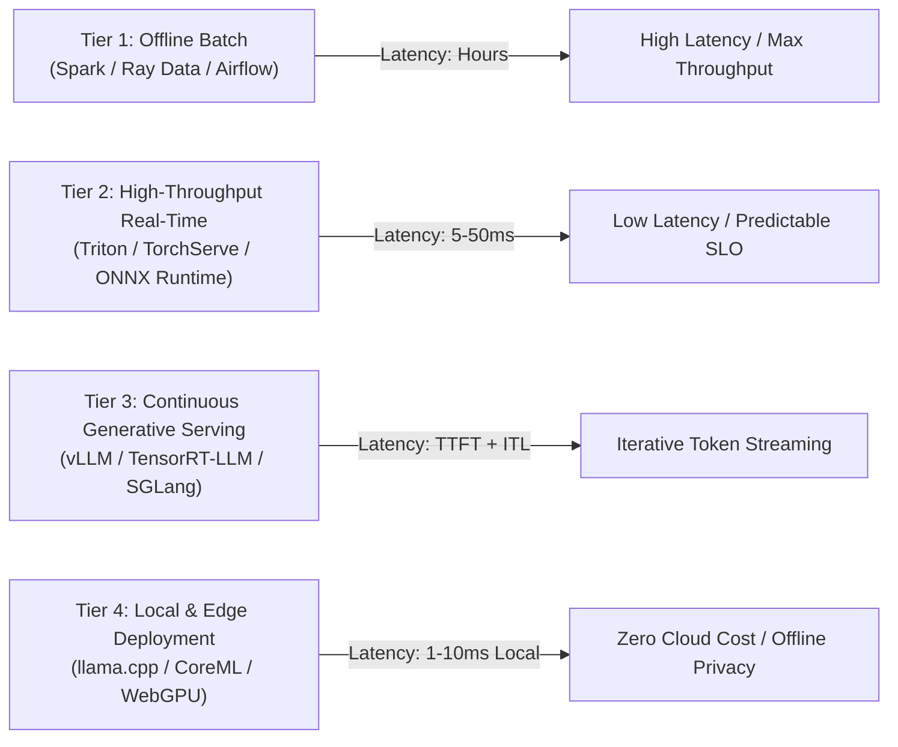
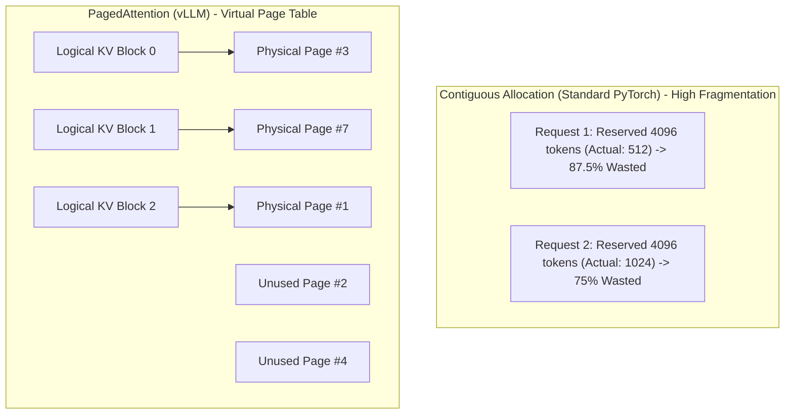
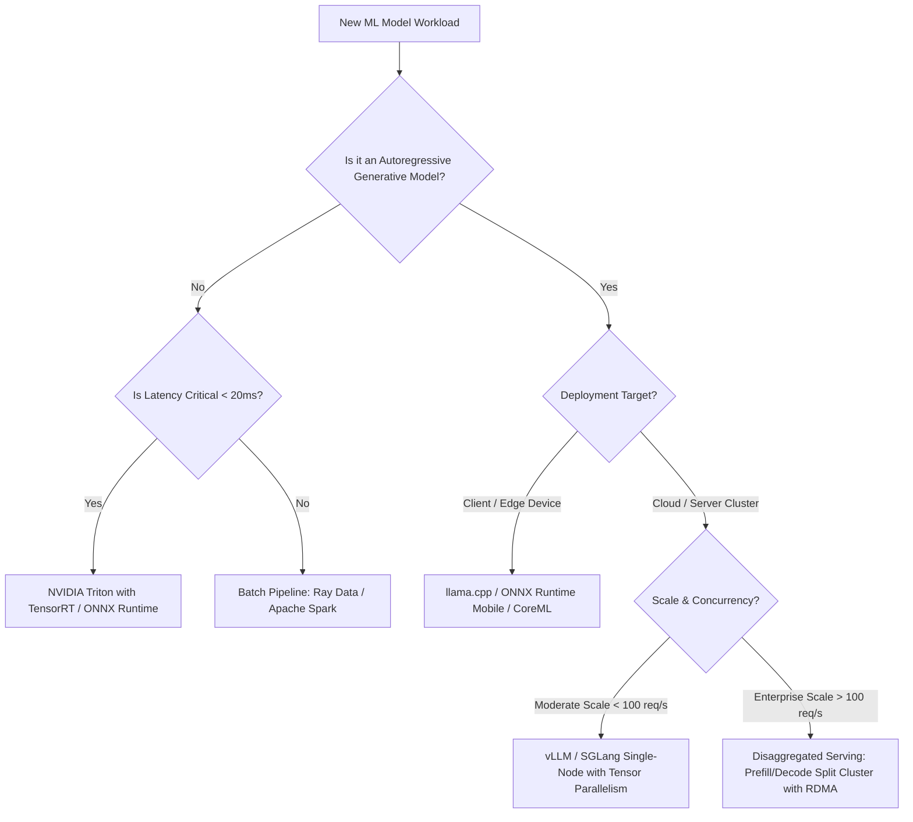

## Why Did Synchronous REST Microservices Fail Under Modern Generative AI Workloads?

In classical machine learning operations (MLOps), model deployment was treated as a conventional stateless web service problem. A trained scikit-learn, XGBoost, or ResNet model was serialized into an artifact (`.pkl`, `.onnx`, or `.pt`), mounted into a Flask or FastAPI container, and deployed behind an HTTP reverse proxy. In this paradigm, incoming requests followed a deterministic request-response lifecycle: the server received a batch of structured tabular features or an image tensor, performed a single forward pass through the static computation graph, and immediately returned an inference score or prediction vector in tens of milliseconds.

```mermaid
flowchart TD
    subgraph ClassicalServing["Classical ML Microservice (Stateless)"]
        A[Client Request] --> B[HTTP Gateway]
        B --> C[FastAPI / Gunicorn]
        C --> D[Single Forward Pass (PyTorch / ONNX)]
        D --> E[Immediate Prediction Tensor]
    end

    subgraph GenerativeServing["LLM Serving Runtime (Stateful & Dynamic)"]
        F[Client Stream] --> G[Continuous Batching Engine]
        G --> H[Prefill Phase: Compute KV Cache]
        H --> I[Decode Loop: Token-by-Token Iteration]
        I --> J{End-of-Sequence?}
        J -- No --> I
        J -- Yes --> K[Stream Completion]
        I --> L[Dynamic KV Cache Allocation]
        L -.-> I
    end
```

The arrival of modern generative large language models (LLMs) completely dismantled this paradigm. Generative transformers exhibit three core properties that break classical microservice infrastructure:

1. **Autoregressive Token Generation**: Inference is not a single execution pass. After processing the initial prompt (prefill phase), the model enters an autoregressive decoding loop where generating $N$ output tokens requires $N$ sequential forward passes. Each pass produces exactly one token and appends its key-value representations to memory.
2. **Dynamic Request Durations**: In classical serving, execution latency is predictable. In generative inference, one user may request a single boolean classification (1 token), while another requests a multi-page codebase analysis (4,096 tokens). Holding HTTP worker connections open across divergent iteration cycles causes severe head-of-line blocking under static request batching.
3. **Severe Memory Bottlenecks in the KV Cache**: Unlike dense weights which remain static during serving, the Key-Value (KV) cache grows dynamically with context length and batch size:

$$\text{KV Memory Per Token} = 2 \times n_{\text{layers}} \times n_{\text{heads}} \times d_{\text{head}} \times \text{bytes per element}$$

For a 70B model operating at 16-bit precision, serving a batch of 64 requests with 4,096 tokens requires tens of gigabytes of GPU High Bandwidth Memory (HBM) purely for attention activations, causing memory fragmentation and frequent out-of-memory (OOM) crashes in standard inference servers.

---

## The Four Architectural Tiers of Machine Learning Serving

Modern machine learning serving divides into four distinct architectural regimes, each defined by its compute location, latency bounds, and memory access patterns.



### 1. Offline Batch Processing

Batch inference executes asynchronous model scoring over large datasets stored in object stores (Amazon S3, Google Cloud Storage) or data lakes. Orchestrated via systems like Apache Spark, Ray Data, or Prefect, batch inference maximizes hardware utilization by saturating compute cores with static tensor shapes. Because latency is measured in hours rather than milliseconds, cold starts and scheduling overhead are amortized across millions of samples.

### 2. High-Throughput Classical Serving (Triton / TorchServe)

For low-latency discrimination tasks (e.g., fraud scoring, ranking, embedding generation), enterprise systems deploy dedicated inference platforms such as NVIDIA Triton Inference Server. Triton separates the HTTP/gRPC transport layer from model execution backends, offering dynamic request batching, model pipelining, and multi-model concurrent execution on shared GPUs:

```protobuf
// NVIDIA Triton Model Configuration Schema (model.pbtxt)
name: "ensemble_classifier"
platform: "onnxruntime_onnx"
max_batch_size: 128
dynamic_batching {
  max_queue_delay_microseconds: 5000
}
instance_group [
  {
    count: 2
    kind: KIND_GPU
    gpus: [ 0 ]
  }
]
```

### 3. Continuous Generative Serving (vLLM / SGLang)

Generative serving architectures discard request-level batching in favor of **iteration-level continuous batching** (Orca) and virtual memory paging (PagedAttention, implemented in vLLM). As requests arrive, their prefill phases are interleaved with ongoing decoding iterations. Completed sequences immediately vacate their memory slots, eliminating GPU underutilization caused by padded sequences.

### 4. Edge and Embedded Inference

As demonstrated in our audits of [1-bit on-device compression](/posts/prismml-1-bit-bonsai-on-device-ai/) and [low-latency speech serving](/posts/supertonic-onnx-runtime-tts/), resource-constrained client devices run localized runtimes like ONNX Runtime, GGML/llama.cpp, and WebGPU. Edge deployment removes network ingress latency and cloud compute expenditure entirely while preserving user data locality.

---

## Deconstructing Continuous Batching and PagedAttention

To understand why specialized LLM serving engines outperform general-purpose microservices by $4\times$ to $10\times$ in throughput, we must examine the memory allocator inside vLLM: **PagedAttention** (Kwon et al., 2023).

In standard PyTorch serving implementations, the KV cache for a sequence must be allocated contiguously in GPU virtual memory based on the theoretical maximum sequence length (e.g., 4,096 tokens). Because actual generation lengths vary widely, up to 60–80% of allocated GPU memory is wasted on unallocated internal fragmentation or reserved over-allocation.



PagedAttention draws direct inspiration from virtual memory paging in operating systems:

- The KV cache is divided into fixed-size physical blocks (e.g., 16 or 32 tokens per block).
- A centralized block manager maintains a page table mapping each request's logical token indices to non-contiguous physical memory pages in HBM.
- As a request generates new tokens, the engine allocates individual physical blocks on demand from a global memory pool.

When multiple requests share identical prompt prefixes—such as in few-shot prompting, system prompts, or multi-turn agent conversations—PagedAttention allows different requests to point their logical blocks to the **same physical pages** using copy-on-write semantics. This dramatically slashes redundant compute and memory footprint, directly supporting high-concurrency systems examined in our [vector database evaluation](/posts/choice-vector-database-for-llm/) and [2024 model landscape audit](/posts/llm-2024-survey/).

---

## Architectural Comparison: Serving Paradigms

| Dimension | FastAPI / PyTorch Microservice | NVIDIA Triton (Classical) | vLLM / TensorRT-LLM (Generative) |
| :--- | :--- | :--- | :--- |
| **Primary Workload** | Tabular, vision, small NLP | Multimodal, ONNX, TensorRT, ranking | Autoregressive LLMs & VLMs |
| **Batching Mechanism** | Static manual batching | Dynamic request-level queue batching | Iteration-level continuous batching |
| **Memory Allocation** | Contiguous tensor allocations | Static buffer pools | Virtual PagedAttention memory manager |
| **Streaming Support** | Primitive SSE / chunked encoding | Decoupled gRPC streaming | Token-level SSE / WebSocket native streaming |
| **Multi-LoRA Serving** | Separate container per adapter | Dynamic model swapping | Dynamic adapter merging onto base weights |
| **Quantization Support** | External quantization pipelines | TensorRT INT8 / FP8 calibration | Native AWQ, GPTQ, FP8, bitsandbytes |
| **Hardware Topology** | Single GPU per process | Multi-instance GPU (MIG), multi-GPU | Tensor Parallelism (TP) + Pipeline Parallelism (PP) |

---

## How Machine Learning Deployment Evolved Across 2026

By 2026, inference infrastructure transitioned from single-node instances to disaggregated, heterogeneous distributed clusters:

```mermaid
flowchart LR
    Client[Client Query] --> Router[Disaggregated Router / Scheduler]
    
    subgraph PrefillCluster["Prefill Nodes (Compute-Bound, High FLOPs)"]
        Router -->|Prompt Tokens| PNode1[Node 1: FP8 GEMM Prefill]
        Router -->|Prompt Tokens| PNode2[Node 2: FP8 GEMM Prefill]
    end

    PrefillCluster -->|Transfer KV Cache via RDMA / PCIe| DecodeCluster

    subgraph DecodeCluster["Decode Nodes (Memory Bandwidth-Bound, High HBM)"]
        DecodeCluster --> DNode1[Node 1: Continuous Batching Decode]
        DecodeCluster --> DNode2[Node 2: Continuous Batching Decode]
    end

    DecodeCluster -->|Token Stream| Client
```

1. **Disaggregated Prefill and Decode (Splitwise / DistServe)**: In transformer models, the prefill phase is compute-bound (matrix-matrix multiplication with near-peak FLOP utilization), whereas the decode phase is memory-bandwidth bound (matrix-vector operations stalled on memory transfer). In 2026 production systems, architectures separate these phases onto distinct hardware nodes: dedicated high-compute servers process prompt prefill and stream the resulting KV cache across InfiniBand/RDMA networks to memory-optimized decode instances.
2. **Speculative Decoding Engines**: Production serving frameworks widely adopt speculative decoding, pairing a small draft model (e.g., 1B–3B parameters) with a large target model (e.g., 70B+ parameters). The draft model speculatively generates multiple candidate tokens at high speed, which the target model verifies in a single forward pass, boosting inference speed by $2\times$ to $3.5\times$ without altering model output distributions.
3. **Prefix Caching and Radix Trees**: Frameworks like SGLang introduced RadixAttention, which maintains an active radix tree of all generated and served token prefixes across requests. When subsequent requests share long system instructions, RAG context, or prior conversation turns, the server skips re-computing key-value tensors, reducing Time-To-First-Token (TTFT) by up to 90%.
4. **Unified FP8 and Micro-Scaling Serving**: Hardware architectures such as NVIDIA Blackwell and AMD MI350 standardized on native FP8 and lower-precision formats. Serving engines exploit hardware-accelerated transformer engines with dynamic scaling factors, doubling effective inference throughput per GPU.
5. **Decoupled Orchestration and Resilient Autoscaling**: Cloud-native ML deployment shifted from static Kubernetes ReplicaSets to specialized operators (KServe, vLLM Production Stack). Autoscalers no longer monitor raw CPU/GPU memory; instead, they scale pods dynamically based on KV cache saturation metrics and queue-time SLO breaches.

---

## Practical Deployment Topology Reference

For engineering teams determining where to place their inference boundary, the following decision flow encapsulates production tradeoffs:



{: .light .shadow .rounded-10 w='1212' h='668' }

---

## Key Takeaways

- **Classical Microservices Cannot Scale Generative AI**: Stateless request-response containers fail under autoregressive generation loops, varying token durations, and massive KV cache memory footprints.
- **Continuous Batching Maximizes Hardware Saturation**: Iteration-level scheduling eliminates idle GPU compute by interleaving arriving prefill tokens with running decode sequences.
- **PagedAttention Solves KV Cache Fragmentation**: Managing attention memory through non-contiguous virtual pages eliminates internal fragmentation and enables zero-copy prefix sharing.
- **Disaggregated Architectures Define 2026 Production Standards**: Modern high-volume serving clusters separate compute-bound prefill nodes from memory-bound decode nodes, utilizing speculative decoding and cross-cluster prefix caching.

---

## New Questions

- How do RDMA network bandwidth bottlenecks impact the viability of disaggregated prefill-decode architectures when serving long-context models (128K+ tokens)?
- What mathematical bounds dictate the optimal parameter size ratio between draft and verifier models in speculative decoding pipelines?
- How will the standardization of 4-bit and 2-bit weight-activation formats alter the balance between compute-bound prefill and memory-bound decode serving phases?

---

## References

- Kwon, W., Li, Z., Zhuang, S., Sheng, Y., Zheng, L., Yu, C. H., Gonzalez, J. E., Zhang, H., & Stoica, I. (2023). *Efficient Memory Management for Large Language Model Serving with PagedAttention*. In Proceedings of the 29th ACM Symposium on Operating Systems Principles (SOSP '23), arXiv preprint [arXiv:2309.06180](https://arxiv.org/abs/2309.06180) (accessed 2026-10-18).
- NVIDIA. (2026). *NVIDIA Triton Inference Server Technical Documentation*. NVIDIA Developer Documentation. [https://docs.nvidia.com/deeplearning/triton-inference-server/user-guide/docs/](https://docs.nvidia.com/deeplearning/triton-inference-server/user-guide/docs/) (accessed 2026-10-18).
- Patel, P., Choukse, E., Zhang, C., Shah, A., & Goiri, Í. (2024). *Splitwise: Efficient Generative LLM Inference Using Phase Splitting*. In Proceedings of the 51st Annual International Symposium on Computer Architecture (ISCA '24), arXiv preprint [arXiv:2311.18677](https://arxiv.org/abs/2311.18677) (accessed 2026-10-18).
- Zheng, L., Yin, L., Xie, Z., Sun, C., Huang, C. H., Yu, C. H., Cao, S., Christaballen, C. A., Stoica, I., Gonzalez, J. E., & Sheng, Y. (2024). *SGLang: Efficient Execution of Structured Language Model Programs*. arXiv preprint [arXiv:2312.07104](https://arxiv.org/abs/2312.07104) (accessed 2026-10-18).
