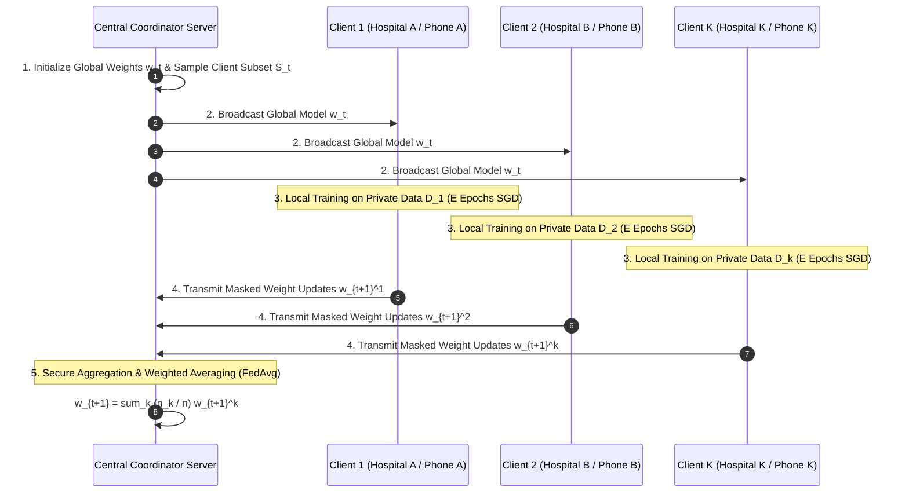
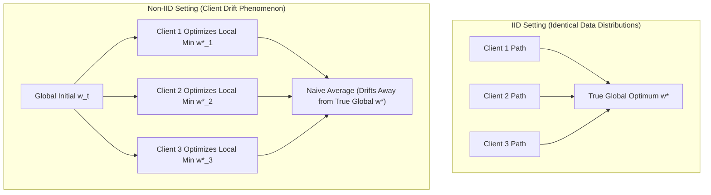
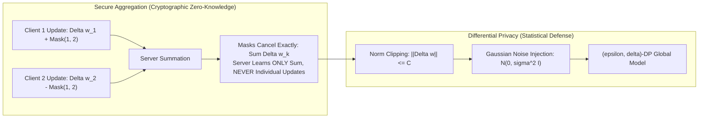
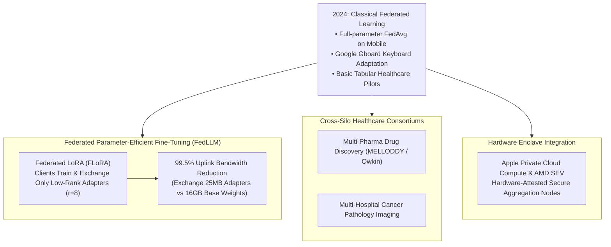

## Why Is Centralized Data Pooling Structurally Incompatible with Regulated AI?

In standard machine learning paradigms, data is assumed to be easily centralized: client telemetry, medical health records, banking transactions, and mobile keystrokes are uploaded over public networks to a single monolithic data lakehouse. Once aggregated in cloud object storage, engineers train deep neural networks using data-parallel distributed gradient descent across massive GPU clusters.

In highly regulated, privacy-sensitive industries—such as healthcare (governed by HIPAA and GDPR), commercial banking (governed by PCI-DSS and Basel III), and consumer mobile operating systems—this centralized aggregation pattern is legally, ethically, and operationally dead on arrival:
1. **Regulatory Data Sovereignty**: Transmitting raw patient electronic health records (EHR) or cross-border financial transactions violates statutory data localization laws, exposing organizations to multi-million-dollar fines and existential compliance liability.
2. **Catastrophic Breach Vulnerability**: Centralizing the sensitive records of millions of users in a single cloud repository creates an irresistible "honeypot" for state-sponsored cyber adversaries and malicious insider threats.
3. **Uplink Bandwidth Asymmetry**: Edge devices (smartphones, connected vehicles, hospital CT scanners) generate terabytes of high-dimensional sensor data daily. Uploading raw sensor streams over constrained cellular or hospital Wi-Fi links saturates physical infrastructure.

Introduced by Google researchers in their foundational paper *Communication-Efficient Learning of Deep Networks from Decentralized Data* ([McMahan et al., AISTATS 2017](https://arxiv.org/abs/1602.05629)), **Federated Learning (FL)** fundamentally inverted the training paradigm: **bring the model to the data, rather than bringing the data to the model**. By keeping raw training samples strictly confined to client edge nodes and coordinating training through distributed mathematical aggregation of ephemeral weight updates, federated learning enables collaborative model training across millions of decentralized devices.

This privacy-preserving decentralized computation directly links to edge device constraints in [Apple Intelligence Architecture](/posts/apple-intelligence-paper/), data pipeline governance in [Machine Learning Data Quality](/posts/ensuring-data-quality-in-machine-learning/), and modular decoupling in [Modern Software Architecture](/posts/modern-software-architecture/).

---

## The Federated Optimization Lifecycle: FedAvg Mechanics

The standard federated learning lifecycle coordinates a central orchestration server with an ephemeral pool of $K$ decentralized clients over a series of communication rounds $t = 1, 2, \dots, T$:

### The Federated Averaging (FedAvg) Algorithm
Let client $k \in \{1, \dots, K\}$ hold a private partition of dataset $\mathcal{D}_k$ containing $n_k = |\mathcal{D}_k|$ training samples, with total dataset size $n = \sum_{k=1}^K n_k$. The global optimization objective is to minimize the empirical risk:

$$\min_{\mathbf{w} \in \mathbb{R}^d} F(\mathbf{w}) \quad \text{where} \quad F(\mathbf{w}) = \sum_{k=1}^K \frac{n_k}{n} F_k(\mathbf{w})$$

where $F_k(\mathbf{w}) = \frac{1}{n_k} \sum_{\mathbf{x}_i \in \mathcal{D}_k} \ell(\mathbf{w}; \mathbf{x}_i)$ represents the local loss on client $k$.

In each communication round $t$:
1. **Client Selection**: The server selects a random subset $\mathcal{S}_t \subseteq \{1, \dots, K\}$ of $C \cdot K$ participating clients (e.g., devices currently connected to unmetered Wi-Fi and charging).
2. **Model Broadcast**: The server transmits current global parameter vector $\mathbf{w}_t$ to all clients in $\mathcal{S}_t$.
3. **Local Stochastic Gradient Descent (SGD)**: Each selected client initializes local weights $\mathbf{w}_{t, 0}^k = \mathbf{w}_t$ and executes $E$ local epochs of mini-batch SGD:

$$\mathbf{w}_{t, e+1}^k = \mathbf{w}_{t, e}^k - \eta \nabla F_k\left(\mathbf{w}_{t, e}^k\right)$$

producing final local model $\mathbf{w}_{t+1}^k$.
4. **Server Aggregation**: Clients transmit their updated weights back to the coordinator. The server computes the new global parameter vector via sample-weighted averaging:

$$\mathbf{w}_{t+1} = \sum_{k \in \mathcal{S}_t} \frac{n_k}{\sum_{j \in \mathcal{S}_t} n_j} \mathbf{w}_{t+1}^k$$

By executing multiple local epochs ($E > 1$) on client devices prior to communication, FedAvg amortizes the high latency of network communication rounds, achieving convergence in orders of magnitude fewer round-trips than naive distributed SGD.

---

## The Non-IID Data Challenge and Client Drift: FedProx and SCAFFOLD

The central theoretical challenge in federated learning is that client data is **Non-IID (Not Independent and Identically Distributed)**. In mobile keyboard prediction (Google Gboard), different users write in distinct languages, dialects, and vocabularies; in oncology networks, different hospitals specialize in specific cancer subtypes and demographic cohorts.

When local objective functions $F_k(\mathbf{w})$ diverge significantly:
- As clients execute multiple local epochs $E$, their parameters drift toward their respective local minima $\mathbf{w}_k^* = \arg\min F_k(\mathbf{w})$, which may be mutually contradictory.
- Averaging these drifted weights causes the global trajectory to oscillate, slow convergence, or suffer catastrophic accuracy collapse.

### The FedProx Regularization Solution
To constrain client drift, Li et al. (MLSys 2020) formulated **FedProx**, adding an explicit proximal regularization term to each client's local loss function:

$$\min_{\mathbf{w} \in \mathbb{R}^d} h_k\left(\mathbf{w}; \mathbf{w}_t\right) = F_k(\mathbf{w}) + \frac{\mu}{2} \left\| \mathbf{w} - \mathbf{w}_t \right\|_2^2$$

The proximal parameter $\mu \ge 0$ penalizes local models from venturing too far from the current global consensus $\mathbf{w}_t$. If a resource-constrained client is unable to complete all $E$ epochs (a "straggler" device), FedProx allows it to return a partial solution without destabilizing the global update.

---

## Cryptographic Security: Secure Aggregation (SecAgg) and Differential Privacy

A common misconception is that transmitting model weights or gradients rather than raw data guarantees absolute privacy. Research on **Gradient Inversion Attacks** (Zhu et al., Deep Leakage from Gradients) proved that an adversarial server can reconstruct pixel-perfect training images and exact text sentences by back-solving for inputs that match the observed gradient $\nabla_{\mathbf{w}} \ell$.

Production federated platforms implement two interlocking cryptographic and statistical defenses:

### 1. Secure Aggregation Protocol (SecAgg)
Engineered by Google ([Bonawitz et al., ACM CCS 2017](https://eprint.iacr.org/2017/281)), Secure Aggregation ensures that the central server learns **only the aggregate sum of client updates, and nothing else**:
- Participating clients establish pairwise shared secrets using Diffie-Hellman key exchanges.
- Client $u$ and Client $v$ generate a mutual pseudo-random mask $\mathbf{s}_{u, v}$. When transmitting updates, Client $u$ adds $\mathbf{s}_{u, v}$, while Client $v$ subtracts $\mathbf{s}_{u, v}$.
- When the central server sums all client payloads:

$$\sum_{u} \mathbf{y}_u = \sum_u \left( \mathbf{w}_u + \sum_{v > u} \mathbf{s}_{u, v} - \sum_{v < u} \mathbf{s}_{v, u} \right) = \sum_u \mathbf{w}_u$$

Every blinding mask cancels out identically in the sum. The server inspects the aggregate update with zero individual gradient visibility.
- To handle client dropouts (e.g., mobile phones disconnecting mid-round), SecAgg uses Shamir's $t$-out-of-$n$ Secret Sharing, allowing surviving clients to reconstruct only the masks of disconnected peers.

### 2. Differential Privacy (DP-FedAvg)
To prevent memorization of rare training samples within the aggregated model weights, federated systems apply the **Gaussian Mechanism** of $(\epsilon, \delta)$-Differential Privacy:
1. **Gradient Clipping**: Each client's update vector is clipped to a maximum $\ell_2$-norm threshold $C$:

$$\tilde{\Delta}_k = \Delta_k \cdot \min\left(1, \frac{C}{\|\Delta_k\|_2}\right)$$

2. **Calibrated Noise Injection**: The coordinator adds isotropic Gaussian noise proportional to the sensitivity $\Delta_2$:

$$\mathbf{w}_{t+1} = \mathbf{w}_t + \frac{1}{|\mathcal{S}_t|} \sum_{k \in \mathcal{S}_t} \tilde{\Delta}_k + \mathcal{N}\left( \mathbf{0}, \sigma^2 \mathbf{I} \right), \quad \sigma = \frac{C \sqrt{2 \ln(1.25 / \delta)}}{\epsilon \cdot |\mathcal{S}_t|}$$

This provides a mathematical guarantee that the presence or absence of any individual patient's record in the dataset alters the final model output probability by at most $e^\epsilon$, neutralizing gradient inversion and membership inference attacks.

---

## Empirical Comparison: Centralized vs Federated Paradigms

| Dimension / Metric | Centralized ML | Naive Distributed SGD | Federated Learning (FedAvg + SecAgg) |
| :--- | :--- | :--- | :--- |
| **Data Locality** | Central cloud lakehouse | Private VPC cluster | Decentralized on edge client devices |
| **Raw Data Exposure** | High (Full centralized copy) | High (Data accessible to nodes) | **Zero (Raw data never leaves client)** |
| **Communication Pattern** | Continual streaming ETL | Synchronous every mini-batch | Periodic round-based model aggregation |
| **Network Constraint** | High-bandwidth datacenter | 100 Gbps InfiniBand | Asymmetric, lossy mobile Wi-Fi / 5G |
| **Client Heterogeneity** | Homogeneous cloud nodes | Homogeneous GPU clusters | Extreme (Smartphones, IoT, CT Scanners)|
| **Privacy Guarantee** | Trust-based encryption at rest | Network isolation | Cryptographic SecAgg + $(\epsilon, \delta)$-DP |
| **Data Distribution** | Uniformly shuffled (IID) | Shuffled batches | Arbitrary Non-IID client distributions |

---

## How Federated Learning Evolved Across 2024–2026 Foundation Model Workflows

Between 2024 and 2026, the scaling of Large Language Models (LLMs) transformed federated learning from an edge mobile utility into an enterprise foundation model infrastructure:

### 1. Federated LoRA (FLoRA) for Large Language Models
Transmitting a full 7B or 70B parameter model over client uplink connections (requiring 14 GB to 140 GB per communication round) is physically impossible on consumer edge networks.
- In 2025–2026, the industry consolidated around **Federated LoRA (FLoRA)**.
- The base LLM (e.g., Llama 3.1 8B) remains frozen on client devices.
- Clients train only low-rank adapter matrices ($\mathbf{A} \in \mathbb{R}^{r \times d}, \mathbf{B} \in \mathbb{R}^{d \times r}$ with rank $r = 8$).
- Only the adapter weights (consuming $\approx 25\text{ megabytes}$) are blinded via SecAgg and uploaded to the server, slashing communication bandwidth requirements by over **$99.5\%$**.

### 2. Cross-Silo Healthcare Consortiums (MELLODDY and Owkin)
In pharmaceutical research, competing biopharma companies hold proprietary chemical libraries that could accelerate cancer drug discovery if combined, but cannot share data due to competitive intellectual property rights.
- Cross-silo federated learning consortia (e.g., MELLODDY, connecting 10 global pharmaceutical giants) use federated learning to train quantitative structure-activity relationship (QSAR) models across multi-million compound databases.
- Models predict chemical binding affinity with unprecedented generalization without any participant exposing proprietary chemical structures to competitors.

### 3. Hardware-Attested Confidential Federated Aggregation
Rather than relying purely on complex multi-party cryptographic protocols that incur computational overhead, modern 2026 federated deployments run aggregation servers inside **Confidential Computing Enclaves** (utilizing AMD SEV-SNP, Intel TDX, or Apple Private Cloud Compute hardware attestation). The central coordinator verifies cryptographic hardware certificates proving that incoming gradients are aggregated in encrypted volatile memory and erased immediately without secondary inspection.

---

## Key Takeaways

- **Decentralized Principle**: Federated Learning eliminates the need to centralize raw private records by bringing the training computation to edge data sources and transmitting only ephemeral mathematical updates.
- **Communication Efficiency via FedAvg**: Performing multiple local training epochs ($E > 1$) on client devices prior to aggregation amortizes high network latency, achieving global convergence in minimal communication rounds.
- **Non-IID Drift Mitigation**: Objective functions like FedProx add proximal regularization terms $\frac{\mu}{2}\|\mathbf{w} - \mathbf{w}_t\|^2$ to prevent local client models from diverging from global empirical consensus.
- **Defense in Depth**: Combining Secure Aggregation (cryptographic zero-knowledge masking) with Differential Privacy (norm clipping and Gaussian noise injection) completely neutralizes gradient inversion attacks.
- **Federated LoRA Scalability**: In the 2026 foundation model era, exchanging low-rank parameter adapters (FLoRA) allows 8B+ parameter LLMs to be fine-tuned federatedly across consumer devices with minimal bandwidth overhead.

---

## New Questions

1. **Byzantine Fault Tolerance and Data Poisoning**: If a malicious client injects intentionally backdoored gradients under Secure Aggregation where the server cannot inspect individual contributions, how can the coordinator identify and prune poisoned updates without breaking cryptographic blinding?
2. **Asymmetric Heterogeneity in Edge LLMs**: When participating clients range from high-end M-series Macs to entry-level Android smartphones with vastly disparate RAM and thermal constraints, how can federated schedules allocate adaptive LoRA ranks without creating straggler bottlenecks?
3. **Personalization vs Generalization Trade-Off**: How can federated foundation models balance global shared alignment with personalized on-device LoRA adapters tailored to an individual user's unique stylistic and cognitive patterns?

---

## References

- McMahan, B., Moore, E., Ramage, D., Hampson, S., & y Arcas, B. A. (2017). *Communication-Efficient Learning of Deep Networks from Decentralized Data*. International Conference on Artificial Intelligence and Statistics (AISTATS 2017). [arXiv:1602.05629](https://arxiv.org/abs/1602.05629). (accessed 2026-10-18).
- Bonawitz, K., Ivanov, V., Kreuter, B., Marcedone, A., McMahan, H. B., Patel, S., Ramage, D., Segal, A., & Seth, K. (2017). *Practical Secure Aggregation for Privacy-Preserving Machine Learning*. Proceedings of the 2017 ACM SIGSAC Conference on Computer and Communications Security (CCS 2017). [https://eprint.iacr.org/2017/281](https://eprint.iacr.org/2017/281). (accessed 2026-10-18).
- Li, T., Sahu, A. K., Zaheer, M., Sanjabi, M., Talwalkar, A., & Smith, V. (2020). *Federated Optimization in Heterogeneous Networks (FedProx)*. Proceedings of Machine Learning and Systems (MLSys 2020). [arXiv:1812.06127](https://arxiv.org/abs/1812.06127). (accessed 2026-10-18).
- Dwork, C., & Roth, A. (2014). *The Algorithmic Foundations of Differential Privacy*. Foundations and Trends in Theoretical Computer Science, 9(3-4), 211-407. [DOI:10.1561/0400000042](https://doi.org/10.1561/0400000042). (accessed 2026-10-18).
- Kairouz, P., McMahan, H. B., Avent, B., et al. (2021). *Advances and Open Problems in Federated Learning*. Foundations and Trends in Machine Learning, 14(1-2), 1-210. [arXiv:1912.04977](https://arxiv.org/abs/1912.04977). (accessed 2026-10-18).
