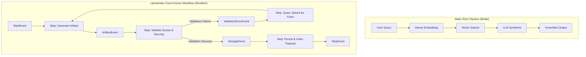
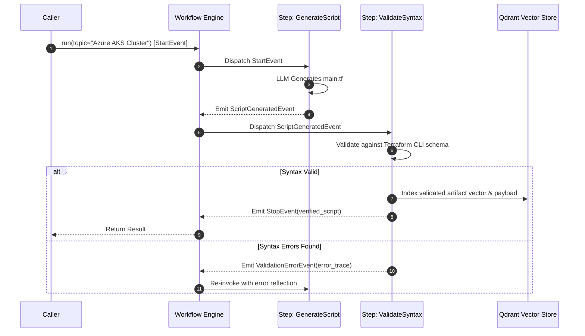
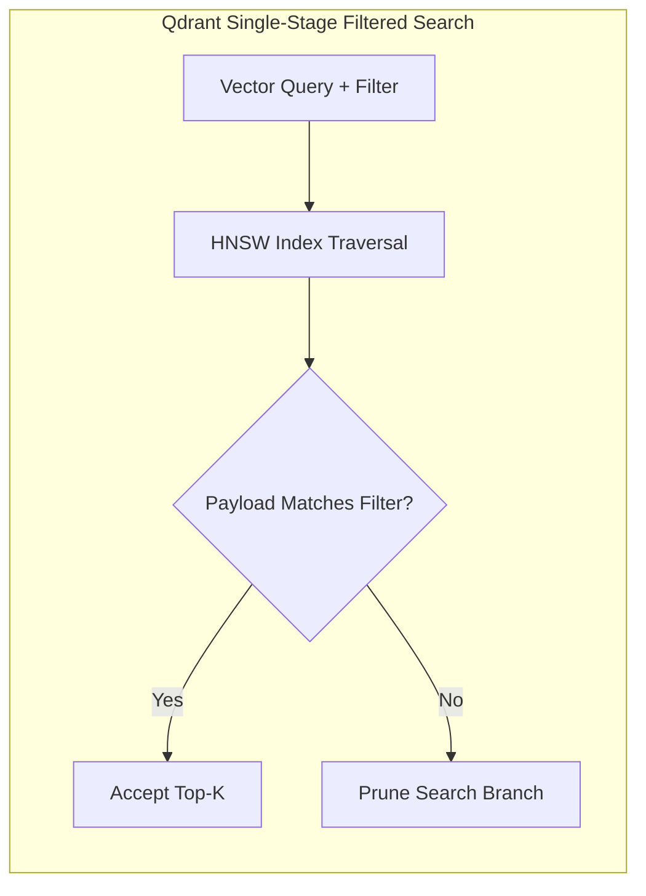

## Why Did Event-Driven Architecture Replace Static RAG Pipelines?

Standard Retrieval-Augmented Generation (RAG) implementations typically rely on linear execution chains. An incoming query is converted into a vector embedding, searched against a vector index, concatenated into a prompt template, and synthesized by a large language model. While this pipeline suffices for simple fact retrieval, it breaks down in complex technical workflows—such as Infrastructure as Code (IaC) generation, multi-stage compliance verification, and recursive query expansion.

When generating mission-critical artifacts like Terraform configurations, a single-pass generation risks catastrophic cloud misconfigurations, syntax invalidations, or security perimeter breaches. An autonomous system requires iterative cycles: generating a tentative configuration, dispatching it to a validation sandbox, parsing schema errors, querying vector stores for corrected API parameters, and compiling a verified deliverable.



In August 2024, LlamaIndex introduced **Workflows**, an event-driven framework designed to replace monolithic DAG runners and opaque agent executors. By modeling agentic logic as asynchronous steps consuming and emitting typed events, Workflows enabled robust error recovery, parallel fan-out/fan-in processing, and stateful human-in-the-loop validation.

---

## Architectural Breakdown: LlamaIndex Workflows Primitives

LlamaIndex Workflows re-architects agent coordination around four fundamental constructs:

1. **`Workflow` Container**: The orchestrator class that manages execution context, event dispatching, and step discovery.
2. **`Event` Classes**: Strongly typed data contracts inheriting from `llama_index.core.workflow.Event`. Events encapsulate intermediate payloads, routing metadata, and execution telemetry.
3. **`@step` Decorator**: Async methods within the workflow decorated with `@step`. A step declares the event types it accepts via type annotations and emits new events via return values or internal context queues.
4. **`StartEvent` & `StopEvent`**: Standardized system boundaries marking the entry point of user input and the terminal delivery of final results.



### Decoupled Execution and Native Fan-Out / Fan-In

Unlike rigid chain graphs where step $A$ must directly invoke step $B$, event-driven architectures decouple steps completely. A step simply declares: "When an event of type $T$ arrives, execute this logic."

This enables effortless **parallel fan-out and fan-in**. If a document chunking step emits five `ChunkExtractedEvent` objects, LlamaIndex Workflows can automatically spin up five concurrent extraction steps. A downstream aggregation step can then use `Context` to await all five completion events before emitting a consolidated summary.

---

## Implementing an Agentic Terraform Engine with Qdrant Indexing

Below is a production-grade implementation of an event-driven workflow that generates, validates, and indexes Terraform configurations into a Qdrant vector database:

```python
import os
import asyncio
from typing import Optional
from llama_index.core.workflow import (
    Workflow,
    Event,
    StartEvent,
    StopEvent,
    step,
    Context
)
from llama_index.core import Document, VectorStoreIndex, StorageContext, Settings
from llama_index.llms.openai import OpenAI
from llama_index.embeddings.openai import OpenAIEmbedding
from llama_index.vector_stores.qdrant import QdrantVectorStore
from qdrant_client import AsyncQdrantClient, models

# 1. Define Strongly Typed Workflow Events
class ScriptGeneratedEvent(Event):
    topic: str
    script: str
    iteration: int = 1

class ValidationFailedEvent(Event):
    topic: str
    script: str
    error_message: str
    iteration: int

class ScriptValidatedEvent(Event):
    topic: str
    script: str

# 2. Implement the Event-Driven Workflow
class TerraformIaCWorkflow(Workflow):
    def __init__(
        self,
        qdrant_client: AsyncQdrantClient,
        collection_name: str = "terraform_modules",
        max_retries: int = 3,
        **kwargs
    ):
        super().__init__(**kwargs)
        self.qdrant_client = qdrant_client
        self.collection_name = collection_name
        self.max_retries = max_retries
        self.llm = OpenAI(model="gpt-4o", temperature=0.1)

    @step
    async def generate_script(
        self, ctx: Context, ev: StartEvent | ValidationFailedEvent
    ) -> ScriptGeneratedEvent | StopEvent:
        if isinstance(ev, StartEvent):
            topic = ev.get("topic")
            iteration = 1
            prompt = (
                f"Generate clean, production-grade HCL Terraform configuration for: {topic}.\n"
                f"Output only valid HCL code without markdown backticks."
            )
        else:
            topic = ev.topic
            iteration = ev.iteration + 1
            if iteration > self.max_retries:
                return StopEvent(result=f"Failed to generate valid script after {self.max_retries} attempts.")
            prompt = (
                f"Fix the following Terraform script for {topic}.\n"
                f"Original Script:\n{ev.script}\n\n"
                f"Validation Error:\n{ev.error_message}\n"
                f"Output only corrected HCL code."
            )

        response = await self.llm.acomplete(prompt)
        return ScriptGeneratedEvent(topic=topic, script=str(response), iteration=iteration)

    @step
    async def validate_syntax(
        self, ctx: Context, ev: ScriptGeneratedEvent
    ) -> ScriptValidatedEvent | ValidationFailedEvent:
        # Heuristic / CLI verification pass
        script = ev.script
        if "resource " not in script or "provider " not in script:
            return ValidationFailedEvent(
                topic=ev.topic,
                script=script,
                error_message="Missing essential provider or resource declaration blocks.",
                iteration=ev.iteration
            )
        
        # Validated successfully
        return ScriptValidatedEvent(topic=ev.topic, script=script)

    @step
    async def index_and_persist(
        self, ctx: Context, ev: ScriptValidatedEvent
    ) -> StopEvent:
        # Construct document payload
        doc = Document(
            text=ev.script,
            metadata={
                "topic": ev.topic,
                "framework": "terraform",
                "validated": True
            }
        )
        
        # Ingest directly into Qdrant collection
        vector_store = QdrantVectorStore(
            aclient=self.qdrant_client,
            collection_name=self.collection_name
        )
        storage_context = StorageContext.from_defaults(vector_store=vector_store)
        
        # Build index and insert
        await VectorStoreIndex.async_from_documents(
            [doc],
            storage_context=storage_context
        )

        return StopEvent(result={
            "status": "success",
            "topic": ev.topic,
            "script": ev.script,
            "indexed_in": self.collection_name
        })
```

---

## Architectural Comparison: Agentic Orchestration Frameworks

| Dimension | LangChain LCEL | LangGraph | LlamaIndex Workflows |
| :--- | :--- | :--- | :--- |
| **Primary Abstraction** | Runnable Composition (`\|`) | Cyclical State Graph | Event-Driven Asynchronous Steps |
| **State Coordination** | Ephemeral per-node kwargs | Centralized `TypedDict` Schema | Emitted `Event` classes & Step Context |
| **Concurrency Paradigm** | `RunnableParallel` | Superstep-based branch execution | Native Event-Loop Fan-Out / Fan-In |
| **Vector Store Interop** | Retriever adapters | State node integration | Native Indexing, Node Parsers, & Query Engines |
| **Error Handling** | Chain-level fallbacks | Conditional edge rerouting | Event re-emission (e.g. `ValidationFailedEvent`) |
| **Human-in-the-Loop** | External break coordinators | Native `interrupt()` & checkpointer | Async event wait via step pause |

---

## Why Qdrant Provides the Optimal Vector Substrate for Agentic RAG

In an agentic retrieval loop, vector storage cannot function as a naive nearest-neighbor index. Agentic workflows require tight metadata coupling, as analyzed in our [vector database architectural evaluation](/posts/choice-vector-database-for-llm/):



1. **Payload-Aware Single-Stage Filtering**: Unlike vector databases that perform post-filtering (retrieving 100 nearest vectors and then discarding items that do not match metadata), Qdrant evaluates metadata payloads during HNSW graph traversal. In Terraform indexing, queries filtering by `provider == "aws"` and `module_type == "vpc"` evaluate filters directly on the index edges, preventing recall degradation.
2. **Dense + Sparse Hybrid Search with Reciprocal Rank Fusion**: Production queries blend keyword identifiers (e.g., `azurerm_kubernetes_cluster`) with conceptual queries (e.g., "managed container orchestrator"). Qdrant natively combines dense embeddings with sparse lexical representations (such as BM25 or SPLADE), adhering to the best practices outlined in our [systematic RAG workflow guide](/posts/rag-systematic-workflow/).
3. **Point Updates and Real-Time Vector Upserts**: When an agent updates a modified script, Qdrant allows in-place point mutations without rebuilding the underlying HNSW index graphs.

{: .light .shadow .rounded-10 w='1212' h='668' }

---

## How Agentic Retrieval and Workflows Evolved Across 2026

Between 2024 and 2026, agentic RAG transitioned from experimental code demos into high-reliability enterprise platforms:

1. **Self-Reflective and Speculative Retrieval**: Rather than trusting the first retrieval pass, 2026 workflows implement Self-RAG reflection loops. Steps grade retrieved chunks for factual relevance and contextual completeness before invoking generation models. If passages lack critical syntax documentation, the workflow dispatches secondary queries to technical documentation endpoints or ColPali visual document stores, following principles detailed in our [ColPali document retrieval audit](/posts/colpali-efficient-document-retrieval/).
2. **Distributed Checkpointing and Step Replay**: Modern workflow engines serialize event histories into persistent key-value databases. If an external API or sandbox fails at step 4, the workflow can resume directly from the last valid `Event` without repeating expensive embedding and model generation calls.
3. **Unified Protocol Standards (MCP Integration)**: Standalone tool implementations gave way to Model Context Protocol (MCP) servers. Workflow steps invoke remote MCP tools for sandboxed code execution (Docker, WebAssembly) and schema validation, isolating untrusted LLM-generated code from host environments.
4. **Convergence of State Graphs and Event Engines**: The conceptual boundary between [LangGraph cyclical state machines](/posts/llm-cource-with-langchain-and-agent/) and LlamaIndex Workflows narrowed. Modern architectures often deploy event-driven routers at the edge to ingest incoming tasks, while utilizing specialized sub-agent state graphs for deep domain execution.

---

## Key Takeaways

- **Linear Chains Fail Under Iterative Tasks**: Technical generation requires recursive feedback, automated syntax validation, and self-correcting error loops that static DAGs cannot support.
- **Event-Driven Steps Decouple Complexity**: LlamaIndex Workflows replaces brittle routing logic with typed event broadcasting, enabling native fan-out/fan-in concurrency and modular step isolation.
- **Qdrant Delivers Single-Stage Filtering Precision**: In-graph payload filtering prevents recall drop-off in high-cardinality metadata environments like Infrastructure as Code indexing.
- **2026 Standards Prioritize Observability and Sandboxing**: Modern enterprise workflows combine event checkpointing, self-reflective retrieval grading, and MCP-isolated execution environments.

---

## New Questions

- How do event-driven workflows prevent infinite self-correction loops when the underlying model repeatedly encounters contradictory syntax errors?
- What are the memory overheads of serializing full document payloads inside intermediate event buses during high-throughput enterprise batch indexing?
- At what document scale does cross-encoder reranking become a prohibitive latency bottleneck within real-time interactive workflow steps?

---

## References

- Liu, J., et al. (2024). *Introducing LlamaIndex Workflows: Event-Driven Orchestration for Complex AI Applications*. LlamaIndex Official Engineering Blog. [https://www.llamaindex.ai/blog/introducing-workflows-beta-a-new-way-to-create-complex-ai-applications-with-llamaindex](https://www.llamaindex.ai/blog/introducing-workflows-beta-a-new-way-to-create-complex-ai-applications-with-llamaindex) (accessed 2026-10-18).
- Qdrant Documentation. (2026). *Qdrant Vector Database Architecture and Payload Filtering*. Qdrant Official Documentation. [https://qdrant.tech/documentation/concepts/filtering/](https://qdrant.tech/documentation/concepts/filtering/) (accessed 2026-10-18).
- Asai, A., Sewon, M., Jiang, Z., Chen, X., Zettlemoyer, L., & Yih, W. (2023). *Self-RAG: Learning to Retrieve, Generate, and Critique through Self-Reflection*. arXiv preprint [arXiv:2310.11511](https://arxiv.org/abs/2310.11511) (accessed 2026-10-18).
- Mantha, K. P. K. (2024). *Practical Implementation of Agentic RAG Workflows with Llama-Index and Qdrant*. Towards AI / Medium. [https://medium.com/@manthapavankumar11/practical-implementation-of-agentic-rag-workflows-with-llama-index-and-qdrant-3b6622cd3124](https://medium.com/@manthapavankumar11/practical-implementation-of-agentic-rag-workflows-with-llama-index-and-qdrant-3b6622cd3124) (accessed 2026-10-18).
