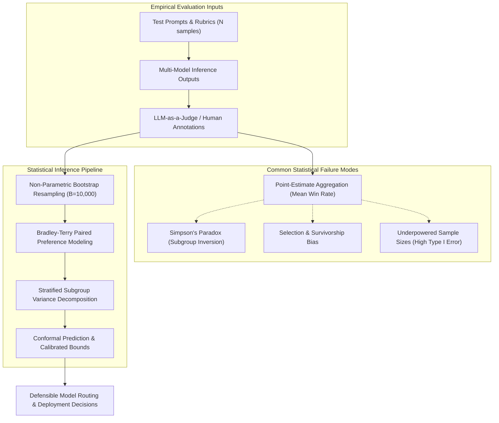
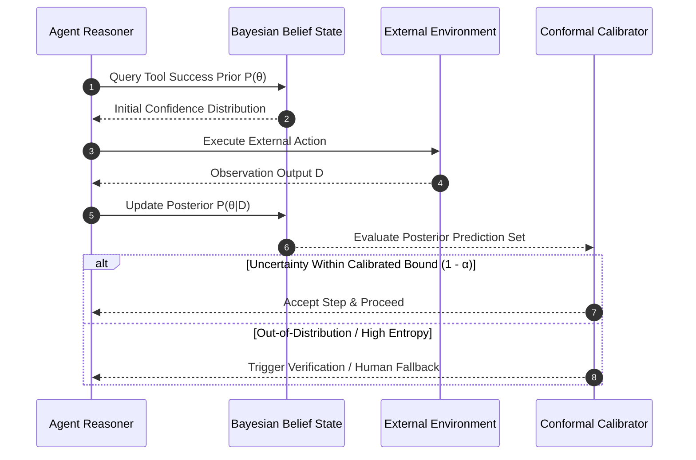

## Why Do Naive Benchmark Averages Mislead Frontier Model Evaluation?

Early machine learning evaluations relied predominantly on point estimates: reporting a single top-1 accuracy percentage on ImageNet, an aggregate F1 score on SQuAD, or an overall win rate across human preference evaluations. However, as generative language models operate over open-ended generative distributions, evaluating model capability requires rigorous statistical inference rather than superficial leaderboard ranking. Point-estimate comparisons conceal sampling variance, prompt sensitivity, judge biases, and severe subgroup distribution shifts.

In modern AI engineering, treating benchmark outcomes as absolute scalar scores leads directly to catastrophic deployment failures. For instance, claiming that Model A outperforms Model B by 1.2% across a benchmark suite of 500 prompts is statistically meaningless without reporting confidence intervals, test power, and variance decomposition. A shift in system prompt phrasing or temperature can invert the ranking entirely. Statistical rigor provides the mathematical foundation necessary to determine whether an observed performance delta reflects true architectural superiority or mere sampling stochasticity.

Understanding core statistical principles—including non-parametric bootstrap estimation, Simpson's paradox in stratified evals, selection bias in preference tuning, and conformal uncertainty quantification—transforms speculative LLM benchmarking into an exact empirical discipline.



## Deconstructing Foundational Statistical Concepts in Modern AI Workflows

The mathematical concepts originally conceived for agricultural experiments, clinical trials, and econometric modeling now govern the reliability of production foundation models and multi-agent systems.

### 1. Non-Parametric Bootstrap and Confidence Intervals

In generative AI evaluations, the underlying distribution of benchmark scores rarely conforms to Gaussian assumptions. Performance metrics on tasks such as code generation (e.g., pass@k) or agentic tool use exhibit heavy skewness, bi-modal clustering, or zero-inflated distributions. Applying standard Student's t-distributions produces invalid confidence intervals.

Instead, production evaluation frameworks rely on Bradley-Terry paired comparisons with non-parametric bootstrap resampling:

$$\text{Given sample } \mathcal{S} = \{x_1, x_2, \dots, x_N\}, \quad \mathcal{S}^{*(b)} \sim \text{Uniform}(\mathcal{S}) \text{ with replacement for } b \in \{1, \dots, B\}$$

By recalculating win rates or accuracy across $B = 10{,}000$ bootstrap replicates, engineers construct empirical $95\%$ percentile intervals:

$$[\hat{\theta}^*_{\alpha/2}, \; \hat{\theta}^*_{1 - \alpha/2}]$$

When comparing two frontier models whose aggregate benchmark scores differ by 1.5%, an empirical bootstrap often reveals overlapping confidence bands (e.g., Model A: $[74.1\%, 77.8\%]$ vs Model B: $[73.2\%, 76.9\%]$), demonstrating that the perceived advantage does not achieve statistical significance at $\alpha = 0.05$.

### 2. Simpson's Paradox in Stratified Capability Evaluations

Simpson's paradox occurs when a trend apparent across distinct sub-categories disappears or reverses when the groups are aggregated into a single summary metric. In AI evaluation, aggregate benchmark leaderboards frequently mask domain-specific regression.

Consider evaluating two models across two distinct domains: high-volume creative writing queries and low-volume mathematical reasoning queries:

| Evaluation Domain | Prompts | Model A Win Rate | Model B Win Rate |
| :--- | :--- | :--- | :--- |
| Creative Writing | 800 prompts | **70%** (560/800) | 65% (520/800) |
| Complex Mathematics | 200 prompts | **40%** (80/200) | 35% (70/200) |
| **Combined Score** | **1,000 prompts** | **64.0%** (640/1,000) | 59.0% (590/1,000) |

If an evaluation suite instead tests 200 creative prompts and 800 math prompts for Model A, but 800 creative prompts and 200 math prompts for Model B due to unbalanced routing, Model B's aggregate score can falsely appear superior despite Model A beating Model B in both categories individually. Aggregate metrics without strict domain stratification yield misleading deployment signals.

### 3. Selection and Survivorship Bias in Preference Optimization

During Reinforcement Learning from Human Feedback (RLHF) and Direct Preference Optimization (DPO), models are trained on paired preferences $(y_w, y_l)$. A pervasive failure mode is selection bias in synthetic data filtering. If automated filters reject all model completions that trigger length limits, fail compilation, or contain refusal tokens, the resulting training dataset conditions the model strictly on "surviving" completions.

This survivorship bias produces models that exhibit sycophancy and over-confidence: they never learn recovery trajectories for intermediate execution errors, because failure patterns were systematically excised from the training distribution. Defending against selection bias requires preserving failed rollouts and modeling execution failures explicitly within preference pair margins.

### 4. Bayesian Updating and Uncertainty Quantification

Modern agentic architectures require dynamic decision-making under uncertainty. In multi-step tool execution, naive argmax greedy decoding prevents agents from calibrating confidence. By treating model belief states through Bayesian updating, systems can balance prior knowledge with empirical tool observations:

$$P(\theta \mid \mathcal{D}) = \frac{P(\mathcal{D} \mid \theta) P(\theta)}{\int P(\mathcal{D} \mid \theta) P(\theta) \, d\theta}$$

In agentic systems, prior distributions represent historical tool failure rates, while incoming tool feedback updates posterior confidence. When posterior uncertainty exceeds safety thresholds, the agent can trigger human-in-the-loop escalation or switch from speculative execution to verified verification loops, as explored in [RouteLLM routing strategies](/posts/routellm-shows-the-real-battle/) and [production LLM architectures](/posts/awesome-production-llm/).



## How Statistical Evaluation Evolved Across 2026

Across 2026, the artificial intelligence industry experienced a paradigm shift from deterministic benchmark leaderboards toward distribution-free, uncertainty-aware statistical verification:

1. **Abandonment of Static Benchmark Leaderboards**: Industry consensus moved away from static benchmarks like MMLU and GSM8K due to pervasive test-set contamination and low statistical power. In their place, continuous evaluation platforms such as LMSYS Chatbot Arena adopt live Bradley-Terry modeling with online maximum-likelihood estimation and bootstrap confidence bands to track Elo trajectories dynamically.
2. **Conformal Prediction for Hallucination Guardrails**: Rather than relying on soft heuristic temperature scaling or uncalibrated softmax confidence scores, production LLM systems in 2026 implement split conformal prediction. Conformal prediction constructs distribution-free prediction sets that guarantee marginal coverage:
   $$P(Y \in \hat{C}(X)) \ge 1 - \alpha$$
   providing rigorous mathematical guarantees that the true answer lies within the generated candidate set at a user-specified significance level $\alpha$.
3. **Statistical Power Analysis in Agent Regression Testing**: Enterprise CI/CD pipelines no longer merge model or prompt changes based on informal spot checks. Automated test harnesses require pre-experimental power calculations to determine the minimum sample size ($N$) needed to detect a target effect size ($\delta$) at power $1 - \beta = 0.80$, preventing costly Type I (false positive) and Type II (missed regression) errors.
4. **Causal Inference in Multi-Agent Attribution**: When multi-agent swarms fail complex tasks, correlation-based attribution fails to isolate the root cause. Modern observability harnesses integrate Judea Pearl's do-calculus and structural causal models (SCMs) to compute counterfactual rollouts: determining whether Agent B's hallucination was caused by Agent A's misleading output or an ambiguous user specification, building on insights from [LLM performance improvement methodologies](/posts/improving-the-performance-llm/).

## Implementation: Bootstrap Paired Significance Testing in Python

To eliminate subjective guesswork in model evaluation, practitioners must implement automated hypothesis testing. The following Python module implements non-parametric paired bootstrap testing to calculate exact empirical p-values and confidence intervals for two competing LLM configurations:

```python
"""
bootstrap_eval.py - Non-parametric paired bootstrap significance testing for LLMs.
"""

from typing import Tuple, List
import numpy as np


def paired_bootstrap_test(
    scores_a: List[float],
    scores_b: List[float],
    num_bootstraps: int = 10000,
    alpha: float = 0.05,
    random_seed: int = 42
) -> dict:
    """
    Computes paired difference, bootstrap confidence interval, and empirical p-value.
    
    Args:
        scores_a: Per-sample evaluation scores from Model A (e.g., rubric scores [0, 1]).
        scores_b: Per-sample evaluation scores from Model B.
        num_bootstraps: Number of resampling iterations (standard: 10,000).
        alpha: Significance level (standard: 0.05 for 95% confidence).
        random_seed: Seed for reproducible pseudorandom resampling.
    """
    arr_a = np.asarray(scores_a, dtype=np.float64)
    arr_b = np.asarray(scores_b, dtype=np.float64)
    
    if len(arr_a) != len(arr_b):
        raise ValueError("Sample sizes for Model A and Model B must be identical for paired testing.")
        
    n_samples = len(arr_a)
    observed_diff = float(np.mean(arr_a) - np.mean(arr_b))
    
    rng = np.random.default_rng(random_seed)
    
    # Generate B bootstrap index samples with replacement
    indices = rng.integers(0, n_samples, size=(num_bootstraps, n_samples))
    
    # Calculate mean differences across all bootstrap replicates
    boot_diffs = np.mean(arr_a[indices] - arr_b[indices], axis=1)
    
    # Percentile bootstrap confidence interval
    lower_pct = (alpha / 2.0) * 100
    upper_pct = (1.0 - alpha / 2.0) * 100
    ci_lower = float(np.percentile(boot_diffs, lower_pct))
    ci_upper = float(np.percentile(boot_diffs, upper_pct))
    
    # Two-sided empirical p-value under null hypothesis H0: diff == 0
    # Center bootstrap distribution at 0 under H0
    centered_boot = boot_diffs - observed_diff
    p_value = float(np.mean(np.abs(centered_boot) >= np.abs(observed_diff)))
    
    is_significant = bool(p_value < alpha and (ci_lower > 0 or ci_upper < 0))
    
    return {
        "n_samples": n_samples,
        "mean_a": float(np.mean(arr_a)),
        "mean_b": float(np.mean(arr_b)),
        "observed_difference": observed_diff,
        "ci_95": (ci_lower, ci_upper),
        "p_value": p_value,
        "statistically_significant": is_significant
    }


if __name__ == "__main__":
    # Example: 150 prompt evaluations comparing Model A (new) vs Model B (baseline)
    np.random.seed(0)
    model_a_scores = np.random.binomial(n=1, p=0.82, size=150)
    model_b_scores = np.random.binomial(n=1, p=0.76, size=150)
    
    result = paired_bootstrap_test(model_a_scores, model_b_scores)
    print("Bootstrap Significance Evaluation Report:")
    for k, v in result.items():
        print(f"  {k}: {v}")
```

Running paired bootstrap evaluations ensures that architectural decisions—such as adopting a new fine-tuned checkpoint or prompt pipeline—rest on verifiable statistical separation rather than random evaluation noise.

## Key Takeaways

- **Point Estimates Are Inadequate**: Aggregate percentage scores on public benchmarks conceal sampling variance, prompt instability, and judge biases. All benchmark results must report confidence intervals and sample size parameters.
- **Stratification Defeats Simpson's Paradox**: Global benchmark averages frequently invert true capability trends. Model evaluations must be stratified across capability tiers, domain ontologies, and prompt complexity levels.
- **Bootstrap Resampling Accommodates Arbitrary Distributions**: LLM metrics do not follow standard Gaussian bell curves. Non-parametric bootstrap resampling ($B \ge 10{,}000$) provides distribution-free, reliable confidence intervals for paired preference testing.
- **Selection Bias Corrupts Preference Datasets**: In RLHF and DPO pipelines, filtering out execution failures introduces survivorship bias, making models brittle and sycophantic. Failed execution paths must be represented within the preference loss.
- **2026 Production Relies on Calibrated Bounds**: Modern enterprise AI systems adopt split conformal prediction and structural causal modeling, moving from empirical speculation to mathematically bounded error guarantees.

## New Questions

- How do high-temperature generative sampling and stochastic decoding alter the effective degrees of freedom in automated LLM-as-a-judge evaluations?
- What are the sample size limits of paired bootstrap testing when evaluating rare edge-case safety failures occurring at frequencies below 0.1%?
- Can conformal prediction intervals be dynamically updated at inference time without incurring prohibitive computational latency in latency-critical agent loops?
- How can structural causal models be incorporated directly into RLHF reward modeling to penalize spurious correlations without degrading reasoning depth?

## References

- Angelopoulos, A. N., & Bates, S. (2023). *A Gentle Introduction to Conformal Prediction and Distribution-Free Uncertainty Quantification*. arXiv preprint arXiv:2107.07511. URL: [https://arxiv.org/abs/2107.07511](https://arxiv.org/abs/2107.07511) (accessed 2026-10-18).
- Chiang, W.-L., Zheng, L., Sheng, Y., Angelopoulos, A. N., Li, T., Lin, D., Zhang, H., Gonzalez, J. E., & Stoica, I. (2024). *Chatbot Arena: An Open Platform for Evaluating LLMs by Human Preference*. arXiv preprint arXiv:2403.04132. URL: [https://arxiv.org/abs/2403.04132](https://arxiv.org/abs/2403.04132) (accessed 2026-10-18).
- Efron, B., & Tibshirani, R. J. (1994). *An Introduction to the Bootstrap*. Chapman & Hall/CRC. URL: [https://doi.org/10.1201/9780429246593](https://doi.org/10.1201/9780429246593) (accessed 2026-10-18).
- Pearl, J. (2009). *Causality: Models, Reasoning, and Inference* (2nd ed.). Cambridge University Press. URL: [https://doi.org/10.1017/CBO9780511803161](https://doi.org/10.1017/CBO9780511803161) (accessed 2026-10-18).
