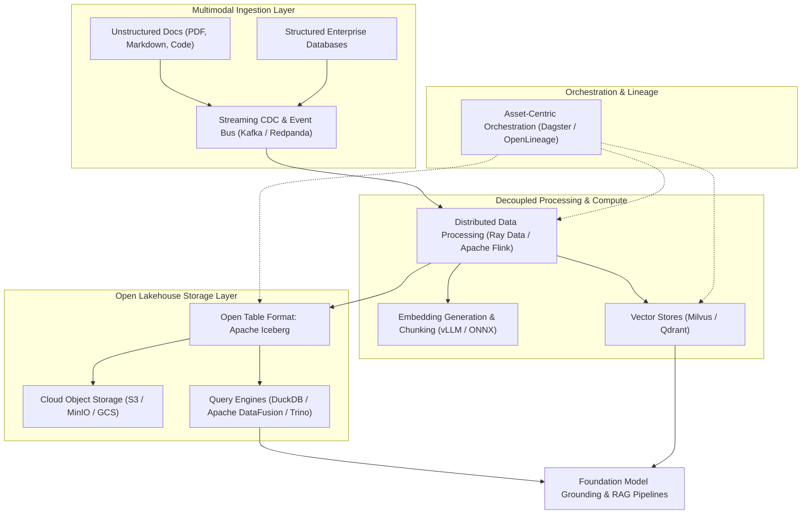
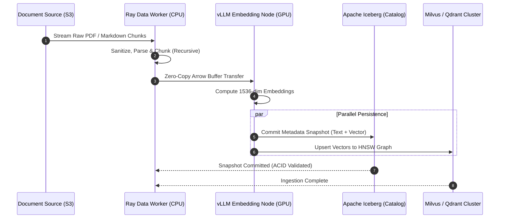

## Why Did Traditional Big Data Architectures Collapse Under Generative AI Demands?

The classical data engineering stack—dominated by Hadoop Distributed File System (HDFS), Hive metastores, batch MapReduce or early Spark scripts, and relational OLAP warehouses—was engineered around structured tabular records and static daily reporting. These legacy architectures operated under three primary assumptions: schemas evolve slowly, data is predominantly structured numerical or categorical text, and queries access row or columnar projections over historical logs.

The emergence of foundation models, multi-agent reasoning, and multimodal retrieval shattered these core assumptions. Training, fine-tuning, and grounding modern generative systems requires ingesting vast volumes of unstructured data—PDFs, documentation trees, conversational transcripts, code repositories, and high-dimensional vector embeddings. Furthermore, Retrieval-Augmented Generation (RAG) and compound AI systems demand sub-second freshness, ACID transactional guarantees over cloud object storage, and reproducible data versioning to guard against data drift and pipeline poisoning.

Modern open-source data engineering has systematically replaced legacy monolithic warehouses with decoupled, interoperable primitives: open table formats (Apache Iceberg), zero-copy in-memory columnar execution (Apache Arrow and DataFusion), distributed unstructured transformation (Ray Data), and asset-based orchestrators (Dagster).



## Deconstructing the Five Pillars of the Modern AI Data Stack

Navigating the open-source data engineering landscape requires understanding how specialized components compose into a robust, high-throughput pipeline.

### 1. Open Table Formats: Apache Iceberg over Object Storage

For over a decade, data lakes relied on directory-based partitioning schemes inherited from Apache Hive (e.g., `/year=2024/month=08/day=12/`). In cloud object storage (such as Amazon S3 or MinIO), directory listings are non-atomic and slow, leading to partial writes, read inconsistency during concurrent writes, and metadata bottlenecks when querying millions of Parquet files.

Apache Iceberg addresses this architectural limitation by decoupling metadata from physical storage layouts:
- **Snapshot Isolation and ACID Transactions**: Iceberg writes explicit metadata tree structures (Snapshot -> Manifest List -> Manifest Files -> Data Files). Every write operation produces an atomic snapshot, allowing readers to query consistent states without locking.
- **Hidden Partitioning and Partition Evolution**: Queries no longer require explicit directory paths in `WHERE` clauses. If partitioning strategy changes from daily to hourly, Iceberg updates metadata pointers without rewriting historical data files.
- **Time Travel and Git-like Branching**: Iceberg enables reproducible model training datasets by exposing snapshot IDs: `SELECT * FROM train_corpus VERSION AS OF 1284910284729104`. This ensures absolute reproducibility when evaluating models or debugging regressions, directly complementing [rigorous statistical evaluation practices](/posts/essential-statistical-concepts-must-know/).

### 2. High-Performance In-Memory Execution: Apache Arrow and DataFusion

Traditional distributed compute frameworks incurred massive serialization overhead when transferring data between memory spaces (e.g., JVM to Python, or Spark to Pandas). 

Apache Arrow provides a standardized columnar in-memory format that eliminates serialization penalties:
- **Zero-Copy IPC**: Multiple execution processes (e.g., Rust query engines and Python embedding models) access the same shared memory buffers via memory mapping without serializing to disk or network sockets.
- **SIMD Vectorization**: Columnar layout enables Single Instruction, Multiple Data (SIMD) CPU hardware acceleration, allowing filter and aggregation kernels to process billions of rows per second.
- **Apache DataFusion**: Written in Rust, DataFusion provides an extensible, embeddable query engine that runs queries directly over Arrow memory structures, enabling sub-millisecond query planning and execution inside containerized AI microservices deployed on [Kubernetes clusters](/posts/what-is-kubernetes/).

### 3. Distributed Processing for Unstructured Data: Ray Data and Apache Flink

While Apache Spark remains prevalent for large-scale enterprise reporting, AI workloads require heterogeneous compute acceleration (combining CPUs for text parsing and GPUs for feature embedding).

- **Ray Data**: Specifically designed for AI data pipelines, Ray Data streams tabular and unstructured datasets across heterogeneous clusters. It dynamically balances CPU-bound document tokenization with GPU-bound embedding generation without materializing intermediate gigabytes to disk.
- **Apache Flink**: For real-time streaming architectures, Flink processes continuous event streams with exactly-once stateful processing semantics. In multi-agent environments, Flink calculates rolling session features and detects anomalous interaction patterns in real time.

### 4. Vector ETL and Embedding Storage: Milvus and Qdrant

In traditional analytics, data pipelines terminate in a relational warehouse. In AI engineering, pipelines terminate in specialized vector stores and hybrid search indices:
- **Document Chunking & Deduplication**: Vector ETL engines extract semantic chunks, compute MinHash / SimHash fingerprints to eliminate near-duplicate documents, and maintain parent-child document relationships.
- **Distributed Indexing**: Systems like Milvus and Qdrant index billions of dense vectors using Hierarchical Navigable Small World (HNSW) graphs and Inverted File with Product Quantization (IVF-PQ), enabling sub-50ms Approximate Nearest Neighbor (ANN) search over massive text corpora, as detailed in [production LLM system guides](/posts/awesome-production-llm/).

### 5. Asset-Centric Orchestration: Dagster and OpenLineage

Legacy orchestrators like Airflow 1.x modeled pipelines as directed acyclic graphs (DAGs) of arbitrary tasks (`task_a >> task_b >> task_c`). This task-centric model lacks visibility into what data assets were produced, what schema they adhered to, or whether their freshness guarantees were met.

Asset-centric orchestrators (such as Dagster) treat data assets (tables, models, embedding indices) as first-class citizens. Dagster schedules runs based on asset freshness policies and tracks end-to-end data lineage via OpenLineage standards, enabling automated backfills and instant identification of poisoned training inputs.



## How Open-Source Data Engineering Evolved Across 2026

Throughout 2026, the convergence of data engineering and generative artificial intelligence fundamentally restructured open-source data architectures:

1. **Native Multimodal Lakehouses**: The boundary between file stores and databases completely dissolved. Apache Iceberg v3 introduced native support for multidimensional array types, geo-spatial vectors, and embedded binary tensors. Practitioners no longer maintain disparate databases for metadata and embeddings; a single Iceberg catalog manages structured metadata, raw multimodal binaries, and vector indices simultaneously.
2. **Shift to Rust-Centric Data Engines**: Python remains the API layer for machine learning, but the underlying execution plane has overwhelmingly migrated to Rust. Tools like Apache DataFusion, Polars, and LanceDB have replaced heavyweight JVM runtimes for medium-scale data processing (under 10 TB), reducing cluster memory overhead by up to 70% and eliminating JVM garbage collection pauses.
3. **Continuous Synthetic Data Curation Pipelines**: Data engineering teams in 2026 spend more compute generating and filtering synthetic training data than processing raw enterprise logs. Modern pipelines use automated LLM-in-the-loop filtering, embedding similarity deduplication, and quality-scoring rubrics to curate multi-terabyte datasets for model pre-training and supervised fine-tuning.
4. **Federated Lakehouse Catalogs with Apache Polaris**: With Snowflake open-sourcing Apache Polaris and Databricks open-sourcing Unity Catalog, enterprise data architectures standardized on open REST catalogs. This prevents cloud vendor lock-in, enabling multi-engine access (Spark, Trino, Flink, and Ray) over a shared security and governance boundary.

## Practical Implementation: Building an Arrow-Native Vector ETL Pipeline

To demonstrate the power of modern decoupled data engineering, the following Python pipeline extracts documents, sanitizes text, generates embeddings, and structures the output using Apache PyArrow for zero-copy downstream loading into lakehouse storage:

```python
"""
vector_etl_pipeline.py - Zero-copy Arrow-native Vector ETL pipeline for AI pipelines.
"""

from typing import List, Dict, Any
import pyarrow as pa
import pyarrow.compute as pc
import numpy as np


def create_arrow_document_batch(documents: List[Dict[str, Any]]) -> pa.Table:
    """
    Constructs an Arrow Table with explicit types for text metadata and dense vector embeddings.
    """
    doc_ids = [doc["id"] for doc in documents]
    sources = [doc["source"] for doc in documents]
    contents = [doc["content"] for doc in documents]
    
    # Simulate embedding generation: 768-dimensional float32 vectors
    rng = np.random.default_rng(seed=42)
    embedding_dim = 768
    raw_embeddings = rng.standard_normal((len(documents), embedding_dim), dtype=np.float32)
    
    # Normalize embeddings to unit L2 norm for cosine similarity
    norms = np.linalg.norm(raw_embeddings, axis=1, keepdims=True)
    normalized_embeddings = raw_embeddings / norms
    
    # Define strongly-typed Arrow schema
    schema = pa.schema([
        ("doc_id", pa.string()),
        ("source", pa.string()),
        ("content", pa.string()),
        ("embedding", pa.list_(pa.float32(), list_size=embedding_dim)),
        ("char_length", pa.int64())
    ])
    
    # Construct fixed-size list array for dense embeddings
    flat_embeddings = pa.array(normalized_embeddings.flatten(), type=pa.float32())
    embedding_array = pa.FixedSizeListArray.from_arrays(flat_embeddings, embedding_dim)
    
    char_lengths = [len(c) for c in contents]
    
    table = pa.Table.from_arrays(
        [
            pa.array(doc_ids, type=pa.string()),
            pa.array(sources, type=pa.string()),
            pa.array(contents, type=pa.string()),
            embedding_array,
            pa.array(char_lengths, type=pa.int64())
        ],
        schema=schema
    )
    
    return table


def filter_and_validate_batch(table: pa.Table, min_chars: int = 50) -> pa.Table:
    """
    Executes vectorized filtering using Apache Arrow Compute kernels without JVM overhead.
    """
    # Vectorized compute filter: remove low-information / short chunks
    filter_mask = pc.greater_equal(table["char_length"], min_chars)
    filtered_table = table.filter(filter_mask)
    
    return filtered_table


if __name__ == "__main__":
    sample_docs = [
        {
            "id": "doc_001",
            "source": "kubernetes_gpu_audit.md",
            "content": "Kubernetes GPU scheduling requires the NVIDIA GPU Operator to expose MIG slices to Kubelet."
        },
        {
            "id": "doc_002",
            "source": "short_snippet.md",
            "content": "Too short."
        },
        {
            "id": "doc_003",
            "source": "iceberg_architecture.md",
            "content": "Apache Iceberg provides ACID transactions and snapshot isolation on top of cloud object storage."
        }
    ]
    
    arrow_table = create_arrow_document_batch(sample_docs)
    valid_table = filter_and_validate_batch(arrow_table, min_chars=30)
    
    print(f"Original record count: {arrow_table.num_rows}")
    print(f"Validated record count: {valid_table.num_rows}")
    print(f"Arrow Schema:\n{valid_table.schema}")
```

Adopting strongly typed, memory-efficient primitives like Apache Arrow ensures data pipelines maintain sub-second throughput and eliminate the out-of-memory crashes common in unoptimized Python ETL scripts.

## Key Takeaways

- **Decoupled Architecture Wins**: Modern AI data stacks separate storage (S3/MinIO), metadata (Apache Iceberg), memory layouts (Apache Arrow), and compute engines (DataFusion/Ray), preventing proprietary warehouse lock-in.
- **ACID over Object Storage Is Essential**: Directory-based Hive partitioning is obsolete. Open table formats like Iceberg deliver atomic commits, time travel, and partition evolution required for reproducible model training.
- **Vector ETL Demands Heterogeneous Compute**: Unstructured data preprocessing requires coordinating CPU-intensive document parsing and GPU-intensive embedding generation, best orchestrated by frameworks like Ray Data.
- **Rust and Arrow Replace Heavy JVMs**: For medium-scale AI engineering, Rust-native engines (DataFusion, Polars) deliver order-of-magnitude reductions in memory footprint and latency compared to legacy Hadoop and Spark clusters.
- **Asset-Centric Lineage Prevents Data Poisoning**: Orchestrators like Dagster track end-to-end data assets and schema drift, guaranteeing that downstream fine-tuning and RAG systems never ingest corrupted or unvalidated inputs.

## New Questions

- How can distributed vector search indices be integrated directly into open table manifest files without sacrificing write throughput during high-frequency streaming ingest?
- What are the operational trade-offs of using Apache Flink for real-time document chunking versus batch-based micro-batching via Ray Data?
- How will the standardization of open REST catalogs (such as Apache Polaris) impact multi-cloud data sovereignty and cross-region AI inference?
- Under what scale thresholds does transitioning from DuckDB/DataFusion to a distributed Trino cluster become economically and architecturally justified?

## References

- Apache Iceberg Community. (2024). *Apache Iceberg: The Open Table Format for Analytic Datasets*. Apache Software Foundation. URL: [https://iceberg.apache.org/](https://iceberg.apache.org/) (accessed 2026-10-18).
- Armbrust, M., Ghodsi, A., Xin, R., & Zaharia, M. (2021). *Lakehouse: A New Generation of Open Platforms that Unify Data Warehousing and Advanced Analytics*. Proceedings of CIDR 2021. URL: [https://www.cidrdb.org/cidr2021/papers/cidr2021_paper17.pdf](https://www.cidrdb.org/cidr2021/papers/cidr2021_paper17.pdf) (accessed 2026-10-18).
- Carbone, P., Katsifodimos, A., Ewen, S., Markl, V., Haridi, S., & Tzoumas, K. (2015). *Apache Flink: Stream and Batch Processing in a Single Engine*. IEEE Data Engineering Bulletin, 38(4), 28-38. URL: [https://asterix.ics.uci.edu/pub/debull-15-4-carbone-flink.pdf](https://asterix.ics.uci.edu/pub/debull-15-4-carbone-flink.pdf) (accessed 2026-10-18).
- Moritz, P., Nishihara, R., Wang, S., Tumanov, A., Liaw, R., Liang, E., Elibol, M., Yang, Z., Paul, W., Jordan, M. I., & Stoica, I. (2018). *Ray: A Distributed Framework for Emerging AI Applications*. 13th USENIX Symposium on Operating Systems Design and Implementation (OSDI 18). URL: [https://www.usenix.org/conference/osdi18/presentation/moritz](https://www.usenix.org/conference/osdi18/presentation/moritz) (accessed 2026-10-18).
