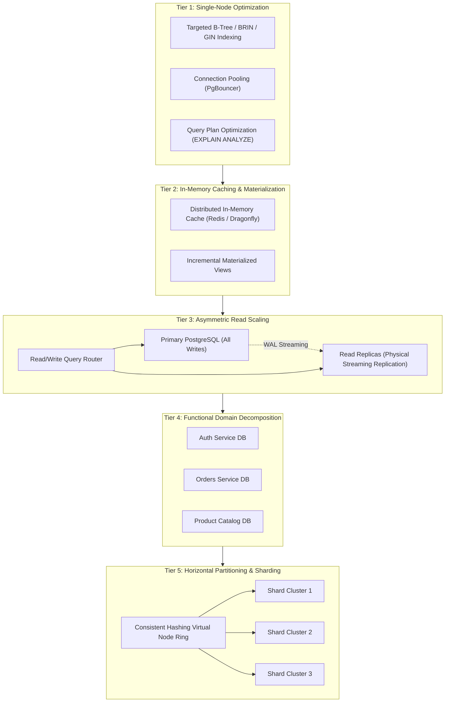
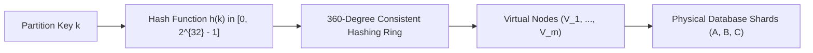
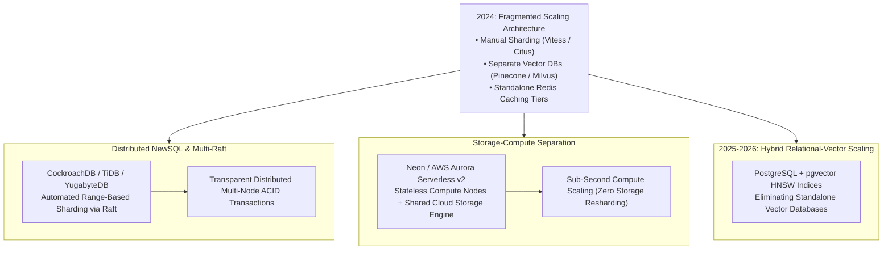

## Why Does Premature Sharding Cripple Database Maintainability?

In modern software engineering, one of the most destructive architectural missteps is premature horizontal sharding. Enthralled by narratives of Big Tech hyper-scale, engineering teams encountering query latency degradation frequently jump directly to partitioning their relational database tables across dozens of distributed database nodes.

In practice, premature horizontal sharding introduces catastrophic operational complexity:
1. **Destruction of ACID Guarantees**: Relational foreign key constraints and cross-table multi-row ACID transactions cannot easily span distributed network partitions without complex two-phase commit (2PC) protocols that dramatically inflate p99 write latencies.
2. **Scatter-Gather Latency Explosions**: Queries that fail to specify the designated partition (sharding) key must broadcast to every single shard node in parallel ("scatter-gather"), causing network congestion and tail latency collapse.
3. **Severe Operational Tax**: Managing cross-shard schema migrations, resharding balancing algorithms, and distributed backups consumes vast engineering capacity that could have been avoided.

As established by Martin Kleppmann in *Designing Data-Intensive Applications* and Neil Gunther's Universal Scalability Law, database scaling is not a binary choice between a single server and distributed sharding. It is a disciplined, hierarchical progression. Before introducing distributed state, engineers must exhaust single-node query optimizations, connection pooling, cache-aside tiers, and read-replica streaming topologies.

This data tier discipline connects directly to distributed reliability patterns in [Production Web Systems](/posts/web-application-10-essential/), enterprise AI data pipelines in [Generative AI Systems Architecture](/posts/generative-ai-eco-system/), and embedded vector datastores in [ZVec Embedded Vector Database](/posts/zvec-sqlite-of-vector-dbs/).

---

## The Database Scaling Hierarchy: A Phased Systems Pyramid

A resilient database architecture progresses systematically through five distinct operational tiers as throughput demands escalate:

---

## Deconstructing the Five Scaling Tiers

### Tier 1: Single-Node Query Optimization and Connection Pooling
Before spending money on additional hardware, the vast majority of database bottlenecks can be solved inside the existing database process:
- **Index Specialization**: Moving beyond generic single-column B-trees to **composite covering indexes** (allowing index-only scans without visiting table heap pages), partial indexes (indexing only `WHERE status = 'active'`), and Block Range Indexes (BRIN, ideal for sequential append-only time-series data).
- **Connection Pool Exhaustion**: Each direct connection to a relational database like PostgreSQL allocates an independent operating system backend process consuming 10 to 20 MB of RAM, triggering CPU context-switching saturation. Deploying connection poolers like **PgBouncer** or **HikariCP** in transaction-pooling mode allows thousands of client HTTP threads to share a lean pool of 50 to 100 actual database sockets.

### Tier 2: Storage Decoupling and Distributed Caching
Disk I/O and relational row reconstruction are fundamentally expensive. Deploying an in-memory caching tier reduces read load by over 80%:
- **Cache-Aside Pattern**: The application queries Redis/Dragonfly first; on a cache miss, it fetches data from PostgreSQL and populates the cache with an explicit Time-To-Live (TTL).
- **Materialized Views**: For complex analytical aggregation queries (e.g., calculating daily merchant sales over millions of rows), pre-computing results into a materialized view and refreshing it periodically shifts computation from runtime request loops to background batch jobs.

### Tier 3: Read Scaling via Physical Streaming Replication
Because most web applications exhibit an asymmetric $9:1$ or $99:1$ read-to-write ratio, separating reads from writes dramatically expands throughput:
- **Write-Ahead Log (WAL) Streaming**: The primary database accepts all `INSERT`, `UPDATE`, and `DELETE` transactions, sequentially appending changes to its Write-Ahead Log. Replicas ingest this byte stream asynchronously or semi-synchronously, maintaining identical physical page states.
- **Handling Replication Lag**: Because replication is asynchronous, a replica may lag behind the primary by milliseconds or seconds. Applications must enforce **Read-Your-Own-Writes Consistency**: routing a user's reads to the primary instance immediately following a write transaction, while routing general background reads to replicas.

### Tier 4: Functional Decomposition (Microservices Split)
When a monolithic database schema grows to hundreds of tables, tables compete for the same buffer pool memory and transaction lock managers:
- By identifying bounded contexts (e.g., Auth, Catalog, Billing, Analytics), engineering teams split tables into distinct physical databases.
- The Billing database can scale independently on write-heavy storage, while the Catalog database scales on read-heavy memory replicas.

### Tier 5: Horizontal Sharding via Consistent Hashing
When write throughput exceeds the physical saturation limits of a single primary server's disk controllers, the database must partition table rows horizontally across independent database instances (shards):
- **Sharding Key Selection**: Choosing a key (e.g., `user_id` or `tenant_id`) that clusters related data onto the same physical node, ensuring queries can be fulfilled by querying a single shard.
- **Consistent Hashing**: Utilizing a virtual node hashing ring to distribute partitions evenly without requiring full data reshuffling when adding new hardware nodes.

---

## Mathematical Formulations: Systems Scalability and Consistent Hashing

Scaling systems are constrained by non-linear mathematical laws governing concurrency, network communication, and hash distribution.

### 1. Gunther's Universal Scalability Law (USL)
A common fallacy is that database capacity scales linearly with added nodes ($C(N) = N$). In reality, systems are throttled by contention and coherence delay, as formalized by Neil Gunther's Universal Scalability Law:

$$C(N) = \frac{N}{1 + \alpha(N - 1) + \beta N(N - 1)}$$

where:
- $N$ is the number of concurrent workers or hardware nodes.
- $\alpha \in [0, 1]$ represents **contention overhead** (Amdahl's law parameter for serialization: waiting for shared locks or WAL flush).
- $\beta \ge 0$ represents **coherency penalty** (cross-node crosstalk: cache coherence, two-phase commit consensus, and replica synchronization).

If $\beta > 0$, throughput eventually peaks and *degrades* as $N$ increases (retrograde scalability). This mathematical proof demonstrates why simply adding nodes to an unpartitioned database cluster worsens overall latency.

### 2. Consistent Hashing and Virtual Node Variance Reduction
In horizontal sharding, naive modulo hashing ($\text{node} = h(k) \pmod N$) suffers catastrophic failure when adding a new node: nearly every single key must be rehashed and moved across the network ($N/(N+1)$ reshuffling).

Consistent Hashing maps both keys and physical shards onto a continuous integer ring $[0, 2^{32} - 1]$ using a cryptographic hash function $h(\cdot)$. A key is assigned to the first shard whose position on the ring is greater than or equal to $h(k)$.

To prevent non-uniform distribution (hot spotting) caused by random point clustering, each physical machine $i$ is assigned $V$ distinct **virtual nodes** scattered across the ring.

Let $K$ keys be distributed across $M$ physical machines with $V$ virtual nodes each. The standard deviation of the key load per physical server scales inversely with the square root of virtual nodes:

$$\sigma_{\text{load}} \propto \sqrt{\frac{K}{M \cdot V}}$$

By setting $V \ge 100$ to $250$ virtual nodes per physical host, load imbalance across shards drops below $5\%$, ensuring uniform resource utilization across the cluster.

---

## Empirical Comparison: Scaling Strategies Trade-Off Matrix

| Strategy | Primary Target | Write Scaling? | ACID Complexity | Operational Overhead | Implementation Cost |
| :--- | :--- | :--- | :--- | :--- | :--- |
| **Covering Indexes** | Latency reduction | No (Adds write cost) | Native ACID | Minimal | Low (SQL DDL only) |
| **Connection Pooling** | Concurrency capacity | No | Native ACID | Low (PgBouncer proxy) | Low |
| **In-Memory Caching** | Read throughput | No | Eventual Consistency | Moderate (Invalidation logic)| Moderate |
| **Read Replicas** | Read throughput | No (Single writer) | Replication Lag Risk | Moderate (Routing proxy) | Moderate |
| **Vertical Partitioning**| Domain isolation | Partial | Lost cross-domain joins | High (App refactoring) | High |
| **Horizontal Sharding** | **Read & Write throughput**| **Yes** | **Severe (Lost cross-shard ACID)**| **Very High** | **Extremely High** |

---

## How Database Scaling Evolved Across 2024–2026 Distributed Systems

Between 2024 and 2026, the database landscape underwent major architectural consolidation, driven by distributed NewSQL, serverless storage-compute separation, and native AI vector indexing:

### 1. Storage-Compute Separation (Neon and Aurora Serverless)
Classical databases tightly coupled execution compute (CPU/RAM) with persistent disk storage. Scaling required either moving hundreds of gigabytes of disk files to a larger virtual machine or manually provisioning read replicas.
- Modern cloud databases (such as Neon and AWS Aurora) separate stateless compute nodes from a shared distributed storage layer (Page Servers).
- Compute nodes autoscale up and down in milliseconds in response to query bursts, while the underlying storage engine handles durability, replication, and backup independently without requiring database resharding.

### 2. Distributed NewSQL Automation (CockroachDB and TiDB)
Rather than writing custom application-layer sharding routing logic (e.g., using Vitess), enterprise organizations increasingly deploy NewSQL engines:
- Tables are automatically split into contiguous byte-ranges (typically 64 MB chunks).
- Each chunk is replicated across nodes using the Raft consensus algorithm.
- When a chunk grows beyond 64 MB, the database automatically splits the range and migrates half the data to an underutilized node transparently, eliminating manual sharding maintenance.

### 3. Integrated Vector Indexing with pgvector
With the explosion of generative AI and semantic retrieval, organizations initially deployed standalone vector databases (e.g., Pinecone, Milvus), creating distributed synchronization lag between relational user records and vector embeddings.
- By 2025–2026, enterprise architectures consolidated: PostgreSQL with `pgvector` executes both relational ACID operations and high-dimensional HNSW vector lookups within the same database engine.
- Scaling vector queries leverages standard read-replica streaming, drastically simplifying operational infrastructure.

---

## Key Takeaways

- **Hierarchical Progression Over Premature Sharding**: Database scaling must follow a disciplined hierarchy: index optimization, connection pooling, and caching must be exhausted before introducing read replicas or horizontal sharding.
- **The Universal Scalability Law (USL)**: Concurrency scaling is bounded by serialization contention ($\alpha$) and cross-node coherency penalties ($\beta$). Adding nodes to a coherent cluster without partitioning eventually degrades performance.
- **Consistent Hashing with Virtual Nodes**: Horizontal sharding assigns partitions using virtual nodes on a cryptographic hash ring, reducing node-imbalance variance to $\sigma \propto 1/\sqrt{V}$ and minimizing network reshuffling on node membership changes.
- **Read-After-Write Consistency**: Asynchronous streaming replication offloads read traffic to replicas but requires applications to direct immediate post-mutation reads to the primary instance to avoid serving stale data.
- **Storage-Compute Decoupling**: Modern 2026 cloud-native databases (Neon, Aurora, NewSQL) decouple stateless query compute from distributed storage, enabling instantaneous auto-scaling without physical resharding.

---

## New Questions

1. **Distributed Two-Phase Commit Bottlenecks in Serverless NewSQL**: As distributed NewSQL engines handle cross-region multi-master transactions, how can Raft consensus protocols mitigate the physical speed-of-light roundtrip latency without weakening linearizable consistency?
2. **Dynamic Auto-Sharding for Skewed Power-Law Data**: When a single enterprise client generates $100\times$ more write traffic than average tenants (the "celebrity tenant" problem), how can dynamic sharding engines sub-partition a single tenant's data across multiple physical shards without breaking local transactional integrity?
3. **High-Dimensional Vector Index Partitioning**: When a database table contains 100 million 1536-dimensional vector embeddings, how can HNSW graph indices be partitioned across horizontal shards without degrading k-nearest neighbor recall accuracy?

---

## References

- Kleppmann, M. (2017). *Designing Data-Intensive Applications: The Big Ideas Behind Reliable, Scalable, and Maintainable Systems*. O'Reilly Media. ISBN: 978-1449373320. (accessed 2026-10-18).
- Karger, D., Lehman, E., Leighton, T., Panigrahy, R., Levine, M., & Lewin, D. (1997). *Consistent Hashing and Random Trees: Distributed Caching Protocols for Relieving Hot Spots on the World Wide Web*. ACM Symposium on Theory of Computing (STOC 1997). [DOI:10.1145/258533.258660](https://doi.org/10.1145/258533.258660). (accessed 2026-10-18).
- Gunther, N. J. (2007). *Guerrilla Capacity Planning: A Tactical Approach to Planning for Highly Scalable Applications and Services*. Springer. ISBN: 978-3540261384. (accessed 2026-10-18).
- Corbett, J. C., Dean, J., Epstein, M., et al. (2013). *Spanner: Google’s Globally Distributed Database*. ACM Transactions on Computer Systems (TOCS), 31(3), 8. [DOI:10.1145/2491245](https://doi.org/10.1145/2491245). (accessed 2026-10-18).
- PostgreSQL Global Development Group. *High Availability, Load Balancing, and Replication*. PostgreSQL Documentation. [https://www.postgresql.org/docs/current/high-availability.html](https://www.postgresql.org/docs/current/high-availability.html). (accessed 2026-10-18).
