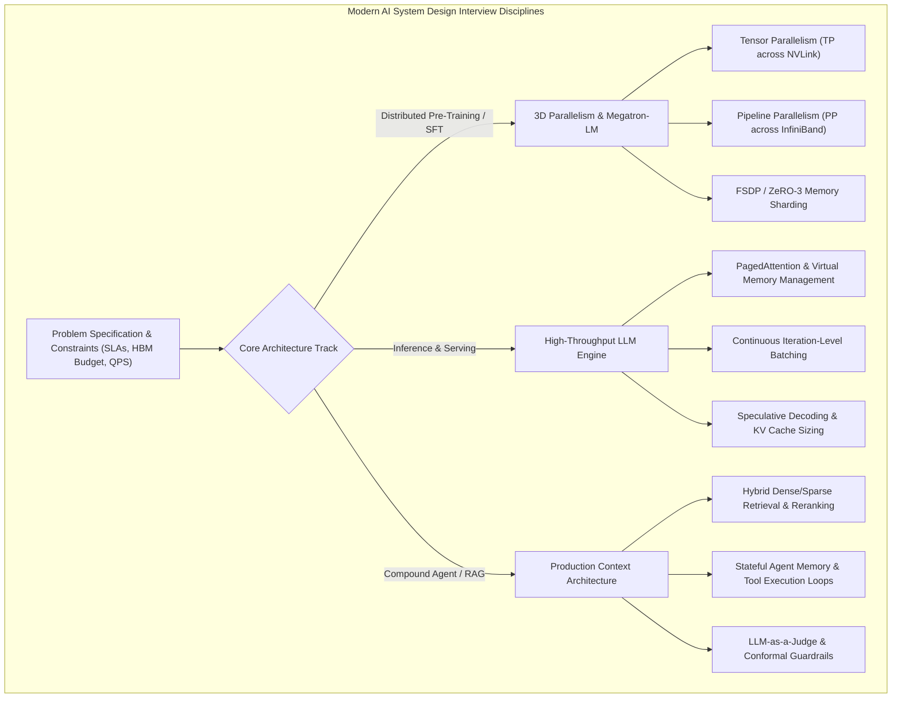
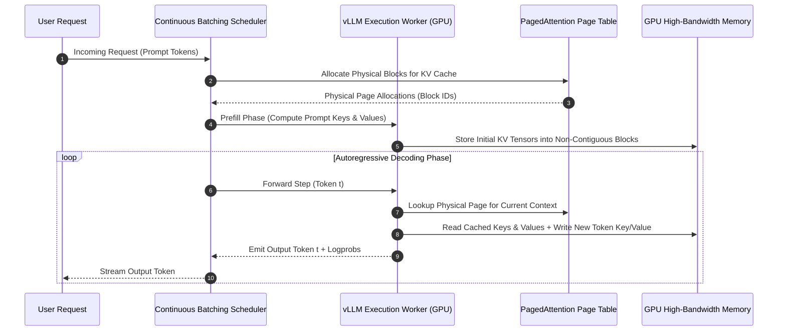

## Why Did Classical ML System Design Interviews Become Obsolete?

For nearly a decade, technical interviews for machine learning engineers followed a predictable script: candidates were asked to design an ad click-through rate (CTR) prediction engine, a video recommendation feed, or an image classification pipeline. Evaluation criteria focused on offline feature stores, logistic regression vs. gradient boosted decision trees (XGBoost), collaborative filtering, and basic parameter server distributed training.

The generative AI revolution rendered these classical interview archetypes insufficient. Modern machine learning engineering roles at leading AI labs and cloud infrastructure providers demand deep competency across three distinct architectural disciplines:
1. **Large-Scale Distributed Training**: Designing multi-node clusters using 3D parallelism (Tensor Parallelism, Pipeline Parallelism, ZeRO/FSDP data parallelism) while managing High Bandwidth Memory (HBM) and InfiniBand network saturation.
2. **High-Throughput Inference Serving**: Optimizing Key-Value (KV) cache memory layouts via PagedAttention, continuous batching, and chunked prefill to minimize Time-to-First-Token (TTFT) and maximize Time-Per-Output-Token (TPOT) throughput.
3. **Compound AI Systems and Agentic RAG**: Architecting hybrid retrieval, semantic cache layers, guardrail classifiers, and automated evaluation harnesses that guard against hallucination drift.

Candidates who approach modern ML system design through generic software engineering primers fail to address the core physical bottleneck of modern AI systems: memory bandwidth and distributed interconnect limits.



## Deconstructing the Four Pillars of Modern ML System Design

Excelling in modern ML engineering interviews requires mastering concrete quantitative formulas and hardware constraints rather than drawing hand-wavy box-and-arrow diagrams.

### 1. GPU Memory Sizing and 3D Distributed Training

In distributed training design questions, interviewers frequently ask: *"How many 80GB H100 GPUs do you need to train a 70-billion parameter dense model with AdamW?"*

A senior engineer calculates the exact memory breakdown:
- **Model Weights (FP16/BF16)**: 2 bytes per parameter $\rightarrow 70 \times 10^9 \times 2 = 140\text{ GB}$.
- **Gradients (FP16/BF16)**: 2 bytes per parameter $\rightarrow 140\text{ GB}$.
- **Optimizer States (AdamW in FP32)**:
  - FP32 master weights: 4 bytes per parameter $\rightarrow 280\text{ GB}$.
  - First momentum ($m_t$): 4 bytes per parameter $\rightarrow 280\text{ GB}$.
  - Second momentum ($v_t$): 4 bytes per parameter $\rightarrow 280\text{ GB}$.
  - Total AdamW state: $12 \text{ bytes/param} \rightarrow 840\text{ GB}$.
- **Total Static Memory**: $2 + 2 + 12 = 16\text{ bytes per parameter} \rightarrow 1{,}120\text{ GB}$ (excluding activation memory).

To distribute this model across hardware:
- **Tensor Parallelism (TP)**: Shards multi-head attention projection matrices ($W_q, W_k, W_v$ column-parallel, $W_o$ row-parallel) across intra-node GPUs connected via high-bandwidth NVLink (900 GB/s on H100). TP degree is strictly limited to 8 (single node) to prevent inter-node network bottlenecks.
- **Pipeline Parallelism (PP)**: Partitions sequential Transformer layers across multi-node servers over InfiniBand networks using 1F1B (1-Forward-1-Backward) scheduling with minimal pipeline bubble overhead.
- **Fully Sharded Data Parallel (FSDP / ZeRO-3)**: Shards optimizer states, gradients, and model weights across all data-parallel workers, gathering parameters via `all-gather` during forward/backward passes and scattering gradients via `reduce-scatter`, as documented in [comprehensive LLM engineering handbooks](/posts/llm-engineer-handbook/).

### 2. LLM Serving Architecture: KV Cache and PagedAttention

In serving system design interviews, the bottleneck is almost never compute FLOPs during token generation; it is memory bandwidth during the autoregressive decoding phase (Memory-Bound regime).

The Key-Value (KV) cache size per token across context length $L$ for a model with $n_{\text{layers}}$, $n_{\text{kv\_heads}}$, and head dimension $d_{\text{head}}$ in FP16 is given by:

$$\text{KV Cache Size} = 2 \times 2 \times n_{\text{layers}} \times n_{\text{kv\_heads}} \times d_{\text{head}} \times L \quad (\text{bytes})$$

For LLaMA-3-70B ($n_{\text{layers}} = 80$, Grouped-Query Attention with $n_{\text{kv\_heads}} = 8$, $d_{\text{head}} = 128$):
$$\text{KV Cache per token} = 4 \times 80 \times 8 \times 128 = 327{,}680\text{ bytes} \approx 320\text{ KB/token}$$
For a concurrent batch of 64 requests with context lengths of 8,192 tokens:
$$\text{Total KV Cache} = 64 \times 8{,}192 \times 320\text{ KB} \approx 167.7\text{ GB of HBM}$$

Without virtual memory management, memory fragmentation wastes over 60% of GPU memory. PagedAttention (implemented in vLLM) solves this by partitioning the KV cache into fixed-size physical blocks (e.g., 16 tokens per page), mapping logical requests to non-contiguous physical pages through a virtual page table. This increases serving throughput by 2x to 4x, a critical pattern when deploying on [Kubernetes GPU clusters](/posts/what-is-kubernetes/).



### 3. Retrieval-Augmented Generation (RAG) and Agent System Design

When interviewers present RAG questions, junior candidates stop at naive dense vector search using LangChain. Senior engineers address production failure modes:
- **Hybrid Retrieval**: Combining dense semantic embeddings with sparse BM25 lexical keyword search through Reciprocal Rank Fusion (RRF) to prevent misses on domain acronyms and serial numbers.
- **Cross-Encoder Reranking**: Utilizing high-accuracy cross-encoders (e.g., BGE-Reranker-Large) on top-50 candidates to produce calibrated relevance scores for the top-5 generator context window.
- **Context Compression & Lost-in-the-Middle Mitigation**: Reordering retrieved chunks to place high-relevance evidence at the beginning and end of the prompt context, mitigating attention attenuation in middle positions, as explored in [production LLM architectures](/posts/awesome-production-llm/) and [model routing battles](/posts/routellm-shows-the-real-battle/).

## How ML Engineering Interviews Evolved Across 2026

Throughout 2026, tech hiring bars underwent major transformations in response to frontier model breakthroughs:

1. **Test-Time Compute and Reasoning Architectures**: Interviewers now expect candidates to understand reasoning models (o1, o3, DeepSeek-R1 style) that scale inference FLOPs. Questions evaluate Monte Carlo Tree Search (MCTS), process reward models (PRMs), and Best-of-N sampling trade-offs between pre-training compute and test-time latency.
2. **Speculative Decoding and Medusa Heads**: Questions probe memory-bound vs compute-bound inference optimization. Candidates must explain how draft models (or parallel decoding heads) generate candidate tokens that a larger target model verifies in a single forward pass, increasing tokens-per-second by 2.5x without changing output distributions.
3. **Synthetic Data Pipeline Engineering**: Model architecture questions are frequently replaced with data curation systems questions: designing automated deduplication, execution-grounded verifiers (code sandboxes and unit tests), and LLM-as-a-judge filtering pipelines capable of curating billions of high-quality synthetic tokens.
4. **Agent Reliability and Tool Recovery Protocols**: Agent interviews evaluate failure recovery rather than happy-path tool calling. Candidates must design structured fallback trees, loop detection mechanisms, and counterfactual validation to prevent catastrophic multi-agent deadlock.

## Implementation: Accurate KV Cache Memory Estimator in Python

To demonstrate quantitative precision in interview system design, the following Python calculator models exact GPU memory requirements, KV cache budgets, and maximum concurrency for arbitrary model architectures:

```python
"""
kv_cache_calculator.py - Exact memory and concurrency estimator for LLM serving systems.
"""

from typing import Dict, Any


def calculate_serving_memory(
    num_params_billions: float,
    num_layers: int,
    num_kv_heads: int,
    head_dim: int,
    precision_bytes: int = 2,  # 2 for FP16/BF16, 1 for FP8
    gpu_vram_gb: float = 80.0,
    tensor_parallel_size: int = 1,
    context_length: int = 4096,
    max_concurrency: int = 32
) -> Dict[str, Any]:
    """
    Computes static weight memory, per-token KV cache footprint, and total serving HBM budget.
    """
    # 1. Static model weight memory (in GB)
    weights_gb = (num_params_billions * 1e9 * precision_bytes) / (1024**3)
    weights_per_gpu = weights_gb / tensor_parallel_size
    
    # 2. KV cache per token (in bytes) across all layers
    # Factor 2 accounts for both Keys and Values
    kv_per_token_bytes = 2 * precision_bytes * num_layers * num_kv_heads * head_dim
    kv_per_token_kb = kv_per_token_bytes / 1024
    
    # KV cache per token per GPU when sharded with Tensor Parallelism
    kv_per_token_gpu_bytes = kv_per_token_bytes / tensor_parallel_size
    
    # 3. Dynamic KV cache memory for maximum concurrent batch
    total_tokens_in_flight = context_length * max_concurrency
    total_kv_cache_gb = (total_tokens_in_flight * kv_per_token_bytes) / (1024**3)
    kv_cache_per_gpu_gb = total_kv_cache_gb / tensor_parallel_size
    
    # 4. Total memory required per GPU (including 20% activation/overhead margin)
    activation_overhead_gb = 4.0  # standard overhead for scratch buffers and CUDA context
    total_required_per_gpu_gb = weights_per_gpu + kv_cache_per_gpu_gb + activation_overhead_gb
    
    feasible = total_required_per_gpu_gb <= gpu_vram_gb
    remaining_hbm_per_gpu = gpu_vram_gb - total_required_per_gpu_gb
    
    return {
        "model_weights_total_gb": round(weights_gb, 2),
        "model_weights_per_gpu_gb": round(weights_per_gpu, 2),
        "kv_cache_per_token_kb": round(kv_per_token_kb, 2),
        "total_kv_cache_gb": round(total_kv_cache_gb, 2),
        "kv_cache_per_gpu_gb": round(kv_cache_per_gpu_gb, 2),
        "total_required_per_gpu_gb": round(total_required_per_gpu_gb, 2),
        "available_gpu_vram_gb": gpu_vram_gb,
        "remaining_hbm_per_gpu_gb": round(remaining_hbm_per_gpu, 2),
        "serving_feasible_on_hardware": feasible
    }


if __name__ == "__main__":
    # Example: LLaMA-3-70B on 4x H100 (80GB) with TP=4, context=8192, concurrency=32
    result = calculate_serving_memory(
        num_params_billions=70.0,
        num_layers=80,
        num_kv_heads=8,
        head_dim=128,
        precision_bytes=2,  # BF16
        gpu_vram_gb=80.0,
        tensor_parallel_size=4,
        context_length=8192,
        max_concurrency=32
    )
    
    print("LLM Serving Memory Sizing Report:")
    for k, v in result.items():
        print(f"  {k}: {v}")
```

Presenting rigorous capacity calculations like this during an interview demonstrates immediate engineering maturity and deep systems mastery.

## Key Takeaways

- **Memory Bandwidth Governs Inference**: While pre-training is compute-bound, autoregressive LLM decoding is strictly memory-bandwidth bound. KV cache management dominates serving system design.
- **Static vs Dynamic Memory Budgets**: Total VRAM requirements equal model weights ($2\times$ params in FP16) plus optimizer states ($12\times$ in AdamW) during training, or weights plus dynamic KV cache allocations during serving.
- **3D Parallelism Prevents Interconnect Choke**: Tensor Parallelism belongs exclusively inside NVLink-connected single nodes; Pipeline Parallelism and FSDP/ZeRO handle inter-node scale across InfiniBand switches.
- **PagedAttention Eliminates Fragmentation**: Virtual memory management for KV caches prevents pre-allocation waste, multiplying concurrent request capacity by up to $4\times$.
- **Modern Interviews Test Test-Time Scaling**: Frontier 2026 interviews probe beyond fixed generation to evaluate MCTS, speculative decoding, and synthetic data curation pipelines.

## New Questions

- How do FP8 and FP4 KV cache quantization schemes degrade attention precision across long-context reasoning tasks?
- What are the architectural bottlenecks of disaggregated serving (splitting prefill nodes from decode nodes) across cloud network fabrics?
- How should a multi-agent orchestration platform budget KV cache eviction when agents share identical system prompts across millions of sub-tasks?
- Under what communication latency thresholds does inter-node Tensor Parallelism become viable using next-generation optical interconnects?

## References

- Huyen, C. (2022). *Designing Machine Learning Systems: An Iterative Process for Production-Ready Applications*. O'Reilly Media. URL: [https://www.oreilly.com/library/view/designing-machine-learning/9781098107956/](https://www.oreilly.com/library/view/designing-machine-learning/9781098107956/) (accessed 2026-10-18).
- Kwon, W., Li, Z., Zhuang, S., Sheng, Y., Zheng, L., Yu, C. H., Gonzalez, J. E., Zhang, H., & Stoica, I. (2023). *Efficient Memory Management for Large Language Model Serving with PagedAttention*. Proceedings of the 29th ACM Symposium on Operating Systems Principles (SOSP '23). URL: [https://doi.org/10.1145/3600006.3613165](https://doi.org/10.1145/3600006.3613165) (accessed 2026-10-18).
- Martin, D. (2024). *The System Design Primer*. GitHub Repository. URL: [https://github.com/donnemartin/system-design-primer](https://github.com/donnemartin/system-design-primer) (accessed 2026-10-18).
- Shoeybi, M., Patwary, M., Puri, R., LeGresley, P., Casper, J., & Catanzaro, B. (2019). *Megatron-LM: Training Multi-Billion Parameter Language Models Using Model Parallelism*. arXiv preprint arXiv:1909.08053. URL: [https://arxiv.org/abs/1909.08053](https://arxiv.org/abs/1909.08053) (accessed 2026-10-18).
