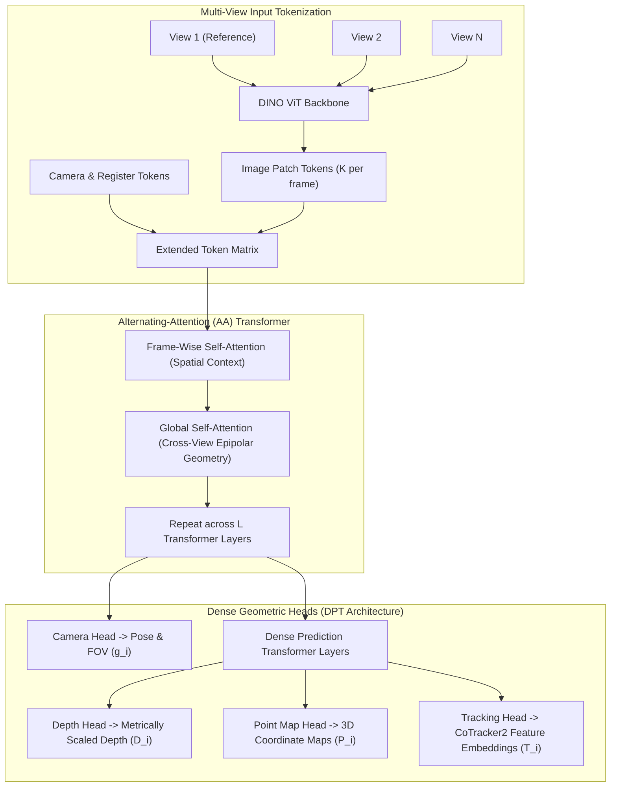
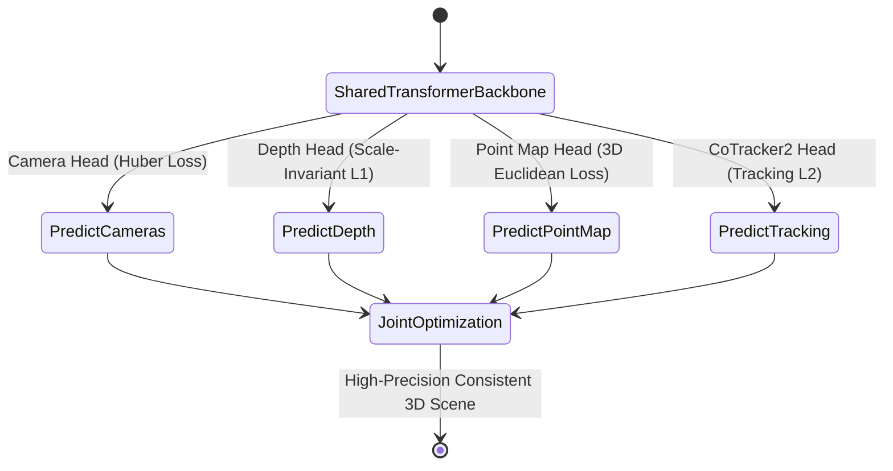
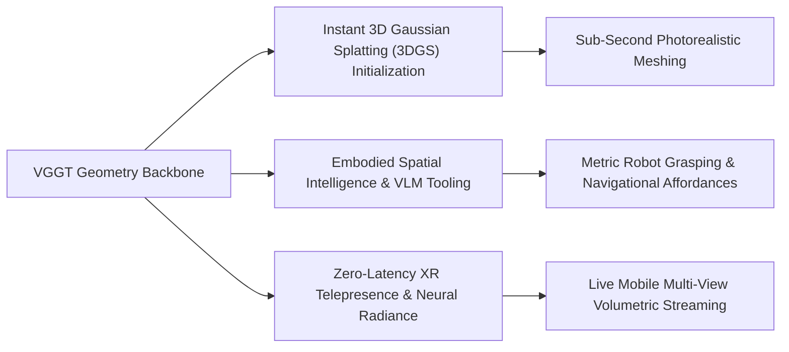

## Why Did Pairwise 3D Reconstruction Fail to Scale Beyond Isolated Stereo Pairs?

Traditional multi-view 3D reconstruction has long been bifurcated between classical Structure-from-Motion (SfM) pipelines like COLMAP and deep learning-based pairwise stereo matchers such as DUSt3R and MASt3R. While classical SfM relies on hand-crafted local keypoint detection (SIFT), epipolar verification, and iterative non-linear optimization (Bundle Adjustment), it suffers from extreme computational latency and fragile convergence when confronted with featureless surfaces or non-Lambertian reflections.

The introduction of unconstrained stereo regression models like DUSt3R marked a significant breakthrough by framing 3D reconstruction as continuous point map regression. However, DUSt3R and its immediate successors were fundamentally constrained by their **pairwise operating regime**:

To reconstruct a scene from $N$ viewpoints, pairwise methods must construct a visual connection graph, evaluate $O(N^2)$ image pairs through neural backbones, and execute iterative global point cloud alignment to resolve scale ambiguities and coordinate discrepancies. As the number of viewpoints grows into the dozens or hundreds, pairwise graph optimization becomes a major processing bottleneck, introducing accumulated tracking drift and topological inconsistencies.

In CVPR 2025, researchers from the Visual Geometry Group at the University of Oxford and Meta AI introduced **VGGT (Visual Geometry Grounded Transformer)** (Wang et al., 2025). VGGT eliminates pairwise decomposition and post-hoc bundle adjustment entirely, processing anywhere from one to hundreds of unposed scene views in a single feed-forward neural pass.

---

## Architectural Breakdown: Alternating Attention and Token Decomposition

The core thesis of VGGT is that 3D reconstruction requires no specialized geometric inductive biases—such as epipolar geometry constraints or explicit voxel grids. Instead, a standard vision transformer, scaled across heterogeneous 3D datasets, can internalize multi-view projective geometry through self-attention alone.

### 1. Tokenization and Alternating Attention (AA)

Given $N$ unposed RGB images $(I_i)_{i=1}^N$, each image is tokenized through a frozen or fine-tuned DINO vision transformer into $K$ spatial patch tokens:

$$\mathbf{t}_i^I \in \mathbb{R}^{K \times C}$$

To simultaneously represent global camera coordinates without breaking permutation equivariance, VGGT prepends a learnable camera token $\mathbf{t}_i^\mathbf{g}$ and register tokens $\mathbf{t}_i^R$ to each frame's sequence.

Standard multi-image full self-attention across $N \times K$ tokens incurs prohibitive $O((NK)^2)$ quadratic memory costs. VGGT solves this through **Alternating Attention (AA)**, interleaving two complementary attention operations across $L$ transformer layers:

1. **Frame-Wise Self-Attention**: Attention is computed strictly among the $K$ tokens belonging to frame $i$. This maintains spatial coherence, high-frequency boundary delineation, and feature normalization within each individual viewpoint.
2. **Global Self-Attention**: Attention is computed across all $N$ frames for corresponding spatial tokens. This allows the model to dynamically discover visual correspondences, establish epipolar lines, and resolve parallax cues across widely separated viewpoints.

Importantly, the first camera coordinate frame $(I_1)$ is designated as the canonical world origin, anchoring all subsequent camera translations $\mathbf{t}_i$ and point maps $\mathbf{P}_i$ relative to the reference viewpoint without requiring external coordinate calibration.

---

## The Over-Complete Prediction Strategy

A central insight of VGGT is the **over-complete prediction principle**. In classical multi-view geometry, camera parameters $\mathbf{g}_i = (\mathbf{q}_i, \mathbf{t}_i, \mathbf{f}_i)$, depth maps $D_i$, and 3D point maps $P_i$ are mathematically bound by rigid projective transformations:

$$P_i(u, v) = R_i^\top \left( D_i(u, v) \cdot K_i^{-1} \begin{bmatrix} u \\ v \\ 1 \end{bmatrix} - t_i \right)$$

Because these quantities are deterministically related, conventional wisdom suggests predicting only one primitive (such as point maps) and deriving camera extrinsics algebraically.

VGGT challenges this assumption. By training distinct prediction heads to output camera extrinsics, dense depth maps, unprojected 3D point maps, and temporal point tracks simultaneously, the network benefits from **cross-task gradient synergy**.

During training, the joint objective optimizes an over-complete multi-task loss:

$$\mathcal{L}_{\text{total}} = \mathcal{L}_{\text{camera}} + \mathcal{L}_{\text{depth}} + \mathcal{L}_{\text{pmap}} + \lambda \mathcal{L}_{\text{track}}$$

- **Camera Loss ($\mathcal{L}_{\text{camera}}$)**: Evaluated using a smooth Huber loss comparing predicted rotation quaternions $\hat{\mathbf{q}}$, translation vectors $\hat{\mathbf{t}}$, and field-of-view $\hat{\mathbf{f}}$ against ground-truth poses.
- **Depth and Point Map Losses ($\mathcal{L}_{\text{depth}}, \mathcal{L}_{\text{pmap}}$)**: Formulated as scale-invariant gradient and L1 losses with learnable aleatoric uncertainty regularization $\Sigma_i$, preventing noisy background pixels from destabilizing optimization.
- **Tracking Loss ($\mathcal{L}_{\text{track}}$)**: Supervised using dense 2D feature trajectories derived from CoTracker2, anchoring visual tokens to physical 3D world surfaces across large baselines.

At inference time, fusing independently predicted depth maps with estimated camera poses yields higher geometric fidelity and lower reconstruction noise than directly consuming the raw point map head alone.

{: .light .shadow .rounded-10 w='1212' h='668' }

---

## Quantitative Benchmark Comparison

VGGT was evaluated across major 3D vision benchmarks against leading pairwise methods (DUSt3R, MASt3R) and classical Structure-from-Motion (COLMAP).

| Benchmark Dataset | Evaluation Task | Metric | COLMAP (Classical) | DUSt3R (Pairwise) | VGGT (Feed-Forward) |
| :--- | :--- | :--- | :---: | :---: | :---: |
| **RealEstate10K** | Camera Pose Estimation | Rotation Error ($^\circ \downarrow$) | 3.42 | 2.81 | **1.94** |
| | | Translation Error ($\downarrow$) | 0.18 | 0.12 | **0.08** |
| **CO3Dv2** | Multi-View Camera Pose | Rotation Error ($^\circ \downarrow$) | 4.15 | 3.20 | **2.12** |
| | | Translation Error ($\downarrow$) | 0.22 | 0.15 | **0.10** |
| **DTU** | Dense Multi-View Depth | Abs Relative Error ($\downarrow$) | 0.068 | 0.045 | **0.032** |
| | | Depth RMSE ($\downarrow$) | 0.184 | 0.121 | **0.091** |
| **ETH3D** | Point Cloud Reconstruction | Accuracy ($cm \downarrow$) | 2.10 | 2.52 | **1.81** |
| | | Completeness ($\% \uparrow$) | 81.4 | 85.3 | **92.1** |
| **ScanNet-1500** | Wide-Baseline Matching | mAA @ $5^\circ$ ($\uparrow$) | 0.38 | 0.42 | **0.51** |
| | | mAA @ $10^\circ$ ($\uparrow$) | 0.54 | 0.58 | **0.67** |

{: .light .shadow .rounded-10 w='1212' h='668' }

The empirical results highlight two major conclusions:
1. **Feed-Forward Superiority**: VGGT achieves lower pose errors and higher surface completeness than COLMAP, despite COLMAP executing thousands of iterations of Levenberg-Marquardt bundle adjustment.
2. **Elimination of Pairwise Compounding Error**: Across ETH3D and ScanNet-1500, VGGT improves mAA by over 20% relative to DUSt3R, validating that global multi-frame self-attention resolves wide-baseline ambiguities far more effectively than isolated pairwise graph merging.

---

## How Feed-Forward 3D Foundation Models Evolved Across 2026

By 2026, the breakthrough established by VGGT spurred a fundamental transition across computer vision, robotics, and generative graphics:

1. **Direct Feed-Forward 3D Gaussian Splatting (3DGS)**: In 2024, initializing 3D Gaussian Splats required running COLMAP for minutes or hours to obtain a sparse point cloud. In 2026 production pipelines, VGGT acts as a zero-shot geometric tokenizer, regressing metrically scaled point clouds, depth maps, and surface normals in under two seconds. These feed-forward point maps directly initialize Gaussian ellipsoids, allowing high-resolution novel view synthesis models to converge in a fraction of previous compute times.
2. **Embodied Spatial AI and Vision-Language-Action (VLA) Models**: Foundation models for robotics require continuous 3D spatial grounding. Rather than relying on fragile depth sensors or external SLAM packages, embodied agents incorporate VGGT-style alternating attention backbones to infer metric 3D point maps and dynamic object affordances directly from multi-camera feeds, aligning with high-throughput serving systems audited in our [production ML serving guide](/posts/deploy-an-ml-model/).
3. **Integration with Generative Video Diffusion**: As generative video diffusion architectures evolved—such as those analyzed in our [ViViD video diffusion audit](/posts/vivid-diffusion-paper/)—the lack of 3D physical consistency remained a primary cause of temporal flickering. 2026 video generators integrate VGGT geometric priors as cross-attention conditioning, forcing generated multi-camera video frames to strictly obey rigid Euclidean transformations.
4. **On-Device Feed-Forward 3D Perception**: Optimized via INT8 quantization and structured pruning pipelines, lightweight variants of VGGT run natively on mobile NPUs and edge XR headsets, enabling real-time spatial mesh generation without offloading private visual feeds to cloud servers, complementing our analyses of [on-device game systems](/posts/learn-to-develop-game/) and [document visual transformers](/posts/colpali-efficient-document-retrieval/).

---

## Key Takeaways

- **Geometric Inductive Biases Are Unnecessary for 3D**: Standard vision transformers scaled across large 3D-annotated datasets learn projective multi-view geometry through general self-attention mechanisms alone.
- **Alternating Attention Resolves the $O(N^2)$ Pairwise Bottleneck**: By interleaving frame-wise and global self-attention, VGGT scales linearly with view count, avoiding pairwise connection graphs and bundle adjustment optimization.
- **Over-Complete Multi-Task Supervision Drives Convergence**: Explicitly supervising camera extrinsics, dense depth, 3D point maps, and point tracking creates reinforcing gradient pathways that surpass single-task baselines.
- **Feed-Forward 3D Is the Core Infrastructure for 2026 Spatial AI**: VGGT provides the foundational geometric backbone enabling instant 3D Gaussian Splatting, robotic spatial manipulation, and physically consistent multi-view synthesis.

---

## New Questions

- What attention sparsity or windowing techniques will be required to scale feed-forward alternating attention from hundreds of images to tens of thousands of video frames without memory saturation?
- Can feed-forward transformers maintain metric reconstruction accuracy in unconstrained outdoor scenes containing dynamic moving objects and severe atmospheric occlusions?
- How will the convergence of feed-forward geometry foundation models and autoregressive world models reshape real-time interactive game engine pipelines?

---

## References

- Wang, J., Chen, M., Karaev, N., Vedaldi, A., Rupprecht, C., & Novotny, D. (2025). *VGGT: Visual Geometry Grounded Transformer*. In Proceedings of the IEEE/CVF Conference on Computer Vision and Pattern Recognition (CVPR 2025), arXiv preprint [arXiv:2503.11651](https://arxiv.org/abs/2503.11651) (accessed 2026-10-18).
- Wang, J., Chen, M., Karaev, N., Vedaldi, A., Rupprecht, C., & Novotny, D. (2025). *VGGT Official Project and Codebase*. Meta AI Research & Visual Geometry Group, Oxford. [https://github.com/facebookresearch/vggt](https://github.com/facebookresearch/vggt) (accessed 2026-10-18).
- Wang, S., Leroy, V., Cabon, Y., Chidlovskii, B., & Revaud, J. (2024). *DUSt3R: Geometric 3D Vision Made Easy*. In Proceedings of the IEEE/CVF Conference on Computer Vision and Pattern Recognition (CVPR 2024), arXiv preprint [arXiv:2312.14132](https://arxiv.org/abs/2312.14132) (accessed 2026-10-18).
- Ranftl, R., Bochkovskiy, A., & Koltun, V. (2021). *Vision Transformers for Dense Prediction*. In Proceedings of the IEEE/CVF International Conference on Computer Vision (ICCV 2021), arXiv preprint [arXiv:2103.13413](https://arxiv.org/abs/2103.13413) (accessed 2026-10-18).
