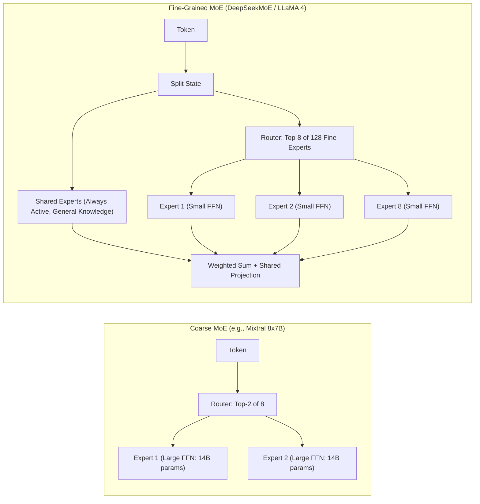
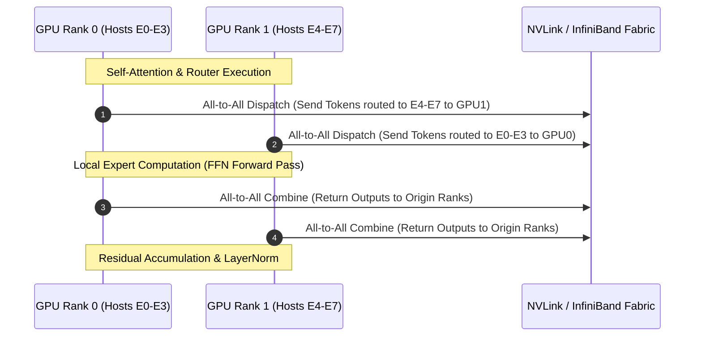

## Why Did Dense Transformer Scaling Encounter Diminishing Returns?

In standard autoregressive transformers—such as the dense 405B architecture evaluated in our [Llama 3.1 technical audit](/posts/introducing-llama-3-1/)—every token processed through the network activates 100% of the model's parameters. Under Chinchilla and Kaplan scaling laws, achieving continuous improvements in perplexity and reasoning capacity requires quadratic scaling of pre-training compute ($C \approx 6 N D$, where $N$ is parameter count and $D$ is dataset token volume).

For dense models scaling beyond 100 billion parameters, this compute-parameter coupling introduces extreme training economics and operational bottlenecks during inference serving. A forward pass through a dense 70B or 405B model requires transferring hundreds of gigabytes of parameter weights from High Bandwidth Memory (HBM) to compute registers for every generated token, severely throttling inference speed under memory-bandwidth bounds.

```mermaid
flowchart TD
    subgraph DenseScaling["Dense Transformer (100% Activated Parameters)"]
        D_In[Input Token x] --> D_Attn[Multi-Head Attention]
        D_Attn --> D_FFN[Monolithic Feed-Forward Network: W_gate, W_up, W_down]
        D_FFN --> D_Out[Output: High Memory Bandwidth & Constant High FLOPs]
    end

    subgraph SparseMoEScaling["Sparse Mixture-of-Experts (Dynamic Routing)"]
        M_In[Input Token x] --> M_Attn[Multi-Head Attention]
        M_Attn --> Router[Learned Softmax Gate W_g]
        Router -->|Top-k Dynamic Routing| E1[Expert FFN 1]
        Router -->|Top-k Dynamic Routing| E2[Expert FFN 2]
        Router -->|Bypassed| E3[Expert FFN 3 (Dormant)]
        Router -->|Bypassed| EN[Expert FFN N (Dormant)]
        E1 --> Combiner[Weighted Tensor Sum]
        E2 --> Combiner
        Combiner --> M_Out[Output: Massive Parameter Capacity with Fixed FLOPs]
    end
```

To break this coupling, modern foundation architectures decouple parameter capacity from per-token computation using **Mixture-of-Experts (MoE)**. In an MoE transformer, the dense Feed-Forward Network (FFN) in each transformer layer is replaced by a set of $N$ parallel expert networks governed by a parameterized gating router. By activating only a sparse subset of $k$ experts per token ($k \ll N$), the model expands its total representational memory by orders of magnitude while preserving the compute and latency profile of a far smaller dense model.

---

## Mathematical Formulation: Sparse Routing, Top-K Gating, and Auxiliary Losses

An MoE layer replaces the standard transformer FFN with $N$ independent multi-layer perceptrons $\{E_i\}_{i=1}^N$ and a gating network $G$:

$$y = \sum_{i=1}^N G(x)_i E_i(x)$$

Here, $x \in \mathbb{R}^d$ represents the hidden state output from multi-head self-attention, and $G(x) \in \mathbb{R}^N$ is the sparse routing vector produced by the router.

### 1. Noisy Top-K Softmax Gating

If $G(x)$ were dense, all $N$ experts would require evaluation, eliminating computational savings. Early sparse gating introduced by Shazeer et al. (2017) enforces sparsity via a top-$k$ operator combined with Gaussian noise to encourage expert exploration during gradient descent:

$$H(x) = W_g x + \epsilon \cdot \text{Softplus}(W_{\text{noise}} x), \quad \epsilon \sim \mathcal{N}(0, 1)$$

$$\text{TopK}(v, k)_i = \begin{cases} v_i & \text{if } v_i \text{ is in the top } k \text{ elements of } v \\ -\infty & \text{otherwise} \end{cases}$$

$$G(x) = \text{Softmax}(\text{TopK}(H(x), k))$$

By assigning non-selected experts to $-\infty$ before computing the softmax distribution, the gating weights for all unselected experts evaluate to exactly zero. Consequently, only $k$ matrix multiplications are dispatched to hardware accelerators.

{: .light .w-75 .shadow .rounded-10 w='800' h='600' }

### 2. Preventing Expert Collapse via Auxiliary Load-Balancing Loss

A primary failure mode during MoE optimization is **expert collapse** (or router polarization): the routing network rapidly learns to favor a tiny subset of experts that received early positive feedback, starving the remaining experts of gradient updates. Left unchecked, the model degenerates into a dense sub-network with idle parameters.

To enforce equitable distribution of tokens across all available hardware ranks, models incorporate an auxiliary load-balancing loss $\mathcal{L}_{\text{aux}}$ into the global training objective:

$$\mathcal{L}_{\text{aux}} = \alpha \cdot N \sum_{i=1}^N f_i P_i$$

Where:
- $N$ is the total count of experts.
- $f_i$ is the fraction of tokens in the batch dispatched to expert $i$:

$$f_i = \frac{1}{T} \sum_{t=1}^T \mathbb{I}(\text{Expert } i \in \text{TopK}(H(x_t), k))$$

- $P_i$ is the average routing probability assigned to expert $i$ before top-$k$ truncation:

$$P_i = \frac{1}{T} \sum_{t=1}^T \text{Softmax}(H(x_t))_i$$

The auxiliary loss penalizes variance across expert allocations. When tokens are uniformly distributed ($f_i = 1/N, P_i = 1/N$), the loss achieves its minimum. The scaling hyperparameter $\alpha$ (typically $0.01$ to $0.05$) ensures that load balancing guides optimization without overriding task-specific cross-entropy minimization.

---

## Structural Evolution: From Coarse MoE to Fine-Grained Architectures

The architectural implementation of MoE evolved through two major generations:



### 1. Coarse-Grained MoE (Mixtral 8x7B / 8x22B)

First-generation open MoE models utilized coarse granularity: 8 large experts per layer, activating the top-2 experts per token. While computationally efficient, coarse experts exhibit significant parameter redundancy: general linguistic patterns (syntax, common word associations) are repeatedly duplicated across all 8 experts, limiting specialization on complex domain knowledge.

### 2. Fine-Grained MoE with Isolated Shared Experts (DeepSeekMoE & LLaMA 4)

To maximize parameter efficiency, modern foundation architectures partition FFNs into a much larger number of fine-grained experts (e.g., 64 to 128 experts) while activating more experts per token ($k = 6 \text{ to } 8$).

Furthermore, fine-grained architectures introduce **Isolated Shared Experts**:
- A subset of experts (e.g., 1 or 2 FFNs) is designated as permanently active for every token, bypassing the router entirely.
- Shared experts capture universally required syntactic and structural representations.
- The remaining routed experts specialize strictly in domain-specific tasks (e.g., symbolic mathematics, low-level systems programming, foreign translation).

$$\text{FFN}_{\text{MoE}}(x) = \sum_{j \in \text{Shared}} E_j^{\text{shared}}(x) + \sum_{i \in \text{Routed}} G(x)_i E_i^{\text{routed}}(x)$$

This hybrid routing topology prevents catastrophic interference, allowing specialized experts to learn non-overlapping representations without sacrificing baseline language modeling coherence.

---

## Production PyTorch Implementation: Fine-Grained MoE Layer

The following implementation demonstrates a production-grade fine-grained MoE block featuring SwiGLU activations, top-$k$ routing, auxiliary load-balancing tracking, and shared expert isolation:

```python
import torch
import torch.nn as nn
import torch.nn.functional as F
from typing import Tuple, List

class SwiGLUExpert(nn.Module):
    """Individual Feed-Forward Expert utilizing SwiGLU activation."""
    def __init__(self, hidden_dim: int, intermediate_dim: int):
        super().__init__()
        self.w_gate = nn.Linear(hidden_dim, intermediate_dim, bias=False)
        self.w_up = nn.Linear(hidden_dim, intermediate_dim, bias=False)
        self.w_down = nn.Linear(intermediate_dim, hidden_dim, bias=False)

    def forward(self, x: torch.Tensor) -> torch.Tensor:
        return self.w_down(F.silu(self.w_gate(x)) * self.w_up(x))

class FineGrainedMoELayer(nn.Module):
    """
    Fine-Grained MoE Layer with Shared Experts and Top-K Routing.
    Implements architectural patterns utilized in LLaMA 4 and DeepSeekMoE.
    """
    def __init__(
        self,
        hidden_dim: int,
        moe_intermediate_dim: int,
        num_routed_experts: int = 64,
        num_shared_experts: int = 2,
        top_k: int = 6,
        aux_loss_coef: float = 0.01
    ):
        super().__init__()
        self.hidden_dim = hidden_dim
        self.num_routed = num_routed_experts
        self.num_shared = num_shared_experts
        self.top_k = top_k
        self.aux_loss_coef = aux_loss_coef

        # Gating router for routed experts
        self.router = nn.Linear(hidden_dim, num_routed_experts, bias=False)

        # Expert pools
        self.routed_experts = nn.ModuleList([
            SwiGLUExpert(hidden_dim, moe_intermediate_dim) for _ in range(num_routed_experts)
        ])
        self.shared_experts = nn.ModuleList([
            SwiGLUExpert(hidden_dim, moe_intermediate_dim) for _ in range(num_shared_experts)
        ])

    def forward(self, x: torch.Tensor) -> Tuple[torch.Tensor, torch.Tensor]:
        batch_size, seq_len, hidden_dim = x.shape
        x_flat = x.view(-1, hidden_dim)  # [Total_Tokens, Hidden_Dim]
        total_tokens = x_flat.size(0)

        # 1. Evaluate Shared Experts (Always Active)
        shared_output = torch.zeros_like(x_flat)
        for expert in self.shared_experts:
            shared_output += expert(x_flat)

        # 2. Compute Routing Logits & Probabilities
        router_logits = self.router(x_flat)  # [Total_Tokens, Num_Routed]
        router_probs = F.softmax(router_logits, dim=-1)

        # 3. Top-K Gating Selection
        topk_weights, topk_indices = torch.topk(router_probs, self.top_k, dim=-1)
        # Normalize top-k weights to sum to 1
        topk_weights = topk_weights / topk_weights.sum(dim=-1, keepdim=True)

        # 4. Dispatch Tokens to Selected Experts
        routed_output = torch.zeros_like(x_flat)
        
        # Dispatch via index mask to avoid dense evaluation
        for expert_idx in range(self.num_routed):
            # Mask indicates where this expert was selected
            selected_mask = (topk_indices == expert_idx)
            if not selected_mask.any():
                continue

            token_indices, k_positions = torch.where(selected_mask)
            selected_tokens = x_flat[token_indices]
            expert_out = self.routed_experts[expert_idx](selected_tokens)
            
            # Weight output by router confidence
            weights = topk_weights[token_indices, k_positions].unsqueeze(-1)
            routed_output.index_add_(0, token_indices, weights * expert_out)

        # 5. Calculate Auxiliary Load-Balancing Loss
        # f_i: fraction of tokens assigned to expert i
        expert_mask = F.one_hot(topk_indices, num_classes=self.num_routed).float()
        tokens_per_expert = expert_mask.sum(dim=[0, 1])
        f_i = tokens_per_expert / (total_tokens * self.top_k)
        # P_i: mean probability allocated to expert i
        P_i = router_probs.mean(dim=0)
        aux_loss = self.aux_loss_coef * self.num_routed * torch.sum(f_i * P_i)

        final_output = (shared_output + routed_output).view(batch_size, seq_len, hidden_dim)
        return final_output, aux_loss
```

---

## Architectural Comparison: Frontier MoE Configurations

| Architecture | Total Parameters | Active Parameters per Token | Routed Experts ($N$) | Activated Experts ($k$) | Shared Experts | Routing Granularity |
| :--- | :---: | :---: | :---: | :---: | :---: | :--- |
| **Mixtral 8x7B** | 46.7B | 12.9B | 8 | 2 | 0 (None) | Coarse |
| **Mixtral 8x22B** | 141B | 39B | 8 | 2 | 0 (None) | Coarse |
| **DeepSeek-V2 / V3** | 236B / 671B | 21B / 37B | 64 / 256 | 6 / 8 | 2 / 1 (Isolated) | Fine-Grained |
| **LLaMA 4 (Maverick)** | ~400B+ | ~17B–22B | 128 | 8 | 2 (Isolated) | Fine-Grained |
| **GShard** | 600B | ~40B | 2048 | 2 | 0 (None) | Coarse Distributed |

{: .light .w-75 .shadow .rounded-10 w='1200' h='800' }

---

## Distributed Systems Bottlenecks: Expert Parallelism (EP) and All-to-All

While MoE models dramatically reduce theoretical arithmetic FLOPs, executing them in distributed training and inference clusters introduces challenging communication constraints.

In a dense model, tensor parallelism (TP) and pipeline parallelism (PP) communicate activations across GPU interconnects using predictable `All-Reduce` collectives. In contrast, scaling MoE models requires **Expert Parallelism (EP)**:
- The $N$ experts are partitioned across $P$ GPUs (e.g., GPU 0 hosts Experts 0–7, GPU 1 hosts Experts 8–15).
- Tokens in a micro-batch on GPU 0 that route to Expert 12 must be sent across the network to GPU 1.
- After computation, the resulting activations must be routed back to GPU 0 for the residual connection.



This exchange requires high-frequency **All-to-All** communication primitives. If network fabric throughput (such as inter-node PCIe or InfiniBand) cannot keep pace with GPU tensor cores, communication latency completely dominates computation, causing hardware stalls. Mitigating this bottleneck requires high-speed fabrics (NVLink switches) and token capacity limits that drop or redirect overflowing tokens when an individual expert's buffer saturates.

---

## How Mixture-of-Experts Architectures Evolved Across 2026

By 2026, MoE engineering moved far beyond basic top-$k$ gating to address multi-node serving realities:

1. **Auxiliary-Loss-Free Load Balancing**: Modern architectures eliminate artificial auxiliary losses ($\mathcal{L}_{\text{aux}}$), which often degrade pure language modeling accuracy. Instead, routers implement **bias-adjusted routing**: dynamic bias terms $b_i$ are added to router logits ($W_g x + b_i$), with biases updated automatically via online PID controllers to maintain target expert distributions without distorting gradient propagation.
2. **Dynamic Multi-Token Speculative Decoding**: In inference serving engines like vLLM and SGLang—audited in our [production ML deployment analysis](/posts/deploy-an-ml-model/)—MoE inference exploits speculative draft models. Because MoE memory bandwidth is dominated by loading expert weights for isolated tokens, speculative drafting aggregates multiple consecutive tokens, allowing the MoE model to batch expert evaluations and maximize arithmetic intensity.
3. **Parameter-Efficient Tuning for MoEs**: As examined in our [PEFT architectural breakdown](/posts/explained-fintune-llm/), fine-tuning MoEs by injecting LoRA adapters into every individual expert causes parameter bloat. Modern regimes apply selective LoRA: adapters are attached strictly to the shared experts and router gating projections, leaving specialized routed weights frozen.
4. **Agentic Workload Specialization**: Production models trained under 2026 agent workflows—such as those explored in our [2024 model survey](/posts/llm-2024-survey/)—exhibit distinct expert emergence: specific fine-grained experts activate selectively during tool execution, JSON grammar enforcement, and mathematical chain-of-thought verification.

---

## Key Takeaways

- **Sparse MoE Decouples Parameters from FLOPs**: Activating a fraction of total network parameters per token allows models to scale to hundreds of billions of parameters with the inference latency and compute footprint of small dense models.
- **Auxiliary Balancing Losses Prevent Expert Collapse**: Without explicit load-balancing constraints, gating networks polarize toward a few early-learning experts, rendering the remaining capacity useless.
- **Fine-Grained Routing with Shared Experts Dominates Frontier Design**: Dividing layers into dozens of small routed experts paired with permanently active shared experts prevents syntactic redundancy and maximizes domain specialization.
- **All-to-All Interconnects Define the Scaling Frontier**: In distributed multi-GPU environments, expert parallelism shifts the primary engineering challenge from compute throughput to network fabric communication.

---

## New Questions

- How do quantization formats (FP8 and 4-bit NormalFloat) interact with MoE routing precision, and does low-precision representation cause catastrophic token dispatch errors?
- Can dynamic top-$k$ routing—where the model autonomously chooses to activate 1 expert for simple tokens and 8 experts for complex tokens—outperform static top-$k$ selection?
- What are the communication-latency limits of scaling Expert Parallelism across geo-distributed data centers connected over public optical backbones?

---

## References

- Shazeer, N., Mirhoseini, A., Maziarz, K., Davis, A., Le, Q., Hinton, G., & Dean, J. (2017). *Outrageously Large Neural Networks: The Sparsely-Gated Mixture-of-Experts Layer*. In International Conference on Learning Representations (ICLR 2017), arXiv preprint [arXiv:1701.06538](https://arxiv.org/abs/1701.06538) (accessed 2026-10-18).
- Fedus, W., Zoph, B., & Shazeer, N. (2022). *Switch Transformers: Scaling to Trillion Parameter Models with Simple and Efficient Sparsity*. Journal of Machine Learning Research (JMLR), arXiv preprint [arXiv:2101.03961](https://arxiv.org/abs/2101.03961) (accessed 2026-10-18).
- Jiang, A. Q., Sablayrolles, A., Roux, A., Mensch, A., Savary, B., Bamford, C., ... & Sayed, W. E. (2024). *Mixtral of Experts*. arXiv preprint [arXiv:2401.04088](https://arxiv.org/abs/2401.04088) (accessed 2026-10-18).
- Dai, D., Deng, C., Zhao, C., Xu, R. X., Gao, H., Chen, D., Li, J., Zeng, W., Yu, X., Zhou, Y., Wang, Z., Liang, W., Shen, Y., Zhang, X., Li, W., & Guan, C. (2024). *DeepSeekMoE: Towards Ultimate Expertise in Mixture-of-Experts Language Models*. arXiv preprint [arXiv:2401.06066](https://arxiv.org/abs/2401.06066) (accessed 2026-10-18).
