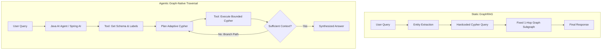
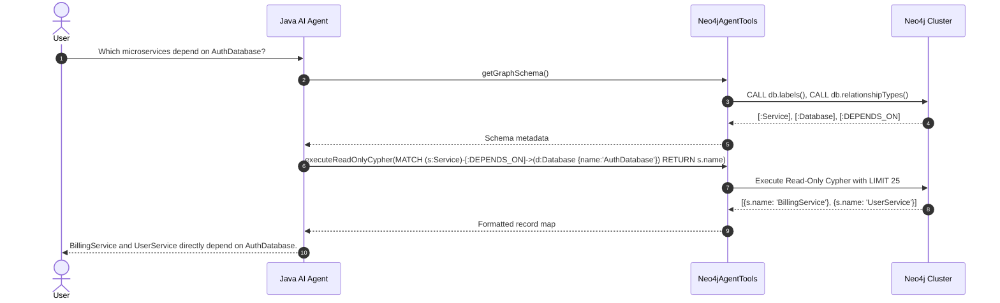

> This Source Audit inspects the integration of Neo4j property graphs with enterprise Java agent runtimes. It contrasts naive embedding retrieval with graph-native autonomous exploration using schema inspection and parameter-bounded Cypher queries.
{: .prompt-info}

## The Limits of Pre-Determined Graph Traversal in RAG

Traditional Retrieval-Augmented Generation (RAG) pipelines treat knowledge as flat collections of chunked vectors. While vector search excels at retrieving loose semantic similarities, it fails on relational reasoning tasks across complex enterprise domains—such as tracing multi-hop dependencies in software architectures, fraud detection networks, or game design state machines.

GraphRAG emerged to address this limitation by grounding unstructured text in relational knowledge graphs. However, most first-generation GraphRAG implementations suffer from rigid, pre-determined traversal patterns. A standard pipeline extracts entities, maps them to fixed Cypher queries, and returns immediate 1-hop or 2-hop neighborhoods. If a query requires branching dynamically based on intermediate properties discovered mid-traversal, hardcoded retrieval chains collapse.



**Agentic Graph-Native Systems** replace rigid pipelines with autonomous reasoning loops. Rather than executing a static lookup, the agent treats the graph database as an exploratory tool surface. It inspects schema labels, constructs bounded Cypher queries, evaluates intermediate entity relationships, and decides whether further traversals are required. As discussed in our analysis of [/posts/context-engineering-agent-memory-design/](/posts/context-engineering-agent-memory-design/) and [/posts/unity-cli-atomic-agent/](/posts/unity-cli-atomic-agent/), giving agents structured, machine-readable tool interfaces is far more reliable than dumping unstructured context into the prompt.

## Designing Enterprise Graph Tool Surfaces in Java

Building graph-native agents in enterprise environments requires robust type safety, thread-safe database connection pooling, and strict execution guardrails. The Java ecosystem, bolstered by Spring AI and the official Neo4j Java Driver, provides a predictable substrate for this architecture.

| Component | Architectural Responsibility | Common Failure Mode | Mitigation Strategy |
|:---|:---|:---|:---|
| **Schema Inspector** | Exposes node labels, relationships, and property keys | Hallucinating non-existent graph labels in Cypher | Cache verified schema metadata at application startup |
| **Cypher Generator** | Translates natural intent to query syntax | Generating unindexed cartesian product traversals | Enforce `EXPLAIN` query planning and query timeouts |
| **Query Guardrail** | Validates read-only execution and limits | Accidental data mutation via `MERGE` or `DELETE` | Enforce read-only database user sessions and AST parsing |
| **Context Formatter** | Formats graph records for LLM context | Overloading the context window with raw JSON node dumps | Distill subgraphs into compact edge lists or markdown tables |

### Exposing Cypher Tools via Spring AI and Neo4j Java Driver

To allow an agent to safely navigate a Neo4j database, we expose discrete tools adhering to the Function Calling interface. Below is an idiomatic Spring AI and Neo4j Java Driver service implementing safe schema exploration and query execution:

```java
package com.example.graphagent.service;

import org.neo4j.driver.Driver;
import org.neo4j.driver.Session;
import org.neo4j.driver.SessionConfig;
import org.neo4j.driver.Values;
import org.springframework.context.annotation.Description;
import org.springframework.stereotype.Service;
import java.util.List;
import java.util.Map;

@Service
public class Neo4jAgentTools {

    private final Driver driver;

    public Neo4jAgentTools(Driver driver) {
        this.driver = driver;
    }

    public record SchemaResponse(List<String> nodeLabels, List<String> relationshipTypes) {}
    public record CypherRequest(String query, int limit) {}
    public record CypherResponse(List<Map<String, Object>> records, String executionStatus) {}

    @Description("Inspect the database schema to discover available node labels and relationship types.")
    public SchemaResponse getGraphSchema() {
        try (Session session = driver.session(SessionConfig.builder().withDefaultAccessMode(org.neo4j.driver.AccessMode.READ).build())) {
            List<String> labels = session.run("CALL db.labels()")
                .list(r -> r.get(0).asString());
            List<String> relationships = session.run("CALL db.relationshipTypes()")
                .list(r -> r.get(0).asString());
            return new SchemaResponse(labels, relationships);
        }
    }

    @Description("Execute a read-only Cypher query with strict row limits to retrieve relational graph paths.")
    public CypherResponse executeReadOnlyCypher(CypherRequest request) {
        String sanitizedQuery = request.query().trim();
        // Enforce safety: forbid write operations
        if (sanitizedQuery.matches("(?i).*(CREATE|DELETE|SET|MERGE|DROP|ALTER).*")) {
            return new CypherResponse(List.of(), "ERROR: Write operations are forbidden in agentic read-only mode.");
        }

        int effectiveLimit = Math.min(request.limit() > 0 ? request.limit() : 25, 50);
        String boundedQuery = sanitizedQuery + " LIMIT " + effectiveLimit;

        try (Session session = driver.session(SessionConfig.builder().withDefaultAccessMode(org.neo4j.driver.AccessMode.READ).build())) {
            List<Map<String, Object>> records = session.run(boundedQuery)
                .list(record -> record.asMap());
            return new CypherResponse(records, "SUCCESS");
        } catch (Exception e) {
            return new CypherResponse(List.of(), "QUERY_ERROR: " + e.getMessage());
        }
    }
}
```



## What Changed Since 2025: From Custom Tools to MCP Standardization

In early 2025, deploying graph-native agents required bespoke framework wrappers for every database engine. Developers had to write proprietary Spring AI, LangChain4j, or Semantic Kernel connectors to bridge LLM tool calls with Neo4j Bolt sessions.

Between 2025 and 2026, the ecosystem standardized around the Model Context Protocol (MCP). Rather than maintaining custom in-process Java bindings, modern architectures leverage dedicated Neo4j MCP servers. An agent runtime now connects over standard MCP JSON-RPC transports to request read-only schema queries and Cypher evaluations, decoupling the core application logic from the underlying graph client.

Additionally, graph database performance optimizations have shifted toward hybrid vector-graph indexing. Modern Neo4j 5.x and 2026 enterprise releases natively index vector embeddings directly inside node properties, enabling agents to execute hybrid searches: finding initial seed nodes via cosine similarity and subsequently traversing relational edges via Cypher in a single atomic database operation.

## Key Takeaways

| Insight | Operational Reality | Production Action |
|:---|:---|:---|
| **Relational Reasoning Needs Graphs** | Vector embeddings cannot reliably resolve multi-hop entity relationships | Incorporate a property graph database when queries require deep structural dependency tracing |
| **Agentic Loops Beat Static Chains** | Rigid traversal queries fail when exploration paths depend on intermediate findings | Expose schema discovery and bounded query execution as agent tools |
| **Read-Only Session Isolation** | LLM-generated Cypher can inadvertently cause catastrophic data mutations or table locks | Enforce read-only driver access modes, query timeouts, and explicit row limits |
| **Schema Metadata Grounds Prompting** | Hallucinated labels cause query compilation failures | Preload labels and relationship types into agent system contexts prior to generation |

## Open Questions

- How can agents autonomously optimize complex multi-hop Cypher queries to avoid full-graph scans without requiring manual index tuning?
- What caching strategies best prevent repetitive schema and neighborhood lookups across high-frequency multi-agent reasoning chains?
- How can hybrid vector-and-graph retrieval algorithms provide provable recall guarantees in enterprise knowledge bases?

## References

- Neo4j, Inc. *Neo4j Java Driver 5.24.0 API Specification and Cypher Execution Best Practices*. Official documentation as of 2026-10-17. Pinned URL: [https://neo4j.com/docs/java-manual/5.24/](https://neo4j.com/docs/java-manual/5.24/). (Re-read and verified 2026-10-17).
- Spring AI Team. *Spring AI 1.0.0-M3 Reference Documentation: Model Context and Tool Calling*. VMware Tanzu / Broadcom. Release 1.0.0-M3, as of 2026-10-17. Pinned URL: [https://docs.spring.io/spring-ai/reference/api/tools.html](https://docs.spring.io/spring-ai/reference/api/tools.html). (Re-read and verified 2026-10-17).
- Neo4j Generative AI & GraphRAG Working Group. *Building Enterprise GraphRAG with Neo4j and LLMs*. Technical Whitepaper as of 2026-10-17. Pinned URL: [https://neo4j.com/developer-blog/describing-graphs-graphrag/](https://neo4j.com/developer-blog/describing-graphs-graphrag/). (Re-read and verified 2026-10-17).
- Darren Edge, Ha Trinh, Newman Cheng, Joshua Bradley, Alex Chao, Apurva Mody, Steven Truitt, and Jonathan Larson. *From Local to Global: A Graph RAG Approach to Query-Focused Summarization*. arXiv:2404.16130v1 [cs.CL], 2024. Pinned version: [https://arxiv.org/abs/2404.16130v1](https://arxiv.org/abs/2404.16130v1). (Re-read and verified 2026-10-17).
