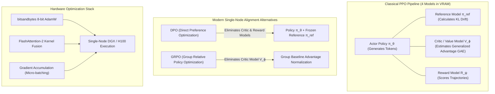
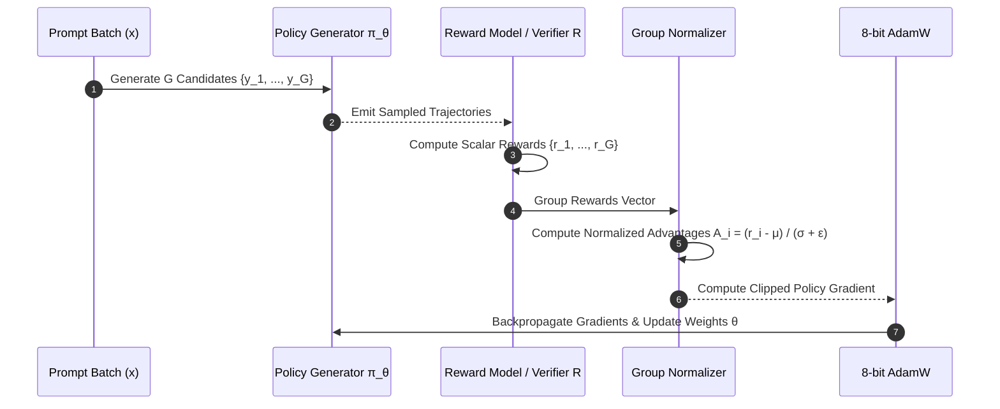

## Can a Full RLHF Alignment Pipeline Run Reliably on Single-Node Hardware?

Reinforcement Learning from Human Feedback (RLHF) established the modern alignment foundation that made conversational models coherent, helpful, and safe. However, standard enterprise RLHF workflows developed by frontier research labs typically presume access to multi-node clusters of 8-way H100 or A100 GPU nodes. Running classical Proximal Policy Optimization (PPO) concurrently requires four distinct models in memory: the active actor policy $\pi_\theta$, the reference policy $\pi_{\text{ref}}$, the critic/value network $V_\phi$, and the reward model $R_\psi$. In full-scale configurations, the resulting memory overhead and inter-process synchronization barriers make local experimentation prohibitively expensive.

Recent developments in algorithmic efficiency—most notably Direct Preference Optimization (DPO), Group Relative Policy Optimization (GRPO), and 8-bit optimizer states—have overturned the assumption that alignment requires massive GPU supercomputers. By systematically analyzing the memory footprint of actor, critic, and reward heads, engineers can execute a complete post-training alignment pipeline on a single high-performance GPU workstation (such as an NVIDIA DGX Spark or single-node workstation).

This source audit deconstructs the mathematical formulation and systems architecture necessary to reproduce instruction alignment on limited hardware, analyzing the trade-offs between PPO, DPO, and critic-free GRPO on summarization benchmarks.



## Mathematical Formulations: PPO, DPO, and GRPO Compared

Understanding post-training alignment requires tracing how optimization objectives evolved from complex actor-critic frameworks to closed-form preference losses and critic-free policy updates.

### 1. Proximal Policy Optimization (PPO) and Dual Clip Stability

Classical RLHF maximizes expected reward while penalizing policy divergence from the original supervised fine-tuned (SFT) checkpoint via Kullback-Leibler (KL) divergence:

$$\max_\theta \mathbb{E}_{x \sim \mathcal{D}, y \sim \pi_\theta(\cdot \mid x)} \left[ R_\psi(x, y) - \beta D_{\text{KL}}(\pi_\theta(y \mid x) \parallel \pi_{\text{ref}}(y \mid x)) \right]$$

In PPO, updates are constrained by the probability ratio $r_t(\theta) = \frac{\pi_\theta(y_t \mid x, y_{<t})}{\pi_{\text{old}}(y_t \mid x, y_{<t})}$ using clipped surrogate objectives:

$$\mathcal{L}_{\text{PPO}}(\theta) = -\hat{\mathbb{E}}_t \left[ \min\left( r_t(\theta)\hat{A}_t, \, \text{clip}(r_t(\theta), 1 - \epsilon, 1 + \epsilon)\hat{A}_t \right) \right]$$

Where $\hat{A}_t$ is the Generalized Advantage Estimator (GAE) computed by the value network $V_\phi$. 

However, when language policies generate tokens out-of-distribution, large negative advantages ($\hat{A}_t < 0$) combined with extreme ratios can destabilize training. Dual Clip PPO introduces a lower bounding threshold $c > 1$:

$$\mathcal{L}_{\text{DualClip}}(\theta) = -\hat{\mathbb{E}}_t \left[ \max\left( \min\left( r_t(\theta)\hat{A}_t, \, \text{clip}(r_t(\theta), 1 - \epsilon, 1 + \epsilon)\hat{A}_t \right), \, c \hat{A}_t \right) \right]$$

Dual clipping prevents catastrophic policy collapse during early training on high-entropy prompts.

### 2. Direct Preference Optimization (DPO)

DPO eliminates the need to train a separate reward model or value network by establishing an exact closed-form substitution of the reward function into the optimal policy distribution:

$$R^*(x, y) = \beta \log \frac{\pi^*(y \mid x)}{\pi_{\text{ref}}(y \mid x)} + \beta \log Z(x)$$

Substituting this parameterization directly into the Bradley-Terry preference objective yields the DPO loss:

$$\mathcal{L}_{\text{DPO}}(\theta) = -\mathbb{E}_{(x, y_w, y_l) \sim \mathcal{D}} \left[ \log \sigma \left( \beta \log \frac{\pi_\theta(y_w \mid x)}{\pi_{\text{ref}}(y_w \mid x)} - \beta \log \frac{\pi_\theta(y_l \mid x)}{\pi_{\text{ref}}(y_l \mid x)} \right) \right]$$

DPO requires only two models in GPU memory: the active policy $\pi_\theta$ and the frozen reference model $\pi_{\text{ref}}$. By caching reference model log-probabilities offline or sharing base transformer layers, DPO reduces active memory consumption by over 50% compared to classical PPO.

### 3. Group Relative Policy Optimization (GRPO)

Introduced in DeepSeekMath and reasoning architectures, GRPO retains reinforcement learning dynamics with generative exploration while completely discarding the memory-heavy value/critic model $V_\phi$.

Instead of training a critic network to estimate baseline state values, GRPO samples a group of $G$ distinct completions $\{y_1, y_2, \dots, y_G\}$ for each prompt $x$. It calculates normalized relative advantages directly across the generated candidate group:

$$\hat{A}_i = \frac{R(x, y_i) - \text{mean}(\{R(x, y_j)\}_{j=1}^G)}{\text{std}(\{R(x, y_j)\}_{j=1}^G) + \epsilon}$$

The policy is optimized using clipped surrogate objectives across the group, incorporating an explicit per-token reverse KL divergence penalty:

$$\mathcal{L}_{\text{GRPO}}(\theta) = -\frac{1}{G}\sum_{i=1}^G \left[ \min\left( r_i(\theta)\hat{A}_i, \, \text{clip}(r_i(\theta), 1 - \epsilon, 1 + \epsilon)\hat{A}_i \right) - \beta D_{\text{KL}}(\pi_\theta \parallel \pi_{\text{ref}}) \right]$$

Eliminating the critic network frees substantial HBM, making RL with online rollouts feasible on single-node hardware.



## System Constraints and Memory Breakdown for Single-Node Execution

Executing post-training alignment on a single GPU node requires strict accounting of VRAM allocation. Consider training a 1.5-billion parameter model (such as Qwen2.5-1.5B) on an 80GB NVIDIA GPU:

| Component | Standard FP32/FP16 PPO | Optimized DPO | Optimized GRPO (Group=4) |
| :--- | :--- | :--- | :--- |
| **Actor Policy $\pi_\theta$ Weights** | 3.0 GB (BF16) | 3.0 GB (BF16) | 3.0 GB (BF16) |
| **Actor Gradients** | 3.0 GB (BF16) | 3.0 GB (BF16) | 3.0 GB (BF16) |
| **Actor Optimizer States** | 18.0 GB (FP32 AdamW) | 6.0 GB (8-bit AdamW) | 6.0 GB (8-bit AdamW) |
| **Reference Model $\pi_{\text{ref}}$** | 3.0 GB (BF16) | 3.0 GB (or Offline Logprobs) | 3.0 GB (BF16) |
| **Critic / Value Model $V_\phi$** | 3.0 GB + 18.0 GB opt | *None (Eliminated)* | *None (Eliminated)* |
| **Reward Model $R_\psi$** | 3.0 GB (BF16) | *None (Implicit)* | 3.0 GB (BF16) or Rule Verifier |
| **Activation Footprint** | ~12.0 GB | ~6.0 GB | ~8.0 GB |
| **Total Memory Required** | **~60.0 GB** | **~18.0 GB** | **~23.0 GB** |

By transitioning from classical PPO to DPO or GRPO and adopting 8-bit optimizer states, the total memory ceiling drops from 60 GB down to 18–23 GB. This makes alignment feasible on consumer or workstation hardware (including RTX 4090 24GB or A6000 48GB cards), directly complementing [modern ML system design architectures](/posts/machine-learning-interview-questions/).

## How Post-Training Alignment Evolved Across 2026

Throughout 2026, the post-training alignment landscape shifted decisively from passive human preference matching to active verification and reinforcement learning from verifiable rewards:

1. **Rule-Based and Verifiable Reward RL (RLVR)**: The reliance on learned reward models ($R_\psi$) dramatically declined for mathematical reasoning, code synthesis, and structured summarization. Because learned reward models are notoriously susceptible to reward hacking (where generators exploit reward model blind spots through verbosity and flattery), 2026 systems utilize deterministic execution compilers, formal unit test verifiers, and exact parser check functions.
2. **Ascendance of GRPO in Reasoning Models**: Following the breakthrough of DeepSeek-R1 and similar open architectures, GRPO displaced both PPO and standard DPO for reasoning alignment. Group relative advantage estimation enables models to explore multiple diverse reasoning trajectories, discovering self-correction patterns without maintaining value networks.
3. **Rejection of Pure Off-Policy DPO for Complex Tasks**: While DPO remains dominant for conversational tone and stylistic alignment, empirical research demonstrated that offline DPO suffers from distribution drift on multi-step reasoning tasks. Frontier systems in 2026 utilize online iterative DPO or on-policy GRPO to continuously generate fresh rollouts from the updating policy.
4. **Integration of Statistical Significance into Model Selection**: As explored in [essential statistical foundations for AI systems](/posts/essential-statistical-concepts-must-know/), alignment teams now validate checkpoint checkpoints using paired bootstrap confidence intervals and Bradley-Terry Elo estimation rather than superficial point-estimate win rates on static test splits.

## Implementation: PyTorch Group Relative Advantage Computation

To implement critic-free GRPO alignment, engineers must compute normalized group advantages across parallel completions. The following production-ready PyTorch module demonstrates group-normalized advantage computation with dual clipping protection:

```python
"""
grpo_loss.py - Group Relative Policy Optimization loss computation in PyTorch.
"""

from typing import Dict, Tuple
import torch
import torch.nn as nn
import torch.nn.functional as F


class GRPOTrainer(nn.Module):
    """
    Computes Group Relative Policy Optimization (GRPO) loss without a value network.
    """
    def __init__(
        self,
        clip_epsilon: float = 0.2,
        dual_clip_c: float = 3.0,
        beta_kl: float = 0.04
    ):
        super().__init__()
        self.clip_epsilon = clip_epsilon
        self.dual_clip_c = dual_clip_c
        self.beta_kl = beta_kl

    def compute_group_advantages(self, rewards: torch.Tensor, group_size: int) -> torch.Tensor:
        """
        Normalizes rewards across groups of size G.
        
        Args:
            rewards: Tensor of shape (B * G,) containing scalar rewards for each trajectory.
            group_size: Number of candidate completions sampled per prompt (G).
            
        Returns:
            Normalized advantages of shape (B * G,).
        """
        # Reshape to (Batch_size, Group_size)
        reshaped_rewards = rewards.view(-1, group_size)
        
        # Calculate group-level empirical mean and standard deviation
        mean = reshaped_rewards.mean(dim=-1, keepdim=True)
        std = reshaped_rewards.std(dim=-1, keepdim=True) + 1e-8
        
        # Normalize relative to group peers
        advantages = (reshaped_rewards - mean) / std
        return advantages.view(-1)

    def forward(
        self,
        log_probs: torch.Tensor,
        old_log_probs: torch.Tensor,
        ref_log_probs: torch.Tensor,
        advantages: torch.Tensor,
        token_masks: torch.Tensor
    ) -> Tuple[torch.Tensor, Dict[str, float]]:
        """
        Calculates the dual-clipped GRPO policy surrogate loss with reverse KL penalty.
        
        Args:
            log_probs: Per-token log-probs from active policy (N, L).
            old_log_probs: Per-token log-probs from rollout policy (N, L).
            ref_log_probs: Per-token log-probs from frozen reference policy (N, L).
            advantages: Normalized scalar advantages (N,).
            token_masks: Attention mask over generated response tokens (N, L).
        """
        # Ratio r_t(θ) = exp(log_prob - old_log_prob)
        ratio = torch.exp(log_probs - old_log_probs)
        
        # Expand advantage scalar to match token dimensions (N, 1)
        adv = advantages.unsqueeze(-1)
        
        # Standard PPO clipped surrogate
        surr1 = ratio * adv
        surr2 = torch.clamp(ratio, 1.0 - self.clip_epsilon, 1.0 + self.clip_epsilon) * adv
        ppo_loss = torch.min(surr1, surr2)
        
        # Dual-clipping protection for large negative advantages
        dual_clipped = torch.where(
            adv < 0,
            torch.max(ppo_loss, self.dual_clip_c * adv),
            ppo_loss
        )
        
        # Per-token reverse KL divergence penalty: D_KL(π_θ || π_ref) = exp(log_ref - log_pi) - (log_ref - log_pi) - 1
        # Approximated by log_pi - log_ref for numerical stability
        kl_div = torch.exp(ref_log_probs - log_probs) - (ref_log_probs - log_probs) - 1.0
        
        # Combined objective masked over valid completion tokens
        total_token_loss = -(dual_clipped - self.beta_kl * kl_div) * token_masks
        loss = total_token_loss.sum() / token_masks.sum()
        
        metrics = {
            "policy_loss": float(loss.item()),
            "mean_ratio": float((ratio * token_masks).sum().item() / token_masks.sum().item()),
            "mean_kl": float((kl_div * token_masks).sum().item() / token_masks.sum().item())
        }
        
        return loss, metrics


if __name__ == "__main__":
    # Test tensor setup: 2 prompts, group size 4 = 8 trajectories, seq len 16
    torch.manual_seed(42)
    B, G, L = 2, 4, 16
    
    trainer = GRPOTrainer()
    dummy_rewards = torch.tensor([0.2, 0.8, -0.4, 0.5,  1.2, 0.1, -0.9, 0.4])
    norm_adv = trainer.compute_group_advantages(dummy_rewards, group_size=G)
    
    log_p = torch.randn(B * G, L)
    old_log_p = log_p.detach() + torch.randn(B * G, L) * 0.05
    ref_log_p = log_p.detach()
    masks = torch.ones(B * G, L)
    
    loss_val, diag = trainer(log_p, old_log_p, ref_log_p, norm_adv, masks)
    print("GRPO Loss Execution Result:")
    print(f"  Loss Value: {loss_val.item():.4f}")
    for k, v in diag.items():
        print(f"  {k}: {v:.4f}")
```

Deploying critic-free loss implementations like GRPO combined with 8-bit optimizers democratizes alignment research, permitting rapid iteration on preference datasets without multi-node infrastructure.

## Key Takeaways

- **Critic-Free Alignment Reduces Memory by 60%**: Classical PPO requires four models in memory. Moving to DPO (closed-form preference) or GRPO (group relative baseline) eliminates the critic and reward networks, enabling single-node alignment.
- **Dual Clipping Prevents Policy Collapse**: When language models venture out-of-distribution, large negative advantages can destabilize standard PPO. Dual clipping establishes a hard lower bound on policy updates.
- **8-Bit Optimizers Enable Workstation Scale**: Using bitsandbytes 8-bit AdamW shrinks optimizer state footprints from 12–16 bytes per parameter down to 2–4 bytes without degrading convergence precision.
- **Rule Verifiers Displace Learned Reward Models**: In 2026 architectures, verifiable programmatic rubrics and deterministic unit tests supersede learned reward models, eliminating reward hacking in reasoning tasks.
- **On-Policy Exploration Matters for Complex Reasoning**: While offline DPO suffices for conversational style, complex multi-step reasoning requires iterative or online rollout methods like GRPO to generate dynamic exploration rollouts.

## New Questions

- How do group sizes ($G \in \{4, 8, 16\}$) in GRPO affect variance reduction versus generation latency when serving models on memory-constrained GPUs?
- What are the mathematical stability limits of combining 8-bit optimizer states with FP8 weight activations during long-context post-training?
- Can rule-based execution verifiers be effectively generalized to abstract, subjective tasks such as nuanced literary summarization?
- How does the distribution of prompt complexity impact the optimal KL penalty coefficient ($\beta$) when scaling test-time exploration?

## References

- Ouyang, L., Wu, J., Jiang, X., Almeida, D., Wainwright, C. L., Mishkin, P., Zhang, C., Agarwal, S., Slama, K., Ray, A., Schulman, J., Hilton, J., Kelton, F., Miller, L., Simens, M., Askell, A., Welinder, P., Christiano, P., Leike, J., & Lowe, R. (2022). *Training language models to follow instructions with human feedback*. Advances in Neural Information Processing Systems (NeurIPS 2022). URL: [https://arxiv.org/abs/2203.02155](https://arxiv.org/abs/2203.02155) (accessed 2026-10-18).
- Rafailov, R., Sharma, A., Mitchell, E., Ermon, S., Manning, C. D., & Finn, C. (2023). *Direct Preference Optimization: Your Language Model is Secretly a Reward Model*. Advances in Neural Information Processing Systems (NeurIPS 2023). URL: [https://arxiv.org/abs/2305.18290](https://arxiv.org/abs/2305.18290) (accessed 2026-10-18).
- Schulman, J., Wolski, F., Dhariwal, P., Radford, A., & Klimov, O. (2017). *Proximal Policy Optimization Algorithms*. arXiv preprint arXiv:1707.06347. URL: [https://arxiv.org/abs/1707.06347](https://arxiv.org/abs/1707.06347) (accessed 2026-10-18).
- Shao, Z., Wang, P., Zhu, Q., Xu, R., Song, J., Zhang, M., Zhang, Y., Wu, Y., & Guo, D. (2024). *DeepSeekMath: Pushing the Limits of Mathematical Reasoning in Open Language Models*. arXiv preprint arXiv:2402.03300. URL: [https://arxiv.org/abs/2402.03300](https://arxiv.org/abs/2402.03300) (accessed 2026-10-18).
- Stiennon, N., Ouyang, L., Wu, J., Ziegler, D. M., Lowe, R., Voss, C., Radford, A., Amodei, D., & Christiano, P. (2020). *Learning to summarize from human feedback*. Advances in Neural Information Processing Systems (NeurIPS 2020). URL: [https://arxiv.org/abs/2009.01325](https://arxiv.org/abs/2009.01325) (accessed 2026-10-18).
