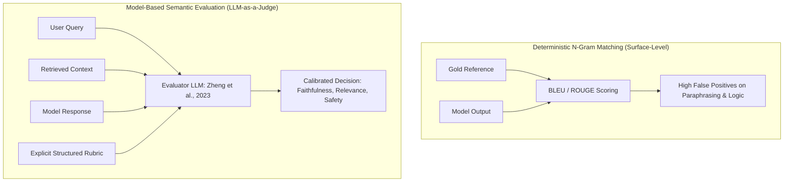
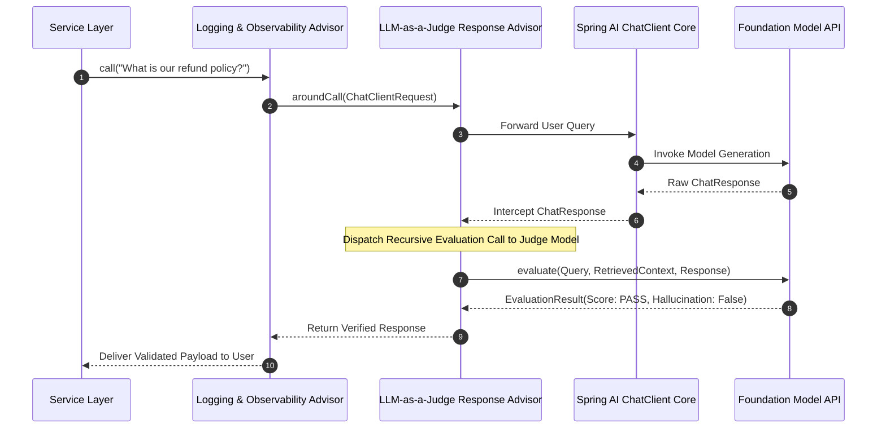
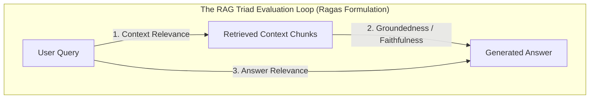

## Why Did Deterministic NLP Metrics Break Down in Production LLM Evaluation?

In traditional natural language processing, automated evaluation relied on deterministic surface-matching statistics: BLEU for machine translation, ROUGE for extractive summarization, and exact-match string comparisons for structured parsing. While these metrics provided fast, zero-cost scoring during offline training, they correlate poorly with human judgment when applied to modern generative language models.

Generative responses exhibit semantic variability: an assistant can formulate a mathematically correct, highly insightful answer that shares zero n-gram overlap with a reference gold answer. Conversely, a model can achieve a deceptive ROUGE score by echoing prompt phrases while generating subtle, catastrophic hallucinations.



To resolve this measurement gap, the machine learning community formalized the **LLM-as-a-Judge** paradigm (Zheng et al., 2023). By prompting a highly capable foundation model (such as GPT-4, Claude 3.5 Sonnet, or specialized open evaluators) to assess candidate outputs against explicit rubrics, automated evaluation achieved over 80% agreement with human annotators. However, deploying LLM-as-a-Judge in enterprise production environments requires solving two engineering challenges: eliminating systematic evaluator biases and embedding evaluation directly into application runtimes.

---

## Deconstructing Evaluator Biases in LLM Judges

While LLM judges offer remarkable semantic reasoning, they are not neutral arbiters. Zheng et al. identified four systematic failure modes that must be controlled in production architectures:

1. **Position Bias**: In pairwise comparisons (e.g., comparing Response A vs. Response B), judges exhibit a pronounced preference for the response presented first, regardless of intrinsic quality. Mitigating this bias requires **permutation swapping**: running two inferences where the candidate order is reversed ($A/B$ and $B/A$) and discarding runs with intransitive or contradictory preferences.
2. **Verbosity Bias**: Foundation models disproportionately reward length and syntactic complexity over brevity and factual density. An answer packed with polite filler phrases and repetitive formatting routinely receives higher scores than a succinct, single-sentence response containing the exact requested factual tuple.
3. **Self-Enhancement Bias**: Models demonstrate a quantifiable bias toward their own outputs. For example, GPT-4 systematically favors responses generated by GPT-3.5 or GPT-4 over outputs from open-weight models of comparable quality.
4. **Grading Drift and Non-Determinism**: Without constrained decoding, judge models exhibit temperature-induced variance in numerical scoring, assigning a 4/5 on run 1 and a 2/5 on run 2 for identical inputs.

```mermaid
flowchart LR
    Candidate[Candidate Pair: A vs B] --> Pass1[Evaluation 1: Prompt order A, B]
    Candidate --> Pass2[Evaluation 2: Prompt order B, A (Permutation Swapped)]
    
    Pass1 --> JudgeA[Judge Decision 1]
    Pass2 --> JudgeB[Judge Decision 2]

    JudgeA --> Verifier{Consistent Winner?}
    JudgeB --> Verifier

    Verifier -- Yes --> Confirmed[Accept Validated Score]
    Verifier -- No (Position Bias Detected) --> Escalate[Flag for Human Review or Tie-Break]
```

To counteract these biases, modern production evaluation enforces strict constraints:
- **Reference-Guided Evaluation**: The judge is provided with an authoritative ground-truth context, restricting evaluation to verifying factual alignment rather than internal knowledge retrieval.
- **Structured Schema Calibration**: Scores are emitted via typed schemas (e.g., Pydantic or Java Records) containing mandatory chain-of-thought justifications before numerical output.
- **Categorical Rubrics**: Replacing open-ended 1–10 scoring scales with discrete, rubric-anchored categorical tiers (e.g., `PASS`, `PARTIAL_HALLUCINATION`, `IRRELEVANT`).

---

## Enterprise Implementation: Spring AI Recursive Advisors

In JVM-based enterprise stacks, orchestrating LLM evaluation requires decoupling model scoring from business services. **Spring AI** introduces an interceptor abstraction known as **Advisors**, implementing the classic Gang of Four Decorator and Interceptor patterns across the model invocation lifecycle.



Spring AI advisors implement `CallAroundAdvisor` and `StreamAroundAdvisor`. When configured as a **Recursive Evaluation Advisor**, an advisor intercepts the generated response, executes a secondary evaluation call through an isolated `ChatModel`, and applies routing logic: returning the response if valid, or triggering automated retry loops if quality thresholds are breached.

### Production Spring AI Evaluator Implementation

The following Java implementation demonstrates a production-grade Spring AI advisor evaluating factual faithfulness in Retrieval-Augmented Generation:

```java
package com.company.ai.evaluation;

import org.springframework.ai.chat.client.ChatClient;
import org.springframework.ai.chat.client.advisor.api.AdvisedRequest;
import org.springframework.ai.chat.client.advisor.api.AdvisedResponse;
import org.springframework.ai.chat.client.advisor.api.CallAroundAdvisor;
import org.springframework.ai.chat.client.advisor.api.CallAroundAdvisorChain;
import org.springframework.ai.chat.model.ChatModel;
import org.springframework.core.Ordered;
import org.springframework.stereotype.Component;

import java.util.List;
import java.util.Map;

/**
 * Enterprise Spring AI Advisor that evaluates factual faithfulness 
 * using an isolated Judge LLM before returning payloads to clients.
 */
@Component
public class FaithfulnessJudgeAdvisor implements CallAroundAdvisor, Ordered {

    private final ChatClient judgeChatClient;
    private static final double PASS_THRESHOLD = 0.85;

    public record EvaluationResult(
        boolean passes,
        double faithfulnessScore,
        String reasoning,
        List<String> unverifiedClaims
    ) {}

    public FaithfulnessJudgeAdvisor(ChatModel chatModel) {
        // Construct dedicated judge client with deterministic temperature
        this.judgeChatClient = ChatClient.builder(chatModel).build();
    }

    @Override
    public AdvisedResponse aroundCall(AdvisedRequest request, CallAroundAdvisorChain chain) {
        // 1. Execute upstream generation
        AdvisedResponse response = chain.nextAroundCall(request);

        String userQuery = request.userText();
        String generatedContent = response.response().getResult().getOutput().getText();
        
        // Extract retrieved context injected by upstream RAG Advisors
        String context = (String) request.adviseContext().getOrDefault("rag_context", "NO_CONTEXT");

        // 2. Perform Recursive Evaluation Call
        EvaluationResult evaluation = evaluateResponse(userQuery, context, generatedContent);

        // 3. Enforce Quality Gate
        if (!evaluation.passes() || evaluation.faithfulnessScore() < PASS_THRESHOLD) {
            throw new QualityGateException(
                "Response rejected by LLM Judge. Faithfulness score: " + evaluation.faithfulnessScore() 
                + ". Reasoning: " + evaluation.reasoning()
            );
        }

        // Attach evaluation metadata to response context for observability
        return response.updateContext(Map.of("judge_evaluation", evaluation));
    }

    private EvaluationResult evaluateResponse(String query, String context, String response) {
        String judgePrompt = """
            You are a strict, impartial enterprise auditor evaluating an AI assistant's response.
            Verify whether every claim in the RESPONSE is strictly grounded in the provided CONTEXT.

            CONTEXT:
            {context}

            QUERY:
            {query}

            RESPONSE:
            {response}

            Evaluate the response based on factual faithfulness. Output JSON matching the schema.
            """;

        return judgeChatClient.prompt()
            .user(u -> u.text(judgePrompt)
                .param("context", context)
                .param("query", query)
                .param("response", response))
            .call()
            .entity(EvaluationResult.class);
    }

    @Override
    public int getOrder() {
        return Ordered.LOWEST_PRECEDENCE - 10;
    }
}
```

---

## The RAG Triad and Automated Metrics Hierarchy

In production RAG systems—detailed in our [systematic RAG workflow guide](/posts/rag-systematic-workflow/) and [production RAG implementation roadmap](/posts/rag-application-in-just-3-days/)—LLM-as-a-Judge systems standardize on the **RAG Triad** formulation:



1. **Context Relevance (Retrieval Precision)**: Measures whether the retrieved documents are focused on the user's query or contaminated with noisy, irrelevant passages.
2. **Faithfulness / Groundedness (Hallucination Rate)**: Evaluates whether every factual claim in the response can be directly inferred from the retrieved passages. A score of $1.0$ indicates zero ungrounded assertions.
3. **Answer Relevance**: Measures whether the generated answer directly addresses the intent of the original user prompt, penalizing evasive or off-topic responses.

---

## Architectural Comparison: Evaluation Frameworks

| Dimension | Classical Unit Tests (AssertJ / JUnit) | Deterministic NLP (BLEU/ROUGE) | Standalone Python Eval (Ragas / DeepEval) | Spring AI Recursive Advisors |
| :--- | :--- | :--- | :--- | :--- |
| **Execution Phase** | Build / CI pipeline | Offline model training | Batch offline experiment analysis | Online runtime request interceptor |
| **Evaluation Depth** | Exact type & string equality | Surface n-gram statistics | Multi-metric semantic scoring | Real-time semantic quality gating |
| **Runtime Latency** | Sub-millisecond | Tens of milliseconds | High (Batch API calls) | Synchronous or async background triage |
| **Circuit Breaking** | Build failure | Statistical reporting | Dashboard alerting | Immediate exception or fallback model route |
| **Enterprise Governance**| Native Java/JVM | Ad-hoc Python scripts | External SaaS dependencies | First-class Spring Boot ecosystem |

---

## How Automated LLM Evaluation Evolved Across 2026

Across 2026, LLM evaluation evolved from ad-hoc prompting into dedicated, low-latency infrastructure:

1. **Specialized Small Language Model Evaluators**: Using frontier models (e.g., GPT-4o) as online judges introduces significant token costs and adds hundreds of milliseconds of latency. In 2026 production systems, organizations deploy distilled, fine-grained evaluator models (such as Prometheus 2 or JudgeLM). These 7B–14B parameter models are fine-tuned strictly on rubric-conditioned evaluation datasets, matching frontier judge accuracy at $10\times$ lower serving cost.
2. **Asynchronous Triage and Shadow Evaluation**: Rather than blocking customer responses synchronously, enterprise architectures apply **tiered evaluation**. Simple deterministic heuristics and small classifiers execute inline, while comprehensive LLM-as-a-Judge audits are offloaded asynchronously via Kafka or RabbitMQ into observability engines (Opik, Langfuse, LangSmith), as explored in our [agent orchestration review](/posts/llm-cource-with-langchain-and-agent/).
3. **Multi-Judge Panel Consensus (LLM Jury)**: For high-stakes domains (legal compliance, financial advisories), single-judge evaluations are vulnerable to model-specific alignment artifacts. Production systems employ multi-judge juries (e.g., three diverse foundation backends), taking the median score or executing voting consensus to filter out rogue hallucinations.
4. **Automated CI/CD Regression Sandboxes**: Evaluation migrated into pre-merge code review pipelines. Every prompt template modification, model upgrade, or chunking parameter change triggers an automated eval run against a golden dataset, blocking pull requests that degrade faithfulness metrics below service level agreements (SLAs), integrating with techniques audited in our [production serving guide](/posts/deploy-an-ml-model/).

---

## Key Takeaways

- **Surface N-Gram Metrics Fail Generative Evaluation**: BLEU and ROUGE fail to measure semantic accuracy, factual hallucinations, and reasoning coherence.
- **LLM Judges Require Explicit Bias Mitigation**: Position bias, verbosity bias, and self-enhancement must be systematically countered through permutation swapping and rubric constraints.
- **Spring AI Advisors Decouple Quality Gates from Services**: The recursive advisor abstraction allows enterprise developers to intercept model payloads, run isolated judge evaluations, and enforce circuit breakers cleanly.
- **2026 Standards Prioritize Specialized Evaluator SLMs**: Cost and latency constraints shifted high-volume evaluation from frontier models to compact, fine-tuned judge SLMs operating asynchronously within observability fabrics.

---

## New Questions

- At what point does fine-tuning a dedicated judge model on synthetic data risk circular alignment drift and unseen catastrophic blind spots?
- How can distributed enterprise systems optimize the network latency of multi-judge jury consensus when responses must stream in sub-second interactive windows?
- What formal mathematical guarantees can be established to prove an LLM judge cannot be manipulated via adversarial prompt injections embedded within user-submitted context?

---

## References

- Zheng, L., Chiang, W. L., Sheng, Y., Zhuang, S., Wu, Z., Zhuang, Y., Lin, Z., Li, Z., Xing, E. P., Zhang, H., Gonzalez, J. E., & Stoica, I. (2023). *Judging LLM-as-a-Judge with MT-Bench and Chatbot Arena*. In Advances in Neural Information Processing Systems (NeurIPS 2023), arXiv preprint [arXiv:2306.05685](https://arxiv.org/abs/2306.05685) (accessed 2026-10-18).
- Spring AI Documentation. (2026). *Spring AI ChatClient Advisors and Evaluation Reference*. Broadcom / VMware Tanzu Documentation. [https://docs.spring.io/spring-ai/reference/api/chatclient.html#_advisors](https://docs.spring.io/spring-ai/reference/api/chatclient.html#_advisors) (accessed 2026-10-18).
- Es, S., James, J., Espinosa-Anke, L., & Schockaert, S. (2023). *RAGAS: Automated Evaluation of Retrieval Augmented Generation*. arXiv preprint [arXiv:2309.15217](https://arxiv.org/abs/2309.15217) (accessed 2026-10-18).
- Kim, S., Shin, J., Cho, Y., Jang, J., Do, S., Sohn, S., & Seo, M. (2024). *Prometheus: Inducing Fine-grained Evaluation Capability in Language Models*. In International Conference on Learning Representations (ICLR 2024), arXiv preprint [arXiv:2310.08491](https://arxiv.org/abs/2310.08491) (accessed 2026-10-18).
