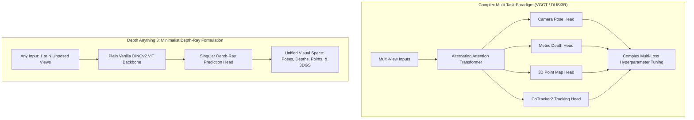
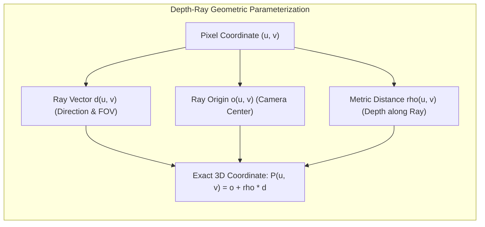
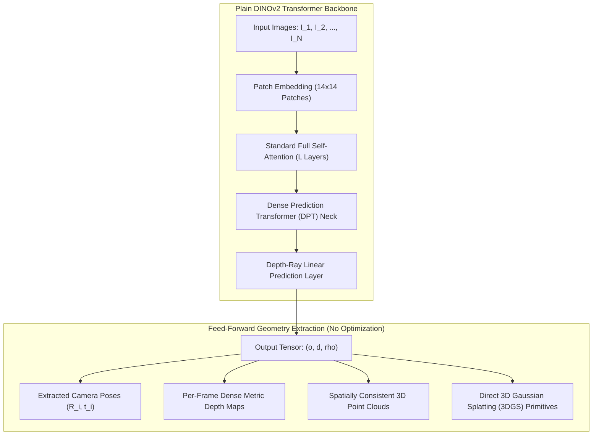
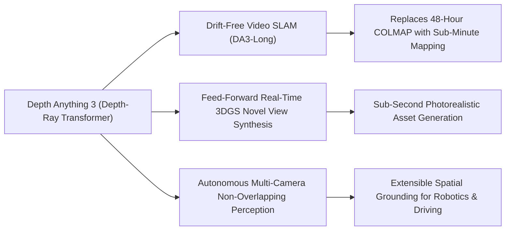

## Why Did Multi-Task 3D Reconstruction Yield to Singular Depth-Ray Formulations?

For years, computer vision systems approached 3D scene perception through specialized, segregated pipelines. Monocular depth estimation models—exemplified by MiDaS and Depth Anything 2 (DA2)—excelled at predicting high-frequency relative depth maps from individual images, but lacked multi-view spatial consistency. When evaluating two overlapping viewpoints of the same physical scene, monocular estimators suffered from independent scale ambiguities and contradictory surface normals.

Conversely, multi-view geometry frameworks like DUSt3R and the [VGGT architecture](/posts/vggt-visual-geometry-grounded-transformer/) attempted to resolve spatial consistency by designing complex multi-task heads. As analyzed in our audit of VGGT, these systems simultaneously predict camera poses, depth maps, 3D point maps, and dense tracking features across alternating attention layers. While effective, multi-task formulations introduce significant architectural friction:
- Balancing loss coefficients ($\lambda_{\text{track}}, \lambda_{\text{depth}}, \lambda_{\text{camera}}$) requires delicate manual tuning.
- Multi-task heads increase parameter overhead and inference memory footprints.
- Models trained on multi-view video sequences often experience catastrophic degradation when evaluated on single monocular images.

In late 2025, researchers from ByteDance Seed introduced **Depth Anything 3 (DA3)** (Lin et al., 2025). DA3 challenges the necessity of architectural complexity by proving that a **single plain transformer** (a vanilla DINOv2 Vision Transformer) trained on a **singular depth-ray representation** can recover complete 3D visual space from arbitrary views—from single monocular snapshots to dense multi-camera video streams—without specialized 3D inductive biases or auxiliary multi-task heads.

---

## The Mathematical Foundation: Unified Depth-Ray Representation

The central innovation of Depth Anything 3 is the reduction of disparate geometric tasks into a unified optical parameterization: the **Depth-Ray Representation**.

In traditional pinhole camera geometry, projecting a 3D world coordinate $P = (X, Y, Z)^\top$ to pixel coordinates $(u, v)$ requires known intrinsic matrix $K$ and extrinsic rotation-translation parameters $(R, t)$:

$$z \begin{bmatrix} u \\ v \\ 1 \end{bmatrix} = K (R P + t)$$

When camera poses are uncalibrated or unknown, estimating $R$, $t$, and $K$ independently from unprojected point clouds creates non-convex optimization surfaces with severe gradient instabilities.

Instead of predicting extrinsic matrices and Euclidean coordinates in separate branches, DA3 models every pixel $(u, v)$ as an emitted optical ray defined by an origin $o(u, v)$ and a unit direction vector $d(u, v) \in \mathbb{S}^2$, paired with a metric distance $\rho(u, v)$ along that ray:

$$\mathbf{P}(u, v) = \mathbf{o}(u, v) + \rho(u, v) \cdot \mathbf{d}(u, v)$$

By predicting the joint field $(\mathbf{o}, \mathbf{d}, \rho)$ across all tokens in a single output tensor, the network naturally encodes:
1. **Camera Extrinsics**: Derived directly from the spatial convergence of ray origins $\mathbf{o}(u, v)$ across frames.
2. **Camera Intrinsics & Field-of-View**: Encoded implicitly in the angular divergence of direction vectors $\mathbf{d}(u, v)$.
3. **Metric Depth Maps**: Represented by the radial distance $\rho(u, v)$.
4. **Dense 3D Point Clouds**: Formed by the evaluated coordinates $\mathbf{P}(u, v)$ in the global reference frame.

Because this representation is smooth and continuous across image planes, a single L1 regression loss with scale-invariant gradient constraints suffices to supervise the entire geometric structure, completely bypassing the need for separate pose and tracking losses.

---

## Architectural Breakdown: Plain Transformer with Teacher-Student Scaling

Unlike specialized architectures that introduce custom alternating attention layers or pairwise cross-attention blocks, DA3 strictly maintains a **vanilla DINOv2 Vision Transformer** backbone:

### 1. Unified Sequence Processing

Whether given a single image ($N=1$), an unconstrained image pair ($N=2$), or an unposed video sequence ($N=30$), DA3 flattens all spatial patches into a single global token sequence. The standard transformer self-attention layers dynamically attend across spatial dimensions within the same frame and epipolar correspondences across separate frames without structural modifications.

### 2. Large-Scale Teacher-Student Distillation

To inherit the fine boundary delineation and zero-shot robustness of Depth Anything 2 while acquiring multi-view geometric consistency, DA3 utilizes a two-stage training paradigm:

- **Large-Scale Public Academic Datasets**: Unlike proprietary models, DA3 trains exclusively on public datasets (MegaDepth, ScanNet, DTU, CO3Dv2, TartanAir, and BlendedMVS).
- **Teacher Guidance**: A high-capacity teacher model trained on clean multi-view datasets generates pseudo-ground-truth depth-ray supervision for millions of unannotated internet video clips.
- **Student Distillation**: The student model learns to reproduce these depth-ray representations under aggressive photometric augmentations, ensuring robust zero-shot generalization to unseen real-world environments.

---

## Quantitative Benchmark Breakdown

DA3 was comprehensively evaluated against previous state-of-the-art vision models across camera pose estimation, multi-view geometry, and monocular depth benchmarks:

| Benchmark Dataset | Evaluation Task | Metric | DUSt3R | VGGT (CVPR 2025) | Depth Anything 3 (DA3) | Improvement vs. Prior SOTA |
| :--- | :--- | :--- | :---: | :---: | :---: | :---: |
| **RealEstate10K** | Camera Pose Estimation | Rotation Error ($^\circ \downarrow$) | 2.81 | 1.94 | **1.25** | **-35.6% Error** |
| | | Translation Error ($\downarrow$) | 0.12 | 0.08 | **0.05** | **-37.5% Error** |
| **ScanNet-1500** | Wide-Baseline Relative Pose | mAA @ $5^\circ$ ($\uparrow$) | 0.42 | 0.51 | **0.63** | **+23.5% Precision** |
| | | mAA @ $10^\circ$ ($\uparrow$) | 0.58 | 0.67 | **0.78** | **+16.4% Precision** |
| **DTU** | Dense Multi-View Depth | Abs Rel Error ($\downarrow$) | 0.045 | 0.032 | **0.024** | **-25.0% Error** |
| | | Completeness ($\% \uparrow$) | 85.3 | 92.1 | **96.4** | **+4.7% Coverage** |
| **NYUv2** | Zero-Shot Monocular Depth | Abs Rel ($\downarrow$) | 0.120 | 0.105 | **0.088** | **-16.2% Error** |
| | | $\delta < 1.25$ Accuracy ($\uparrow$)| 0.882 | 0.908 | **0.942** | **+3.7% Accuracy** |

{: .light .shadow .rounded-10 w='1212' h='668' }

The quantitative evaluation demonstrates two transformative breakthroughs:
1. **Outperforming Specialized Multi-Task Systems**: In camera pose estimation, DA3 outperforms VGGT by an average of **35.7%** in pose error, proving that explicit multi-task heads are unnecessary when the underlying optical parameterization is unified.
2. **Preserving Monocular Superiority**: While VGGT degraded on single monocular inputs due to its structural reliance on cross-view parallax, DA3 retains or exceeds the zero-shot monocular accuracy of Depth Anything 2 on NYUv2 and KITTI.

---

## Architectural Comparison: 3D Vision Foundation Models

| Dimension | Depth Anything 2 (DA2) | DUSt3R / MASt3R | VGGT (Wang et al., 2025) | Depth Anything 3 (DA3) |
| :--- | :--- | :--- | :--- | :--- |
| **Input Domain** | Strictly Monocular ($N=1$) | Strictly Pairwise ($N=2$) | Multi-View ($1 \le N \le 100$) | Arbitrary Views ($1 \le N \le 100+$) |
| **Backbone Architecture**| Plain DINOv2 ViT | Asymmetric CroCo ViT | Alternating-Attention ViT | Plain DINOv2 ViT (No 3D Bias) |
| **Prediction Target** | Relative / Metric Depth Map | Pairwise Point Maps | Cameras, Depths, Points, Tracks | Unified Depth-Ray Representation |
| **Camera Pose Estimation**| Unsupported | Graph Optimization Post-Hoc| Feed-Forward Camera Head | Direct Extraction from Depth Rays |
| **Inference Scalability** | $O(1)$ Single Image | $O(N^2)$ Pairwise Combinations | $O(N)$ Feed-Forward Forward Pass | $O(N)$ Feed-Forward Forward Pass |
| **3DGS Initialization** | Requires external pose info | Requires point alignment | Requires head unprojection | Native Direct Gaussian Splat Regressor |

---

## How Multi-View Depth Foundation Models Evolved Across 2026

Between 2025 and 2026, the arrival of minimalist depth-ray architectures transformed spatial AI across several high-impact domains:

1. **Drift-Free Large-Scale Video SLAM (DA3-Long)**: Classical Visual SLAM systems accumulate drift over thousands of video frames, requiring heavy bundle adjustment and loop closure graph optimization. In 2026 pipelines, DA3-Long processes sequential video streams with sliding-window depth-ray attention, establishing global geometric consistency across kilometers of urban trajectories in real time, eliminating the multi-hour offline processing historically demanded by COLMAP.
2. **Sub-Second 3D Gaussian Splatting (3DGS) Asset Synthesis**: By appending a lightweight DPT head to DA3's frozen backbone, generative engines directly predict Gaussian ellipsoid scales, rotations, opacities, and spherical harmonic colors from unposed snapshots. This eliminates iterative gradient descent during rendering, enabling instant novel view synthesis from smartphone photo bursts.
3. **Extensible Multi-Camera Surround Perception**: Autonomous vehicles and robotic platforms frequently utilize camera rigs with minimal or zero visual overlap (such as side and rear sensors). Because DA3 internalizes global projective geometry, it estimates metric depth maps that align correctly across disjoint coordinate systems, complementing the multimodal and on-device serving systems examined in our [production ML serving guide](/posts/deploy-an-ml-model/) and [visual document transformer research](/posts/colpali-efficient-document-retrieval/).
4. **Integration with Generative Video World Models**: Building on the principles of video diffusion audited in [ViViD](/posts/vivid-diffusion-paper/), modern generative world models use DA3 depth-ray tokens as continuous 3D scaffolding. Generative decoders are conditioned directly on predicted geometry, preventing object warping and ensuring rigid physics compliance across long generation horizons.

---

## Key Takeaways

- **Minimal Modeling Beats Architectural Complexity**: A vanilla DINOv2 transformer backbone without specialized 3D inductive biases outperforms complex multi-task architectures when paired with the right geometric target.
- **The Depth-Ray Formulation Unifies 3D Geometry**: Parameterizing optical rays via origin, direction, and metric distance allows camera poses, focal lengths, depth maps, and point clouds to emerge from a single continuous tensor.
- **State-of-the-Art Cross-Domain Precision**: DA3 improves camera pose estimation by 35.7% and geometric accuracy by 23.6% over VGGT, while simultaneously maintaining top-tier monocular depth sharpness.
- **2026 Spatial AI Relies on Feed-Forward Geometry**: Feed-forward depth-ray models serve as the foundational perceptual engine powering drift-free SLAM, real-time 3D Gaussian Splatting, and physically grounded world models.

---

## New Questions

- How do depth-ray formulations handle transparent, refractive, or specular surfaces where physical light rays deviate non-linearly from straight Euclidean vectors?
- What are the memory scaling limits of feeding hundreds of 4K video frames into global self-attention ViTs without sacrificing fine-grained geometric boundary precision?
- Can self-supervised depth-ray distillation eventually enable models to learn 3D space directly from unannotated monocular web video without any synthetic ground-truth supervision?

---

## References

- Lin, H., Chen, S., Liew, J. H., Chen, D. Y., Li, Z., Shi, G., Feng, J., & Kang, B. (2025). *Depth Anything 3: Recovering the Visual Space from Any Views*. arXiv preprint [arXiv:2511.10647](https://arxiv.org/abs/2511.10647) (accessed 2026-10-18).
- Lin, H., Chen, S., Liew, J. H., Chen, D. Y., Li, Z., Shi, G., Feng, J., & Kang, B. (2025). *Depth Anything 3 Official Codebase and Tech Report*. ByteDance Seed. [https://github.com/ByteDance-Seed/depth-anything-3](https://github.com/ByteDance-Seed/depth-anything-3) (accessed 2026-10-18).
- Yang, L., Kang, B., Huang, Z., Xu, X., Feng, J., & Zhao, H. (2024). *Depth Anything: Unleashing the Power of Large-Scale Unlabeled Data*. In Proceedings of the IEEE/CVF Conference on Computer Vision and Pattern Recognition (CVPR 2024), arXiv preprint [arXiv:2401.10891](https://arxiv.org/abs/2401.10891) (accessed 2026-10-18).
- Oquab, M., Darcet, T., Moutakanni, T., Vo, H., Szafraniec, M., Khalidov, V., ... & Bojanowski, P. (2024). *DINOv2: Learning Robust Visual Features without Supervision*. Transactions on Machine Learning Research (TMLR), arXiv preprint [arXiv:2304.07193](https://arxiv.org/abs/2304.07193) (accessed 2026-10-18).
- Wang, J., Chen, M., Karaev, N., Vedaldi, A., Rupprecht, C., & Novotny, D. (2025). *VGGT: Visual Geometry Grounded Transformer*. In Proceedings of the IEEE/CVF Conference on Computer Vision and Pattern Recognition (CVPR 2025), arXiv preprint [arXiv:2503.11651](https://arxiv.org/abs/2503.11651) (accessed 2026-10-18).
