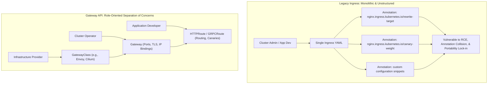
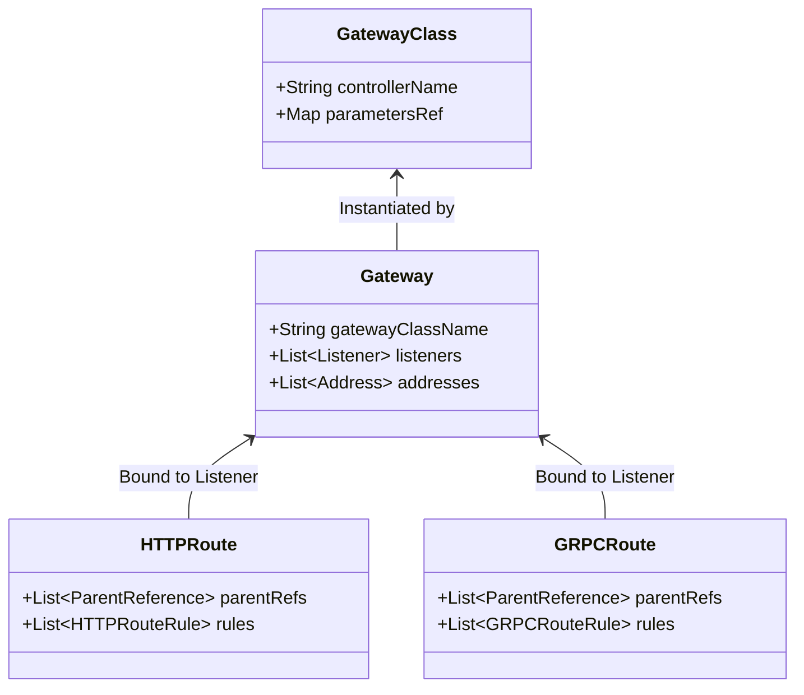
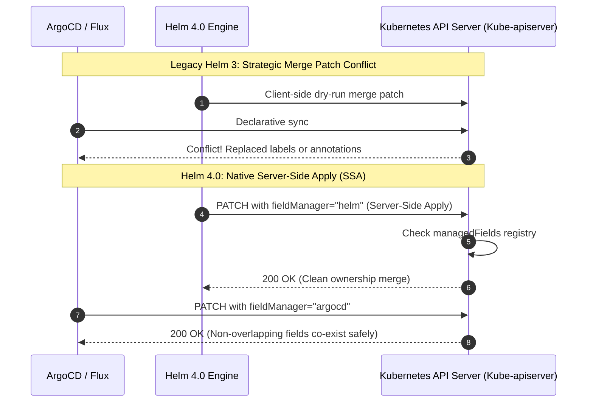
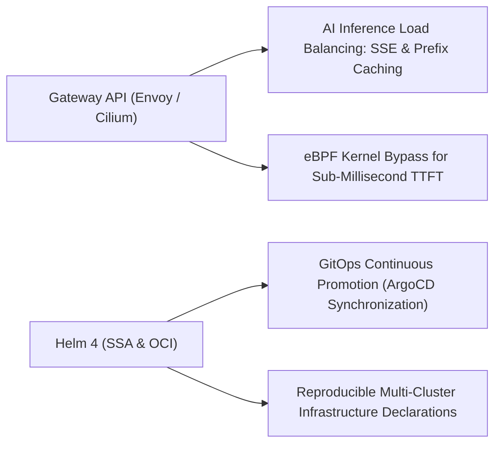

## Why Did the Kubernetes Ingress Specification Fail Enterprise Multi-Tenant Production?

For nearly a decade, `Ingress`—and specifically the community-maintained `ingress-nginx` controller—served as the undisputed default for routing external HTTP traffic into Kubernetes clusters. However, the original Ingress resource (introduced in Kubernetes 1.1 as beta and only formalized in v1.19) was designed around a simplistic, monolithic abstraction: a single YAML resource that conflated infrastructure provisioning, TLS termination, and application path routing into one document.

As enterprise Kubernetes adoption expanded, this monolithic design broke down across three critical architectural dimensions:



1. **The Annotation Anti-Pattern**: Because the core `Ingress` specification defined only rudimentary host- and path-based routing, every advanced networking requirement—such as header matching, URL rewriting, traffic shadowing, rate limiting, and canary weighted routing—had to be implemented via vendor-specific annotations (`nginx.ingress.kubernetes.io/*`). These annotations lacked schema validation, causing silent failures, syntax incompatibilities across cloud providers, and severe security vulnerabilities (including CVE-2021-25742, where custom snippet injection allowed remote code execution on cluster controllers).
2. **Absence of Role-Based RBAC Boundaries**: In modern platforms, infrastructure provisioning (allocating load balancers, public IP pools, and wildcard certificates) is the domain of cluster operations, whereas route definitions belong to application development teams. The legacy Ingress spec forced both personas into the same resource, preventing granular RBAC enforcement and causing cross-namespace routing collisions.
3. **Protocol Limitations**: Classical Ingress was strictly designed for HTTP/1.1 and simple HTTPS termination. Non-HTTP protocols, WebSocket upgrades, bidirectional gRPC streams, and raw TCP/UDP workloads required awkward non-standard workarounds.

These structural limits culminated in the Kubernetes SIG Network and Security Response Committee announcing the formal retirement of `ingress-nginx`, designating **Gateway API** as the official architectural standard for cloud-native traffic management. Simultaneously, the cloud-native packaging ecosystem addressed its own reconciliation bottlenecks through the release of **Helm 4.0**.

---

## Architectural Breakdown: Gateway API Role Separation and Route Hierarchy

Gateway API is not a simple syntax update; it is an expressive, role-oriented routing fabric grounded in three decoupled custom resources:



### 1. `GatewayClass` (Infrastructure Provider Scope)

Defined by cloud providers or network fabric vendors (e.g., Envoy Gateway, Cilium, Istio), `GatewayClass` specifies the underlying data plane controller implementation. It is cluster-scoped and strictly managed by platform engineers:

```yaml
apiVersion: gateway.networking.k8s.io/v1
kind: GatewayClass
metadata:
  name: cilium-gateway
spec:
  controllerName: io.cilium/gateway-controller
```

### 2. `Gateway` (Cluster Operator Scope)

A `Gateway` resource declares the point of ingress: network interfaces, exposed ports, IP address pools, and TLS certificate secret references. It translates directly into a physical cloud load balancer or edge proxy deployment without containing application-level path rules:

```yaml
apiVersion: gateway.networking.k8s.io/v1
kind: Gateway
metadata:
  name: public-edge-gateway
  namespace: infrastructure
spec:
  gatewayClassName: cilium-gateway
  listeners:
  - name: https
    protocol: HTTPS
    port: 443
    tls:
      mode: Terminate
      certificateRefs:
      - name: enterprise-wildcard-cert
    allowedRoutes:
      namespaces:
        from: Selector
        selector:
          matchLabels:
            shared-gateway-access: "true"
```

### 3. `HTTPRoute` and `GRPCRoute` (Application Developer Scope)

Application teams independently define routing rules within their own application namespaces, binding their routes to upstream `Gateway` listeners via `parentRefs`. Standard features like weighted canary splits and header manipulation are first-class, typed schema attributes:

```yaml
apiVersion: gateway.networking.k8s.io/v1
kind: HTTPRoute
metadata:
  name: ai-inference-route
  namespace: ml-serving
spec:
  parentRefs:
  - name: public-edge-gateway
    namespace: infrastructure
  hostnames:
  - "api.company.internal"
  rules:
  - matches:
    - path:
        type: PathPrefix
        value: /v1/chat/completions
    backendRefs:
    - name: vllm-primary-service
      port: 8000
      weight: 90
    - name: vllm-canary-service
      port: 8000
      weight: 10
```

---

## Helm 4.0: Resolving Reconciliation Collisions via Server-Side Apply

While Gateway API resolved ingress boundaries, Kubernetes package management faced systemic reconciliation collisions between client-side templating tools and GitOps operators (e.g., ArgoCD, Flux). Helm 4.0 modernized the core engine around three architectural shifts:



### 1. Native Server-Side Apply (SSA) Integration

In Helm 3, releases relied on client-side three-way strategic merge patches. When GitOps controllers or external Horizontal Pod Autoscalers (HPA) updated resource fields (such as `spec.replicas` or dynamic metadata labels), subsequent `helm upgrade` commands would detect schema divergence, triggering destructive field overrides and release failures.

Helm 4 adopts **Server-Side Apply (SSA)** as its default reconciliation strategy. By declaring an explicit `fieldManager: "helm"`, the Kubernetes API server tracks fine-grained field ownership in `metadata.managedFields`. When Helm updates container images or config values, it mutates only the fields it owns, allowing GitOps operators and autonomous controllers to manage distinct fields on the same resource without conflict storms.

### 2. WebAssembly (WASM) Plugin Sandboxing

Helm plugins traditionally executed as unconstrained host binaries. A malicious or vulnerable third-party plugin had full access to the operator's filesystem, environment variables, and Kubernetes kubeconfig credentials.

Helm 4 embeds a WebAssembly runtime (via Wasmtime), executing plugins within secure WebAssembly System Interface (WASI) sandboxes. Plugins can manipulate chart YAML ASTs in memory at near-native execution speed while strictly blocked from accessing host sockets or arbitrary filesystem directories unless explicitly granted by capability flags.

### 3. Content-Addressable OCI Artifact Caching

Helm 4 abandons time-based chart cache invalidation. All charts packaged as Open Container Initiative (OCI) artifacts are indexed by their SHA256 cryptographic digest. Helm queries remote OCI registries for manifest digests before downloading payloads, reducing network bandwidth by up to 80% across high-concurrency CI/CD deployment pipelines.

---

## Architectural Comparison: Legacy vs. Modern Cloud-Native Foundation

| Dimension | Legacy Stack (Ingress NGINX + Helm 3) | Modern Cloud-Native Stack (Gateway API + Helm 4) |
| :--- | :--- | :--- |
| **Ingress Specification** | Monolithic single resource | Role-oriented (`GatewayClass`, `Gateway`, `*Route`) |
| **Advanced Routing** | Fragile, vendor-specific annotations | First-class, typed schema fields (canary, headers, redirects) |
| **Protocol Support** | HTTP/1.1 and simple HTTPS | Native gRPC, HTTP/2, WebSockets, TCP/UDP, TLS passthrough |
| **Security Surface** | High (snippet execution vulnerabilities) | Strict schema validation; no arbitrary code injection |
| **Package Reconciliation** | Client-side 3-way merge patching | Native Kubernetes Server-Side Apply (SSA) field ownership |
| **Plugin Isolation** | Unrestricted host binary execution | Sandboxed WebAssembly (WASM/WASI) execution runtime |
| **GitOps Interoperability** | Frequent field conflict loops | Conflict-free co-ownership with ArgoCD, Flux, and HPAs |

---

## How Cloud-Native Ingress and Packaging Evolved Across 2026

Between 2025 and 2026, the transition to Gateway API and Helm 4 aligned with the demands of high-throughput AI serving infrastructure:



1. **AI Workload Routing (vLLM and Triton Ingress)**: Standard HTTP load balancers distribute requests using round-robin or least-connections algorithms. For generative inference workloads audited in our [production ML deployment analysis](/posts/deploy-an-ml-model/), round-robin distribution degrades GPU cache efficiency. Modern Envoy Gateway implementations utilize Gateway API extensions to inspect incoming prompt prefixes, routing requests to inference pods hosting identical KV cache contexts (Radix trees), slashing Time-To-First-Token (TTFT) by up to 50%.
2. **eBPF-Powered Data Planes (Cilium Gateway API)**: In high-scale Kubernetes clusters, routing traffic through intermediate user-space ingress controllers introduces double-proxy overhead. Deployments widely standardize on Cilium's eBPF-native Gateway API implementation: the Linux kernel parses HTTP/gRPC frames directly at the network interface card (NIC) level, routing packets to target model serving containers while bypassing kube-proxy iptables entirely.
3. **Automated Migration Tooling and GitOps Convergence**: The retirement of `ingress-nginx` accelerated the adoption of automated translation controllers (`ingress2gateway`), which parse legacy Ingress manifests and output valid Gateway and HTTPRoute resources. Coupled with Helm 4's Server-Side Apply, platform engineers execute automated multi-cluster migrations without causing downtime or routing flapping, supporting automated infrastructure workflows examined in our [LlamaIndex agentic Terraform audit](/posts/rag-workflow-with-llamaindex/).

---

## Key Takeaways

- **Ingress NGINX Retirement Marks the End of Annotation Ingress**: The monolithic Ingress specification could not enforce RBAC boundaries or maintain security hygiene under complex enterprise routing requirements.
- **Gateway API Enforces Role-Oriented Separation**: Splitting infrastructure declarations (`GatewayClass`, `Gateway`) from application routing (`HTTPRoute`) provides native multi-tenancy, gRPC support, and portable traffic splitting.
- **Helm 4 Server-Side Apply Eliminates GitOps Conflicts**: Adopting SSA field ownership allows Helm, GitOps reconcilers, and autoscalers to collaboratively manage resources without destructive merge loops.
- **WASM Transforms Ecosystem Security**: Replacing raw binary execution with sandboxed WebAssembly plugins prevents credential exfiltration and supply-chain vulnerabilities in package management.

---

## New Questions

- How do eBPF-based Gateway API implementations handle hardware-accelerated TLS termination when throughput exceeds 100 Gbps per host?
- What are the operational limits of Gateway API cross-namespace route bindings when managing clusters with tens of thousands of application tenants?
- How will the convergence of WebAssembly system runtimes and Kubernetes CRI alter the boundary between container images and Helm package definitions?

---

## References

- Kubernetes SIG Network. (2025). *Ingress NGINX Retirement: What You Need to Know*. Kubernetes Official Engineering Blog. [https://kubernetes.io/blog/2025/11/11/ingress-nginx-retirement/](https://kubernetes.io/blog/2025/11/11/ingress-nginx-retirement/) (accessed 2026-10-18).
- Gateway API Working Group. (2026). *Kubernetes Gateway API: A Modern Approach to Ingress and Service Networking*. Kubernetes SIGs. [https://gateway-api.sigs.k8s.io/](https://gateway-api.sigs.k8s.io/) (accessed 2026-10-18).
- Helm Project. (2025). *Helm 4.0 Architecture Specification and Release Notes*. Cloud Native Computing Foundation (CNCF). [https://helm.sh/docs/](https://helm.sh/docs/) (accessed 2026-10-18).
- Kubernetes Documentation. (2026). *Kubernetes Server-Side Apply and Field Management*. Kubernetes Reference Documentation. [https://kubernetes.io/docs/reference/using-api/server-side-apply/](https://kubernetes.io/docs/reference/using-api/server-side-apply/) (accessed 2026-10-18).
