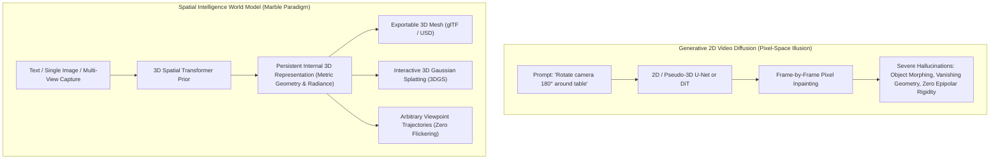
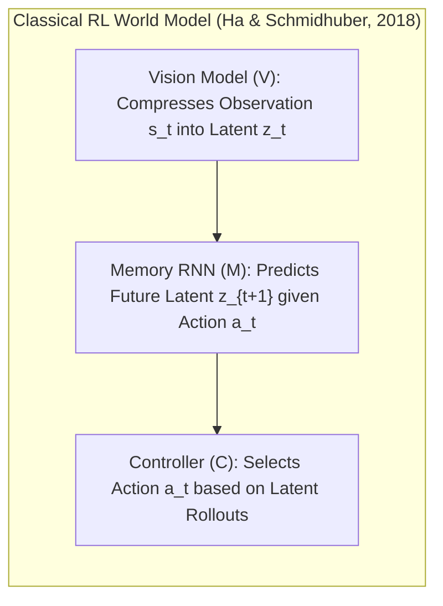
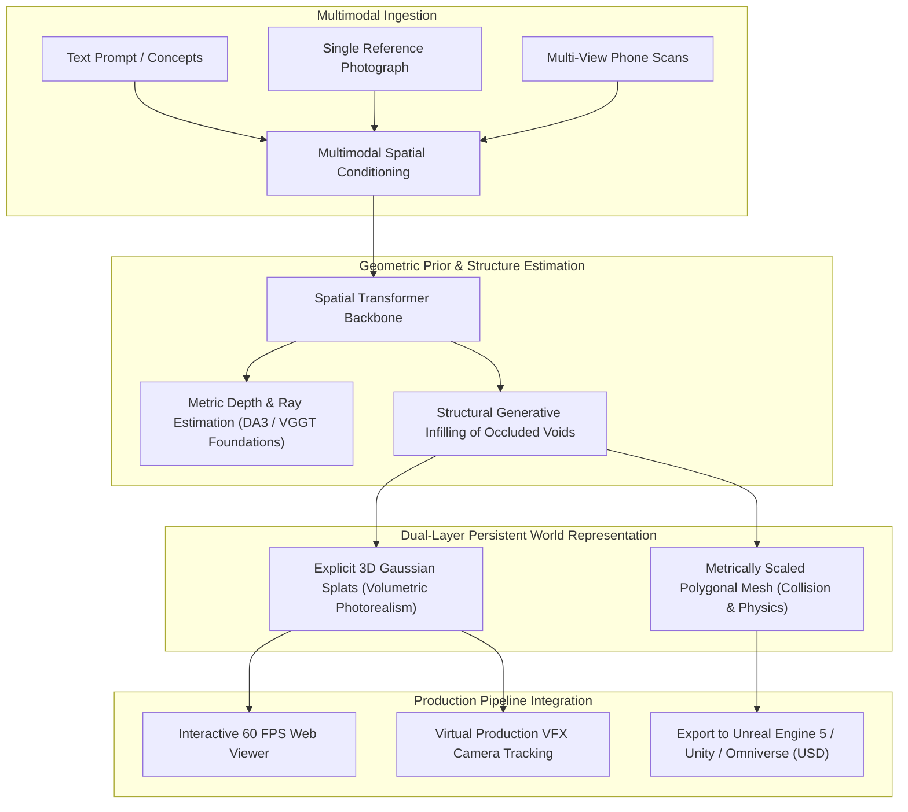
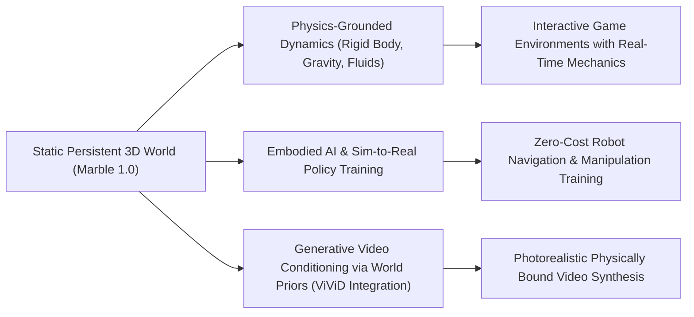

## Why Did Generative 2D Video Models Fail to Deliver True World Models?

Throughout 2024 and 2025, text-to-video diffusion models (such as OpenAI Sora, Runway Gen-3, and Kling) demonstrated visually stunning synthetic video sequences. Industry narratives frequently claimed these generative architectures acted as emergent "physics engines" or foundational world models. However, when deployed in engineering domains demanding interactive manipulation—such as game development, VFX virtual production, and embodied robotic simulation—pure 2D video generators consistently failed.

The breakdown stems from an epistemic limitation: **pixel generation is not world modeling**. 

Video diffusion models optimize for temporal statistical likelihood across image planes. They possess no internal representation of Euclidean 3D space, metric coordinates, light transport, or persistent physical boundaries:
- **Geometric Inconsistency and Morphing**: When a synthetic camera moves behind an object and returns to its original viewpoint, background elements routinely change scale, mutate textures, or vanish entirely.
- **Lack of Physical Affordances**: Video frames cannot be queried for depth collisions, collision meshes, or surface normals required for robotic grasping or physics simulation.
- **Non-Editable Ephemeral Outputs**: Once generated, a video cannot be modified. An engineer cannot move a light source, remove a foreground tree, or export the environment into Unity, Unreal Engine, or an embodied robot simulator.

In November 2025, **WorldLabs**—co-founded by computer vision pioneer Fei-Fei Li—launched **Marble**, marking the commercial emergence of **Spatial Intelligence**. Rather than hallucinating disconnected 2D frames, Marble constructs persistent, metric, and fully navigable 3D world models directly from multimodal inputs.

---

## Theoretical Foundations: From Schmidhuber's Dreamer to Spatial Intelligence

The conceptual foundation of world models traces back to cognitive science and reinforcement learning theory, specifically the seminal formulation by Ha and Schmidhuber (2018) and Danijar Hafner's Dreamer framework (2020–2023):

In classical RL, a world model decomposes into:
1. **Perceptual Compression ($V$)**: Maps raw sensory inputs into a compact spatial latent vector.
2. **Transition Dynamics ($M$)**: Predicts future state transitions conditioned on potential agent actions without interacting with the physical environment.
3. **Behavior Optimization ($C$)**: Allows an agent to "dream" millions of trial-and-error policy steps purely within latent space.

Fei-Fei Li extended this formulation through the concept of **Spatial Intelligence**:
> *"If language models taught machines to read and write, spatial intelligence will teach machines to see, reason, and build space."*

Spatial intelligence requires grounding representations in three-dimensional geometric reality. A true world model must predict not merely what the world looks like from a single perspective, but what exists in unobserved occluded space, how objects relate metric-wise to one another, and how physical forces govern interaction.

---

## Architectural Breakdown: How WorldLabs Marble Synthesizes 3D Worlds

Marble implements spatial intelligence by uniting feed-forward geometric priors with neural radiance and 3D Gaussian Splatting (3DGS) parameterizations:

### 1. Unified Geometric Prior and Structural Infilling

When provided with a single 2D image or text brief, Marble faces an ill-posed inverse problem: what lies behind the visible foreground objects?

Rather than performing 2D diffusion inpainting, Marble deploys a high-capacity spatial transformer conditioned on massive multi-view and synthetic 3D structural priors. The network estimates metric depth, ray vectors, and camera parameters using principles established in modern feed-forward geometry architectures—such as [Depth Anything 3](/posts/depth-anything-3/) and [VGGT](/posts/vggt-visual-geometry-grounded-transformer/).

Crucially, the architecture resolves occluded space by generating plausible **3D structural continuations**. If the input depicts the front facade of a Victorian manor, the spatial transformer infers room dimensions, hallway topologies, and rear wall placements that maintain global volumetric coherence.

### 2. Dual-Layer Scene Parameterization: Splats and Meshes

Marble avoids committing to a single imperfect representation by generating a synchronized dual-layer spatial artifact:

1. **Photorealistic Volumetric Layer (3D Gaussian Splatting)**: For visual rendering, Marble outputs millions of parameterized 3D Gaussians (each defined by center position $\mu$, 3D covariance matrix $\Sigma$, opacity $\alpha$, and spherical harmonic color coefficients). This enables sub-millisecond, photorealistic novel view rendering without ray-marching latency.
2. **Topological Geometric Layer (Polygonal Mesh)**: For physical simulation, the system extracts clean polygonal geometry with UV unwrapped texture maps, exportable directly as `.usd` or `.gltf` files. This allows game engines to compute navmeshes, physics colliders, and dynamic lighting immediately upon import, directly linking to architectural workflows analyzed in our [game development guide](/posts/learn-to-develop-game/).

---

## Architectural Comparison: Generative Approaches to 3D Space

| Dimension | 2D Video Diffusion (Sora / Kling) | NeRF / SDS (DreamFusion / Magic3D) | 3D Asset Generators (TripoSR / Meshy) | Commercial World Model (Marble) |
| :--- | :--- | :--- | :--- | :--- |
| **Output Representation** | 2D video pixel stream | Neural radiance weight fields | Isolated single 3D object mesh | Metric, multi-room persistent 3D world |
| **Camera Controllability** | Approximate prompt guidance | Arbitrary 6-DoF continuous camera | Rotational turntable viewer | Deterministic, unconstrained 6-DoF navigation |
| **Temporal Consistency** | Severe flickering & object morphing | Strictly consistent (static scene) | Strictly consistent (single asset) | Persistent geometry across infinite traversals |
| **Physical Simulation** | None (purely optical illusion) | None (density fields only) | Basic rigid mesh collisions | Navmesh, occlusion boundaries, collision bounds |
| **Downstream Export** | MP4 / WebM video files | Volumetric density checkpoints | Single glTF / OBJ file | Dual-layer: 3DGS splats + USD polygonal meshes |
| **Generation Latency** | Minutes per short video clip | Tens of minutes of optimization | 5 to 30 seconds | Sub-minute feed-forward scene generation |

---

## How Spatial Intelligence and World Models Evolved Across 2026

Between 2025 and 2026, world models transitioned from static spatial reconstruction into interactive, physically grounded environments:

1. **Interactive Physical Dynamics and Object Affordances**: Early world models generated static dioramas. 2026 iterations incorporate dynamic physics engines directly into latent state representations. When an agent kicks a cup off a generated table, the world model simulates mass, friction, and fluid splashing in real time, validating predictions against physical collision boundaries.
2. **Embodied AI and Sim-to-Real Transfer**: The most profound impact of commercial world models is in robotics. Real-world robot data collection is notoriously slow and expensive. Systems like Marble generate millions of photorealistic, geometrically verified indoor and outdoor environments. Autonomous mobile robots (AMRs) and humanoid manipulators train vision-language-action (VLA) navigation policies inside synthetic world models, achieving zero-shot transfer to real physical warehouses.
3. **Integration with Generative Video Diffusion**: The dichotomy between video generation and 3D modeling dissolved. State-of-the-art video generators discard pure 2D noise prediction, instead rendering coarse 3D Gaussian paths generated by world models, and then applying diffusion super-resolution networks as detail enhancers, building directly upon the cross-attention principles evaluated in our [ViViD video diffusion analysis](/posts/vivid-diffusion-paper/).
4. **Spatial Computing and Virtual Production**: In film and XR production, virtual sets are created in minutes from concept art. Directors walk through generated sets using Apple Vision Pro headsets, adjusting virtual focal lengths and camera track cranes in real-time, completely replacing physical set construction.

---

## Key Takeaways

- **Video Diffusion Cannot Model Physical Reality**: Pure 2D pixel generation lacks Euclidean geometric priors, causing object morphing, perspective drift, and non-navigable artifacts.
- **Spatial Intelligence Grounding**: World models must represent the world in three dimensions, predicting occluded volumes, metric distances, and physical affordances.
- **Marble's Dual-Layer Representation**: By pairing volumetric 3D Gaussian Splatting for photorealism with polygonal meshes for physics, Marble bridges generative AI with industrial production engines (Unity, Unreal Engine).
- **The Core Enabler for Embodied AI**: Persistent 3D world models provide the synthetic training ground necessary to train autonomous robots and spatial computing agents at scale.

---

## New Questions

- How do world model architectures prevent cumulative error drift when simulating long-horizon interactive physical actions across thousands of environment steps?
- What are the storage and streaming bandwidth requirements of serving multi-gigabyte 3D Gaussian Splat environments over cellular networks to lightweight XR headsets?
- At what point does synthetic world model policy training surpass real-world embodied data collection in robotic manipulation precision?

---

## References

- WorldLabs. (2025). *Introducing Marble: The First Commercial World Model for Spatial Intelligence*. WorldLabs Official Announcement. [https://www.worldlabs.ai/](https://www.worldlabs.ai/) (accessed 2026-10-18).
- Ha, D., & Schmidhuber, J. (2018). *World Models*. arXiv preprint [arXiv:1803.10122](https://arxiv.org/abs/1803.10122) (accessed 2026-10-18).
- Hafner, D., Pasukonis, J., Ba, J., & Lillicrap, T. (2023). *Mastering Diverse Domains through World Models*. arXiv preprint [arXiv:2301.04104](https://arxiv.org/abs/2301.04104) (accessed 2026-10-18).
- Li, F.-F. (2024). *From Seeing to Acting: The Next Frontier in Spatial Intelligence*. Stanford Institute for Human-Centered Artificial Intelligence (HAI). [https://hai.stanford.edu/](https://hai.stanford.edu/) (accessed 2026-10-18).
