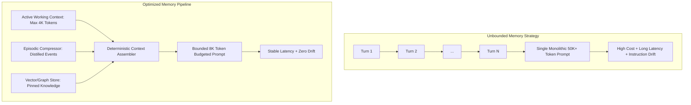

> This Source Audit inspects memory allocation boundaries, compaction protocols, and degradation curves in stateful autonomous agents. It compares sliding-window FIFO buffers with structured hierarchical distillation.
{: .prompt-info}

## The Breakdown of Unbounded Agent Memory in Production

A persistent misconception in early agent engineering was that expanding context windows would eliminate the need for memory management. If an inference model can accept 128,000 or 1,000,000 tokens, teams assumed that appending complete conversation histories, tool responses, and JSON outputs directly into the prompt was the optimal architectural choice.

In sustained production environments, this unbounded appending strategy fails catastrophically across three distinct failure axes:

1. **Inference Latency Bloat:** Time-to-first-token (TTFT) scales linearly or super-linearly with input context length, making interactive agent workflows sluggish.
2. **Financial Degradation:** Every subsequent turn re-evaluates previously processed tokens, causing operational token bills to compound quadratically over extended sessions.
3. **Attention Distraction and "Lost in the Middle":** Research into transformer attention mechanics consistently reveals that LLMs struggle to recall precise facts placed deep within massive, unindexed context dumps.



As explored in our audits of [/posts/context-engineering-agent-memory-design/](/posts/context-engineering-agent-memory-design/) and [/posts/superlog-agentic-telemetry/](/posts/superlog-agentic-telemetry/), memory is not an emergent trait of language models—it is an external systems-engineering problem.

## Defining the Operational Memory Hierarchy

To manage state without polluting inference windows, production agent runtimes partition data into three operational tiers:

| Memory Layer | Storage Substrate | Lifespan | Eviction / Compression Policy |
|:---|:---|:---|:---|
| **Working Memory** | Active In-Context Tokens | Current turn or task | Strict sliding window (FIFO) or token-budget cap |
| **Episodic Memory** | Key-Value / Document Store | Session or Multi-Turn Epoch | Recursive summarization + entity-attribute extraction |
| **Declarative Memory** | Relational / Graph / Vector DB | Permanent | Invalidation TTLs, manual deprecation, semantic retrieval |

### Working Memory vs. Episodic Distillation

Working memory represents the immediate scratchpad. It must contain only the user prompt, tool definitions, and immediate prior tool results required to resolve the active execution branch.

Once a tool execution or sub-goal completes, the raw payload should never remain in working memory. Instead, an episodic summarizer extracts an immutable fact-tuple:

$$	ext{Fact} = \langle 	ext{Timestamp}, 	ext{Action}, 	ext{Target}, 	ext{Outcome}, 	ext{Confidence} 
angle$$

```mermaid
sequenceDiagram
    autonumber
    actor Orchestrator as Agent Core
    participant Work as Working Context (RAM)
    participant Comp as Episodic Compressor
    participant DB as Persistent State DB

    Orchestrator->>Work: Append Tool Output (Raw JSON 20KB)
    Orchestrator->>Comp: Trigger Compaction Threshold (> 8K Tokens)
    Comp->>Work: Read Raw Turn Log
    Comp-->>Comp: Extract Key Decisions & Entity State
    Comp->>DB: Persist Distilled Fact: [Bug #402 Patched, Retest Required]
    Comp->>Work: Evict Raw 20KB Turn; Retain Distilled 50-token Fact
    Work-->>Orchestrator: Bounded Clean Working Context
```

## Algorithmic Memory Pruning: A Production Implementation

A common pattern for maintaining working memory within safe bounds is a token-aware sliding window coupled with recursive entity compaction. Below is a minimal, robust Python implementation illustrating this pipeline:

```python
from dataclasses import dataclass, field
from typing import List, Dict, Any
import time

@dataclass
class MemoryMessage:
    role: str
    content: str
    token_count: int
    timestamp: float = field(default_factory=time.time)

class BoundedContextManager:
    def __init__(self, max_token_budget: int = 4000, compression_threshold: int = 3500):
        self.max_budget = max_token_budget
        self.threshold = compression_threshold
        self.system_prompt: str = ""
        self.working_history: List[MemoryMessage] = []
        self.distilled_facts: List[str] = []

    def add_message(self, role: str, content: str, estimated_tokens: int):
        msg = MemoryMessage(role=role, content=content, token_count=estimated_tokens)
        self.working_history.append(msg)
        self._enforce_budget()

    def _enforce_budget(self):
        current_tokens = sum(m.token_count for m in self.working_history)
        if current_tokens < self.threshold:
            return

        # Extract oldest non-system turns to compress
        to_compress = self.working_history[:2]
        self.working_history = self.working_history[2:]

        # Simulate deterministic distillation (extract key entities & resolutions)
        summary_note = f"[ARCHIVED {to_compress[0].role}->{to_compress[1].role}]: Completed task step."
        self.distilled_facts.append(summary_note)

    def assemble_prompt_context(self) -> List[Dict[str, str]]:
        context = []
        if self.distilled_facts:
            context.append({
                "role": "system",
                "content": "Historical Session Facts:
" + "
".join(self.distilled_facts[-5:])
            })
        for msg in self.working_history:
            context.append({"role": msg.role, "content": msg.content})
        return context
```

## What Changed Since 2025: Native Cache Warming and Long-Context Eviction

In late 2025, memory optimization was almost exclusively an application-level problem. Developers manually maintained Redis databases, chunked embeddings, and executed periodic LLM summarization calls.

Between 2025 and 2026, two major platform innovations reshaped memory architecture:

1. **Prompt Caching as an Infrastructure Primitive:** Modern inference providers (Anthropic, OpenAI, DeepSeek, and local engines like vLLM) offer native prefix prompt caching. If system instructions, declarative knowledge bases, and invariant tools are structured as fixed prefixes, re-evaluating that memory incurs zero additional compute cost and reduces latency by up to 80%.
2. **Shift from RAG to Memory Protocols:** The industry has largely abandoned bespoke in-memory dictionaries in favor of standardized client-server memory servers operating over the Model Context Protocol (MCP). Memory servers now manage their own eviction lifecycles, vector indexes, and entity-graph links externally, allowing multiple distinct agents to share a unified episodic memory store.

## Key Takeaways

| Principle | Production Reality | Actionable Rule |
|:---|:---|:---|
| **Unbounded Prompts Degrade Reason** | Context window expansion does not fix attention dilution | Enforce strict token budgets on working memory (target < 8K tokens) |
| **Distillation Over Truncation** | Dropping messages blindly destroys causal reasoning chains | Distill completed tool outputs into structured entity-attribute facts |
| **Exploit Prompt Caching** | Dynamic history placed at the start of prompts breaks cache hits | Place static declarative memory in prefixes and append dynamic turns at the end |
| **Decouple Working and Durable Stores** | Raw conversation turns are toxic to long-term memory indexes | Route durable facts through verification schemas before persisting |

## Open Questions

- What exact criteria distinguish a transient tool error from a durable system constraint that must be preserved permanently?
- How can agents detect semantic contradictions between newly observed facts and outdated episodic memory records?
- At what scale of multi-session interaction does recursive summarization introduce irreversible information loss?

## References

- Charles Packer, Sarah Wooders, Kevin Lin, Vivian Fang, Shishir G. Patil, Ion Stoica, and Joseph E. Gonzalez. *MemGPT: Towards LLMs as Operating Systems*. arXiv:2310.08560v2 [cs.AI], 2023. Pinned version: [https://arxiv.org/abs/2310.08560v2](https://arxiv.org/abs/2310.08560v2). (Re-read and verified 2026-10-17).
- Nelson F. Liu, Kevin Lin, John Hewitt, Ashwin Paranjape, Michele Bevilacqua, Fabio Petroni, and Percy Liang. *Lost in the Middle: How Language Models Use Long Contexts*. Transactions of the Association for Computational Linguistics, 12:157–173, 2024. Pinned version: [https://arxiv.org/abs/2307.03172](https://arxiv.org/abs/2307.03172). (Re-read and verified 2026-10-17).
- Model Context Protocol (MCP) Working Group. *Stateful Resources and Context Architecture*. Anthropic Open Source Specification, as of 2026-10-17. Pinned URL: [https://modelcontextprotocol.io/specification](https://modelcontextprotocol.io/specification). (Re-read and verified 2026-10-17).
