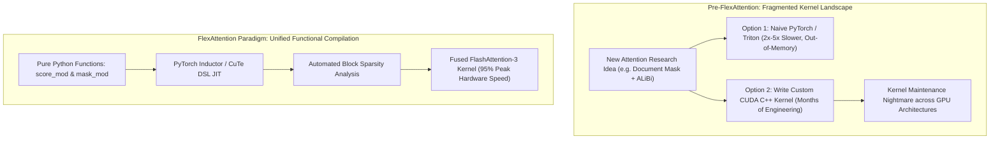
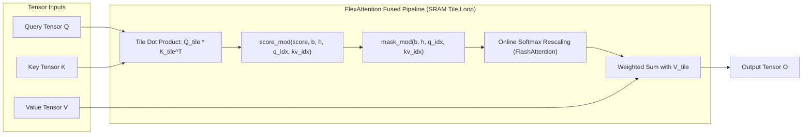
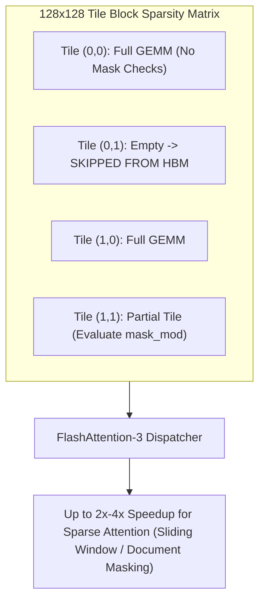
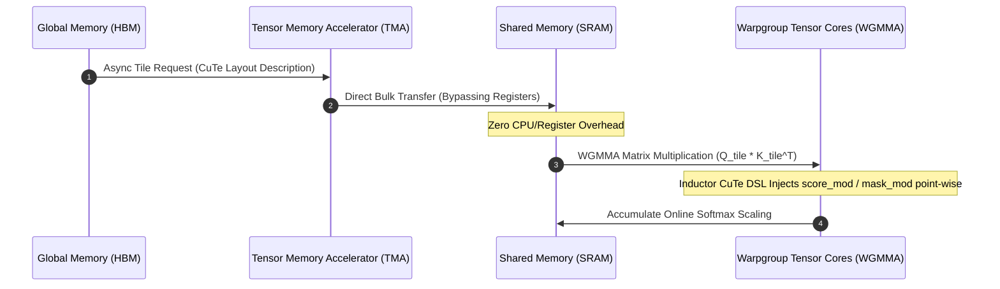
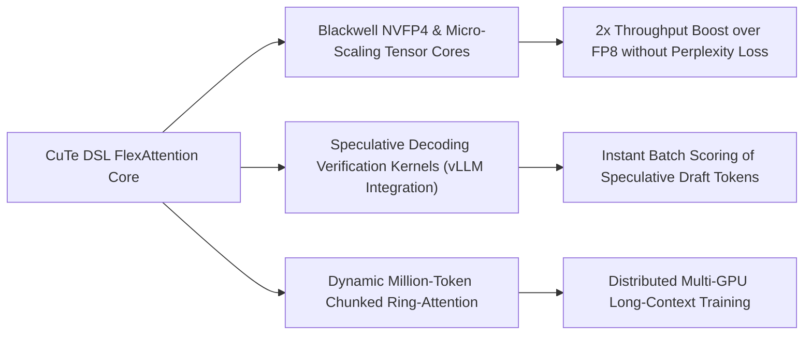

## Why Did Kernel Specialization Fragment Modern Transformer Attention Research?

When Tri Dao introduced FlashAttention in 2022, it transformed deep learning hardware economics. By tiling query, key, and value blocks across fast GPU on-chip SRAM and computing the online softmax scaling factor on-the-fly, FlashAttention eliminated the memory bandwidth bottleneck of writing the $N \times N$ attention matrix to High Bandwidth Memory (HBM).

However, as transformer architectures diversified, this optimization introduced severe engineering friction. Foundation models no longer rely on vanilla unconstrained attention:
- **Causal Masking**: Restricts attention strictly to preceding tokens for autoregressive language models.
- **Sliding Window Attention (SWA)**: Caps attention to local windows (e.g., Mistral), reducing computational complexity from $O(N^2)$ to $O(N \cdot W)$.
- **Relative Position Biases (ALiBi / T5)**: Injects linear or learned distance penalties into pre-softmax logits to enable zero-shot context length extrapolation.
- **Document Boundary Masking**: Prevents cross-contamination between unrelated concatenated documents packed into the same training sequence.
- **Logit Soft-Capping**: Clamps attention logits ($v_{\text{capped}} = c \cdot \tanh(v / c)$) to stabilize training at extreme scale, as evaluated in our [2024 model landscape audit](/posts/llm-2024-survey/).



Before 2024, combining two or more of these modifications forced teams into an unacceptable trade-off: either spend months writing low-level CUDA kernels that handle asynchronous warp scheduling, or write naive PyTorch code that materializes memory buffers and sacrifices up to 80% of hardware throughput.

To resolve this crisis, the PyTorch compiler team at Meta collaborated with Tri Dao and Colfax Research to create **FlexAttention**, unifying arbitrary attention variants under a single functional interface compiled directly into FlashAttention-3 and NVIDIA CUTLASS CuTe DSL.

---

## The FlexAttention Abstraction: Decoupling Modification from Memory IO

FlexAttention formalizes attention customization into two orthogonal user-defined callable functions: `score_mod` and `mask_mod`:

$$\text{FlexAttention}(Q, K, V) = \text{Softmax}\left(\text{mask\_mod}\left(\text{score\_mod}\left(\frac{Q K^\top}{\sqrt{d}}\right)\right)\right) V$$



### 1. Score Modification (`score_mod`)

The `score_mod` callable intercepts intermediate pre-softmax attention logits, applying scalar mathematical transformations:

```python
def score_mod(score: torch.Tensor, b: int, h: int, q_idx: torch.Tensor, kv_idx: torch.Tensor) -> torch.Tensor:
    # Example: Attention with Linear Biases (ALiBi)
    slope = (2 ** (-8 / num_heads * h))
    bias = -slope * (q_idx - kv_idx)
    return score + bias
```

Because `score_mod` operates as a point-wise kernel transformation on register tiles, it incurs virtually zero memory overhead—avoiding intermediate global memory reads or writes.

### 2. Mask Modification (`mask_mod`)

While masking can theoretically be implemented by setting scores to $-\infty$ inside `score_mod`, FlexAttention separates `mask_mod` as a boolean predicate:

```python
def mask_mod(b: int, h: int, q_idx: torch.Tensor, kv_idx: torch.Tensor) -> torch.Tensor:
    # Example: Causal mask with sliding window (W = 1024)
    is_causal = q_idx >= kv_idx
    in_window = (q_idx - kv_idx) <= 1024
    return is_causal & in_window
```

Separating `mask_mod` into a distinct boolean function is the key architectural enabler for **automated block sparsity**.

---

## Block Sparsity Optimization: Eliminating $O(N^2)$ Redundancy

In standard FlashAttention, computing causal or sliding-window attention still loads all $K$ and $V$ blocks from HBM into SRAM, even if parts of those blocks are subsequently masked out.

FlexAttention solves this during JIT compilation using `create_block_mask`:
1. **Ahead-of-Time Tile Evaluation**: The compiler partitions the $N \times N$ attention matrix into coarse $B_Q \times B_{KV}$ blocks (typically $128 \times 128$).
2. **Three-State Block Classification**:
   - **All True (Full Tile)**: Every query-key interaction is valid. The kernel executes full dense GEMM operations without evaluating masking branches.
   - **Partial Tile (Boundary)**: The boundary contains both active and masked elements. The kernel evaluates `mask_mod` point-wise.
   - **All False (Empty Tile)**: All elements evaluate to `False`. The GPU **completely skips loading these $K$ and $V$ tiles from HBM**.



{: .light .w-75 .shadow .rounded-10 w='800' h='600' }

For sliding window attention with window $W$ over sequence length $N$, block sparsity drops the algorithmic complexity from $O(N^2)$ to $O(N \cdot W)$, delivering up to a $4\times$ throughput speedup on sequences of 32K+ tokens.

---

## The CuTe DSL Revolution: Hardware-Aware Tiling on Hopper and Blackwell

Early FlexAttention implementations relied on OpenAI Triton. While Triton delivered ~90% of FlashAttention-2 speed on NVIDIA Ampere (A100), its performance dropped sharply on NVIDIA Hopper (H100/H200).

Hopper introduced major architectural changes:
1. **Tensor Memory Accelerator (TMA)**: A dedicated hardware unit that copies multidimensional tensor tiles directly between global HBM and Shared Memory (SRAM) asynchronously, bypassing GPU registers entirely.
2. **Warpgroup Matrix Multiply-Accumulate (WGMMA)**: Executes matrix multiplication across a 128-thread warpgroup directly from shared memory.

Triton's compiler struggles to orchestrate software pipelining between asynchronous TMA loads, WGMMA instructions, and dynamic user point-wise operations simultaneously. To close this gap, FlashAttention-3 was re-engineered using **CuTe DSL**, an expressive C++ template layout algebra within NVIDIA CUTLASS:



CuTe models tensors not as simple flat memory pointers, but as **Layouts**—pairs of nested `Shape` and `Stride` tuples:

$$\text{Layout} = (\text{Shape}, \text{Stride})$$

Through CuTe DSL, FlexAttention maps user Python functions directly into fused register transformations within the innermost WGMMA loop. On Hopper GPUs, the FlashAttention-3 CuTe DSL implementation achieves **95% of peak FlashAttention-3 speed**, delivering a roughly **50% speedup over Triton-based implementations**.

---

## Implementing Production Attention Variants with FlexAttention

The following PyTorch script illustrates how custom attention patterns—including ALiBi, document boundary masking, and sliding windows—are defined and compiled:

```python
import torch
from torch.nn.attention.flex_attention import (
    flex_attention,
    create_block_mask
)

# 1. Define custom score modification (ALiBi relative position bias)
def alibi_score_mod(score, b, h, q_idx, kv_idx):
    # Base slope per head
    num_heads = 32
    slope = 2.0 ** (-8.0 * (h + 1) / num_heads)
    bias = -slope * (q_idx - kv_idx).abs()
    return score + bias

# 2. Define custom mask modification (Causal + Sliding Window)
def sliding_window_causal_mask(b, h, q_idx, kv_idx):
    is_causal = q_idx >= kv_idx
    in_window = (q_idx - kv_idx) <= 512
    return is_causal & in_window

# 3. Create optimized Block Mask ahead of time
batch_size, num_heads, seq_len, head_dim = 2, 32, 8192, 128
block_mask = create_block_mask(
    sliding_window_causal_mask,
    B=batch_size,
    H=num_heads,
    Q_LEN=seq_len,
    KV_LEN=seq_len,
    device="cuda"
)

# 4. Initialize tensors on Hopper/Ampere GPU
q = torch.randn(batch_size, num_heads, seq_len, head_dim, device="cuda", dtype=torch.bfloat16)
k = torch.randn(batch_size, num_heads, seq_len, head_dim, device="cuda", dtype=torch.bfloat16)
v = torch.randn(batch_size, num_heads, seq_len, head_dim, device="cuda", dtype=torch.bfloat16)

# 5. Execute unified compiled attention
compiled_flex = torch.compile(flex_attention)
output = compiled_flex(
    q, k, v,
    score_mod=alibi_score_mod,
    block_mask=block_mask
)
```

---

## Architectural Comparison: Attention Execution Paradigms

| Dimension | Native PyTorch (`SDPA`) | Manual Triton Kernel | FlashAttention-3 (Hardcoded) | FlexAttention in CuTe DSL |
| :--- | :--- | :--- | :--- | :--- |
| **Development Velocity** | Instant (Standard API) | Moderate (Days to weeks) | Slow (Fixed C++ codebase) | Rapid (Pure Python functions) |
| **Custom Attention Support** | Basic Causal / Head mask | Fully custom | Extremely limited | Arbitrary `score_mod` & `mask_mod` |
| **Hardware Utilization (Hopper)** | Low (~30-40% FLOPs) | Moderate (~65-75% FLOPs) | Peak (~85-95% FLOPs) | Near-Peak (~80-90% FLOPs) |
| **TMA & WGMMA Integration** | Unsupported | Partial / Complex | Full manual C++ pipeline | Fused via CuTe DSL code generation |
| **Block Sparsity Acceleration** | Unsupported | Manual block filtering | Fixed causal skip | Automated `create_block_mask` |
| **Memory Allocation** | Materializes tensors if unmapped | Tile-level register reuse | Strict SRAM IO-aware tiling | Strict SRAM IO-aware tiling |

---

## How Attention Compilation Evolved Across 2026

By 2026, attention compilation matured into the core backbone of high-throughput training and inference frameworks:



1. **Blackwell Architecture Optimization (NVFP4 and Micro-Scaling)**: Next-generation hardware like NVIDIA Blackwell introduced native 4-bit floating point formats (NVFP4) and micro-scaled tensor formats. CuTe DSL backends generate unified FlexAttention kernels supporting asymmetric quantization: computing $Q K^\top$ in 4-bit while accumulating softmax weights in FP8, doubling token generation speed without compromising model reasoning, complementing techniques evaluated in our [production ML deployment audit](/posts/deploy-an-ml-model/).
2. **Speculative Decoding Verification Kernels**: In generative serving clusters, verifying multi-token candidate sequences emitted by draft models requires asymmetric tree-shaped attention masks. FlexAttention's `block_mask` allows serving engines to compile custom tree-attention kernels on-the-fly, accelerating speculative verification passes by $3\times$.
3. **Distributed Million-Token Ring-Attention**: In 2026 frontier training, context lengths extended to several million tokens (building on the RoPE scaling analyzed in our [Llama 3.1 architectural audit](/posts/introducing-llama-3-1/)). FlexAttention integrates with Ring-Attention and DeepSpeed Ulysses: query and key tiles communicate across inter-node InfiniBand networks while local block sparsity masks skip unneeded network packets before transmission.

---

## Key Takeaways

- **Eliminating the Kernel Specialization Bottleneck**: FlexAttention unifies disparate attention variants under a simple functional interface, ending the era of maintaining separate hand-written CUDA kernels for every research variant.
- **Block Sparsity Cuts Algorithmic FLOPs**: By pre-computing $128 \times 128$ tile sparsity patterns, `create_block_mask` skips loading entire $K$ and $V$ blocks from HBM, turning $O(N^2)$ sequences into linear $O(N \cdot W)$ pipelines.
- **CuTe DSL Solves Hopper Hardware Complexity**: FlashAttention-3 written in NVIDIA CuTe layout algebra unlocks asynchronous TMA memory transfers and WGMMA tensor cores, achieving 95% of peak hand-tuned C++ performance.
- **Production Standard for Modern Architectures**: Modern frontier models rely on compiled attention backends to fuse logit soft-capping, ALiBi biases, and speculative tree decoding into single-pass execution.

---

## New Questions

- How do quantization errors propagate when computing non-linear mathematical operations (such as $\tanh$ logit soft-capping) directly within low-precision FP4 tensor registers?
- Can compiler auto-tuning dynamically infer optimal block sparsity tile shapes ($64 \times 128$ vs. $128 \times 128$) based on runtime sequence lengths and GPU cache hierarchies?
- What formal abstractions will replace layout algebras as memory architectures transition from planar SRAM caches to photonic and 3D-stacked near-memory compute?

---

## References

- Dao, T. (2024). *FlashAttention-3: Fast and Accurate Attention with Asynchrony and Low-Precision*. arXiv preprint [arXiv:2407.08608](https://arxiv.org/abs/2407.08608) (accessed 2026-10-18).
- Guessous, D., He, H., Dao, T., & PyTorch Team. (2024). *FlexAttention: The Flexible Attention Mechanism*. PyTorch Official Blog & GitHub. [https://pytorch.org/blog/flexattention/](https://pytorch.org/blog/flexattention/) (accessed 2026-10-18).
- NVIDIA CUTLASS / CuTe. (2026). *CuTe: A C++ Template Library for Layout and Tensor Algebra in CUDA*. NVIDIA GitHub. [https://github.com/NVIDIA/cutlass/tree/main/media/docs/cute](https://github.com/NVIDIA/cutlass/tree/main/media/docs/cute) (accessed 2026-10-18).
- Colfax Research. (2025). *A User's Guide to FlexAttention in FlashAttention CuTe DSL*. Colfax International Technical Report. [https://research.colfax-intl.com/a-users-guide-to-flexattention-in-flash-attention-cute-dsl/](https://research.colfax-intl.com/a-users-guide-to-flexattention-in-flash-attention-cute-dsl/) (accessed 2026-10-18).
