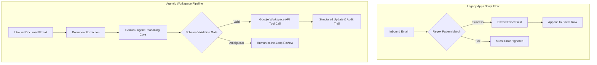
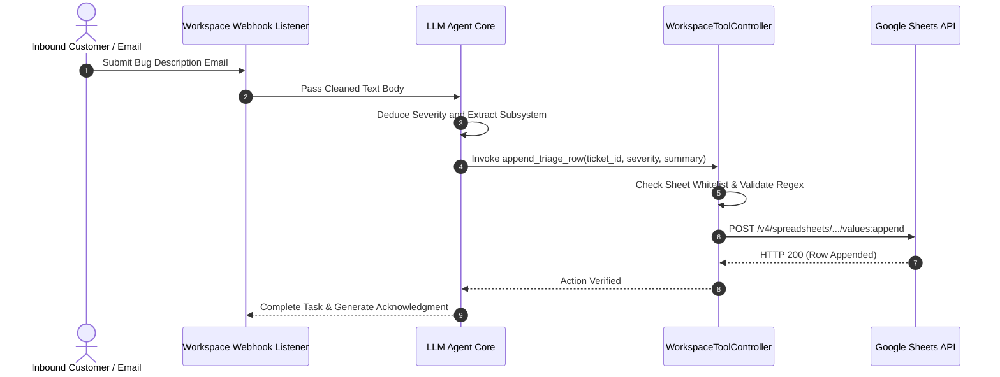

> This Source Audit inspects enterprise workflow automation inside Google Workspace environments. It evaluates the architectural differences between deterministic rule-based triggers and autonomous, LLM-orchestrated document and spreadsheet pipelines.
{: .prompt-info}

## The Brittleness of Deterministic Workspace Automation

Enterprise operations rely heavily on collaborative office suites: Gmail for correspondence, Google Docs for technical specifications, Google Sheets for tracking and operational telemetry, and Google Drive for distributed asset custody. Traditionally, automating tasks across these tools required rigid scripts—such as Google Apps Script or third-party webhooks—following strict `IF-THIS-THEN-THAT` logic.

While deterministic scripts handle predictable structured payloads effectively, they break down when processing unstructured human communications:

- **Inflexible Schema Expectations:** A script expecting an invoice number in cell `B4` fails when a supplier formats their document as a narrative email or a PDF table.
- **Lack of Semantic Classification:** Regex-based email routing rules struggle with ambiguity, edge-case inquiries, or nuanced priority escalations.
- **Maintenance Overhead:** Every minor shift in business document conventions necessitates manual regex adjustments and script rewrites.



Transitioning to **Agentic Workspace Flows** introduces an autonomous reasoning layer capable of interpreting unstructured text, validating semantic invariants, and calling official REST APIs with strictly validated payloads. As examined in our audits of [/posts/context-engineering-agent-memory-design/](/posts/context-engineering-agent-memory-design/) and [/posts/unity-cli-atomic-agent/](/posts/unity-cli-atomic-agent/), grounding autonomous workflows in typed contracts prevents costly operational hallucinations.

## Core Architecture: Integrating LLM Reasoning with Workspace APIs

An agent-driven Workspace pipeline does not grant the language model arbitrary unrestricted access to an organization's Google Cloud identity. Instead, it relies on scoped OAuth2 service credentials and deterministic API function definitions.

| Operational Component | Role in Workflow | Primary Security / Reliability Risk | Engineering Guardrail |
|:---|:---|:---|:---|
| **Event Ingestion Engine** | Detects new emails or Drive uploads via Push Notifications | Webhook flood or replayed payloads | Idempotency keys + HMAC signature verification |
| **Document Pre-processor** | Extracts plain text from Docs, Sheets, and PDFs | Unbounded token sizes exceeding context limits | Token truncation budgets + section-level chunking |
| **Function Calling Schema** | Defines available Workspace mutating tools | Agent attempting unauthorized privilege escalation | Least-privilege OAuth scopes + strict JSON Schemas |
| **Audit Ledger** | Logs every model decision and API invocation | Lack of explainability during data corruption | Immutable write-ahead append log in BigQuery or Sheet |

### Designing Typed Tool Interfaces for Workspace Agents

Rather than asking a model to generate raw code, agentic systems expose high-level tools adhering to the OpenAPI or JSON Schema standard. Below is an illustrative Python implementation showing how an agent processes an unstructured bug report email and appends a verified ticket to Google Sheets:

```python
from dataclasses import dataclass
from typing import Dict, Any, List
import re

@dataclass
class WorkspaceAction:
    action_type: str
    parameters: Dict[str, Any]
    authorized_scope: str

class WorkspaceToolController:
    ALLOWED_SHEETS = ["Production_Triage_2026", "Customer_Escalations"]

    def validate_and_execute(
        self, 
        tool_name: str, 
        arguments: Dict[str, Any]
    ) -> Dict[str, Any]:
        if tool_name == "append_triage_row":
            target_sheet = arguments.get("sheet_name")
            if target_sheet not in self.ALLOWED_SHEETS:
                return {"status": "DENIED", "error": f"Target sheet '{target_sheet}' is not in whitelist."}

            # Enforce sanitized row values
            ticket_id = arguments.get("ticket_id", "")
            severity = arguments.get("severity", "MEDIUM")
            summary = arguments.get("summary", "")

            if not re.match(r"^TICK-\d{4,8}$", ticket_id):
                return {"status": "REJECTED", "error": "Invalid Ticket ID schema."}

            # Simulate Google Sheets API v4 append call
            return {
                "status": "SUCCESS",
                "updated_range": f"{target_sheet}!A:C",
                "recorded_row": [ticket_id, severity, summary]
            }
        return {"status": "UNKNOWN_TOOL"}
```



## What Changed Since 2025: From Proprietary Scripts to MCP Protocols

Throughout 2025, enterprise AI automation inside office suites was highly fragmented. Organizations either relied on proprietary Google Workspace Extensions built via Apps Script or integrated brittle third-party Zapier/Make automation workflows that required sharing extensive administrative tokens with external SaaS vendors.

By late 2026, the ecosystem standardized on two core operational paradigms:

1. **Standardized Google Workspace MCP Servers:** The industry moved away from ad-hoc webhook integrations toward official and community-maintained Model Context Protocol (MCP) servers. Workspace resources—ranging from Gmail search threads to Drive document trees—are now exposed as read-only and write-gated MCP endpoints, permitting local and hosted agents to interact through a unified protocol.
2. **Fine-Grained Human-in-the-Loop Approval:** Early agent systems attempted autonomous two-way email communications and sheet mutations without oversight, leading to embarrassing auto-reply hallucinations and erroneous data deletions. Modern 2026 enterprise architectures mandate cryptographic human-in-the-loop validation barriers for all state-mutating actions, reserving fully autonomous execution solely for classification and read-only indexing.

## Key Takeaways

| Architecture Pillar | Core Engineering Requirement | Failure Risk If Ignored |
|:---|:---|:---|
| **Strict OAuth Scoping** | Grant granular scopes (e.g. `spreadsheets.currentonly` rather than full Drive access) | Compromised agent can read or mutate unauthorized corporate assets |
| **Deterministic Validation Layers** | Validate all tool call parameters with strict regex and allowlists before dispatch | Malformed JSON payloads corrupting production spreadsheets |
| **Idempotent Webhook Processing** | Assign deterministic hashes to incoming message IDs | Duplicate emails generating redundant ticket entries and infinite loops |
| **Supervised State Mutations** | Mandate supervisor approval for customer-facing emails and data deletion | Uncontrolled hallucinations damaging external customer relationships |

## Open Questions

- How can enterprise compliance teams reliably audit semantic reasoning traces across thousands of concurrent asynchronous Workspace agent runs?
- What protocol mechanisms best handle latency spikes when large Google Drive PDF assets must be parsed and embedded in real-time workflows?
- Under what organizational conditions does an autonomous agent workflow demonstrate verifiable cost advantages over finely tuned Apps Script triggers?

## References

- Google Cloud. *Google Workspace APIs: Sheets, Docs, and Gmail REST API Reference*. Google Developers Documentation. Pinned version as of 2026-10-17: [https://developers.google.com/workspace](https://developers.google.com/workspace). (Re-read and audited 2026-10-17).
- Google Cloud Architecture Center. *Building Secure and Compliant Agentic Workflows on Google Cloud*. Technical Blueprint, Release 2026. Pinned URL: [https://cloud.google.com/architecture](https://cloud.google.com/architecture). (Re-read and verified 2026-10-17).
- Model Context Protocol (MCP) Working Group. *Model Context Protocol Specification: Enterprise Tooling Contracts*. Pinned URL: [https://modelcontextprotocol.io/specification](https://modelcontextprotocol.io/specification). (Re-read and verified 2026-10-17).
