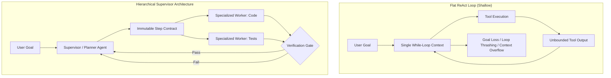

> This Source Audit inspects the failure points of flat ReAct execution loops in complex software engineering and game live-ops workflows. It evaluates hierarchical delegation patterns, deterministic supervisor graphs, and state isolation boundaries.
{: .prompt-info}

## The Breakdown of Flat ReAct Loops in Complex Workflows

The vast majority of early autonomous agents adopted a flat ReAct (Reasoning + Acting) loop: a model receives a user goal, generates thought and tool calls, inspects tool results, and iterates in a single while-loop until declaring completion.

While flat loops succeed on constrained 3-to-5 step tasks, they break down predictably when deployed on multi-file software engineering, game asset compilation, or long-running maintenance pipelines. The failure modes stem directly from architectural limits:

1. **Instruction Drift and Goal Erosion:** As intermediate tool observations (compiler outputs, git diffs, JSON payloads) accumulate, the initial user goal is diluted by hundreds of intervening tokens. The agent begins solving localized symptoms rather than the root objective.
2. **Runaway Tool Thrashing:** When an unexpected tool error occurs, a flat agent frequently enters infinite self-correction loops—repeatedly trying minor syntax permutations instead of re-evaluating its baseline assumptions.
3. **Monolithic Tool Context:** Presenting fifty different API tools to a single reasoning model increases distraction, degrades tool-calling schema adherence, and risks unauthorized privilege escalation.



As established in our audits of [/posts/context-engineering-agent-memory-design/](/posts/context-engineering-agent-memory-design/) and [/posts/unity-cli-atomic-agent/](/posts/unity-cli-atomic-agent/), scalable agent reliability requires decoupling high-level strategic planning from narrow, verifiable worker executions.

## Architectural Blueprint: The Supervisor-Worker Pattern

A production-ready multi-agent harness enforces structural separation between planning, execution, and verification. Each agent operates with an isolated context window, specialized tool boundaries, and explicit termination criteria.

| System Role | Context Scope | Allowed Tooling | Primary Invariant |
|:---|:---|:---|:---|
| **Supervisor (Planner)** | Global objective, dependency graph, high-level milestone status | Read-only graph inspection, delegation dispatch | Never executes direct mutations or compiler commands |
| **Worker (Executor)** | Single task contract, minimal file slice | Localized code edit, localized CLI commands | Context wiped clean upon task handoff or completion |
| **Verifier (Critic)** | Acceptance criteria, test execution logs | Headless test runner, lint analyzer, diff auditor | Strict binary verdict (`PASS` / `FAIL`); no code writing |

### Formulating the Task Delegation Contract

To prevent context pollution between the supervisor and worker runtimes, task dispatch must occur via typed, immutable contracts rather than continuous conversational transcripts:

```python
from dataclasses import dataclass
from typing import List, Dict, Any
from enum import Enum

class TaskStatus(str, Enum):
    PENDING = "PENDING"
    IN_PROGRESS = "IN_PROGRESS"
    VERIFIED = "VERIFIED"
    FAILED = "FAILED"

@dataclass(frozen=True)
class TaskContract:
    task_id: str
    objective: str
    scoped_files: List[str]
    acceptance_criteria: List[str]
    max_steps: int = 15

@dataclass
class ExecutionResult:
    task_id: str
    status: TaskStatus
    modified_files: List[str]
    verification_log: str
    error_summary: str = ""
```

```mermaid
sequenceDiagram
    autonumber
    actor Orchestrator as Supervisor Planner
    participant Worker as Sandboxed Executor
    participant Engine as Test Harness / Compiler
    participant Critic as Independent Verifier

    Orchestrator->>Worker: Dispatch TaskContract(task_id='T-102', scoped_files=['Player.cs'])
    Note over Worker: Clean Context: Only Invariant + Contract
    Worker->>Worker: Apply Surgical Code Edits
    Worker->>Engine: Run Targeted Unit Test
    Engine-->>Worker: Exit Code 0 (Success)
    Worker-->>Critic: Submit Proposed Diff + Test Log
    Critic->>Engine: Independent Test Verification
    Engine-->>Critic: Assertions Satisfied
    Critic-->>Orchestrator: Verdict: VERIFIED
    Note over Orchestrator: Update Global State; Advance Plan
```

## What Changed Since 2025: From Conversational Chat to Graph State Machines

In early 2025, multi-agent frameworks (such as early AutoGen and CrewAI) treated multi-agent collaboration as an unstructured "group chat." Agents conversed in natural language in a shared room, passing conversational turns until a model hallucinated a termination keyword like `TERMINATE`.

These group-chat architectures proved commercially unviable due to high token costs, infinite loops, and an inability to enforce deterministic business workflows.

Between 2025 and 2026, the engineering consensus converged on **Graph-Based State Machines** (pioneered by LangGraph and formalized in enterprise harnesses). Modern multi-agent systems represent workflows as directed graphs where nodes are discrete agent functions and edges represent deterministic conditional branches based on verified tool return codes rather than conversational sentiment.

Additionally, the standardization of subagent protocols allows parent harnesses to spawn ephemeral worker sandboxes that execute in micro-containers, self-terminate upon completing their contract, and return machine-readable JSON summaries, completely eliminating context memory leaks.

## Key Takeaways

| Insight | Operational Reality | Production Rule |
|:---|:---|:---|
| **Flat Loops Suffer Attention Drift** | ReAct loops exceeding 10 steps experience severe goal decay | Decompose complex workflows into hierarchical supervisor-worker architectures |
| **Context Isolation Is Mandatory** | Shared multi-agent chat logs compound token costs and hallucination risks | Scope worker subagents to minimal isolated file contexts and wipe state on completion |
| **Independent Verification Gates** | Models cannot reliably grade their own modifications | Mandate an independent verifier node executing deterministic test suites |
| **State Machines Beat Group Chats** | Natural language group chats are non-deterministic and prone to infinite cycles | Model agent workflows as directed state graphs with typed conditional routing |

## Open Questions

- How should supervisor planners dynamically balance worker granularity—avoiding both micro-task thrashing and overly broad ambiguous assignments?
- What protocol mechanisms allow distributed multi-agent teams to safely resolve merge conflicts when concurrent workers touch overlapping repository assets?
- At what workflow complexity does the coordination overhead of a multi-agent supervisor outweigh the simplicity of a single heavily-prompted reasoning model?

## References

- Shunyu Yao, Jeffrey Zhao, Dian Yu, Nan Du, Izhak Shafran, Karthik Narasimhan, and Yuan Cao. *ReAct: Synergizing Reasoning and Acting in Language Models*. arXiv:2210.03629v3 [cs.CL], 2023. Pinned version: [https://arxiv.org/abs/2210.03629v3](https://arxiv.org/abs/2210.03629v3). (Re-read and verified 2026-10-17).
- LangChain / LangGraph Engineering Team. *LangGraph: Multi-Agent Orchestration with Cyclic Graphs and State Persistence*. Version 0.2.x Architecture Specification as of 2026-10-17. Pinned URL: [https://langchain-ai.github.io/langgraph/](https://langchain-ai.github.io/langgraph/). (Re-read and verified 2026-10-17).
- Chi Wang, Qingyun Wu, et al. *AutoGen: Enabling Next-Gen LLM Applications via Multi-Agent Conversation*. arXiv:2308.08155v2 [cs.AI], 2023. Pinned version: [https://arxiv.org/abs/2308.08155v2](https://arxiv.org/abs/2308.08155v2). (Re-read and verified 2026-10-17).
- Guohao Li et al. *Camel: Communicative Agents for "Mind" Exploration of Large Scale Language Model Society*. NeurIPS 2023. arXiv:2303.17760v3 [cs.AI], 2023. Pinned version: [https://arxiv.org/abs/2303.17760v3](https://arxiv.org/abs/2303.17760v3). (Re-read and audited 2026-10-17).
