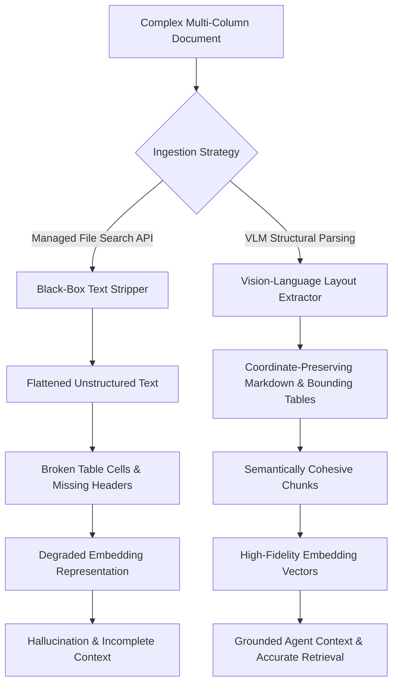

## Does Vision-Language Document Parsing Beat Managed File Search APIs?

When managed retrieval systems like Google Gemini File Search API package parsing, chunking, and vector storage into a single hosted pipeline, teams often assume document extraction is a solved commodity. Managed search tools ingest complex file types such as PDF, DOCX, and XLSX with minimal initial configuration. However, evaluating enterprise document retrieval on semi-structured reports, nested financial sheets, and irregular multi-column layouts exposes a critical engineering tension: hosted black-box parsers discard essential visual topologies that downstream retrieval-augmented generation (RAG) models rely upon to generate grounded answers.

Document parsing is not merely a string-extraction preprocessing stage; it is the semantic foundation of the entire RAG topology. When text extraction flattens bounding boxes, omits table headers across pagination boundaries, or drops diagrammatic associations, the resulting text chunks corrupt embedding representations. Specialized Vision-Language Model (VLM) parsing engines, such as STORM Parse, MinerU, and ColPali, preserve spatial layout coordinates, structural hierarchies, and tabular relations before feeding text into vector indices.



Examining the mechanics of VLM parsing against managed file search infrastructure reveals why layout preservation produces substantial gains in retrieval precision, and where managed pipelines remain advantageous for low-complexity corporate corpora.

## Architectural Trade-Offs: Managed Black-Box Retrieval vs Specialized Layout Extraction

Managed document search APIs optimize for developer simplicity and low indexing cost. The service ingests raw binary documents, applies rule-based or optical character recognition (OCR) extraction internally, chunks the extracted text, and writes dense vector embeddings directly into a proprietary search index. The developer receives a query endpoint rather than intermediate structured representations.

While convenient, this managed workflow hides the extraction failures that directly degrade retrieval performance:

1. **Table Integrity and Coordinate Loss**: Standard text extractors linearize tabular data row-by-row or column-by-column without markdown delimiter guarantees. When a complex balance sheet spans multiple pages, column headers are severed from their numeric values, leaving retrieved chunks devoid of semantic context.
2. **Multi-Column Reading Order Scrambling**: OCR heuristics routinely read across adjacent columns in magazines, academic papers, and SEC filings. Sentences from column A merge with sentences from column B, producing nonsensical embeddings that mislead vector similarity search.
3. **Diagram and Infographic Omission**: Embedded graphics, architecture flowcharts, and flow arrows contain vital procedural logic. Managed APIs ignore graphical vectors or treat diagrams as unparsed white space.

Specialized VLM parsers address these structural vulnerabilities by framing document parsing as a visual scene understanding task. Rather than piping raw OCR characters into text streams, vision encoders process document images at native resolution, predicting markdown schemas, cell coordinates, and semantic bounding zones simultaneously.

| Dimension | Managed Document Search API (e.g. Gemini File Search) | Specialized VLM Parser (e.g. STORM Parse, MinerU) |
| :--- | :--- | :--- |
| **Pipeline Visibility** | Opaque black-box; inputs document, returns search hits | Fully transparent; outputs validated Markdown, JSON AST, and bounding boxes |
| **Tabular Preservation** | Linearized text strings; frequent cross-cell fragmentation | Markdown tables with explicit column headers duplicated across page splits |
| **Multi-Column Handling** | Rule-based heuristics; prone to reading-order collisions | Visual attention maps determine actual reading flow accurately |
| **Visual Ingestion** | Strips non-text charts; diagrams treated as empty space | Extracts chart summaries or transcribes flow diagrams into structured text |
| **Infrastructure Cost** | Low upfront API cost ($0.15 / 1M tokens), zero compute management | Higher compute cost (GPU inference required for vision encoders) |
| **Storage Flexibility** | Vendor lock-in; embeddings and indices live in provider cloud | Fully portable; text and embeddings can be indexed in local or enterprise vector stores |

Teams designing agentic memory and tool ecosystems—such as those operating [/posts/superlog-agentic-telemetry/](/posts/superlog-agentic-telemetry/) or building modular context engines in [/posts/context-engineering-agent-memory-design/](/posts/context-engineering-agent-memory-design/)—require deterministic chunk schemas. When an agent requests a financial figure, receiving a cleanly formatted Markdown table with pinned headers eliminates the prompt overhead required to correct hallucinated tabular data.

## Why Visual Attention Resolves Cascading Retrieval Failures

In a standard dense retrieval pipeline, retrieval quality degrades non-linearly when document layout is compromised. Consider a dual-column report discussing quarterly performance. When an OCR engine reads across the page margin, text chunks contain fractured assertions:

```text
// Corrupted Chunk from Linearized OCR
Operating margins expanded by 4.2% while server hardware depreciation
accelerated in North America due to supply constraints, our cloud segment
reported operating revenue of $14.2B, a decrease of 1.1% year-over-year.
```

The resulting 1536-dimensional embedding vector maps between cloud revenue declines and hardware depreciation margins. When an LLM agent queries for "North American cloud revenue growth", the retrieval engine assigns a mediocre cosine similarity score to this chunk because its semantic center has been diluted by hardware commentary.

By contrast, an attention-driven VLM segmentation model processes document geometry prior to tokenization. The vision backbone identifies bounding boxes for headings, text bodies, sidebars, and captions:

```json
{
  "page_index": 1,
  "elements": [
    {
      "type": "section_header",
      "text": "Cloud Infrastructure Performance",
      "bbox": [72.0, 104.5, 340.0, 128.0]
    },
    {
      "type": "table",
      "headers": ["Segment", "Q3 Revenue", "YoY Growth"],
      "rows": [
        ["Cloud Segment", "$14.2B", "-1.1%"],
        ["Hardware Operations", "$8.4B", "+4.2%"]
      ],
      "bbox": [72.0, 140.0, 520.0, 290.0]
    }
  ]
}
```

By converting layout regions into semantic JSON ASTs or markdown tables before chunking, the chunk boundary aligns with the actual information structure. The table is preserved intact, and vector similarity scores reflect pure, unpolluted domain semantics.

## What Changed Since 2024: The Rise of ColPali and Vision Document Representation

Between 2024 and 2026, the document ingestion landscape underwent a paradigm shift. In early 2024, production RAG relied primarily on OCR libraries like Tesseract or closed-source document cloud APIs, followed by naive character-length chunking. The introduction of Vision-Language Models fine-tuned for layout extraction (such as Donut and Nougat) proved that visual context prevented text corruption, but their inference speeds made high-throughput enterprise batching economically prohibitive.

The breakthrough arrived in late 2024 and solidified throughout 2025 and 2026 with models like **ColPali** and specialized document extraction models like **MinerU**. ColPali eliminates the traditional OCR-then-embed pipeline entirely by computing multi-vector representations directly from page image patch embeddings, utilizing the late-interaction scoring mechanism pioneered by ColBERT.

Rather than transcribing words and discarding typography, modern multi-modal document retrieval models score the query tokens against the image patches themselves. Fonts, bold headings, table borders, and diagram legends are directly encoded into the visual token representations. For workflows that still require explicit text extraction, VLM parsers have dropped token generation costs through quantization and specialized distillation, allowing teams to run local document conversion pipelines at a fraction of the 2024 cost profile.

## Key Takeaways

- **Document parsing dictates the upper bound of RAG precision**: Downstream re-ranking, embedding models, and generative LLMs cannot recover factual details, table relationships, or diagrammatic logic discarded during extraction.
- **Managed search APIs excel at convenience but risk structural corruption**: Hosted file search tools provide zero-configuration indexing, but their black-box extraction frequently fragments multi-page tables, scrambles multi-column text, and omits visual charts.
- **VLM-based extraction preserves critical semantic topology**: By treating document pages as visual scenes, vision-language parsers maintain reading orders, nested hierarchies, and tabular structures as machine-readable Markdown or JSON ASTs.
- **Modern retrieval incorporates visual features directly**: The shift toward multi-vector visual retrieval models like ColPali demonstrates that indexing visual representations directly outperforms text-only OCR pipelines for complex documents.

## Open Questions

- What is the latency and economic tipping point where running local VLM parsing clusters (e.g. 8B parameter vision backbones) becomes cheaper than paying managed API indexing fees on million-page corpora?
- How will agentic multi-modal retrieval handle dynamic digital documents—such as reactive SVG dashboards, interactive spreadsheets, and embedded audio clips—without requiring separate dedicated parsers?
- Will multi-vector visual retrieval completely displace textual chunking for standard business documents, or will hybrid architectures combining VLM-generated Markdown with dense text embeddings remain the production standard?

## References

- Faysse, M., et al. (2024). *ColPali: Efficient Document Retrieval with Vision Language Models*. arXiv:2407.01449v2. Retrieved on 2026-10-17 from https://arxiv.org/abs/2407.01449
- Google Cloud. (2025). *Gemini File Search Tool Documentation and API Specification*. Official Release Note. Retrieved on 2026-10-17 from https://cloud.google.com/vertex-ai/generative-ai/docs/multimodal/document-understanding
- OpenDataLab. (2024). *MinerU: A High-Quality Tool for Parsing Multi-Format Documents into Markdown*. GitHub Repository tag v0.8.0. Retrieved on 2026-10-17 from https://github.com/opendatalab/MinerU
- Khattab, O., & Zaharia, M. (2020). *ColBERT: Efficient and Effective Passage Search via Contextualized Late Interaction over BERT*. ACM SIGIR. Retrieved on 2026-10-17 from https://arxiv.org/abs/2004.12832
