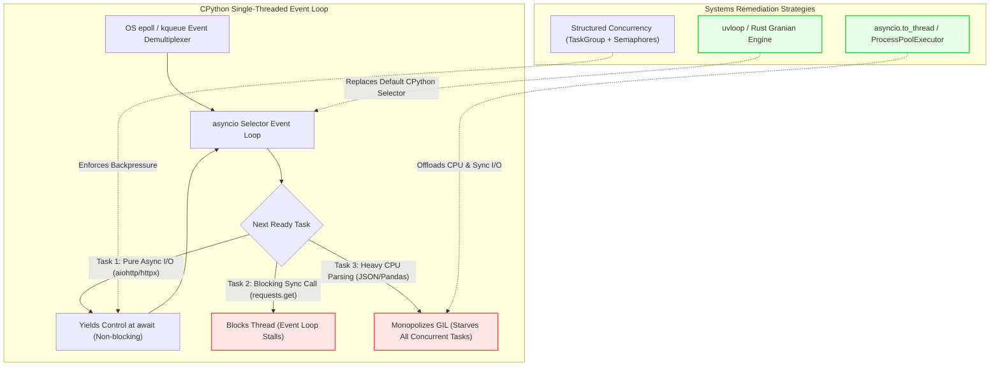

## Why Do Naive AsyncIO Implementations Underperform Synchronous Pipelines?

A common failure mode in Python backend engineering is treating asynchronous programming (`asyncio`) as an automatic acceleration switch. Engineering teams frequently refactor synchronous request handlers, microservices, and AI data loaders into `async/await` syntax, anticipating multi-fold latency reductions. Instead, production benchmarks often reveal degraded throughput, higher P99 tail latencies, and elevated CPU utilization compared to simple threaded or synchronous equivalents.

This paradox stems from a fundamental misunderstanding of the CPython execution runtime. In standard synchronous programming, the operating system kernel manages thread preemption, balancing hardware CPU cores against blocking network sockets. In contrast, Python's `asyncio` is single-threaded cooperative multitasking. The event loop relies entirely on individual coroutines voluntarily yielding execution control via `await`.

When developers introduce sequential awaits, execute CPU-bound cryptographic or serialization routines within the main thread, or mix synchronous I/O libraries (such as `requests` or `psycopg2`) into coroutine functions, the single-threaded event loop becomes starved. Rather than overlapping latency, the runtime incurs coroutine context-switching overhead on top of serialized execution.



## Deconstructing the Four Critical Bottlenecks of Async Python

Systematically eliminating async performance regressions requires profiling the interaction between user-space coroutines, the CPython Global Interpreter Lock (GIL), and OS kernel primitives.

### 1. Event Loop Starvation and Inadvertent Synchronous I/O

The core invariant of asynchronous I/O is that no operation may execute synchronously for longer than a few milliseconds. If a single coroutine invokes a blocking function—such as writing to a local disk file with standard `open()`, querying a database with a non-async driver, or making an HTTP call via `requests`—the entire event loop freezes.

During this freeze:
- All other in-flight network connections cannot process incoming packets.
- TCP keep-alive timers expire, triggering connection resets.
- Heartbeat probes (such as Kubernetes liveness checks) fail, causing container orchestrators to terminate healthy pods, as observed in [cloud infrastructure and Kubernetes deployments](/posts/what-is-kubernetes/).

To maintain loop responsiveness, blocking operations must be explicitly routed outside the event loop thread using thread or process pools:

```python
# ❌ INCORRECT: Freezes the entire event loop for 200ms
response = requests.get("https://api.internal/data")

# ✅ CORRECT: Offloads blocking I/O to a background worker thread
response = await asyncio.to_thread(requests.get, "https://api.internal/data")
```

### 2. CPU-Bound Tasks and Global Interpreter Lock (GIL) Contention

Python coroutines run within a single OS thread. Consequently, compute-intensive tasks—such as computing embedding distance matrices, tokenizing text chunks, or decompressing massive JSON payloads—monopolize the CPU.

Because CPython enforces the Global Interpreter Lock (GIL), even running CPU-bound functions inside `asyncio.to_thread()` (which uses Python OS threads) can degrade throughput: worker threads contend for the single interpreter lock, causing thread thrashing and increasing CPU cache invalidation.

For CPU-intensive computations in AI data pipelines, work must be dispatched across separate memory spaces via `concurrent.futures.ProcessPoolExecutor` or dedicated Ray / C-extension workers, as analyzed in [modern open-source data engineering architectures](/posts/explore-the-landscape-of-open-source-data-engineering/).

```mermaid
sequenceDiagram
    autonumber
    participant Client as 100 Concurrent Clients
    participant Loop as asyncio Event Loop (Thread 1)
    participant ThreadPool as ThreadPoolExecutor (Thread 2..N)
    participant ProcessPool as ProcessPoolExecutor (Cores 1..M)

    Client->>Loop: Stream Concurrent Requests
    Loop->>Loop: Handle Async Non-blocking I/O
    alt Blocking Network Call
        Loop->>ThreadPool: asyncio.to_thread(sync_func)
        ThreadPool-->>Loop: Return Result via Event Loop Callback
    else Heavy CPU / Tensor Math
        Loop->>ProcessPool: loop.run_in_executor(cpu_heavy_task)
        ProcessPool-->>Loop: Inter-Process IPC Result (Bypasses GIL)
    end
    Loop-->>Client: Low-Latency Stream Responses
```

### 3. Sequential Awaits vs Unbounded Concurrency

A common developer mistake is creating "fake" asynchronous workflows by chaining sequential awaits:

```python
# ❌ Anti-pattern: Sequential awaits negate concurrency benefits
async def process_user_batch(user_ids: list):
    results = []
    for uid in user_ids:
        # Each query takes 50ms; 100 users = 5,000ms total latency!
        res = await fetch_user_record(uid)
        results.append(res)
    return results
```

The naive fix is wrapping all coroutines into `asyncio.gather(*tasks)`. However, unconstrained concurrency creates an equally severe failure mode: **resource exhaustion**. If `user_ids` contains 10,000 items, `asyncio.gather()` immediately instantiates 10,000 coroutines, opening 10,000 concurrent database connections or file descriptors. This saturates the OS socket buffer, triggers database connection pool exhaustion, and leads to cascading service timeouts.

Production architectures require **structured concurrency with backpressure**, using bounded concurrency primitives like `asyncio.Semaphore` or `asyncio.Queue`.

### 4. Memory Allocations and Coroutine Object Overhead

Every invocation of an `async def` function instantiates a coroutine object on the Python heap, encapsulating the frame object, local variable pointers, and future state. When an application spawns hundreds of thousands of fine-grained coroutines per second, Python's memory allocator (`PyMalloc`) and garbage collector incur significant overhead.

When sub-millisecond execution is required, using synchronous batching or compiled C extensions (such as Cython, PyO3 Rust extensions, or uvloop) eliminates coroutine frame allocation penalties.

## How Async Python Evolved Across 2026

Throughout 2026, the Python asynchronous ecosystem underwent profound architectural transformations:

1. **Adoption of Free-Threaded CPython (PEP 703)**: With the stabilization of free-threaded Python (no-GIL build) in Python 3.13 and 3.14, multi-threaded event loop models became viable. Instead of running multiple OS processes managed by Gunicorn, high-throughput ASGI servers run multi-threaded event loops sharing a unified memory heap without GIL lock contention.
2. **Transition from `asyncio.gather` to `asyncio.TaskGroup`**: Python 3.11+ structured concurrency via `asyncio.TaskGroup` became the mandatory enterprise standard. Task groups guarantee that if any sub-task raises an unhandled exception, sibling tasks are canceled immediately, preventing orphaned background tasks from leaking memory and network connections.
3. **Rust-Powered Event Loops and Runtimes**: Production AI microservices transitioned from standard CPython `asyncio` selectors to Rust-native web runtimes like **Granian** (powered by Tokio and Hyper) and **uvloop** (libuv). These engines handle TCP demultiplexing, HTTP parsing, and SSL handshakes directly in native Rust/C code, reducing event loop CPU overhead by up to 60%.
4. **Integration with Distributed Microservices**: High-performance backend architectures standardized on asynchronous RPC protocols (such as gRPC over HTTP/2 and Apache Arrow Flight) rather than high-overhead JSON REST payloads, establishing clean microservice seams as outlined in [modern microservice architectural styles](/posts/microservices-popular-architectural-style/).

## Implementation: Production-Grade Async Pipeline with Backpressure

The following Python module demonstrates production-ready asynchronous execution: pairing Python 3.11+ `asyncio.TaskGroup` with strict semaphore backpressure, error handling, and thread-pool offloading:

```python
"""
resilient_async_pipeline.py - Production-grade asynchronous processing engine.
Demonstrates structured concurrency, bounded semaphores, and CPU offloading.
"""

import asyncio
import time
from typing import List, Dict, Any


async def fetch_remote_resource(resource_id: str, semaphore: asyncio.Semaphore) -> Dict[str, Any]:
    """
    Simulates an asynchronous I/O-bound network call protected by a concurrency semaphore.
    """
    async with semaphore:
        # Simulate network latency (50ms - 100ms)
        await asyncio.sleep(0.05)
        return {
            "resource_id": resource_id,
            "status": "success",
            "timestamp": time.time()
        }


def cpu_intensive_hashing(payload: str) -> str:
    """
    Simulates a CPU-heavy cryptographic or serialization routine that must NOT block the event loop.
    """
    # CPU work executed outside event loop
    h = 0
    for char in payload * 1000:
        h = (h * 31 + ord(char)) & 0xFFFFFFFF
    return f"{h:08x}"


async def process_batch_with_structured_concurrency(
    resource_ids: List[str],
    max_concurrent_io: int = 10
) -> List[Dict[str, Any]]:
    """
    Processes resources using structured concurrency (TaskGroup) and bounded backpressure.
    """
    semaphore = asyncio.Semaphore(max_concurrent_io)
    results = []

    # Structured concurrency: TaskGroup guarantees cleanup if any task fails
    async with asyncio.TaskGroup() as tg:
        tasks = [
            tg.create_task(fetch_remote_resource(rid, semaphore))
            for rid in resource_ids
        ]

    # Collect completed results
    raw_results = [task.result() for task in tasks]

    # Offload CPU-bound post-processing using asyncio.to_thread
    for item in raw_results:
        # Prevents GIL monopolization during heavy parsing
        computed_hash = await asyncio.to_thread(
            cpu_intensive_hashing, item["resource_id"]
        )
        item["hash"] = computed_hash
        results.append(item)

    return results


async def main():
    test_ids = [f"res_{idx:04d}" for idx in range(50)]
    start_time = time.perf_counter()

    processed_data = await process_batch_with_structured_concurrency(
        test_ids, max_concurrent_io=15
    )

    elapsed = time.perf_counter() - start_time
    print(f"Processed {len(processed_data)} items in {elapsed:.3f} seconds.")
    print(f"Sample output: {processed_data[0]}")


if __name__ == "__main__":
    asyncio.run(main())
```

Adopting structured task groups and concurrency limiters ensures that high-volume asynchronous systems remain stable under heavy load without degrading event loop responsiveness.

## Key Takeaways

- **Async Is Cooperative, Not Preemptive**: Coroutines yield control only at `await` points. Any synchronous I/O or heavy computation blocks the entire event loop for all concurrent connections.
- **Sequential Awaits Eliminate Concurrency**: Chaining `await` statements inside loops turns asynchronous code into serialized execution with added coroutine overhead.
- **Unbounded Concurrency Triggers Cascading Failures**: Naively wrapping thousands of tasks in `asyncio.gather()` exhausts memory and socket pools. Always enforce backpressure via `asyncio.Semaphore`.
- **Structured Concurrency Prevents Leaks**: Python 3.11+ `asyncio.TaskGroup` ensures exception propagation and guarantees cancellation of orphaned child tasks.
- **Free-Threading and Native Engines Reshape 2026**: Modern production architectures combine no-GIL Python with Rust-based ASGI runtimes (Granian/uvloop) to achieve multi-core hardware scaling.

## New Questions

- How do free-threaded Python (PEP 703) lock-free reference counting mechanisms impact coroutine allocation overhead compared to standard CPython?
- What are the architectural trade-offs between kernel-level `io_uring` implementations and userspace event loops like Tokio in high-frequency trading microservices?
- How should backpressure semaphores be dynamically calibrated at runtime based on downstream database latency feedback?
- Under what workload characteristics does IPC overhead in `ProcessPoolExecutor` negate the throughput gains of bypassing the GIL?

## References

- EdgeDB Team. (2024). *uvloop: Fast asyncio Event Loop in Cython and libuv*. GitHub Repository. URL: [https://github.com/MagicStack/uvloop](https://github.com/MagicStack/uvloop) (accessed 2026-10-18).
- Gross, S. (2023). *PEP 703 – Making the Global Interpreter Lock Optional in CPython*. Python Enhancement Proposals. URL: [https://peps.python.org/pep-0703/](https://peps.python.org/pep-0703/) (accessed 2026-10-18).
- Python Software Foundation. (2024). *asyncio — Asynchronous I/O*. Python 3.12/3.13 Documentation. URL: [https://docs.python.org/3/library/asyncio.html](https://docs.python.org/3/library/asyncio.html) (accessed 2026-10-18).
- van Rossum, G. (2014). *PEP 3156 – Asynchronous IO Support Rebooted: asyncio*. Python Enhancement Proposals. URL: [https://peps.python.org/pep-3156/](https://peps.python.org/pep-3156/) (accessed 2026-10-18).
