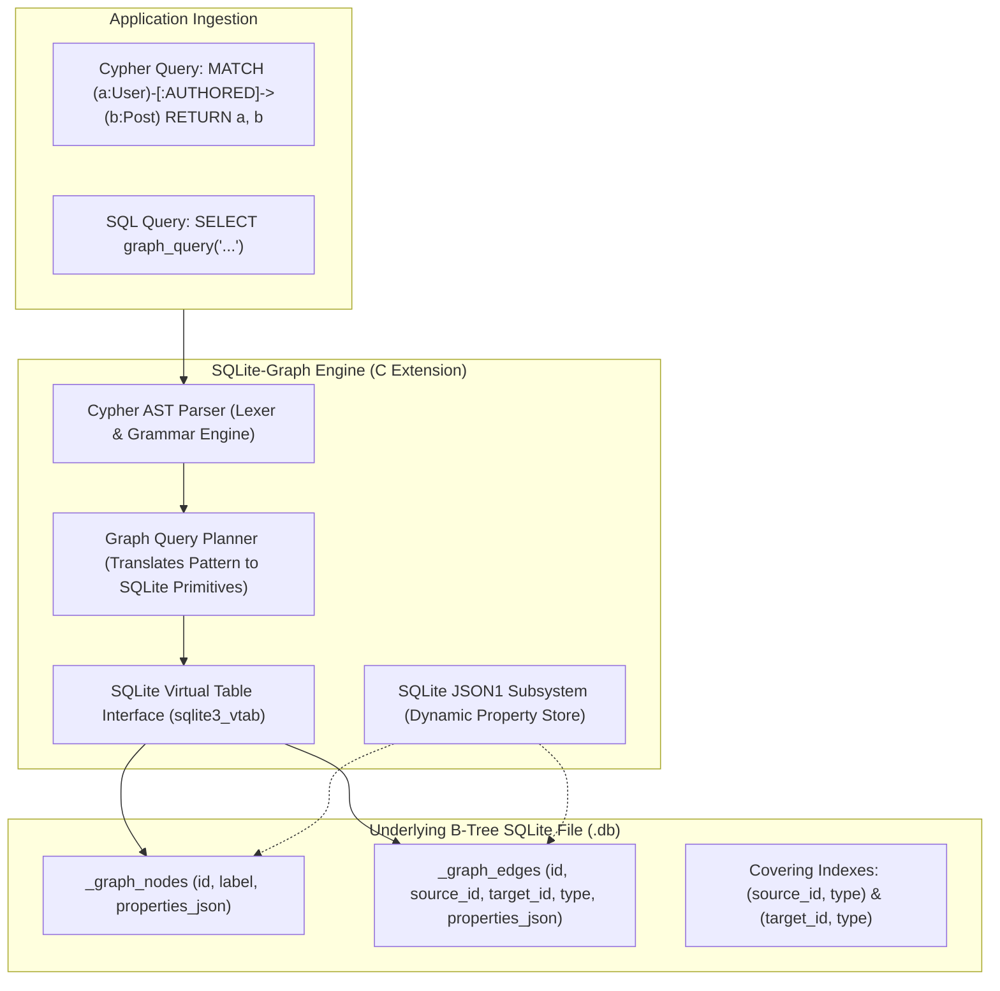
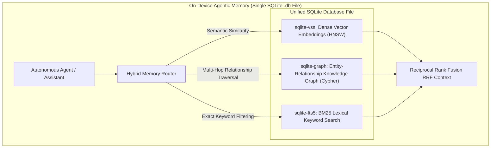

## Why Did Relational SQL Engines Struggle with Multi-Hop Graph Traversals?

Relational database management systems (RDBMS) were architected around Edgar F. Codd’s relational algebra: data is organized into rectangular tables of tuples, and relationships are modeled indirectly through primary-foreign key pairings. While this structure guarantees schema rigidity and ACID transactional guarantees, it exhibits severe computational inefficiencies when querying deeply interconnected networks.

In graph-heavy domains—such as fraud ring detection, social relationship mapping, and Graph-Augmented Generation (Graph RAG)—the primary workload consists of traversing paths across entities ($A \to B \to C \to D$). In standard SQL, querying paths beyond two hops requires cascading `JOIN` operations:

```sql
-- Querying a 3-hop relationship in standard SQL
SELECT fof.name, fof.id
FROM Person p
JOIN Friends e1 ON p.id = e1.source_id
JOIN Person f1 ON e1.target_id = f1.id
JOIN Friends e2 ON f1.id = e2.source_id
JOIN Person f2 ON e2.target_id = f2.id
JOIN Friends e3 ON f2.id = e3.source_id
JOIN Person fof ON e3.target_id = fof.id
WHERE p.name = 'Alice';
```



```mermaid
flowchart TD
    subgraph RelationalJoinDegradation["Relational Cascading JOINs (Quadratic Explosion)"]
        T1["Person Table"] -->|Scan & Hash Join| J1["Friends Junction Table"]
        J1 -->|Index Lookup| T2["Person Table (Hop 1)"]
        T2 -->|Scan & Hash Join| J2["Friends Junction Table"]
        J2 -->|Index Lookup| T3["Person Table (Hop 2)"]
        T3 -->|Scan & Hash Join| J3["Friends Junction Table"]
        J3 -->|Final Filter| T4["Person Table (Hop 3)"]
    end

    subgraph CypherPatternMatching["Cypher Graph Traversal (Index-Free Adjacency / Pointer Chasing)"]
        Pattern["MATCH (p:Person {name: 'Alice'})-[:FRIENDS*3]->(fof:Person)"]
        Pattern --> GraphEngine["Graph Traversal Engine"]
        GraphEngine --> Nodes["Direct Node Pointer Traversal: O(k * degree)"]
    end
```

Every additional hop in SQL requires scanning B-tree indexes, materializing intermediate Cartesian joins, and filtering results. As the hop depth $k$ increases, query planning becomes intractable, and recursive Common Table Expressions (`WITH RECURSIVE`) become unreadable and notoriously difficult to optimize.

Conversely, dedicated graph databases (like Neo4j) popularized **Cypher**, an intuitive declarative query language using ASCII-art pattern matching:

```cypher
MATCH (p:Person {name: 'Alice'})-[:FRIENDS*3]->(fof:Person)
RETURN fof.name, fof.id
```

However, deploying standalone graph servers introduces heavy operational overhead: high memory footprints (often requiring gigabytes of dedicated JVM heap), complex cluster maintenance, and separate network round-trips. This created a demand for an embedded, zero-maintenance solution: **SQLite-Graph**.

---

## Architectural Breakdown: How SQLite-Graph Extends SQLite

SQLite is the most widely deployed database engine on earth, celebrated for its single-file storage format, zero-configuration architecture, and in-process execution speed. **SQLite-Graph** is an open-source C extension that bridges SQLite with property graph data models and Cypher query execution.



### 1. The Relational Schema Mapping

To maintain 100% compatibility with standard SQLite tooling and backup mechanisms, SQLite-Graph stores graph entities inside structured relational tables:

- **`_graph_nodes`**: Stores unique node identifiers, entity labels, and flexible attribute payloads:
  ```sql
  CREATE TABLE _graph_nodes (
      id INTEGER PRIMARY KEY AUTOINCREMENT,
      label TEXT NOT NULL,
      properties TEXT, -- Stored as compact JSONB / JSON1 text
      created_at TIMESTAMP DEFAULT CURRENT_TIMESTAMP
  );
  CREATE INDEX idx_graph_nodes_label ON _graph_nodes(label);
  ```
- **`_graph_edges`**: Stores directed relationships between entities, including relationship types and edge attributes:
  ```sql
  CREATE TABLE _graph_edges (
      id INTEGER PRIMARY KEY AUTOINCREMENT,
      source_id INTEGER NOT NULL REFERENCES _graph_nodes(id) ON DELETE CASCADE,
      target_id INTEGER NOT NULL REFERENCES _graph_nodes(id) ON DELETE CASCADE,
      type TEXT NOT NULL,
      properties TEXT,
      created_at TIMESTAMP DEFAULT CURRENT_TIMESTAMP
  );
  CREATE INDEX idx_graph_edges_forward ON _graph_edges(source_id, type, target_id);
  CREATE INDEX idx_graph_edges_reverse ON _graph_edges(target_id, type, source_id);
  ```

By maintaining covering composite indexes on both forward `(source_id, type, target_id)` and reverse `(target_id, type, source_id)` paths, the engine accelerates edge traversal, mimicking index-free adjacency while preserving relational ACID safety.

### 2. Cypher-to-SQL Compilation and Virtual Tables

When an application invokes `cypher('MATCH (u:User)-[:LIKES]->(p:Product) WHERE u.age > 25 RETURN p.title')`, SQLite-Graph executes a multi-stage compilation pipeline:
1. **Lexical Analysis & AST Construction**: The Cypher statement is parsed into an abstract syntax tree representing matched nodes, relationship directions, and filtering predicates.
2. **Virtual Table Lowering (`sqlite3_vtab`)**: The extension implements SQLite's virtual table interface, converting the Cypher AST into optimized index lookups against `_graph_nodes` and `_graph_edges`.
3. **JSON1 Predicate Pushdown**: Property filters (e.g., `WHERE u.age > 25`) are translated into native SQLite `json_extract(properties, '$.age') > 25` expressions, evaluating filters directly in the C layer before materializing tuples into application memory.

{: .light .w-75 .shadow .rounded-10 w='800' h='600' }

---

## Python Integration: Constructing an Embedded Knowledge Graph

The following implementation demonstrates how developers interact with SQLite-Graph from Python, loading the extension and executing Cypher pattern queries:

```python
import sqlite3
import json

def initialize_graph_database(db_path: str = ":memory:") -> sqlite3.Connection:
    conn = sqlite3.connect(db_path)
    conn.enable_load_extension(True)
    
    # Load compiled SQLite-Graph dynamic library
    conn.load_extension("./sqlite_graph")
    
    # Initialize graph catalog schema
    conn.execute("SELECT graph_init();")
    return conn

# 1. Populate Nodes and Edges via Cypher
def populate_knowledge_graph(conn: sqlite3.Connection):
    cypher_script = """
    CREATE (a:Paper {title: 'GNN-RAG', year: 2024, category: 'AI'})
    CREATE (b:Topic {name: 'Knowledge Graphs'})
    CREATE (c:Topic {name: 'Retrieval Augmented Generation'})
    CREATE (a)-[:ADDRESSES]->(b)
    CREATE (a)-[:ADDRESSES]->(c)
    """
    conn.execute("SELECT cypher(?);", (cypher_script,))
    conn.commit()

# 2. Execute Multi-Hop Pattern Matching
def query_related_topics(conn: sqlite3.Connection, paper_title: str):
    query = """
    MATCH (p:Paper {title: $title})-[:ADDRESSES]->(t:Topic)
    RETURN t.name AS topic_name
    """
    cursor = conn.cursor()
    # Execute parameterized Cypher query through virtual table
    results = cursor.execute(
        "SELECT * FROM cypher(?, ?);",
        (query, json.dumps({"title": paper_title}))
    ).fetchall()
    
    return [row[0] for row in results]

# Example execution
if __name__ == "__main__":
    conn = initialize_graph_database()
    populate_knowledge_graph(conn)
    topics = query_related_topics(conn, "GNN-RAG")
    print(f"Extracted Topics: {topics}")
```

---

## Architectural Comparison: Embedded vs. Enterprise Graph Engines

| Dimension | Native SQLite (`WITH RECURSIVE`) | SQLite-Graph (Extension) | Kùzu / DuckPGQ (Columnar Graph) | Neo4j (Standalone Server) |
| :--- | :--- | :--- | :--- | :--- |
| **Primary Paradigm** | Relational SQL Tables | Relational Tables + Cypher VTab | Columnar Storage + Cypher | Native Index-Free Adjacency Graph |
| **Query Interface** | Standard SQL CTEs | Declarative Cypher & SQL Functions | Declarative Cypher / ISO GQL | Declarative Cypher |
| **Deployment Model** | In-process embedded (C library) | In-process embedded (SQLite file) | In-process embedded (Single file) | Client-Server / Cluster daemon |
| **Memory Footprint** | Extremely low (< 5 MB) | Extremely low (< 10 MB) | Low to moderate (Tens of MB) | High (Gigabytes of JVM heap) |
| **Analytical Scan Speed** | Slow on multi-hop joins | Moderate (B-tree bounded) | Very Fast (Vectorized Columnar) | Moderate to Fast |
| **ACID Transaction Support** | Full Serialized / WAL ACID | Full SQLite ACID compliant | Full ACID compliant | Full ACID compliant |
| **Ecosystem Integration** | Native mobile/edge/desktop | Ubiquitous SQLite tooling | Python / DuckDB ecosystem | Dedicated enterprise connectors |

---

## Why Embedded Graphs Are Essential for 2026 Agentic Memory and Graph RAG

In 2024, retrieval-augmented generation predominantly relied on dense vector databases, as audited in our [vector database evaluation](/posts/choice-vector-database-for-llm/). However, vector similarity alone fails at multi-hop associative reasoning. To answer queries like *"Which papers authored by researchers at Lab X cite the dataset used in Model Y?"*, systems must traverse structured relationships.

As demonstrated in our audit of [GNN-RAG](/posts/gnn-rag-paper/), combining relational graph structures with dense embeddings dramatically improves reasoning precision. In 2026 production systems, SQLite-Graph fills a critical architectural niche:



1. **Zero-Infrastructure Local Agent Memory**: Edge AI agents and local developer assistants cannot spin up external Neo4j instances on user laptops. By bundling SQLite-Graph directly into SQLite, agents gain persistent, queryable entity memory stored inside a single `.db` file, directly aligning with stateful agent workflows analyzed in our [agent orchestration review](/posts/llm-cource-with-langchain-and-agent/).
2. **Hybrid Triple Indexing (Vector + Graph + Full-Text)**: A single SQLite database can load `sqlite-vss` (dense vectors), `sqlite-fts5` (sparse lexical BM25), and `sqlite-graph` (Cypher relationships). An agent can locate a starting node via vector similarity, traverse three relationship hops via Cypher, and filter attributes using FTS5—all within a single ACID-compliant local transaction.
3. **Deterministic Graph RAG Pre-Filtering**: Before querying foundation models, agents execute localized Cypher queries to extract deterministic subgraphs, bounding context windows with validated facts and eliminating hallucinations.

---

## How Embedded Graph Databases Evolved Across 2026

Between 2025 and 2026, the embedded graph ecosystem underwent rapid evolution driven by standardization and hardware advances:

1. **Adoption of ISO GQL (Graph Query Language)**: Following the formalization of ISO/IEC 39075 (GQL), embedded graph engines moved beyond proprietary Cypher dialects to support standardized GQL syntax, ensuring cross-compatibility between embedded engines and enterprise data warehouses.
2. **Vectorized Columnar Execution (The Kùzu Convergence)**: Traditional row-oriented B-trees in SQLite encounter I/O throughput limits during wide-graph analytical scans. In response, modern embedded engines adopt columnar compression and vectorized execution (such as Kùzu and DuckPGQ), accelerating path aggregations by $10\times$ while maintaining embedded zero-dependency deployment.
3. **Dynamic Graph Pruning in Agent Loops**: As agents generate memory graphs over months of continuous execution, graph bloat becomes an issue. Embedded graph engines integrate automatic decay operators: edge weights attenuate dynamically over time unless reinforced by user queries, pruning dormant relationship subgraphs automatically.

---

## Key Takeaways

- **Relational SQL Fails Multi-Hop Traversal**: Cascading SQL joins and recursive CTEs degrade exponentially on deep relationship queries compared to declarative Cypher pattern matching.
- **SQLite-Graph Bridges Portability and Expressiveness**: By mapping Cypher ASTs to SQLite virtual tables and JSON1 property stores, SQLite-Graph delivers graph capabilities with zero operational overhead.
- **Embedded Architecture Eliminates Infrastructure Friction**: Storing property graphs inside standard SQLite files enables transactional ACID compliance on mobile, desktop, and edge environments without dedicated database servers.
- **The Ideal Substrate for Local Agent Memory**: Bundling vector search and Cypher graph traversals into a single embedded SQLite database provides the ideal hardware-efficient foundation for modern Graph RAG and agentic recall.

---

## New Questions

- What are the write latency penalties of updating bidirectional composite edge indexes during high-concurrency real-time streaming graph ingestion?
- At what graph density (node-to-edge ratio) does SQLite's B-tree storage layout become fundamentally less cache-efficient than native pointer-swizzling graph memory architectures?
- How will the standardization of ISO GQL affect compatibility and schema migration between lightweight embedded SQLite extensions and distributed analytical graph warehouses?

---

## References

- AgentFlare AI. (2025). *SQLite-Graph: A Lightweight Graph Database Extension for SQLite with Cypher Query Support*. GitHub Open Source Repository. [https://github.com/agentflare-ai/sqlite-graph](https://github.com/agentflare-ai/sqlite-graph) (accessed 2026-10-18).
- Hipp, D. R. (2026). *The Virtual Table Mechanism of SQLite and the JSON1 Extension*. SQLite Official Documentation. [https://www.sqlite.org/vtab.html](https://www.sqlite.org/vtab.html) (accessed 2026-10-18).
- Francis, N., Green, A., Guagliardo, P., Libkin, L., Lindaaker, T., Marsault, V., Plantikow, S., Rydberg, M., Selmer, P., & Taylor, A. (2018). *Cypher: An Evolving Query Language for Property Graphs*. In Proceedings of the 2018 ACM SIGMOD International Conference on Management of Data, pp. 1433–1445. [https://doi.org/10.1145/3183713.3190657](https://doi.org/10.1145/3183713.3190657) (accessed 2026-10-18).
- Kùzu Database Project. (2024). *Kùzu: An Embedded Property Graph Database Management System*. Kùzu Official Documentation. [https://kuzudb.com/](https://kuzudb.com/) (accessed 2026-10-18).
