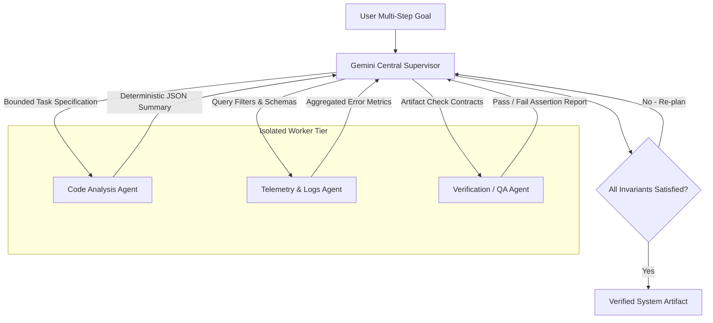

## Can Frontier Multi-Modal LLMs Function as Multi-Agent Central Supervisors?

Frontier multi-modal models like the Google Gemini series introduce massive context windows (up to two million tokens) paired with native audio, visual, and code reasoning. In multi-agent system design, engineering teams frequently propose using these frontier models as centralized "super-brains"—single orchestrator nodes that ingest telemetry streams, logs, architectural diagrams, and user intents simultaneously, dispatching micro-tasks to specialized sub-agents.

However, deploying a massive-context frontier model as a central multi-agent supervisor introduces severe operational bottlenecks: context dilution over extended turns, quadratic attention costs during continuous streaming, and non-deterministic tool dispatching when schemas grow beyond dozens of endpoints. Rather than relying on a monolithic prompt that holds all system state, production multi-agent architectures require formal supervisor-worker delegation contracts, schema boundaries, and deterministic state transitions.



Examining the mechanics of frontier model orchestration reveals why large context capacity cannot replace explicit interface contracts in multi-agent systems.

## Large Context Windows vs Modular State Segregation

The prevailing temptation with multi-million-token models is to append all intermediate agent executions, raw tool outputs, and environment diffs directly into the supervisor’s ongoing context. While models maintain high retrieval accuracy across synthetic "needle-in-a-haystack" tests, practical multi-agent execution degrades under continuous conversational context accumulation:

1. **Instruction Inversion and Distraction**: As raw bash execution logs, compiler stack traces, and JSON payloads fill the prompt buffer, the model’s attention weight on the root system instruction weakens. Sub-agents begin hallucinating parameters or dropping safety guardrails.
2. **Economic and Latency Inefficiency**: Prompt tokens are re-processed on every supervisory iteration. Re-transmitting 500,000 tokens of accumulated history on each turn introduces multi-second time-to-first-token (TTFT) latency and unsustainable API costs.
3. **Loss of Determinism**: When a supervisor model attempts to parse its own multi-turn conversational stream to deduce what steps remain, subtle variations in prompt formatting cause plan drift and cyclic re-execution.

To prevent context pollution, robust multi-agent frameworks—such as those explored in [/posts/multi-agent-systems/](/posts/multi-agent-systems/) and memory architectures evaluated in [/posts/ai-agents-memory-optimization/](/posts/ai-agents-memory-optimization/)—enforce strict memory boundaries between supervisor and worker nodes.

| Architectural Dimension | Monolithic Long-Context Prompting | Bounded Supervisor-Worker Protocol |
| :--- | :--- | :--- |
| **Context Management** | Everything appended into single prompt buffer | Workers operate in isolated, ephemeral context forks |
| **Tool Dispatch** | Master model attempts to invoke 50+ mixed tools | Workers expose focused, single-purpose tool sets (3–5 tools) |
| **Cost & Token Scaling** | Quadratic cost growth ($O(N^2)$ token re-ingestion) | Linear or constant cost per turn via compact state passing |
| **Recovery from Failure** | Single worker error corrupts global context | Isolated worker restarts cleanly without corrupting orchestrator state |
| **Validation Gate** | Supervisor judges its own work inside generation | Independent verifier node asserts schema compliance externally |

## Designing Deterministic Dispatch Contracts

In an orchestrated architecture, the central supervisor model should never perform execution directly. Its sole responsibility is task decomposition, routing, and synthesis. The interface between the supervisor and worker nodes must be governed by machine-validated schemas rather than unstructured natural language dialogue.

Consider a production supervisor dispatch payload:

```json
{
  "task_id": "task-8841",
  "assigned_worker": "telemetry_evaluator",
  "instruction": "Analyze latency anomalies in service ingress logs between 14:00 and 14:15 UTC",
  "context_scope": {
    "service_name": "payment-gateway",
    "time_window": ["2026-10-17T14:00:00Z", "2026-10-17T14:15:00Z"],
    "error_threshold_ms": 450
  },
  "expected_artifact": {
    "format": "application/json",
    "required_fields": ["p99_latency_ms", "root_cause_service", "reproduction_trace_id"]
  }
}
```

By constraining the worker to emit a strictly typed result artifact, the supervisor model only consumes the structured summary (`p99_latency_ms`, `root_cause_service`), discarding megabytes of raw line-by-line log output. This prevents the supervisor from experiencing token exhaustion or hallucinated state transitions.

## What Changed Since 2024: Frontier Models as Orchestrators

Between 2024 and 2026, multi-agent frameworks evolved from experimental auto-prompting scripts (such as AutoGen 0.1 and early BabyAGI) into typed, graph-based state engines (such as LangGraph and crewAI enterprise orchestrators). In 2024, agents frequently looped indefinitely because models lacked reliable function-calling discipline and hallucinated missing API keys or tool parameters.

With the release of Gemini 1.5, 2.0, and 3-class frontier models, function calling reliability and structured output compliance (enforcing JSON schemas via constrained decoding) reached enterprise maturity. Furthermore, multi-modal reasoning—allowing models to evaluate UI screenshots, audio traces, and code diffs in the same forward pass—enabled cross-modal verification. An orchestrator can now dispatch a code change to a coding agent, review the resulting browser rendering visual diff, and assert whether visual invariants were violated without requiring separate OCR pipelines.

However, greater model intelligence has reinforced rather than eliminated the need for software engineering discipline: state machines, deterministic error recovery, and strict tool boundaries remain essential prerequisites for enterprise reliability.

## Key Takeaways

- **Context capacity does not replace architectural boundaries**: Relying on multi-million token contexts to store raw tool executions leads to instruction drift, high latency, and excessive token expenditure.
- **Isolate worker contexts from the central supervisor**: Workers should execute in ephemeral context sandboxes, reporting back only validated, schema-compliant summary artifacts.
- **Enforce constrained JSON decoding for orchestration**: Using structured tool schemas and strict typed outputs eliminates parsing hallucinations and circular dispatch errors.
- **Multi-modal verification enhances QA feedback loops**: Frontier models can evaluate visual render diffs and system logs directly, providing grounded validation signals back to the orchestrator.

## Open Questions

- At what point does dynamic runtime sub-agent spawning become superior to statically defined state graphs for long-horizon production tasks?
- How can distributed multi-agent systems maintain consensus and fault tolerance when individual worker LLM calls experience rate limiting or transient timeouts?
- Will specialized, smaller open-weight orchestrators fine-tuned strictly for task decomposition replace frontier closed-source models as the primary central dispatcher?

## References

- Google DeepMind. (2024). *Gemini 1.5: Unlocking multimodal understanding across millions of tokens of context*. arXiv:2403.05530v2. Read on 2026-10-17 from https://arxiv.org/abs/2403.05530
- Wu, Q., et al. (2023). *AutoGen: Enabling Next-Gen LLM Applications via Multi-Agent Conversation Framework*. arXiv:2308.08155v2. Read on 2026-10-17 from https://arxiv.org/abs/2308.08155
- Hong, S., et al. (2024). *MetaGPT: Meta Programming for A Multi-Agent Collaborative Framework*. ICLR 2024. arXiv:2308.00352v5. Read on 2026-10-17 from https://arxiv.org/abs/2308.00352
- Google Cloud. (2025). *Gemini API Function Calling and Structured Outputs Specification*. Vertex AI release v1.8. Read on 2026-10-17 from https://cloud.google.com/vertex-ai/docs/generative-ai/multimodal/function-calling
