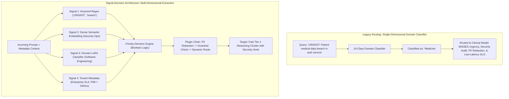
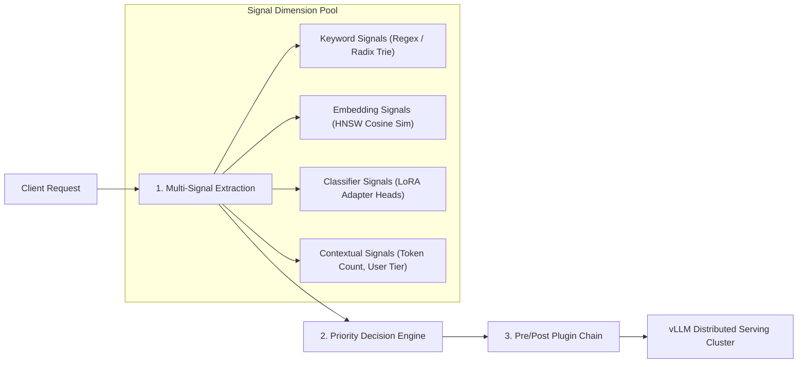
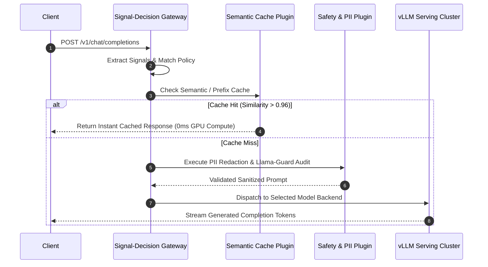
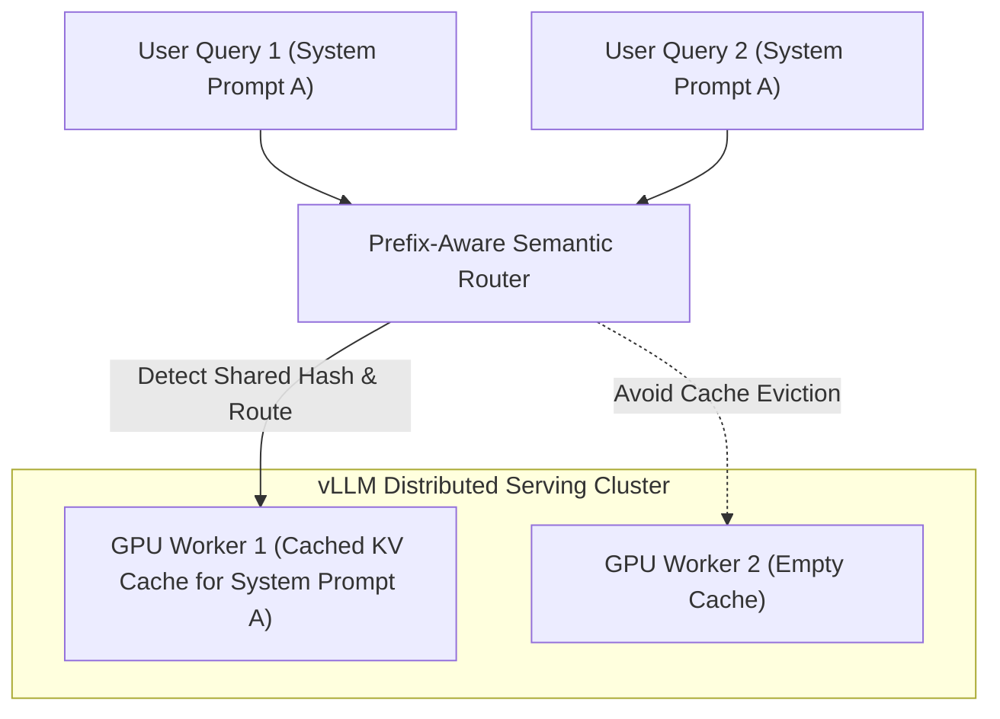
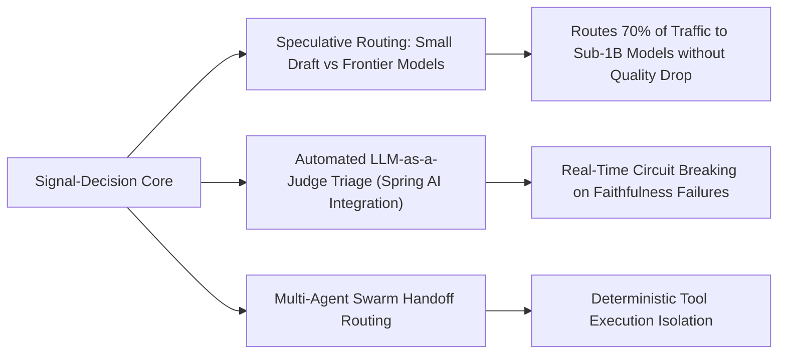

## Why Did Single-Dimensional Intent Classification Fail in Enterprise Model Serving?

In early enterprise large language model gateways, semantic request routing followed a simplistic single-stage pipeline: incoming prompts were passed through a monolithic text classifier (such as an embedding model fine-tuned on the 14 academic MMLU categories) to determine the query's primary domain—such as "Mathematics," "Computer Science," or "Humanities." The gateway then forwarded the request to a corresponding backend model.

In high-concurrency production environments, this single-dimensional classification failed across three fundamental operational axes:



1. **Information Collapse in Intent Modeling**: Real-world prompts contain orthogonal, simultaneous signals. A user prompt stating *"URGENT: Audit this authentication controller for memory safety vulnerabilities before deployment"* encompasses:
   - A **domain intent**: Systems programming (`Rust` / `C++`).
   - An **operational urgency**: Critical Priority (P0).
   - A **security classification**: Vulnerability analysis requiring isolated sandbox execution.
   - A **regulatory compliance flag**: Proprietary code requiring zero data retention.
   A single-label classifier collapses this rich multidimensional vector into a single scalar label, stripping away the signals necessary to enforce security guardrails or dynamic pricing models.
2. **Rigid Categorical Boundaries**: Academic benchmark categories (e.g., MMLU) fail to reflect enterprise operational boundaries, where organizations maintain dozens of proprietary internal taxonomies (e.g., internal billing systems, customer dispute resolution, confidential IP).
3. **Decoupling Routing from Security and Caching**: Traditional routing treated model selection as an isolated decision. In modern architectures, routing decisions dictate whether an incoming query should bypass LLM compute via semantic cache, undergo automated PII redaction, or activate specialized safety classifiers like Llama Guard.

To overcome these structural limits, the vLLM ecosystem formalized the **Signal-Decision Architecture**, separating raw signal extraction from policy decisions and orchestrating modular plugin pipelines before hardware dispatch.

---

## Architectural Breakdown: Signals, Decision Logic, and Plugin Pipelines

The Signal-Decision Architecture decomposes intelligent model routing into three decoupled subsystems:



### 1. Multi-Dimensional Signal Extraction

Rather than forcing a single model to output a terminal routing target, the gateway extracts four complementary signal categories simultaneously:

- **Keyword Signals**: Fast, deterministic regex and Radix Trie pattern matching. Used for operational overrides (e.g., `["URGENT", "P0", "CVE-"]`) that bypass probabilistic evaluation in under $100\,\mu\text{s}$.
- **Dense Embedding Signals**: Vector representations generated via compact embedding models (such as BGE-Small or Sentence-BERT). Cosine similarity against pre-indexed prompt clusters identifies conceptual proximity using HNSW indexing.
- **Specialized LoRA Classifier Signals**: Lightweight classification heads attached to small foundation models (e.g., 1B–3B parameters) via parameter-efficient low-rank adaptation (LoRA), predicting task taxonomy labels without full model compute.
- **Contextual Signals**: Non-textual operational metadata, including token length estimates, API tier allowances, historical session context, and cost budgets.

{: .light .shadow .rounded-10 w='1029' h='1742' }

### 2. The Priority Decision Engine

Extracted signals are fed into a declarative decision matrix supporting full Boolean algebra (`AND`, `OR`, `NOT`) and prioritized rule weights:

```yaml
# Declarative Routing Decision Rule (K8s CRD Format)
apiVersion: router.vllm.ai/v1alpha1
kind: RoutingPolicy
metadata:
  name: enterprise-security-routing
spec:
  priority: 100
  condition:
    and:
      - signal: "urgency_keyword"
        operator: "Exists"
      - signal: "domain_classifier"
        operator: "In"
        values: ["cybersecurity", "infrastructure"]
      - not:
          signal: "pii_detected"
          operator: "Equals"
          value: true
  action:
    targetModel: "deepseek-coder-v2-33b"
    maxTokens: 4096
    temperature: 0.0
    plugins:
      - name: "prompt-caching"
      - name: "code-safety-guard"
```

If multiple policies match, the engine evaluates rule priorities deterministically, preventing race conditions or ambiguous routing states.

### 3. Integrated Plugin Pipeline Orchestration

The decision engine does not merely forward requests to a raw model socket; it binds the request to an ordered **Plugin Execution Chain**:



- **Exact & Semantic Caching**: Queries with high semantic similarity ($> 0.96$) to historical queries return cached completions instantly, saving substantial GPU FLOPs.
- **Security & Redaction**: Queries triggering privacy signals are automatically scrubbed of phone numbers, social security IDs, and secret tokens before payload transmission.
- **Context Optimization**: Queries exceeding target context thresholds are summarized or compressed via prompt distillation modules before hitting the engine.

{: .light .shadow .rounded-10 w='1212' h='668' }

---

## Architectural Comparison: Semantic Routing Paradigms

| Dimension | Static Threshold Routing | MMLU Single-Class Routing | LangChain Router Chains | vLLM Signal-Decision Architecture |
| :--- | :--- | :--- | :--- | :--- |
| **Signal Depth** | Single scalar similarity score | 14 fixed academic categories | LLM prompt classification | Multi-dimensional (Regex, Embedding, LoRA, Context) |
| **Decision Logic** | Basic if/else threshold check | ArgMax probability selection | LLM JSON reasoning output | Typed Boolean AST with priority weighting |
| **Routing Latency** | Low (5–10ms) | Moderate (20–40ms) | Very High (200–800ms) | Extremely Low (2–8ms compiled execution) |
| **Plugin Interop** | Hardcoded middleware | None | Chained runnables | First-class lifecycle plugins (Cache, Guard, PII) |
| **Cluster Awareness** | None (Stateless URL forward) | None | None | Aware of vLLM PagedAttention prefix cache states |
| **Multi-Tenancy** | Ad-hoc API keys | Shared single-model queue | Custom agent isolation | First-class Kubernetes CRD routing policies |

---

## Prefix-Aware Routing and Hardware Cache Synergy

The most impactful architectural advantage of embedding the Signal-Decision engine directly within the serving infrastructure—as explored in our [production ML serving guide](/posts/deploy-an-ml-model/)—is its awareness of GPU memory states.

In distributed vLLM clusters utilizing PagedAttention, re-computing prompt tokens (the prefill phase) consumes significant GPU arithmetic cycles. When multiple users submit queries sharing common system instructions, few-shot examples, or document context:



1. **Radix-Aware Worker Dispatch**: The router hashes incoming prompt prefixes. Instead of load-balancing requests randomly across workers via round-robin, the router dispatches queries to GPU workers that **already host the relevant KV cache blocks** in on-board HBM.
2. **Slashing Time-to-First-Token (TTFT)**: Bypassing the prefill phase through cache-aware routing reduces Time-to-First-Token by up to 80% while dramatically reducing overall cluster power consumption.
3. **Dynamic LoRA Adapter Routing**: For enterprise multi-domain serving, the router coordinates with vLLM's dynamic LoRA multiplexing, swapping small LoRA adapter weights onto base foundation models in microseconds without restarting containers, aligning with parameter-efficient techniques audited in our [PEFT analysis](/posts/explained-fintune-llm/).

{: .light .shadow .rounded-10 w='1678' h='2178' }

---

## How Semantic Routing and Inference Gateways Evolved Across 2026

Between 2025 and 2026, intelligent model routing shifted from experimental utility libraries into the core control plane of enterprise AI:



1. **Cost-Optimized Speculative Routing**: Rather than sending all prompts to expensive 70B or 405B frontier models (such as those analyzed in our [Llama 3.1 audit](/posts/introducing-llama-3-1/)), 2026 gateways deploy hierarchical routing. Over 70% of routine corporate queries are intercepted by the Signal-Decision engine and satisfied by specialized 1B–8B models or cached entries, reserving frontier reasoning clusters exclusively for multi-step algorithmic prompts.
2. **Real-Time Quality Gating via Evaluator Models**: As examined in our audit of [LLM-as-a-Judge architectures](/posts/spring-ai-llm-as-judge/), routing gateways intercept output completions before client delivery. If an evaluator model flags a response for hallucination or compliance violations, the gateway triggers an immediate internal re-route to an alternative reasoning engine with escalated context instructions.
3. **Multi-Agent Protocol Routing**: As single-agent scripts gave way to coordinated multi-agent swarms, the routing layer became the primary traffic cop. Gateways parse incoming user goals, decompose tasks into sub-signals, and route individual sub-tasks to specialized domain agents, enforcing strict security boundaries between untrusted user inputs and internal tool-calling endpoints.

---

## Key Takeaways

- **Single-Dimensional Intent Classification Fails Production**: Real-world prompts contain simultaneous, orthogonal signals (urgency, domain, security, compliance) that monolithic classifiers flatten and erase.
- **Decoupling Extraction from Decision Logic**: By extracting signals independently through regex, embeddings, and LoRA heads, the decision engine applies expressive Boolean logic with strict priority guarantees.
- **Hardware-Aware Prefix Routing**: Connecting semantic routing directly to vLLM's PagedAttention KV cache states eliminates redundant prefill computation, delivering massive TTFT reductions across high-concurrency clusters.
- **The Modern Control Plane for AI Serving**: In 2026 enterprise architectures, intelligent gateways act as the unified policy layer governing semantic caching, security guardrails, cost allocation, and multi-model dispatch.

---

## New Questions

- What mathematical bounds govern router decision latency to ensure multi-signal extraction does not consume more time than the GPU prefill compute it saves?
- How can distributed semantic routing gateways maintain synchronized Radix tree cache maps across thousands of independent GPU serving instances without network broadcast bottlenecks?
- Can reinforcement learning from human feedback (RLHF) be applied directly to router policies to autonomously learn optimal model selection trade-offs between financial cost and user satisfaction?

---

## References

- vLLM Project Team. (2025). *Signal-Decision Architecture: Multi-Dimensional Semantic Routing for Enterprise AI Gateways*. vLLM Official Engineering Blog. [https://blog.vllm.ai/](https://blog.vllm.ai/) (accessed 2026-10-18).
- Reimers, N., & Gurevych, I. (2019). *Sentence-BERT: Sentence Embeddings using Siamese BERT-Networks*. In Proceedings of the 2019 Conference on Empirical Methods in Natural Language Processing (EMNLP 2019), arXiv preprint [arXiv:1908.10084](https://arxiv.org/abs/1908.10084) (accessed 2026-10-18).
- Malkov, Y. A., & Yashunin, D. A. (2020). *Efficient and Robust Approximate Nearest Neighbor Search Using Hierarchical Navigable Small World Graphs*. IEEE Transactions on Pattern Analysis and Machine Intelligence, 42(4), 824–836. [https://doi.org/10.1109/TPAMI.2018.2889473](https://doi.org/10.1109/TPAMI.2018.2889473) (accessed 2026-10-18).
- Hu, E. J., Shen, Y., Wallis, P., Allen-Zhu, Z., Li, Y., Wang, S., Wang, L., & Chen, W. (2022). *LoRA: Low-Rank Adaptation of Large Language Models*. In International Conference on Learning Representations (ICLR 2022), arXiv preprint [arXiv:2106.09685](https://arxiv.org/abs/2106.09685) (accessed 2026-10-18).
