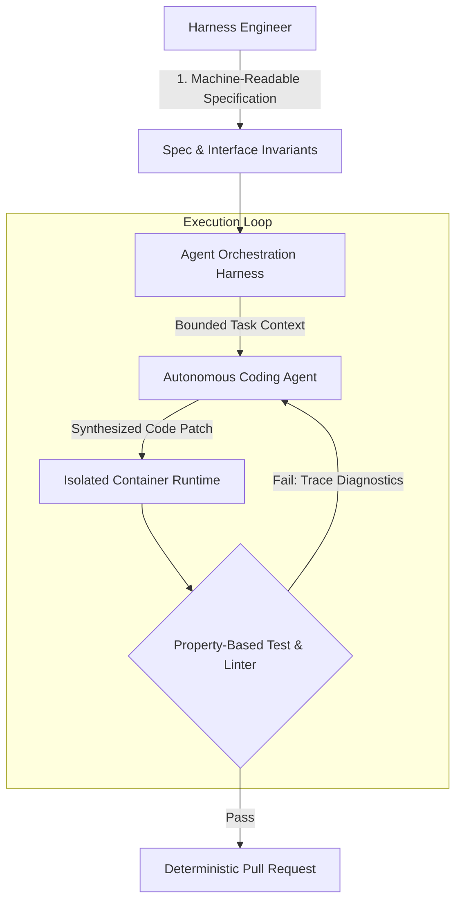

## What Technical Disciplines Replace Syntax Writing in Agent-Driven Software Development?

As generative coding models and autonomous programming agents assume the burden of routine syntax completion and boilerplate generation, software engineering is undergoing an architectural inversion. Writing line-by-line algorithmic implementation is no longer the primary productivity bottleneck. Instead, the engineering challenge shifts upward to harness engineering: defining machine-readable interfaces, isolating execution environments, specifying rigorous system invariants, and building automated verification pipelines.

When autonomous agents are tasked with writing code, unconstrained natural language prompts yield fragile systems riddled with subtle regression bugs, security vulnerabilities, and hallucinations. Without formal boundaries, agents routinely produce code that looks syntactically plausible while failing edge cases. Mastering the modern engineering stack requires deep fluency in harness design, deterministic testing, and state machine isolation.



Examining modern agent harness patterns reveals five foundational disciplines that define robust autonomous engineering workflows.

## The Five Core Disciplines of Agent Harness Engineering

Rather than treating AI as an unstructured autocomplete tool, production engineering teams treat AI models as non-deterministic execution engines that must be constrained by deterministic runtime scaffolds.

1. **Interface Contract and Schema Design**: Natural language specifications allow semantic drift. Engineers must formalize expectations into typed schemas—such as OpenAPI, Protobuf, or JSON Schema. When an agent generates code against an immutable schema, static typecheckers and contract validators can instantly identify deviations before code touches runtime.
2. **State Decomposition and Bounded Delegation**: Monolithic tasks overwhelm an agent’s working memory. Engineers decompose complex features into bounded state machine transitions, ensuring each sub-agent operates within a small, verifiable context window.
3. **Property-Based Testing and Invariant Specification**: Standard example-based unit tests assert expected outputs for known inputs. In contrast, property-based tests (e.g. using Hypothesis or fast-check) generate thousands of randomized, adversarial inputs to verify system invariants (e.g. idempotency, round-trip serialization, and memory bounds). Agents excel when guided by invariant assertions.
4. **Execution Sandbox Isolation and Tool Safety**: Autonomous agents must not have unconstrained access to host machines. Engineers configure secure containerized sandboxes, virtual filesystems, and least-privilege capability tokens, preventing accidental data deletion or unauthorized network egress.
5. **Evaluation Telemetry and Failure Diagnosis**: Debugging autonomous workflows requires structured telemetry. Tracing prompt contexts, tool call latencies, and token expenditures enables systematic prompt optimization and failure clustering.

| Engineering Focus | Pre-Agent Paradigm (Traditional) | Agent-Driven Paradigm (Harness Engineering) |
| :--- | :--- | :--- |
| **Core Activity** | Writing implementation algorithms line-by-line | Designing formal interface contracts and evaluation harnesses |
| **Verification Strategy** | Manual code review and manual unit test writing | Automated property-based testing and synthetic invariant oracles |
| **Bug Triage** | Stepping through code with local debuggers | Analyzing agent prompt traces, tool call failures, and execution sandboxes |
| **Architecture Boundary** | Module and class hierarchies | Tool permissions, context boundaries, and state graph transitions |
| **Tooling Surface** | IDE autocompletion and compiler warnings | Machine-readable CLI tools, MCP endpoints, and container runtimes |

Connecting these disciplines to concrete operational frameworks—such as telemetry pipelines in [/posts/superlog-agentic-telemetry/](/posts/superlog-agentic-telemetry/) and supervisor-worker patterns in [/posts/multi-agent-systems/](/posts/multi-agent-systems/)—transforms non-deterministic LLMs into dependable software delivery pipelines.

## Designing Automated Invariant Oracles for Autonomous Agents

To make an autonomous agent effective, the evaluation feedback loop must be completely automated. If a human engineer must inspect every intermediate step, the multi-agent advantage collapses. The engineer's role is to construct the invariant oracle—a script that returns structured pass/fail diagnostics directly to the agent's context.

Consider an automated test harness designed to guide an agent refactoring a concurrent cache:

```python
import time
from concurrent.futures import ThreadPoolExecutor
from typing import Dict, Any

class InvariantOracle:
    def __init__(self, cache_instance: Any):
        self.cache = cache_instance

    def assert_thread_safety(self, key: str, iterations: int = 1000) -> Dict[str, Any]:
        # Assert that concurrent increments maintain exact mathematical consistency
        self.cache.set(key, 0)
        errors = []

        def worker():
            for _ in range(iterations):
                val = self.cache.get(key)
                self.cache.set(key, val + 1)

        with ThreadPoolExecutor(max_workers=8) as executor:
            futures = [executor.submit(worker) for _ in range(8)]
            for f in futures:
                try:
                    f.result()
                except Exception as e:
                    errors.append(str(e))

        final_val = self.cache.get(key)
        expected_val = 8 * iterations
        passed = (final_val == expected_val) and (len(errors) == 0)

        return {
            "passed": passed,
            "observed_value": final_val,
            "expected_value": expected_val,
            "race_condition_detected": final_val != expected_val,
            "runtime_exceptions": errors
        }
```

When the agent runs its proposed implementation against this oracle, the structured JSON report clearly informs the agent whether race conditions occurred. The agent iteratively modifies its locking primitives without human intervention until the invariant evaluates to `passed: true`.

## What Changed Since 2024: From Autocomplete to Continuous Harness Execution

Between 2024 and 2026, software development tooling evolved through three distinct phases. In 2024, AI adoption was dominated by inline code autocompletion (such as early GitHub Copilot). Developers remained the active drivers, manually accepting or rejecting token suggestions.

By 2025, tool-augmented coding agents (such as Devin, Cursor Composer, and SWE-bench baselines) demonstrated that models could resolve real-world GitHub issues autonomously—provided they had access to compilers, git commands, and test runners. However, benchmark evaluations revealed that unguided agents spent 60% of their tokens cycling through incorrect assumptions when repositories lacked clear documentation or reproducible local test suites.

In 2026, the standard shifted to **Harness-Driven Development**. Repositories are now engineered specifically for agent readability: exposing Model Context Protocol (MCP) servers, containerized test commands that return structured JSON diagnostics, and machine-readable project rule files (such as `AGENTS.md` and `CLAUDE.md`). The engineer of 2026 is fundamentally an architect of autonomous verification harnesses.

## Key Takeaways

- **Engineering shifts from syntax to specifications**: Writing boilerplate is handled by models; specifying precise interface contracts, schemas, and invariants is the core human discipline.
- **Automated feedback loops are mandatory**: Autonomous agents require deterministic invariant oracles that provide structured pass/fail diagnostics rather than opaque stack traces.
- **Isolate agent environments using least-privilege sandboxes**: Protect host environments by constraining agents to containerized runtimes with verified tool execution guardrails.
- **Design repositories for machine readability**: Clean directory structures, reproducible test commands, and typed schemas empower agents to navigate and refactor codebases reliably.

## Open Questions

- How will engineering organizations evaluate junior developer competencies when routine code authorship is largely delegated to autonomous agents?
- Can property-based test generators synthesize complete invariant suites automatically from high-level architectural requirements without human oversight?
- What standardized protocols will emerge to measure agent harness quality and prevent test suite over-fitting in automated CI pipelines?

## References

- Jimenez, C. E., et al. (2024). *SWE-bench: Can Language Models Resolve Real-World GitHub Issues?*. ICLR 2024. arXiv:2310.06770v3. Read on 2026-10-17 from https://arxiv.org/abs/2310.06770
- MacIver, D. R., & Donaldson, A. F. (2020). *Test-Case Reduction for C Compilers and Other Robust Software Tools via Hypothesis*. ACM Transactions on Software Engineering. Read on 2026-10-17 from https://hypothesis.works/
- Anthropic. (2024). *Model Context Protocol: Open Standard for Secure AI Agent Tool Integration*. Release Specification v1.0. Read on 2026-10-17 from https://modelcontextprotocol.io/
- Fowler, M. (2024). *Specification by Example and Automated Invariants in LLM-Assisted Software Design*. Thoughtworks Insights. Read on 2026-10-17 from https://martinfowler.com/articles/specification-by-example.html
