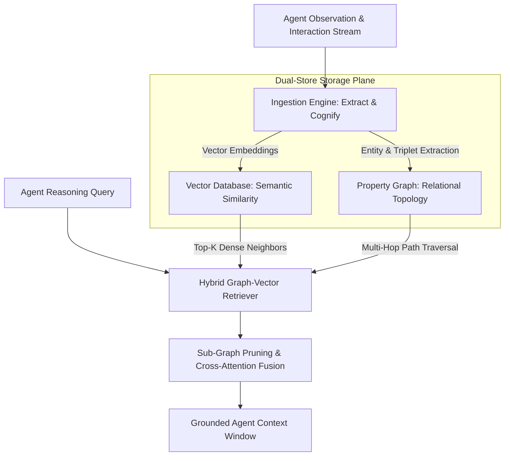

## Why Does Pure Vector Similarity Fail in Multi-Agent Memory Systems?

When autonomous agents operate across extended, multi-session tasks, giving them persistent memory is critical. In standard agent frameworks, memory is commonly implemented using naive vector Retrieval-Augmented Generation (RAG): conversation turns and observations are embedded as dense vectors, stored in a vector database, and retrieved using top-$k$ cosine similarity against the current prompt.

However, vector similarity search operates under a fatal topological assumption: that semantic proximity in embedding space corresponds to logical relevance. In complex enterprise workflows, multi-step dependencies cannot be resolved via flat cosine distance. If an agent needs to reason about how a configuration change made three days ago by Agent A broke a database migration deployed today by Agent B, pure vector search fails. The embeddings of "database migration schema alteration" and "firewall egress port update" are distant in vector space, yet they are causally linked by shared entity relationships in the operational infrastructure.

To bridge this semantic gap, hybrid memory frameworks—such as Cognee and GraphRAG architectures—combine dense vector embeddings with deterministic knowledge graphs, creating structured episodic and semantic memory engines.



Evaluating hybrid memory pipelines reveals how graph-based relational linking eliminates hallucinated dependencies and context fragmentation in multi-agent environments.

## The ECL Pipeline: Extract, Cognify, and Load

Traditional vector pipelines rely on a linear ETL workflow: text is split into arbitrary 500-token chunks, embedded, and indexed. In contrast, graph-vector hybrid platforms (such as Cognee) employ an **ECL (Extract, Cognify, Load)** pipeline that models memory as an evolving semantic ontology.

1. **Extract**: Ingestion processes structured documents, tool invocation traces, and chat transcripts, normalizing unstructured text into clean data streams while stripping transient formatting noise.
2. **Cognify (Entity & Relation Disambiguation)**: Rather than slicing text into dumb geometric slices, an extraction model analyzes sentences to identify explicit named entities (e.g. `User`, `ServerNode`, `ServiceContract`, `DeploymentEvent`) and their directed relationships (`DEPENDS_ON`, `MODIFIED_BY`, `TRIGGERS`). Co-references are resolved so that pronouns ("it", "that service") map to immutable entity IDs.
3. **Load**: The structured triplets are loaded into a property graph database (such as Neo4j, FalkorDB, or Kùzu), while the entity node descriptions and edge attributes are simultaneously indexed in a vector store.

| Memory Dimension | Naive Vector RAG | Hybrid Graph-Vector Memory (e.g. Cognee) |
| :--- | :--- | :--- |
| **Retrieval Mechanism** | Top-$k$ approximate nearest neighbors (ANN) | Vector seed retrieval followed by $N$-hop graph traversal |
| **Multi-Hop Reasoning** | Poor; fails when intermediate bridge entities are missing | High; traversals follow explicit dependency edges |
| **Context Deduplication** | High redundancy (duplicate chunks returned) | Unified entity nodes aggregate information across sessions |
| **Causal Tracking** | Disconnected time slices | Chronological edges connect cause-and-effect events |
| **Indexing Overhead** | Low; single forward pass of embedding model | Higher; requires LLM entity extraction and entity resolution |

By uniting relational property graphs with vector indices—as demonstrated in [/posts/agentic-ai-java-neo4j/](/posts/agentic-ai-java-neo4j/) and hierarchical memory systems in [/posts/ai-agents-memory-optimization/](/posts/ai-agents-memory-optimization/)—agents gain the ability to answer complex structural questions without prompt bloat.

## Traversal Mechanics: Combining Vector Seeds with Graph Walking

In a production hybrid memory system, retrieval is not a single database lookup. It is an active two-stage traversal algorithm designed to bound context window consumption:

```python
from typing import List, Dict, Any

class HybridMemoryRetriever:
    def __init__(self, vector_index, graph_db):
        self.vector_index = vector_index
        self.graph_db = graph_db

    def retrieve_context(self, query: str, top_k_seeds: int = 3, max_hops: int = 2) -> Dict[str, Any]:
        # Step 1: Semantic seed discovery via vector search
        seed_nodes = self.vector_index.search(query, limit=top_k_seeds)
        seed_ids = [node["entity_id"] for node in seed_nodes]

        # Step 2: Multi-hop graph neighborhood expansion
        # Cypher: MATCH (n)-[r:DEPENDS_ON|AFFECTS*1..2]-(m) WHERE n.id IN $seed_ids RETURN n, r, m
        traversal_subgraph = self.graph_db.traverse_neighbors(
            start_ids=seed_ids, 
            allowed_relations=["DEPENDS_ON", "AFFECTS", "CREATED_BY"],
            max_depth=max_hops
        )

        # Step 3: Format extracted sub-graph into structured topological markdown
        formatted_triplets = []
        for edge in traversal_subgraph["edges"]:
            formatted_triplets.append(f"{edge.source_id} -[{edge.relation}]-> {edge.target_id}")

        return {
            "query": query,
            "seeds": seed_ids,
            "connected_triplets": formatted_triplets,
            "entity_payloads": traversal_subgraph["nodes"]
        }
```

When this sub-graph is passed to the reasoning agent, the context contains an exact dependency map. The model does not need to guess how disparate systems relate; the graph topology provides the deterministic path.

## What Changed Since 2024: From Text Chunking to Knowledge Graph RAG

Between 2024 and 2026, enterprise RAG transitioned from naive vector databases toward unified knowledge architectures. In early 2024, the standard solution for poor RAG retrieval was simply increasing chunk overlap, upgrading to larger embedding models, or introducing re-ranking cross-encoders. While these optimizations improved lexical recall, they failed to resolve multi-hop queries that required synthesizing evidence scattered across dozens of corporate documents.

The publication and open-source release of **Microsoft GraphRAG** in mid-2024 demonstrated that clustering entities into hierarchical graph communities enabled global query summarization ("What are the main themes across all support tickets?") that vector search could not answer. Following this, frameworks like **Cognee** engineered lightweight, agent-native ECL pipelines capable of running on embedded graph databases like Kùzu or SQLite-based vectors, bringing graph-augmented memory down to sub-100ms latency.

In 2026, agent memory is no longer a static archive of dumped text chunks; it is an active knowledge graph that continuously prunes stale nodes, merges duplicate entities, and exposes relational query APIs to autonomous worker agents.

## Key Takeaways

- **Pure vector similarity cannot resolve multi-hop reasoning**: Dense embeddings measure topical proximity, failing to capture causal and relational dependencies between distributed entities.
- **The ECL pipeline transforms memory into a structured ontology**: Extracting entities, disambiguating relationships, and loading property graphs creates an inspectable knowledge representation.
- **Combine vector seeds with graph traversal**: Use fast vector search to locate entry points, then walk relational edges to retrieve bounded, highly relevant sub-graphs.
- **Graph structures reduce context window bloat**: Passing structured entity triplets provides higher information density than injecting dozens of redundant unstructured text chunks.

## Open Questions

- How can agent memory systems perform real-time graph compaction and entity deduplication without incurring heavy LLM extraction costs on high-volume event streams?
- What are the optimal graph schema evolution strategies when autonomous agents discover concepts that violate pre-configured domain ontologies?
- How can distributed multi-agent clusters maintain transactional consistency across a shared knowledge graph when multiple agents write conflicting assertions concurrently?

## References

- Edge, D., et al. (2024). *From Local to Global: A Graph RAG Approach to Query-Focused Summarization*. Microsoft Research. arXiv:2404.16130v1. Read on 2026-10-17 from https://arxiv.org/abs/2404.16130
- Cognee Community. (2024). *Cognee: Deterministic Memory and Knowledge Graph Engine for AI Applications*. GitHub Repository release v0.1.25. Read on 2026-10-17 from https://github.com/topoteretes/cognee
- Robinson, I., Webber, J., & Eifrem, E. (2015). *Graph Databases: New Opportunities for Connected Data*. O'Reilly Media. Read on 2026-10-17 from https://graphdatabases.com/
- Sahu, P., et al. (2024). *A Survey on Graph Neural Networks and Knowledge Graphs in RAG Pipelines*. IEEE Transactions on Knowledge and Data Engineering. Read on 2026-10-17 from https://arxiv.org/abs/2408.08921
